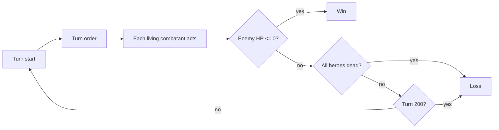

# Combat

[Root](../index.md) > [Combat](./index.md) > Combat

One quest = one battle between a party (up to 6 heroes) and one enemy (`questData` entry, maybe ×amount HP).
Simulated exactly by the [combat simulator](../tooling/combat-simulator/combat-simulator.md).

## Table of contents

- [Battle loop](#battle-loop)
- [Rows and targeting](#rows-and-targeting)
- [Attack resolution](#attack-resolution)
- [Effects](#effects)
  - [Effect timing](#effect-timing)
  - [Schedule](#schedule)
- [HP, heals and revives](#hp-heals-and-revives)
- [Enemy](#enemy)
- [Grade](#grade)
- [Code](#code)

## Battle loop

- Order: enemy first only if `questType == 6` (first attack), then back 1, front 1, back 2, front 2, back 3, front 3, enemy.
  The order is fixed once at the start (`determineTurnOrder`); a dead combatant's turn is skipped.
- Each combatant uses slot `((turn − 1) mod 5) + 1` of its 5-slot `attackList`, from one shared turn counter: hero
  slot k always meets enemy slot k. A fight is a 5-turn timetable ([schedule](#schedule)).
- The enemy always plays its rotation. `isTurnSkipped` is never set, and no hero skill puts an `OnDetermineAction`
  effect on the enemy. Only heroes can be stunned (Pulverize, Stunning Blow: action skipped) or forced to Basic (Drown).

## Rows and targeting

- Slots: back row = party locations 1, 3, 5; front row = 2, 4, 6.
- Enemy default attack (`getDamageRatio`): split evenly over the living front row (each takes 1/n of the damage);
  back row only once the front row is dead. Not random, not by HP, no threat.
- Skills can target `front` / `back` (full damage to each hero of that row, the other row if it is empty), `mid`
  (location 4), `aoe` (all, full damage), a fixed location, or the lowest-HP hero (Execute, `getHeroByStat`).
  `midline` is not a known string to `Party`: such attacks hit everyone.
- Taunt: puts an `OnAttack` effect on the enemy that redirects its next attack (whatever its ratio) to the taunter
  only, then ends.
- Hero skills always target the single enemy. Heals: Lesser Heal heals the front hero of the caster's column (a
  front-row caster heals itself), Greater Heal and party effects reach every living hero.

## Attack resolution

1. Raw damage = `atk + matk + dmg` (skills scale these, e.g. Slash = 1.6 × atk).
2. Hit chance = `round(200 × acc / (acc + eva))`, capped 100. DoTs always hit.
3. Crit if `random(1, 100) ≤ crit` → × `critMod` (2 base). Else luck: ≤ `1.6 × luck` → × 1.35 ("lucky hit").
4. Reduction = `100 / (100 + def × (100 − defPen)%)` for atk; same with mdef for matk. `dmg` is true damage.
5. Defender effects (`OnDamage`, `DamageReceived`) scale the result.

## Effects

- Buffs/debuffs with `stats` (flat or `%`), `turns`, `trigger` (`OnTurn`, `OnAttack`, `OnDamage`, `DamageReceived`,
  `DamageOnTurn`, `HealingOnTurn`, `OnDetermineAction`, `Permanent`).
- Same-name effect: replaced, stacked (`stacks`) or toggled off (`reversible`).
- Percent stats apply last: `stat × (1 + pct)`, floors −90% (atk, matk, HP) / −100%.

### Effect timing

Durations count the **owner's own actions**, not turns (`Combatant:determineAction`):

1. At the start of its action, the owner drops effects with `turns ≤ 0` (0 counts: Lua's 0 is true) and flagged ones.
2. Stats are recomputed, then the action runs.
3. At the end of the action, `turns` goes down by 1 for `OnTurn` effects (any effect with `turns` and no trigger) and
   for `OnDamage` / `OnAttack` / `DamageReceived` / `OnDetermineAction` effects that have `turns`. `HealingOnTurn` and
   `DamageOnTurn` tick here (heal or hit the owner).

So `turns = t` on another combatant lasts for its next t actions (and in between); on yourself (put on during your
own action, then ticked at its end) it lasts for your next t − 1 actions. `Party:addEffect` with `adjustTurns` (Holy
Shield) gives every hero exactly "until the enemy's next action". Effects without `turns` end at the first use:
`OnDamage` / `DamageReceived` at the next hit taken, `OnAttack` at the next attack, `OnDetermineAction` at the next
action. `Permanent` effects (stacking buffs) last the whole fight. A dead combatant loses all its effects.

Examples (enemy acting last, cast on turn k): Soul Barrier (`turns` 2, on the enemy) reflects every hero action of
turns k + 1 and k + 2; a hero debuff on the enemy with `turns` 1 (Ambush) weakens the enemy's action of the same turn
and still counts for heroes acting before the enemy on turn k + 1. Measured windows for every skill:
[schedule](#schedule).

- Cleanse (`removeAllEffects(true, true)`) removes debuffs (`debuff = true`) except `cannotDispell` ones. Silence
  removes the enemy's buffs, and Song of Negation removes all its effects, again except `cannotDispell`.
  An effect without the `debuff` flag cannot be cleansed, even a harmful one.

### Schedule

The engine's skill probe (`web/src/tools/skill-probe.ts`) casts every hero skill and every enemy slot in a controlled
battle and records what it does. `inventory/timelines.json` holds the result:

- tags: damage (single / split / row / aoe), heal (self / ally / party / over time), revive, cleanse (party / self),
  dispel, buff (self / party), debuff (enemy / party), damage over time, stun, forced action, shield, reflect,
  counter, taunt, stat swap, amplify, miss chance;
- per effect: owner, stats, `turns`, how it ends, and the turns (from the cast) in which the owner acts with it and
  in which the other side acts while it is on;
- damage filters (shields, reflects, counters) tested with a physical and a magical hit;
- per enemy (normal and rare): its 5 slots with the above.

Findings from the probe:

- Reflects: Soul Barrier (Archon) returns all damage; Grand Duel (Odin) returns physical damage only; Song of Defense
  (hero) returns 40 %. Reflect (Pumpking) and Retaliation are counters: the enemy still takes full damage. Reflect
  halves `matk` after the damage is already computed, so it reduces nothing.
- Elusion (Fenrir) is a 50 % dodge; Block / Shield cut physical / magical damage to 22 %.

## HP, heals and revives

In the game code we have (`gameVersion` 3.18, `obj.GameClass.lua:6`), inside a map heals can bring a hero back up to
its **max HP**, not just to the HP it had when the map or the battle started. There is no battle-start snapshot
anywhere in the code.

**No per-battle cap in 3.18.** The Lua map-run recordings (the frozen fixtures, runs without heal or revive scrolls)
show a hero going above its room-start HP in 293 of 906 rooms. For example, run 1 (seed 733367392, map 24): a hero
starts the room at 984 HP and is at 1,036 after a Lesser Heal on turn 3. The game's author had described a per-battle
cap; the decision (2026-11-23) is to follow the 3.18 code, so the engine has none. But a hero never **leaves** a map (or a quest) with more HP than it entered with.

1. **Map start:** `questHP = hp`, the hero's current HP, which can be below max (`obj.combat.GameCampaigns.lua:39`, `:42`).
2. **Each room:** the battle runs with `useQuestHp = true` (`obj.combat.Campaign.lua:156`) and starts from the carried
   `questHP` (`obj.combat.Battle.lua:57`, `:65`). HP carries from room to room.
3. **Heals in battle** (`Combatant:receiveHeal`, `obj.Combatant.lua:337`): add, then cap at `maxHP` (`:362`–`:364`).
   There is no cap at the HP the battle started with.
   - A hero already above max gets nothing (`:359`).
   - "Overload" heals skip the cap (the `if not overload` branch, `:352`), so they can go above max. Aqua Shield II's self-heal is one.
4. **Revive:**
   - The Revive skill gives back 50 % of max HP, then the hero can't be revived again for 2 actions (`obj.Combatant.lua:353`–`:356`, `isPercent` 0.5).
   - Revive scrolls (62, 68) give back full max HP (`data.ScrollsData.lua:41`).
5. **After a room won:** `questHP = ceil(min(questHP, maxHP))` (`obj.combat.Campaign.lua:119`). This only trims
   overheal. A level-up during the map refills to max (`:123`).
6. **Healing scrolls** (61, 69; after a battle): `questHP = min(questHP + hp, maxHP)` (`data.ScrollsData.lua:37`).
7. **Map end:** `hp = round(min(questHP, hp))` (`obj.combat.Campaign.lua:70`), where `hp` is the HP on entering.
   Quests do the same (`obj.Quest.lua:220`). This is why life lost in a map is not retrieved: HP healed back inside
   the map counts for the fights, but the hero keeps the lower of its entry HP and its end HP.
8. **Outside maps:** `Hero:heal` caps at max HP (`obj.Hero.lua:434`).

The port does the same, and this is the game's own behaviour, not just matching code:

- `receiveHeal`: `web/src/sim/combatant.ts`;
- rooms: `web/src/sim/campaign.ts:383`;
- `resetHero`: `web/src/sim/campaign.ts:316`;
- scrolls: `web/src/sim/campaign.ts:198`–`:201`;
- 400/400 Lua-parity map runs.

The tools start every simulated fight and map run at full HP (`web/src/sim/api.ts`, `fight` and `mapRun`). A hero
that is injured in the save is simulated as healed.

## Enemy

- Stats from `questData`: `enemyHp`, `enemyAtk`, `enemyMatk`, `enemyDef`, `enemyMdef`, `enemyEva`
  (`…B` for the rare variant), × game-mode `enemyMods`, HP × amount. acc 100, crit 0.
- Rotation `attackList` (`attackListB` when rare). Map runs scale stats with `finalMapStats`.

## Grade

`questService.determineBattleGrade`, won fights only:

- Base `round(1.3 + (avgLevel + 5 × region) / (levelReq + 5 × region), 2)`, clamped 1–4.5; rare −0.5.
- Plus a turn bonus by `questType`, e.g. type 3: `(8 + 3 × region − turns) / 4`.
- Rounded, 1–5. Fewer turns → better grade → more loot ([quests](../game-economy/quests/quests.md)).

## Code

- `decompiled/obj.combat.Battle.lua`, `decompiled/obj.Combatant.lua`, `decompiled/obj.Enemy.lua`, `decompiled/obj.Party.lua`.
- `decompiled/obj.combat.statsService.lua`, `decompiled/obj.combat.questService.lua`, `decompiled/obj.combat.enemiesService.lua`.
- Skills: `decompiled/data.AbilityFunc.lua` (~224 functions), descriptions and AP: `decompiled/data.AbilityData.lua`.
