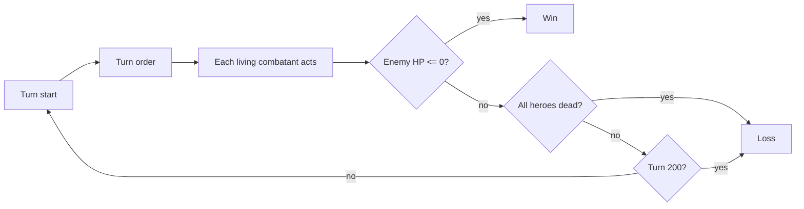

# Combat

[Root](../index.md) > [Combat](./index.md) > Combat

One quest = one battle between a party (up to 6 heroes) and one enemy (`questData` entry, maybe ×amount HP).
Simulated exactly by the [combat simulator](../tooling/combat-simulator/combat-simulator.md).

## Table of contents

- [Battle loop](#battle-loop)
- [Rows and targeting](#rows-and-targeting)
- [Attack resolution](#attack-resolution)
- [Effects](#effects)
- [Enemy](#enemy)
- [Grade](#grade)
- [Code](#code)

## Battle loop

- Order: enemy first only if `questType == 6` (first attack), then back 1, front 1, back 2, front 2, back 3, front 3, enemy.
- Each combatant uses slot `((turn − 1) mod 5) + 1` of its 5-slot `attackList`. Heroes repeat their rotation.
- Effects with `OnDetermineAction` triggers can replace the action (stuns, silences…).

## Rows and targeting

- Slots: back row = party locations 1, 3, 5; front row = 2, 4, 6.
- Enemy default attack: split evenly over the living front row; back row only once the front row is dead.
- Skills can target `front`, `back`, `mid` (location 4), `midline` (3, 4) or `aoe` (all).

## Attack resolution

1. Raw damage = `atk + matk + dmg` (skills scale these, e.g. Slash = 1.6 × atk).
2. Hit chance = `round(200 × acc / (acc + eva))`, capped 100. DoTs always hit.
3. Crit if `random(1, 100) ≤ crit` → × `critMod` (2 base). Else luck: ≤ `1.6 × luck` → × 1.35 ("lucky hit").
4. Reduction = `100 / (100 + def × (100 − defPen)%)` for atk; same with mdef for matk. `dmg` is true damage.
5. Defender effects (`OnDamage`, `DamageReceived`) scale the result.

## Effects

- Buffs/debuffs with `stats` (flat or `%`), `turns`, `trigger` (`OnTurn`, `OnAttack`, `OnDamage`, `DamageReceived`,
  `DamageOnTurn`, `HealingOnTurn`, `OnDetermineAction`, `Permanent`).
- Same-name effect: replaced, stacked (`stacks`) or toggled off (`reversible`).
- Percent stats apply last: `stat × (1 + pct)`, floors −90% (atk, matk, HP) / −100%.

## Enemy

- Stats from `questData`: `enemyHp`, `enemyAtk`, `enemyMatk`, `enemyDef`, `enemyMdef`, `enemyEva`
  (`…B` for the rare variant), × game-mode `enemyMods`, HP × amount. acc 100, crit 0.
- Rotation `attackList` (`attackListB` when rare). Map runs scale stats with `finalMapStats`.

## Grade

`questService.determineBattleGrade`, won fights only:

- Base `round(1.3 + (avgLevel + 5 × region) / (levelReq + 5 × region), 2)`, clamped 1–4.5; rare −0.5.
- Plus a turn bonus by `questType`, e.g. type 3: `(8 + 3 × region − turns) / 4`.
- Rounded, 1–5. Fewer turns → better grade → more loot ([quests](../game-economy/quests/quests.md)).

## Code

- `decompiled/obj.combat.Battle.lua`, `decompiled/obj.Combatant.lua`, `decompiled/obj.Enemy.lua`, `decompiled/obj.Party.lua`.
- `decompiled/obj.combat.statsService.lua`, `decompiled/obj.combat.questService.lua`, `decompiled/obj.combat.enemiesService.lua`.
- Skills: `decompiled/data.AbilityFunc.lua` (~224 functions), descriptions and AP: `decompiled/data.AbilityData.lua`.
