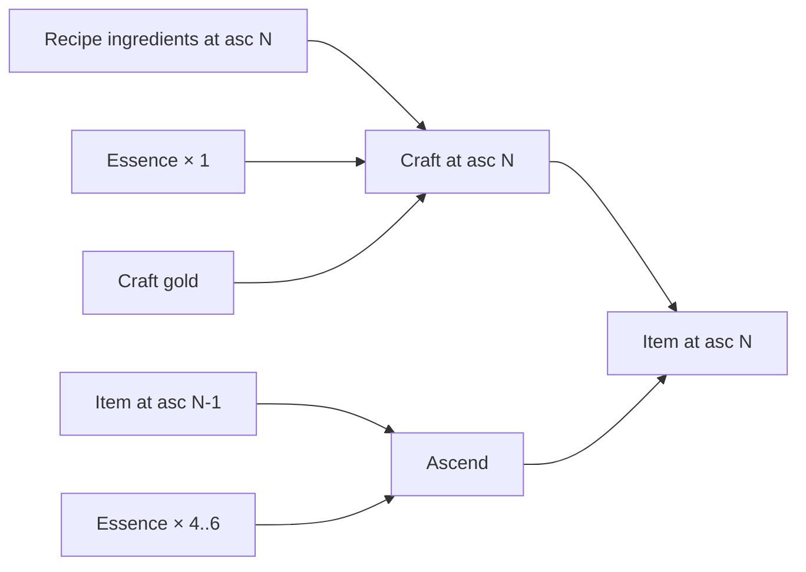

# Ascension

[Root](../../index.md) > [Game Economy](../index.md) > [Ascension](./index.md) > Ascension

The code calls it "prestige". Players call the essences "ascension orbs".

## Table of contents

- [Levels](#levels)
- [Essence tiers](#essence-tiers)
- [Essence amount](#essence-amount)
- [Two ways to ascend](#two-ways-to-ascend)
- [Value](#value)
- [Code](#code)

## Levels

| Type | Max ascension |
|---|---|
| equipment, consumable | 2 |
| map | 1 (no asc-2 maps) |
| material | none |

- Item and hero max level: 60. Some maps have item level 70 (Boss Rush).
- `lockPrestige` on an item blocks ascension.
- Crafter needs its own ascension level and prestige level ≥ item level.

## Essence tiers

`prestigeItemID[asc][region]`. Region = `floor((itemLevel − 1) / 10) + 1`, clamped 1..6.

| Region | Asc-1 essence | Asc-2 essence |
|---|---|---|
| 1 | Forest (33) | Nature (273) |
| 2 | Water (55) | Tidal (274) |
| 3 | Earth (84) | Mountain (275) |
| 4 | Necro (109) | Death (276) |
| 5 | Fire (140) | Inferno (277) |
| 6 | Glacial (255) | Arctic (278) |

- Normal [maps](../maps/maps.md) drop asc-1 essence. Asc-1 maps drop asc-2 essence.

## Essence amount

`default.prestigeItemMaterial`, with `frac = ((itemLevel − 1) / 10) mod 1`:

- Equipment and maps: `20 + frac × 50`. Consumables: `2 + frac × 5`.
- × `rarityMod[rarity][1]`, rounded.
- Upgrade of an existing item: × 4, +1 with a prefix, +1 with a suffix (so × 4 to × 6).
- Modifiers also bump the rarity used above. Example: Shadow Robe (rarity 5) needs 480 / 900 / 1080 essence
  with 0 / 1 / 2 modifiers, while a 2nd modifier adds nothing to its price.
- Upgrading keeps the item's modifiers and never rolls new ones.
- Depends on level and rarity only, **not on the item's value**.

## Two ways to ascend

- Craft directly: normal recipe with ingredients at asc N, plus 1× essence and the craft gold.
- Upgrade: the item at asc N−1 plus 4–6× essence, no gold. Uses `AscendItem`.

## Value

- `value × (2 × asc)`: asc 1 = ×2, asc 2 = ×4. Stackables: `sell` range × same factor.
- Then the usual [selling](../selling/selling.md) rarity multiplier.

## Code

- `decompiled/data.Default.lua`: `prestigeItemID`, `prestigeItemMaterial`, `itemValue`, `itemSellValue`, `itemAscendTime`.
- `decompiled/obj.AscendItem.lua`, `decompiled/obj.Craft.lua`, `decompiled/obj.Crafter.lua` (`getMaxAscLevel`).
- `decompiled/scene.PrestigeItemOverlay.lua`: the upgrade screen.
