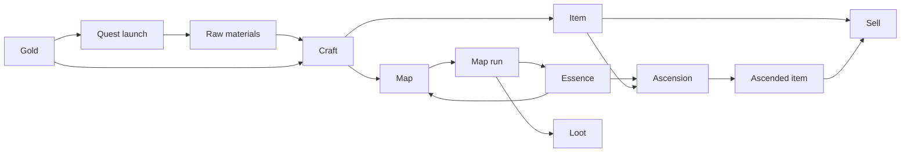

# Game economy

[Root](../index.md) > [Game Economy](./index.md) > Game economy

Everything costs gold in the end. Every item has a cost chain back to quest launches and craft fees.
All rules here come from the decompiled code. Source files are listed per sub-concept.

## Table of contents

- [Cost chain](#cost-chain)
- [Item types](#item-types)
- [Grade](#grade)
- [Code](#code)

## Cost chain

- [Quests](./quests/quests.md) turn gold into raw materials.
- [Crafting](./crafting/crafting.md) turns gold and ingredients into materials, items and maps.
- [Maps](./maps/maps.md) are consumed to produce essence (the "ascension orbs") plus loot.
- [Ascension](./ascension/ascension.md) uses essence to raise an item's level, multiplying its value.
- [Selling](./selling/selling.md) turns items back into gold.
- Loop: maps need essence to craft and produce essence when run.

## Item types

`itemData` holds four types, keyed by id:

| Type | Count | Stackable | Ascendable |
|---|---|---|---|
| material | 278 | yes | no |
| equipment | 780 | no | yes (asc 1, 2) |
| consumable | 69 | yes | yes (asc 1, 2) |
| map | 32 | no | yes (asc 1 only) |

Many ids are placeholders ("Extra Item", "Region 5 Item", "Break", "Weekly Material", "New Item").

## Grade

- Grade 1 to 5 on quests, map runs and items. Grade 3 is neutral.
- Quest/map grade comes from party strength vs. enemy level and battle length.
- It scales drop amounts (`gradeBonus` 0.6, 0.75, 1, 1.25, 1.5), parcel nil odds (`gradeParcelBonus` 1.25 … 0.75)
  and run time (`gradeTime` 1.25 … 0.75).
- Item grade does not change sell value.

## Code

- `decompiled/data.Default.lua`: grade tables, `rarityMod`, ascension formulas, map formulas.
- `decompiled/data.*Data.lua`: the item, quest, parcel, crafter and class tables.
