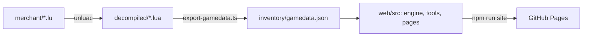

# Merchant balancing project

[Root](./index.md) > Merchant balancing project

Goal: balancing tools for Merchant, a Corona/Solar2D game written in Lua.
Only the compiled build is available, so everything starts from decompiled bytecode.

## Table of contents

- [Folder layout](#folder-layout)
- [Pipeline](#pipeline)
- [Where to start](#where-to-start)

## Folder layout

| Folder | Content | Edit? | In git? |
|---|---|---|---|
| `merchant/` | Original build: `.lu` bytecode, `build.settings` | Never | No (game files) |
| `decompiled/` | One `.lua` per `.lu` (see [decompilation](./tooling/decompilation/decompilation.md)) | Regenerate only | No (game files) |
| `web/` | TypeScript engine (`src/sim/`), tools (`src/tools/`), website pages (`src/ui/`), tests | Yes | Yes (except `test/fixtures/`) |
| `tools/` | Command reference; `unluac.jar` is local only | Yes | Yes |
| `inventory/` | Exported game data, JSON + CSV | Regenerate only | Yes (website data) |
| `reports/` | Profit and essence-source tables | Regenerate only | No |
| `saves/` | `snapshot/` = local copies of the player's save files; `*.csv` = parsed tables (from the former save tool) | Regenerate only | No (personal) |
| `site/` | GitHub Pages website, see [website](./tooling/website/website.md) | Yes | Yes |
| `docs/` | This knowledge folder | Yes | Yes |

Public repo: `git@github.com:titaniteChuck/merchant-rpg-simulator.git`. `.gitignore` keeps every game file
(`*.lu`, `*.lua`), saves, reports, the engine's reference fixtures and third-party binaries out.

## Pipeline

## Where to start

- Game rules: [game-economy](./game-economy/game-economy.md).
- Running or changing the tools: [tooling](./tooling/tooling.md).
- Battle rules and hero stats: [combat](./combat/combat.md).
- Current balancing results: [findings](./findings/findings.md).
