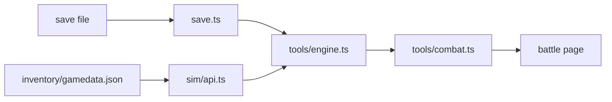

# Combat simulator

[Root](../../index.md) > [Tooling](../index.md) > [Combat Simulator](./index.md) > Combat simulator

Exact fights: the engine (`web/src/sim/`) is a port of the game's combat Lua, checked roll by roll against the game's own
output. Heroes come from the save opened on the battle page (`save.ts`).
Rules being simulated: [combat](../../combat/combat.md), [heroes](../../combat/heroes/heroes.md).

## Table of contents

- [How it works](#how-it-works)
  - [Map runs](#map-runs)
- [Commands](#commands)
- [Search methods](#search-methods)
- [Validation](#validation)
- [Limits](#limits)
- [From Python to TypeScript](#from-python-to-typescript)
- [Code](#code)

## How it works

- `web/src/sim/` ports the game's `Item`, `Equipment`, `Combatant`, `Hero`, `Party`, `Enemy`, `Battle`, `Map`,
  `Campaign` and the skill functions; data tables come from `inventory/gamedata.json`. Porting rules: `web/src/sim/PORTING.md`.
- Random numbers come from the LCG the reference recordings used, so a seed gives the same fight as in the game code.
- Corona extras kept: `math.round` = `floor(x + 0.5)`; combat logs and `print` are dropped.
- Game mode defaults applied as on load (`default.setMode`, save's `gameMode`).
- Heroes are built with `Hero:new` from the raw save entry, gear from its compact item strings.
- Per-skill damage: damage dealt during a combatant's own action is credited to the skill in that rotation slot.
- About 2 ms per solo fight, 5 ms per 4-hero fight, 70 ms per full map run.

### Map runs

- `api.mapRun` builds the game's `Campaign` from a `Map` (save compact string, or id + asc + grade + prefix +
  suffix) the way `GameCampaigns:addNew` does: heroes start at full HP, `campaignID` set so scroll buffs apply.
- `runCombat()` until finished: rooms in order, HP carried over, loot per won room, essence at the end.
- The seed fixes the layout (rooms, enemies, rares, boss) and the fights; each run uses a new seed.
- Per-run hero damage/taken from the change in lifetime totals (`addToTotals`), healing via a hook; hero
  level, XP and totals restored after each run.
- Progress score = rooms cleared + share of the last enemy's HP removed, so "almost beat the boss" ranks higher.
- Scrolls are passed as `Game:startMap` builds them (`{id, amount = 1, chargesUsed = 0, prestigeLevel}`); the game's
  `ScrollsComponent` applies buffs (via the hero's `campaignID`), map stats, post-battle effects and escape.
  Skill sets swapped by the Swap scroll are restored after each run.
- `Map:determineSeedBasedStats` ends with `math.randomseed(os.time())`; `api.mapRun` re-seeds after building the
  map, so a seed gives the same run every time.

## Commands

`web/src/tools/combat.ts` functions. The battle page runs `evaluate` (quest fights) and `evaluateMap` (map runs, with
scrolls); the searches below are library functions not yet on a page (`cmdSkills`, `cmdGear`, `cmdParty`, …), kept from
the former command line.

| Command | What it answers |
|---|---|
| `roster` | Every hero's computed stats, AP use, rotation and passive |
| `fight --quest Q --front ids --back ids` | Win %, turns, grade, damage/taken/heal/death per hero, damage per skill |
| `damage --hero H --quest Q` | Solo damage per fight, per turn, per skill use |
| `solo [--heroes] [--quests]` | Win % of every hero alone vs every quest → `reports/solo.csv` + class table |
| `skills --hero H --quest Q [--front --back]` | Best 5-slot rotation and passive within the AP budget |
| `gear --hero H --quest Q --pool owned\|catalog` | Best item per slot from your items, or from the craftable catalog |
| `party --quest Q [--size 6]` | Best heroes and row positions from your roster |
| `map --map ID\|inv:N [--asc 1] --front --back` | Full map runs: win %, progress, grade, time, loot and essence per run, where it fails |
| `party --map ID` | Best party for a map run |
| `maps --front --back` | Every map (asc 0 and 1) with one party → `reports/maps_survey.csv` (essence/h, loot/h) |
| `map … --scrolls 61,63,69@1` | Map runs with up to 3 scrolls (`ID@ASC` for ascended); charges used and escapes reported |
| `scrolls --map ID --front --back` | Best loadout of up to 3 scrolls (all 286 combinations), with each scroll's crafted cost |

Options: `--rare` (rare variant), `--amount` (enemy count), `-n` (fights per evaluation).

## Search methods

- Every candidate is evaluated on the same seeds (common random numbers), so differences aren't noise.
- Score: win rate first, then fewer turns, then party HP left; for losses, enemy HP removed.
- `skills`: every skill multiset within AP (one order, quick), then all orderings of the best ones,
  then each passive with more fights.
- `gear`: coordinate descent, slot by slot, repeated `--passes` times.
  - `owned`: inventory, sale slots and gear worn by other heroes.
  - `catalog`: every equipment item within `--level-window` levels, built by the game at `--item-grade`,
    `--asc`, `--crafter-level`, with modifier odds forced to 0 (plain item).
- `party`: greedy add (hero × slot) while it helps, then swaps and moves until no improvement.

## Validation

- Computed max HP equals saved HP for the 7 heroes at full health; the 10 wounded ones are all below it.
- Fight outcomes look right against known difficulty: level-60 heroes one-shot region-1 enemies, Odin and
  Archon stay out of reach.
- Not yet compared with a real combat log (`quest_*.clog2` in the save folder).

## Limits

- Loot value counts everything at sell price, including essence; time is the game's map time (battles + walking).
- Level-70 maps (ids 27–32) are skipped by `maps` unless `--include-70`: crafters cap at 60, and generating
  them crashes at grade ≥ 3 (see [maps](../../game-economy/maps/maps.md#level-70-maps)).
- `gear` and `skills` optimise one hero at a time; a full joint search would be much bigger.
- Hero campaign buffs are ignored (`campaignID` forced to -1); potion boosts removed before each fight.
- Results depend on your heroes' gear: the class table compares your heroes, not classes on equal gear.

## From Python to TypeScript

The first version (2026-11-23) ran the game's decompiled Lua through `lupa` from Python (`tools/combat.py`,
`tools/sim/harness.lua`). It was ported to `web/src/tools/` and deleted the same day.

| Former Python | TypeScript |
|---|---|
| `tools/combat.py` (evaluate, optimisers, commands) | `web/src/tools/combat.ts` |
| `tools/sim/engine.py` (`Sim`), `harness.lua` | `web/src/tools/engine.ts` over `web/src/sim/api.ts` |
| `tools/savegame.py` (decoding) | `web/src/tools/save.ts` |

- Before deletion, both sides ran on the shared LCG with the same seeds and gave identical output (screen and CSV) for
  `roster`, `fight`, `damage`, `solo`, `skills`, `gear` (owned and catalog), `party`, `map`, `maps`, `scrolls`, `party --map`.
  The only difference was the order of skills that dealt 0 damage (Python followed Lua's table order).
- Python number formatting is kept: ties to even (`{:.0f}` of 3066.5 is 3066), `100.0` for float CSV columns.
- Bugs of `combat.py` fixed in the port: `solo --quests 1-60` filtered quest ranges by hero ids; `party` options were
  registered on `maps`, so `party` always crashed; `--rare` on a quest without a rare variant is refused up front
  (`solo --rare` skips those quests).
- Commands write lines through an `io` callback and return their data, so a page can run them. The TypeScript command
  line (`cli.ts`) was dropped with the move to a website-only project.

## Code

- `web/src/tools/combat.ts`, `engine.ts`; engine in `web/src/sim/`; page: `web/src/ui/battle*.ts`.
- Tests: `web/test/tools.test.ts`; Lua parity: `web/test/lua-parity.test.ts` with the local fixtures.
