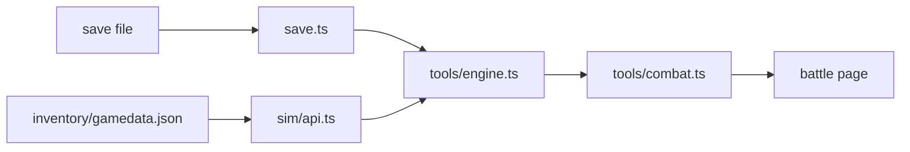

# Combat simulator

[Root](../../index.md) > [Tooling](../index.md) > [Combat Simulator](./index.md) > Combat simulator

Exact fights: the engine (`web/src/sim/`) is a port of the game's combat Lua, checked roll by roll against the game's own
output. Heroes come from the save opened on the battle page (`save.ts`).
Rules being simulated: [combat](../../combat/combat.md), [heroes](../../combat/heroes/heroes.md).

## Table of contents

- [How it works](#how-it-works)
  - [Map runs](#map-runs)
- [Commands](#commands)
- [Search API](#search-api)
- [Search methods](#search-methods)
- [Class balance on equal gear](#class-balance-on-equal-gear)
- [Validation](#validation)
- [Limits](#limits)
- [From Python to TypeScript](#from-python-to-typescript)
- [Code](#code)

## How it works



- `web/src/sim/` ports the game's `Item`, `Equipment`, `Combatant`, `Hero`, `Party`, `Enemy`, `Battle`, `Map`,
  `Campaign` and the skill functions; data tables come from `inventory/gamedata.json`. Porting rules: `web/src/sim/PORTING.md`.
- Random numbers come from the LCG the reference recordings used, so a seed gives the same fight as in the game code.
- Corona extras kept: `math.round` = `floor(x + 0.5)`; combat logs and `print` are dropped.
- Game mode defaults applied as on load (`default.setMode`, save's `gameMode`).
- Heroes are built with `Hero:new` from the raw save entry, gear from its compact item strings.
- Per-skill damage: damage dealt during a combatant's own action is credited to the skill in that rotation slot.
- About 2 ms per solo fight, 5 ms per 4-hero fight, 70 ms per full map run.

### Map runs

- `api.mapRun` builds the game's `Campaign` from a `Map` (save compact string, or id + asc + grade + prefix +
  suffix) the way `GameCampaigns:addNew` does: heroes start at full HP, `campaignID` set so scroll buffs apply.
- `runCombat()` until finished: rooms in order, HP carried over, loot per won room, essence at the end.
- The seed fixes the layout (rooms, enemies, rares, boss) and the fights; each run uses a new seed.
- Per-run hero damage/taken from the change in lifetime totals (`addToTotals`), healing via a hook; hero
  level, XP and totals restored after each run.
- Progress score = rooms cleared + share of the last enemy's HP removed, so "almost beat the boss" ranks higher.
- Scrolls are passed as `Game:startMap` builds them (`{id, amount = 1, chargesUsed = 0, prestigeLevel}`); the game's
  `ScrollsComponent` applies buffs (via the hero's `campaignID`), map stats, post-battle effects and escape.
  Skill sets swapped by the Swap scroll are restored after each run.
- `Map:determineSeedBasedStats` ends with `math.randomseed(os.time())`; `api.mapRun` re-seeds after building the
  map, so a seed gives the same run every time.

## Commands

`web/src/tools/combat.ts` functions. The battle page runs `evaluate` (quest fights) and `evaluateMap` (map runs, with
scrolls). The searches are pure functions (see [Search API](#search-api)); the `cmd*` functions below are text reports
built on them, kept from the former command line.

| Command | What it answers |
|---|---|
| `roster` | Every hero's computed stats, AP use, rotation and passive |
| `fight --quest Q --front ids --back ids` | Win %, turns, grade, damage/taken/heal/death per hero, damage per skill |
| `damage --hero H --quest Q` | Solo damage per fight, per turn, per skill use |
| `solo [--heroes] [--quests]` | Win % of every hero alone vs every quest → `reports/solo.csv` + class table |
| `skills --hero H --quest Q [--front --back]` | Best 5-slot rotation and passive within the AP budget |
| `gear --hero H --quest Q --pool owned\|catalog` | Best item per slot from your items, or from the craftable catalog |
| `party --quest Q [--size 6]` | Best heroes and row positions from your roster |
| `map --map ID\|inv:N [--asc 1] --front --back` | Full map runs: win %, progress, grade, time, loot and essence per run, where it fails |
| `party --map ID` | Best party for a map run |
| `maps --front --back` | Every map (asc 0 and 1) with one party → `reports/maps_survey.csv` (essence/h, loot/h) |
| `map … --scrolls 61,63,69@1` | Map runs with up to 3 scrolls (`ID@ASC` for ascended); charges used and escapes reported |
| `scrolls --map ID --front --back` | Best loadout of up to 3 scrolls (all 286 combinations), with each scroll's crafted cost |

Options: `--rare` (rare variant), `--amount` (quest amount), `-n` (fights per evaluation).

- **Quest amount**: one enemy with its max HP × amount (`obj.Enemy`), loot and quest time scaled with it; not several
  enemies. The game offers 1 to `prestigeLevel × 2 − 1` (1, 3 or 5) for the hero the quest is opened with
  (`default.enemyAmount`; Quick mode `× 3 + 1`, Legendary `× 2 + 1`), less if gold is short; a rare quest is 1.
  `maxQuestAmount(heroes, rare, mode)` takes the party's highest prestige; `evaluate` and the farming report refuse
  an amount outside it.

## Search API

Pure functions for pages and web workers: typed results, no output, no Node APIs. They take engine heroes, not save ids.

| Function | Returns |
|---|---|
| `soloMatrix(sim, [[id, hero]], quests, {n, rare}, ctl)` + `soloSummary(rows, threshold)` | `SoloRow[]` (solo.csv); per-hero and per-class summary |
| `searchSkills(sim, hero, front, back, {quest, rare, amount}, {nQuick, nFinal, top}, ctl)` | `current` and `ranked` `{rotation, passive, ev}` |
| `searchGear(sim, hero, front, back, quest, candidates, {n, passes}, ctl)` | `base`, `final`, `gear[{slot, item, from}]` |
| `catalogGearCandidates(sim, hero, {itemGrade, asc, …})`, `ownedGearCandidates(save, heroId)` | candidates by slot for `searchGear` |
| `surveyMaps(sim, front, back, {n, mapGrade, scrolls, include70}, ctl)` | per map and asc: `MapSurveyRow` + `MapEval`, or the game error |
| `searchScrolls(sim, mapSpec, front, back, {pool, scrollAsc, nQuick, nFinal, top, prices}, ctl)` | `ranked {loadout, ev, cost}` |
| `searchParty(sim, Map<id, hero>, questOrMapTarget, {size, nQuick, nFinal}, ctl)` | `party {front, back}` (ids), `ev`, greedy steps |
| `evaluateTarget(sim, questOrMapTarget, front, back, n)` | `FightEval` for a quest, `MapEval` for a map run (both have `score`) |
| `optimiseFight(sim, Map<id, hero>, questOrMapTarget, {save, size, nQuick, nFinal, maxRounds, minGain, timeBudgetMs, steps}, ctl)` (`optimise.ts`) | `config {party, skills, gear, scrolls}`, final `ev`, `firstPartyEv`, per-step `trace {round, step, before, after, change, ms}` |

- `ctl: SearchControl = {onProgress(done, total, stage), shouldStop()}`. Totals are per stage; a stopped search
  throws `SearchCancelled`. Heroes are always put back as they were (rotation, gear).
- Same results as the former commands for the same seeds: checked on a real save for all six searches (return values
  and every output line). `web/test/search.test.ts` covers them on made-up heroes, so CI runs it.

## Search methods

- Every candidate is evaluated on the same seeds (common random numbers), so differences aren't noise.
- Score: win rate first, then fewer turns, then party HP left; for losses, how far the enemy's HP was brought down
  at its lowest point (`enemy_dmg_peak`), then, as a tiebreak only, the damage it took (`enemy_dmg_total_frac`).
- Healing enemies: `enemy_dmg` is the share of HP removed at the end of the fight. An enemy that heals (Archon's
  Aeon Lash, Goblin Warlord's Feast) can end a lost fight near full HP, so each fight also records the lowest enemy
  HP after any action (`enemyMinHP`) and all damage it took (`enemyDmgTaken`, overkill on the killing blow included).
  Example, the save's best six heroes vs Archon: 0.0% at the end, 0.5% at the lowest, ~1,700 of 200,000 HP per fight.
  `enemy_dmg` can be negative when an enemy shields itself above its max HP (Murlok Monarch).
- `skills`: every skill multiset within AP (one order, quick), then all orderings of the best ones,
  then each passive with more fights. AP budgets are per passive (Wisdom: +2 AP): multisets go up to the largest
  budget and are scored with a passive that affords them; a rotation the game would replace with its default
  (`Hero:calculateAPRemainder`) is never scored.
- `gear`: coordinate descent, slot by slot, repeated `--passes` times.
  - `owned`: inventory, sale slots and gear worn by other heroes.
  - `catalog`: every equipment item within `--level-window` levels, built by the game at `--item-grade`,
    `--asc`, `--crafter-level`, with modifier odds forced to 0 (plain item).
- `party`: greedy add (hero × slot) while it helps, then swaps and moves until no improvement.
- `searchSkills` and `searchGear` take a quest or a map target (typed overloads: a quest still returns `FightEval`).
- **Joint optimiser** (`optimiseFight`, `web/src/tools/optimise.ts`): coordinate descent over party and rows (round 1),
  each member's rotation and passive, each member's gear (owned items: inventory, sale slots, gear of heroes outside
  the party; never one item for two heroes), then scrolls for a map run. A step is kept only if the score rises by
  `minGain` (default 5: half a turn or 1 % HP); another round runs while skills or gear still improve
  (`maxRounds` 2). Defaults: 10 fights / 4 map runs per candidate, 200 / 30 for the final evaluation, 2-minute budget
  (`timeBudgetMs`), after which the best configuration so far is returned. Heroes are restored; apply `config`.

| Target (save's 17 heroes) | `searchParty` alone | `optimiseFight` (2 min) | Unbounded |
|---|---|---|---|
| Desolation Wolf (quest 81) | 100 % win, 2.9 turns | same (59 s, nothing to gain) | same |
| Odin (quest 72) | 0 %, 8.9 % HP removed at lowest | 0 %, 19.8 % (rotations of 5 heroes) | 0 %, 33.5 % (288 s, + gear, round 2) |
| Gnoll Vendetta map asc 1 (boss Gnoll Khan) | 93.3 % win, grade 5 | same (budget spent on party and 2 rotation searches) | — |

  The rotation search is the costly step on long fights (Odin: 15-19 turns) and on map runs; a page should let the
  player raise the budget.

## Potions and enchants in combat

`web/src/tools/consumables.ts` (rules: [heroes](../../combat/heroes/heroes.md#potions-and-enchants)). Browser-safe.

```ts
consumableOptions(hero, "boost" | "enchant", ascs = [0, 1, 2]): ConsumableOption[]   // what the hero may use now
applyConsumable(hero, option): undo                                                  // a potion survives fights (_keepBoost)
rankConsumables(sim, hero, front, back, questOrMapTarget, { kind, n, ascs, solver }, ctl): { base, ranked, freeSlots, fillGain }
consumableMatrix(sim, target, { classes, level, prestige, gearPolicy, kind, n, ascs, top, solver }, ctl): rows per class
```

- Each option is evaluated against the hero without it on the same seeds: score gain, win and lowest-enemy-HP change,
  Solver cost and gain per 1,000 g. Enchants: one more on top of the hero's; `fillGain` = all free slots with the best.
- `api.fight` / `mapRun` drop potions before a fight (as the reference harness did) unless the hero has `_keepBoost`.

| Case (n = 40-50, asc 0 and 2) | Result |
|---|---|
| Save's Odin party (quest 72), per hero | Best potion +2.2 points of Odin's HP (Berserker: Dex / Acc Boost +1 asc 2); no win. The save's heroes use 0 of 16 enchant slots |
| Standard level-60 heroes vs Demon Mage (quest 50) | Potions flip borderline fights: Mage 14 % → 100 % and Cleric 4 % → 100 % with HP Boost asc 2, Bard 96 % → 100 % with Atk Boost +1 asc 2; winners gain only noise |
| vs Arkyos (55), Region 5 (60): no class wins | Atk / Str Boost +1 asc 2 (Arkyos) and HP Boost asc 2 (Region 5) rank first for every class |

- Gains of a few score points are noise: an extra stat shifts which random rolls land. With class-blind `best` gear,
  Mage and Cleric gain from Atk Boost (they carry a physical weapon).

## Class balance on equal gear

`web/src/tools/classes.ts` compares classes, not the player's heroes: every class is built the same way and fights
the same quests alone on the same seeds. Browser-safe (no console, no `node:*`), for the class balance page (U4).

```ts
standardHero(sim, classId, level, prestige, gearPolicy = "best", { itemGrade, itemAsc, crafterLevel, rotation, passive }): Hero
classMatrix(sim, { classes, quests, level, prestige, gearPolicy, skills, searchQuest, searchN, searchNFinal, n, seed0,
  rare, onProgress, shouldStop }): ClassMatrixRow[]
searchSkills(sim, hero, quest, { n, nFinal, top, rare, shouldStop }): { rotation, passive, ev }   // combat.ts searchSkills, solo
summarizeByClass(rows, threshold = 0.9): ClassSummary[]
```

- **Hero**: a raw hero record (class, level, prestige, no gear) through `Sim.hero`, as save heroes are built; the
  game's new-hero path (starting gear) is not supported by the engine. Level is capped per prestige
  (`maxHeroLevel`: 50, 50, 60), so level 60 needs prestige 3.
- **Gear candidates**: catalog equipment of the slot with itemLevel ≤ hero level, not `locked`, with a stat formula
  (drops the "30+ Items" placeholders); crafted plain (no prefix/suffix) at grade 5, asc 0, crafter level 60 by default.
- **Gear policies**:

| Policy | Rule |
|---|---|
| `best` | Same items for every class: per slot, highest itemLevel, then highest catalog `value`, then lowest id. Class-blind (at level 60 a Mage gets Gungnir, an atk axe). |
| `fit` | Per slot, weapon first: the item giving the most offense (`atk` if the class's atk growth ≥ matk growth, `matk` if matk ≥ atk, both for hybrids) × expected crit multiplier `1 + min(crit, 100)/100 × (critMod − 1)`; ties by max HP, def + mdef, then the `best` rule. |
| `none` | No gear. |

- **Skills** (`skills`): `"default"` = the game's default for the level (`defaultAttackList` is all Basic for every
  class, first passive from level 10); `"search"` = the combat.ts `searchSkills` (see [Search methods](#search-methods);
  defaults 10 fights per candidate, 30 per finalist, top 3), once per class on `searchQuest` (default the toughest
  quest of the list, `"each"` = a new search per quest); or an explicit `{ rotation, passive }`. All 9 classes at
  level 60: about 30 s of searching in Node. On a quest no class can win alone the rotation is chosen for damage only
  (lowest enemy HP), so prefer a reference quest the classes can win.
- **Rows** (one per class × quest): win rate, mean turns (and of won fights), grade, damage dealt / taken / healing
  per fight, death rate, enemy HP removed at the end and at its lowest point (`enemyHpRemovedPeak`; the end value
  goes negative when an enemy regenerates above max HP, e.g. Protector of the Forest), HP left, plus the rotation,
  passive and gear used. `summarizeByClass` breaks win-rate ties on the lowest-point value.
- `onProgress(done, total)` after every cell and every rotation search; `shouldStop()` returns the rows done so far.
- Caveats: solo fights only (no party roles: a healer or tank counts only for what it does alone); the `default`
  rotation hides skills, so compare classes with `search`; a rotation searched on one quest is not the best on
  another; `fit` is a stat proxy, not a fight-tested gear search.

## Validation

- Computed max HP equals saved HP for the 7 heroes at full health; the 10 wounded ones are all below it.
- Fight outcomes look right against known difficulty: level-60 heroes one-shot region-1 enemies, Odin and
  Archon stay out of reach.
- Not yet compared with a real combat log (`quest_*.clog2` in the save folder).

## Limits

- Loot value counts everything at sell price, including essence; time is the game's map time (battles + walking).
- Level-70 maps (ids 27–32) are skipped by `maps` unless `--include-70`: crafters cap at 60, and generating
  them crashes at grade ≥ 3 (see [maps](../../game-economy/maps/maps.md#level-70-maps)).
- `gear` and `skills` optimise one hero at a time; a full joint search would be much bigger.
- Hero campaign buffs are ignored (`campaignID` forced to -1); potion boosts removed before each fight.
- `solo` results depend on your heroes' gear: its class table compares your heroes; use
  [class balance on equal gear](#class-balance-on-equal-gear) for classes.

## From Python to TypeScript

The first version (2026-11-23) ran the game's decompiled Lua through `lupa` from Python (`tools/combat.py`,
`tools/sim/harness.lua`). It was ported to `web/src/tools/` and deleted the same day.

| Former Python | TypeScript |
|---|---|
| `tools/combat.py` (evaluate, optimisers, commands) | `web/src/tools/combat.ts` |
| `tools/sim/engine.py` (`Sim`), `harness.lua` | `web/src/tools/engine.ts` over `web/src/sim/api.ts` |
| `tools/savegame.py` (decoding) | `web/src/tools/save.ts` |

- Before deletion, both sides ran on the shared LCG with the same seeds and gave identical output (screen and CSV) for
  `roster`, `fight`, `damage`, `solo`, `skills`, `gear` (owned and catalog), `party`, `map`, `maps`, `scrolls`, `party --map`.
  The only difference was the order of skills that dealt 0 damage (Python followed Lua's table order).
- Python number formatting is kept: ties to even (`{:.0f}` of 3066.5 is 3066), `100.0` for float CSV columns.
- Bugs of `combat.py` fixed in the port: `solo --quests 1-60` filtered quest ranges by hero ids; `party` options were
  registered on `maps`, so `party` always crashed; `--rare` on a quest without a rare variant is refused up front
  (`solo --rare` skips those quests).
- Commands write lines through an `io` callback and return their data, so a page can run them. The TypeScript command
  line (`cli.ts`) was dropped with the move to a website-only project.

## Code

- `web/src/tools/combat.ts`, `engine.ts`; engine in `web/src/sim/`; page: `web/src/ui/battle*.ts`.
- `web/src/tools/classes.ts` (equal-gear class balance).
- Tests: `web/test/tools.test.ts`, `web/test/search.test.ts`, `web/test/classes.test.ts` (catalog data only, runs in CI); Lua parity: `web/test/lua-parity.test.ts` with the local fixtures.
