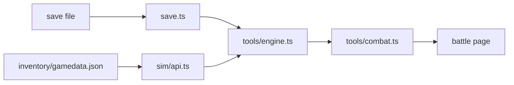

# Combat simulator

[Root](../../index.md) > [Tooling](../index.md) > [Combat Simulator](./index.md) > Combat simulator

Exact fights: the engine (`web/src/sim/`) is a port of the game's combat Lua, checked roll by roll against the game's own
output. Heroes come from the save opened on the battle page (`save.ts`).
Rules being simulated: [combat](../../combat/combat.md), [heroes](../../combat/heroes/heroes.md).

## Table of contents

- [How it works](#how-it-works)
  - [Map runs](#map-runs)
- [Commands](#commands)
- [Search API](#search-api)
- [Search methods](#search-methods)
- [Potions and enchants in combat](#potions-and-enchants-in-combat)
- [Class balance on equal gear](#class-balance-on-equal-gear)
- [Levelling and prestige](#levelling-and-prestige)
- [Validation](#validation)
- [Limits](#limits)
- [From Python to TypeScript](#from-python-to-typescript)
- [Code](#code)

## How it works



- `web/src/sim/` ports the game's `Item`, `Equipment`, `Combatant`, `Hero`, `Party`, `Enemy`, `Battle`, `Map`,
  `Campaign` and the skill functions; data tables come from `inventory/gamedata.json`. Porting rules: `web/src/sim/PORTING.md`.
- Random numbers come from the LCG the reference recordings used, so a seed gives the same fight as in the game code.
- Corona extras kept: `math.round` = `floor(x + 0.5)`; combat logs and `print` are dropped.
- Game mode defaults applied as on load (`default.setMode`, save's `gameMode`).
- Heroes are built with `Hero:new` from the raw save entry, gear from its compact item strings.
- Per-skill damage: damage dealt during a combatant's own action is credited to the skill in that rotation slot.
- About 2 ms per solo fight, 5 ms per 4-hero fight, 70 ms per full map run.

### Map runs

- `api.mapRun` builds the game's `Campaign` from a `Map` (save compact string, or id + asc + grade + prefix +
  suffix) the way `GameCampaigns:addNew` does: heroes start at full HP, `campaignID` set so scroll buffs apply.
- `runCombat()` until finished: rooms in order, HP carried over, loot per won room, essence at the end.
- The seed fixes the layout (rooms, enemies, rares, boss) and the fights; each run uses a new seed.
- Per-run hero damage/taken from the change in lifetime totals (`addToTotals`), healing via a hook; hero
  level, XP and totals restored after each run.
- Progress score = rooms cleared + share of the last enemy's HP removed, so "almost beat the boss" ranks higher.
- Scrolls are passed as `Game:startMap` builds them (`{id, amount = 1, chargesUsed = 0, prestigeLevel}`); the game's
  `ScrollsComponent` applies buffs (via the hero's `campaignID`), map stats, post-battle effects and escape.
  Skill sets swapped by the Swap scroll are restored after each run.
- `Map:determineSeedBasedStats` ends with `math.randomseed(os.time())`; `api.mapRun` re-seeds after building the
  map, so a seed gives the same run every time.

## Commands

`web/src/tools/combat.ts` functions. The battle page runs `evaluate` (quest fights) and `evaluateMap` (map runs, with
scrolls). The searches are pure functions (see [Search API](#search-api)). The `cmd*` functions below are text reports
built on them, kept from the former command line: they take a `Roster` (the save's heroes by id) and an options
object, write lines through an `io` callback and return their data (CSV rows where noted).

| Report | Options | What it answers |
|---|---|---|
| `cmdRoster` | none | Every hero's computed stats, AP use, rotation and passive |
| `cmdFight` | `quest, front, back` (hero ids) | Win %, turns, grade, damage/taken/heal/death per hero, damage per skill |
| `cmdDamage` | `quest, hero` | Solo damage per fight, per turn, per skill use (the hero in the game's slot) |
| `cmdSolo` | `heroes, quests` | Win % of every hero alone vs every quest (`solo.csv` rows) + class table |
| `cmdSkills` | `hero, quest, front, back` | Best 5-slot rotation and passive within the AP budget |
| `cmdGear` | `hero, quest, pool: owned \| catalog` | Best item per slot from your items, or from the craftable catalog |
| `cmdParty` | `quest` or `map`, `size` | Best heroes and row positions from your roster |
| `cmdMap` | `map` (id or `inv:N`), `asc, front, back, scrolls` | Full map runs: win %, progress, grade, time, loot and essence per run, where it fails; with up to 3 scrolls (`61,63,69@1`, `ID@ASC` for ascended), charges used and escapes |
| `cmdMaps` | `front, back` | Every map (asc 0 and 1) with one party (`maps_survey.csv` rows: essence/h, loot/h) |
| `cmdScrolls` | `map, front, back` | Best loadout of up to 3 scrolls (all 286 combinations), with each scroll's crafted cost |

Common options: `rare` (rare variant), `amount` (quest amount), `n` (fights per evaluation).

- **Quest amount**: one enemy with its max HP × amount (`obj.Enemy`), loot and quest time scaled with it; not several
  enemies. The game offers 1 to `prestigeLevel × 2 − 1` (1, 3 or 5) for the hero the quest is opened with
  (`default.enemyAmount`; Quick mode `× 3 + 1`, Legendary `× 2 + 1`), less if gold is short; a rare quest is 1.
  `maxQuestAmount(heroes, rare, mode)` takes the party's highest prestige; `evaluate` and the farming report refuse
  an amount outside it.
- **Party setup** ([rules](../../combat/combat.md#party-setup-rules)): a solo quest takes one hero in front 1, a party
  quest up to `questSize` heroes with front 2 always filled, a map any layout. `evaluate` and `evaluateMap` refuse
  any other layout, with the reason (`partyProblem`).

## Search API

Pure functions for pages and web workers: typed results, no output, no Node APIs. They take engine heroes, not save ids.

| Function | Returns |
|---|---|
| `soloMatrix(sim, [[id, hero]], quests, {n, rare}, ctl)` + `soloSummary(rows, threshold)` | `SoloRow[]` (solo.csv); per-hero and per-class summary |
| `searchSkills(sim, hero, front, back, questOrMapTarget, {nQuick, nFinal, top, prefilter, warmStart}, ctl)` | `current`, `warm` and `ranked` `{rotation, passive, ev}`, `counts` |
| `searchGear(sim, hero, front, back, quest, candidates, {n, passes}, ctl)` | `base`, `final`, `gear[{slot, item, from}]` |
| `catalogGearCandidates(sim, hero, {itemGrade, asc, …})`, `ownedGearCandidates(save, heroId)` | candidates by slot for `searchGear` |
| `surveyMaps(sim, front, back, {n, mapGrade, scrolls, include70}, ctl)` | per map and asc: `MapSurveyRow` + `MapEval`, or the game error |
| `searchScrolls(sim, mapSpec, front, back, {pool, scrollAsc, nQuick, nFinal, top, prices}, ctl)` | `ranked {loadout, ev, cost}` |
| `searchParty(sim, Map<id, hero>, questOrMapTarget, {size, nQuick, nFinal, lock}, ctl)` | `party {front, back}` (ids), `ev`, greedy steps |
| `searchParties(sim, Map<id, hero>, questOrMapTarget, {minSize, maxSize, topK, lock, exclude, rotations, scrolls, timeBudgetMs, …}, ctl)` (`parties.ts`) | the smallest winning parties, fully set up: `results[{size, layout, skills, scrolls, ev, score, tuned}]`, `tried`, `stopped` ([party search](./party-search.md)) |
| `evaluateTarget(sim, questOrMapTarget, front, back, n)` | `FightEval` for a quest, `MapEval` for a map run (both have `score`) |
| `partyRules(target)`, `requiredSlots(target)`, `partyProblem(target, front, back)`, `soloRows(target, hero)` | `{kind, maxSize, required}`; the slots that can't be empty (`[{row: "front", i: 1}]` for a party quest); why a layout is refused, or `null`; one hero's rows in the game's slot |
| `optimiseFight(sim, Map<id, hero>, questOrMapTarget, {save, size, startParty, lock, nQuick, nFinal, maxRounds, minGain, timeBudgetMs, steps}, ctl)` (`optimise.ts`) | `config {party, skills, gear, scrolls}`, final `ev`, `firstPartyEv`, per-step `trace {round, step, before, after, change, ms}` |

- Targets: `QuestTarget = {quest, rare?, amount?, mapRoom?}` (`mapRoom`: a map room's fight, e.g. the map's boss, where
  the quest's own party rules don't apply); `MapTarget = {map: {id, prestigeLevel, grade, prefix, suffix}, scrolls?}`.
- Every function that simulates a layout refuses one the game would not start ([party setup rules](../../combat/combat.md#party-setup-rules)); the searches
  never build one.
- `ctl: SearchControl = {onProgress(done, total, stage), shouldStop()}`. Totals are per stage; a stopped search
  throws `SearchCancelled`. Heroes are always put back as they were (rotation, gear).
- `shouldStop()` is polled before every evaluation and, inside one, before every fight or map run (`evaluate`,
  `evaluateMap` and `evaluateTarget` take it as a last `stop` argument; the schedule pre-filter polls it every 64
  orderings). A search stops within one fight or run of the request.
- Same results as the former commands for the same seeds: checked on a real save for all six searches (return values
  and every output line). `web/test/search.test.ts` covers them on made-up heroes, so CI runs it.

## Search methods

- Every candidate is evaluated on the same seeds (common random numbers), so differences aren't noise.
- Seeds: fight k of an evaluation uses `fightSeed(seed0, k)`, a 32-bit hash of (seed0, k), in `evaluate`,
  `evaluateMap` (so every search), the farming report and levelling. Plain seeds 1, 2, 3... gave a first Park-Miller
  roll of 1 for every seed up to ~1,270, so the first hit check of every fight always landed. The Lua difftests and
  engine snapshots call the engine with their own seeds and are unchanged.
- Score (`score`):
  - Win rate first.
  - Won fights: fewer turns (−10 per turn), then party HP left.
  - Lost fights: how far the enemy's HP was brought down at its lowest point (`enemy_dmg_peak`, 1 % = 100). Then the damage it took (`enemy_dmg_total_frac`, 1 % = 10; it counts when the enemy heals back). Then surviving longer, a small bonus (+0.5 per turn).
  - Before, every turn cost 10 points, won or lost, which rewarded a lost fight that ended sooner.
- Healing enemies: `enemy_dmg` is the share of HP removed at the end of the fight. An enemy that heals (Archon's
  Aeon Lash, Goblin Warlord's Feast) can end a lost fight near full HP, so each fight also records the lowest enemy
  HP after any action (`enemyMinHP`) and all damage it took (`enemyDmgTaken`, overkill on the killing blow included).
  Example, the save's best six heroes vs Archon: 0.0% at the end, 0.5% at the lowest, ~1,700 of 200,000 HP per fight.
  `enemy_dmg` can be negative when an enemy shields itself above its max HP (Murlok Monarch).
- `skills`: every skill multiset within AP (one order, quick), then all orderings of the best ones,
  then each passive with more fights. AP budgets are per passive (Wisdom: +2 AP): multisets go up to the largest
  budget and are scored with a passive that affords them; a rotation the game would replace with its default
  (`Hero:calculateAPRemainder`) is never scored. The current rotation is always a finalist, so the result is never
  worse than what the hero plays.
  - Schedule pre-filter (default for quests once `loadTimelines` ran; `prefilter: k`, default 15, `false` = off).
    Every ordering of every AP-legal multiset is ranked twice, by the counter-schedule score and by damage only
    ([schedule](./schedule.md)). Only the top-k orderings and the best ordering of the top-k skill sets from both
    rankings, the current rotation and the [warm start](./warm-start.md) rotation are simulated, then the usual
    finalists × passives. Map runs and quests without a timeline use the full search.
- `gear`: coordinate descent, slot by slot, repeated `passes` times.
  - `owned`: inventory, sale slots and gear worn by other heroes.
  - `catalog`: every equipment item within `levelWindow` levels, built by the game at `itemGrade`, `asc` and
    `crafterLevel`, with modifier odds forced to 0 (plain item).
- `party`: greedy add (hero × slot) while it helps, then swaps and moves until no improvement. A party quest's front 2
  is filled first and never emptied, and the size stops at `questSize`; a solo quest gets one hero in front 1.
- `searchParties`: beam search over party sizes, smallest winning parties first ([party search](./party-search.md)).
- `searchSkills` and `searchGear` take a quest or a map target (typed overloads: a quest still returns `FightEval`).
- **Joint optimiser** (`optimiseFight`, `web/src/tools/optimise.ts`): coordinate descent over party and rows (round 1),
  the layout steps below, each member's rotation and passive, the layout steps again, each member's gear (owned items:
  inventory, sale slots, gear of heroes outside the party; never one item for two heroes), then scrolls for a map run.
  A step is kept only if the score rises by `minGain` (default 5: half a turn or 1 % HP); another round runs while
  a step other than the party still improves (`maxRounds` 2). Defaults: 10 fights / 4 map runs per candidate, 200 / 30
  for the final evaluation, 2-minute budget (`timeBudgetMs`, the layout steps included), after which the best
  configuration so far is returned. Heroes are restored; apply `config`.
- **Layout steps** (`steps.order`, `steps.swap`, `steps.phase`, all on by default). The turn order is back 1, front 1,
  back 2, front 2, back 3, front 3, then the enemy ([combat](../../combat/combat.md#battle-loop)), and slot k of every
  rotation, the enemy's included, plays on turns k, k + 5, …, so who acts first and when each skill lands both matter.

| Step | Candidates (same seeds as the current layout) | Trace step name |
|---|---|---|
| Order within rows | the 3! × 3! = 36 orders of the front and back rows, empty slots included | `Order within rows` |
| Row swaps | one front slot exchanged with one back slot (9 pairs; a hero may move to an empty slot); if kept, the order step again | `Swap rows: A ↔ B`, then `Order within rows (after swap)` |
| Phase shift | each member's rotation shifted cyclically by 1-4 slots, passive unchanged | `Phase of X: +s` |

  - The pass runs after the party step and again after the skill steps, and is skipped when nothing changed since the
    last pass (same seeds, same result). A pass scores up to about 110 candidates (35 orders, 9 swaps, 35 more orders
    after a kept swap, 4 shifts per hero) at `nQuick` each: 3-10 s on Odin, Archon or a map run.
  - A shift keeps the AP total, the only rule the game puts on a rotation (`Hero:calculateAPRemainder`; slot order is
    free), so every shift is valid; a shift the engine would replace is still skipped.
- **Party setup rules**: every step scores a layout the game would not start as −∞, so it is never kept: the order and
  swap steps never empty a party quest's front 2, and the party step stops at `questSize`. A `startParty` that breaks
  the rules throws the reason when the party step is off; with it on, a valid party replaces it.
- **Starting party and locks**: `startParty {front, back}` (hero ids) is the layout to start from when the party
  step is off, and the candidate the party search must beat when it is on. `lock: [ids]` keeps heroes in the party:
  the party step places them first (their `startParty` slot, else the best free slot) and never swaps them out; the
  layout steps may still move them.
- **Quest amount**: with `amount` > 1 the party must contain a hero whose prestige allows it (`maxQuestAmount`); a
  candidate party that doesn't scores −∞ (skipped) instead of throwing, and the party step uses the constrained search
  (as with locks). If no party of the pool is valid, `optimiseFight` throws "no party could be formed".
- **Gear and AP**: a gear candidate that lowers the hero's AP below its rotation's cost makes the game swap in the
  default rotation and passive. `searchGear` now scores every candidate with the hero's rotation put back and
  restores it at the end. The gear step still re-applies the rotation after equipping, and re-scores the kept gear
  with the rotation the game would really play. Before this fix, one hero's gear search could silently reset that
  hero's rotation (Archon: score 801 → 423 between two gear steps).
- **Schedule pre-filter** (`prefilter`, default 15): the skill step's `searchSkills` uses it. The phase step
  simulates only the 2 best shifts by schedule score and the best by damage only, instead of all 4.

Measured 2026-11-23 (E13), before the party setup rules:

| Target (save's 17 heroes) | `searchParty` alone | `optimiseFight` (2 min) | Unbounded |
|---|---|---|---|
| Desolation Wolf (quest 81) | 100 % win, 2.9 turns | same (59 s, nothing to gain) | same |
| Odin (quest 72) | 0 %, 8.9 % HP removed at lowest | 0 %, 19.8 % (rotations of 5 heroes) | 0 %, 33.5 % (288 s, + gear, round 2) |
| Gnoll Vendetta map asc 1 (boss Gnoll Khan) | 93.3 % win, grade 5 | same (budget spent on party and 2 rotation searches) | — |

  The rotation search is the costly step on long fights (Odin: 15-19 turns) and on map runs; a page should let the
  player raise the budget.

  With and without the layout steps (E14a), same save; gear AP fix in both columns. "HP removed" is the enemy's lowest
  point, 200 fights (30 map runs) in the final evaluation:

| Target | 2 min, without | 2 min, with | Unbounded, without | Unbounded, with | Steps that gained (unbounded trace) |
|---|---|---|---|---|---|
| Odin (72) | 0 %, 31.0 %, 19 turns | 0 %, 31.9 %, 15 turns | 0 %, 33.5 % (249 s) | 0 %, 35.1 % (243 s) | Mage phase +1 (score 791 → 918, before any rotation search), Paladin phase +1 (+22), order in round 2 (Paladin to front 1, Berserker to back 1: +232) |
| Archon (97) | 0 %, 6.3 % | 0 %, 10.1 % | 0 %, 6.3 % (183 s) | 0 %, 9.9 % (205 s) | order (177 → 243), front-back swap (+7), Rogue phase +3 (+18); after the rotations, swap back and re-order (+19) |
| Demon Mage (50) | 100 %, 1 turn | same | same | same | none (already won in one turn) |
| Gnoll Vendetta asc 1 | 93.3 %, grade 5 | same | same | same | none at 4 runs per candidate |

  - The gains come from timing more than from rows: a phase shift is a 0.1-0.5 s step that can be worth more than a
    20 s rotation search (Odin's Mage: Silence one turn earlier). Rotations found by the skill search are already
    best among their own orderings, so the phase step gains mostly before it, or after the order changes.
  - These figures used the former `score`, where losing fights scored fewer turns as better, so Odin's 15 vs 19
    turns was not a gain in itself; the higher lowest-HP point is. Lost fights now count survival as a small bonus.

## Potions and enchants in combat

`web/src/tools/consumables.ts` (rules: [heroes](../../combat/heroes/heroes.md#potions-and-enchants)). Browser-safe.

```ts
consumableOptions(hero, "boost" | "enchant", ascs = [0, 1, 2]): ConsumableOption[]   // what the hero may use now
applyConsumable(hero, option): undo                                                  // a potion survives fights (_keepBoost)
rankConsumables(sim, hero, front, back, questOrMapTarget, { kind, n, ascs, solver }, ctl): { base, ranked, freeSlots, fillGain }
consumableMatrix(sim, target, { classes, level, prestige, gearPolicy, kind, n, ascs, top, solver }, ctl): rows per class
```

- Each option is evaluated against the hero without it on the same seeds: score gain, win and lowest-enemy-HP change,
  Solver cost and gain per 1,000 g. Enchants: one more on top of the hero's; `fillGain` = all free slots with the best.
- `api.fight` / `mapRun` drop potions before a fight (as the reference harness did) unless the hero has `_keepBoost`.

| Case (n = 40-50, asc 0 and 2) | Result |
|---|---|
| Save's Odin party (quest 72), per hero | Best potion +2.2 points of Odin's HP (Berserker: Dex / Acc Boost +1 asc 2); no win. The save's heroes use 0 of 16 enchant slots |
| Standard level-60 heroes vs Demon Mage (quest 50) | Potions flip borderline fights: Mage 14 % → 100 % and Cleric 4 % → 100 % with HP Boost asc 2, Bard 96 % → 100 % with Atk Boost +1 asc 2; winners gain only noise |
| vs Arkyos (55), Region 5 (60): no class wins | Atk / Str Boost +1 asc 2 (Arkyos) and HP Boost asc 2 (Region 5) rank first for every class |

- Gains of a few score points are noise: an extra stat shifts which random rolls land. With class-blind `best` gear,
  Mage and Cleric gain from Atk Boost (they carry a physical weapon).

## Class balance on equal gear

`web/src/tools/classes.ts` compares classes, not the player's heroes: every class is built the same way and fights
the same quests alone on the same seeds. Browser-safe (no console, no `node:*`), for the class balance page (U4).

```ts
standardHero(sim, classId, level, prestige, gearPolicy = "best", { itemGrade, itemAsc, crafterLevel, rotation, passive }): Hero
classMatrix(sim, { classes, quests, level, prestige, gearPolicy, skills, searchQuest, searchN, searchNFinal, n, seed0,
  rare, onProgress, shouldStop }): ClassMatrixRow[]
searchSkills(sim, hero, quest, { n, nFinal, top, rare, shouldStop }): { rotation, passive, ev }   // combat.ts searchSkills, solo, in the game's slot
summarizeByClass(rows, threshold = 0.9): ClassSummary[]
```

- **Hero**: a raw hero record (class, level, prestige, no gear) through `Sim.hero`, as save heroes are built; the
  game's new-hero path (starting gear) is not supported by the engine. Level is capped per prestige
  (`maxHeroLevel`: 50, 50, 60), so level 60 needs prestige 3.
- **Gear candidates**: catalog equipment of the slot with itemLevel ≤ hero level, not `locked`, with a stat formula
  (drops the "30+ Items" placeholders); crafted plain (no prefix/suffix) at grade 5, asc 0, crafter level 60 by default.
- **Gear policies**:

| Policy | Rule |
|---|---|
| `best` | Same items for every class: per slot, highest itemLevel, then highest catalog `value`, then lowest id. Class-blind (at level 60 a Mage gets Gungnir, an atk axe). |
| `fit` | Per slot, weapon first: the item giving the most offense (`atk` if the class's atk growth ≥ matk growth, `matk` if matk ≥ atk, both for hybrids) × expected crit multiplier `1 + min(crit, 100)/100 × (critMod − 1)`; ties by max HP, def + mdef, then the `best` rule. |
| `none` | No gear. |

- **Skills** (`skills`): `"default"` = the game's default for the level (`defaultAttackList` is all Basic for every
  class, first passive from level 10); `"search"` = the combat.ts `searchSkills` (see [Search methods](#search-methods);
  defaults 10 fights per candidate, 30 per finalist, top 3), once per class on `searchQuest` (default the toughest
  quest of the list, `"each"` = a new search per quest); or an explicit `{ rotation, passive }`. All 9 classes at
  level 60: about 30 s of searching in Node. On a quest no class can win alone the rotation is chosen for damage only
  (lowest enemy HP), so prefer a reference quest the classes can win.
- **Rows** (one per class × quest): win rate, mean turns (and of won fights), grade, damage dealt / taken / healing
  per fight, death rate, enemy HP removed at the end and at its lowest point (`enemyHpRemovedPeak`; the end value
  goes negative when an enemy regenerates above max HP, e.g. Protector of the Forest), HP left, plus the rotation,
  passive and gear used. `summarizeByClass` breaks win-rate ties on the lowest-point value.
- `onProgress(done, total)` after every cell and every rotation search; `shouldStop()` returns the rows done so far.
- Caveats: solo fights only, the hero in the game's slot (front 1 in a solo quest, front 2 in a party quest; no party roles: a healer or tank counts only for what it does alone); the `default`
  rotation hides skills, so compare classes with `search`; a rotation searched on one quest is not the best on
  another; `fit` is a stat proxy, not a fight-tested gear search.

## Levelling and prestige

`web/src/tools/levelling.ts` (pure, worker-safe, progress and cancel through `SearchControl`). XP rules:
[heroes](../../combat/heroes/heroes.md#experience).

```ts
xpBetween(tier, from, to): number          // XP from level `from` to `to`
availableQuests(level, tier): number[]      // quest-board quests (not questType 8) the hero may take
availableMaps(level, crafterLevel = 60): number[]   // craftable maps, from hero level 10
questXpRate(sim, hero, front, back, quest, amount = 1, n = 30): XpSource   // win, xpPerRun, hoursPerRun, reviveGold, xpPerHour
mapXpRate(sim, hero, front, back, map, { asc, grade, n, stopBelow }): XpSource   // whole runs: craftHours + runHours
levellingPlan(sim, raw, { from, to, band = 5, companions, n, quests, amounts, minWin = 0.5, expModBonus,
  maps, mapRuns = 10, mapGrade = 3, crafterLevel = 60, solver }, ctl): LevellingPlan
mergeSteps(steps): LevelStep[]              // consecutive bands with the same source -> one step
prestigePayoff(sim, raw, { quest, n }, levellingOptions, ctl): PrestigePayoff
```

- **XP rate**: the hero's own share over seeds 1..n, wins only, nothing at max level; hours = quest time.
  `questXpRate` refuses a map-only enemy (`questType` 8: map bosses 91–98, Treasure Bushes 99–104).
- **Map runs** (`mapXpRate`): XP of every room won while alive (round(exp × mapEnemyMod × 0.2 / heroes) per room,
  `Campaign:runCombat`; a lost run keeps the rooms won), hours = the map's craft time (`mapCraftSeconds`, lower maps
  included) + the run, win = whole runs won. A step on a map also carries `mapGold` (maps at Solver cost).
- **Plan**: every `band` levels the hero is rebuilt at that level; candidates are the quest-board quests × amount (1
  and the party's max by default) and, from level 10, every craftable map run. A map is skipped when even every room
  won (solo share, 1.5 × the expected rooms) over its shortest time (craft + a quarter of the walk) can't beat the best
  source. The best XP/h among those won at least `minWin` is kept; runs = XP needed / XP per run. Consecutive bands
  with the same source (same quest and amount, or same map) are merged into one step (`bands` counts them).
  `stuckAt` marks a band with no usable source.
- **Why the plan said "Murlok Monarch 23 times, then 12 times"** (before E20): `availableQuests` took every quest with
  an enemy, so the map bosses 91–94 counted as 1v1 quests the hero could chain (Monarch: 12,000 XP, quest time
  1,400 s); and each 5-level band was its own step, so the same pick in two bands printed twice. The Monarch only
  appears at the end of Murlok Madness Map, whose full run a solo level-41 Cleric loses every time.
- **Prestige payoff**: stats, enchant slots, amount cap and a solo reference fight at each tier's max level (the next
  tier without enchants), plus level required, gold, enchants lost and the hours to level back up (`relevel`).
- **Farming report**: rows add `xp_per_run` and `xp_per_hour` (per hero) and `revive_gold`; map runs report the XP
  each hero earned (`heroes[].xp`, TypeScript only, ignored by the Lua difftest).
- Example (real save, tier-3 Cleric, solo 1 → 60, n = 20): before E20 33 h in 12 steps, ending with
  "Murlok Monarch" ×5 then ×1 over four bands (~44k XP/h); now 57.5 h in 3 steps: Forest Gathering ×5 (1 → 16),
  Maexna ×1 (16 → 41), Maexna ×5 (41 → 60, ~19k XP/h). Murlok Madness Map runs: 0 % won at level 41; won at 46+
  (33k XP per run) but 13–14k XP/h once its 0.21 h craft and 2.2 h run are counted. Earlier example (tier-3 Berserker,
  before E20): 34 h ending on Murlok Monarch ×5. Prestige 2 → 3 for that hero: HP 823 → 1183, atk 919 → 1159, enchant slots 12 → 16,
  amount cap 3 → 5, for 50,000 g and 34 h of levelling.
- Limits: a fixed party per plan; gear is kept as is, whatever its level; map runs at ascension 0 without scrolls;
  craft time counts as the hero's time (the Scribe could craft the next map during a run).

## Validation

- **Lua parity:** the engine gives exactly the game code's output on frozen recordings: 3,000 fights, 400 map runs
  and 1,949 item rolls (`web/test/lua-parity.test.ts`, `npm run difftest`, `difftest:maps`, `difftest:items`;
  `web/src/sim/PORTING.md`). The recordings embed the player's heroes, so they run only on the machine that made them;
  CI skips them. Any change to `web/src/sim/` must keep them at 100 %.
- **Engine snapshots:** `web/test/snapshots-sim.test.ts` fixes fixed-seed fight and map results with heroes built from catalog data (CI).
- **Save:** computed max HP equals saved HP for the 7 heroes at full health; the 10 wounded ones are all below it.
- **Difficulty:** level-60 heroes one-shot region-1 enemies, Odin and Archon stay out of reach.
- Not yet compared with a real combat log (`quest_*.clog2` in the save folder).

## Limits

- Loot value counts everything at sell price, including essence; time is the game's map time (battles + walking).
- Level-70 maps (ids 27–32) are skipped by `surveyMaps` unless `include70`: crafters cap at 60, and generating
  them crashes at grade ≥ 3 (see [maps](../../game-economy/maps/maps.md#level-70-maps)).
- `gear` and `skills` optimise one hero at a time; a full joint search would be much bigger.
- Every simulated fight and map run starts at full HP: a hero injured in the save is simulated as healed
  ([HP, heals and revives](../../combat/combat.md#hp-heals-and-revives)).
- Quest fights ignore campaign buffs (`campaignID` forced to -1; map runs set it, so scroll buffs apply). Potion boosts
  are removed before each fight unless a tool applied one (`_keepBoost`).
- Party layouts follow the game's [party setup rules](../../combat/combat.md#party-setup-rules); a layout the game
  would not start is refused, not simulated.
- `solo` results depend on your heroes' gear: its class table compares your heroes; use
  [class balance on equal gear](#class-balance-on-equal-gear) for classes.

## From Python to TypeScript

The first version (2026-11-23) ran the game's decompiled Lua through `lupa` from Python (`tools/combat.py`,
`tools/sim/harness.lua`). It was ported to `web/src/tools/` and deleted the same day.

| Former Python | TypeScript |
|---|---|
| `tools/combat.py` (evaluate, optimisers, commands) | `web/src/tools/combat.ts` |
| `tools/sim/engine.py` (`Sim`), `harness.lua` | `web/src/tools/engine.ts` over `web/src/sim/api.ts` |
| `tools/savegame.py` (decoding) | `web/src/tools/save.ts` |

- Before deletion, both sides ran on the shared LCG with the same seeds and gave identical output (screen and CSV) for
  `roster`, `fight`, `damage`, `solo`, `skills`, `gear` (owned and catalog), `party`, `map`, `maps`, `scrolls`, `party --map`.
  The only difference was the order of skills that dealt 0 damage (Python followed Lua's table order).
- Python number formatting is kept: ties to even (`{:.0f}` of 3066.5 is 3066), `100.0` for float CSV columns.
- Bugs of `combat.py` fixed in the port: `solo --quests 1-60` filtered quest ranges by hero ids; `party` options were
  registered on `maps`, so `party` always crashed; `--rare` on a quest without a rare variant is refused up front
  (`solo --rare` skips those quests).
- Commands write lines through an `io` callback and return their data, so a page can run them. The TypeScript command
  line (`cli.ts`) was dropped with the move to a website-only project.

## Code

- `web/src/tools/combat.ts` (evaluation, party rules, searches, reports), `engine.ts`; engine in `web/src/sim/`; page:
  `web/src/ui/battle*.ts`.
- `web/src/tools/optimise.ts` (joint optimiser), `parties.ts` ([party search](./party-search.md)),
  `schedule.ts` and `skill-probe.ts` ([schedule](./schedule.md)), `warmstart*.ts` ([warm start](./warm-start.md)).
- `web/src/tools/consumables.ts` (potions and enchants), `classes.ts` (equal-gear class balance), `levelling.ts`
  (levelling and prestige).
- Tests (made-up heroes or catalog data, run in CI): `web/test/tools.test.ts`, `search.test.ts`, `optimise.test.ts`,
  `parties.test.ts`, `party-rules.test.ts`, `schedule.test.ts`, `warmstart.test.ts`, `consumables.test.ts`,
  `classes.test.ts`, `levelling.test.ts`. Lua parity: `web/test/lua-parity.test.ts` with the local fixtures.
