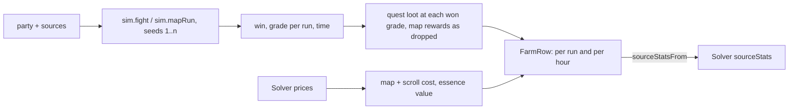

# Profit calculator

[Root](../../index.md) > [Tooling](../index.md) > [Profit Calculator](./index.md) > Profit calculator

`web/src/tools/profit.ts` (library; the [Profit page](../website/website.md#profit-page) runs it in a worker, the battle page prices scrolls with it). Implements the [game economy](../../game-economy/game-economy.md) cost chain.

## Table of contents

- [Sources of an item](#sources-of-an-item)
- [Modifiers](#modifiers)
- [Enchanting](#enchanting)
  - [Map enchanting](#map-enchanting)
- [Shared run cost](#shared-run-cost)
- [Map-only content](#map-only-content)
- [Solving the loop](#solving-the-loop)
- [Options](#options)
- [Outputs](#outputs)
- [Farming report](#farming-report)
- [Implementation](#implementation)
- [Enchant order, Reset, modded ingredients](#enchant-order-reset-modded-ingredients)
- [Not modelled](#not-modelled)

## Sources of an item

Each (item, asc) gets the cheapest of:

| Source | Unit cost |
|---|---|
| Quest | Share of `gold` (+ hero time) over expected drops; quest-board quests only (not `questType` 8) |
| Rare quest | Same with `goldB` and `rewardB*` |
| Map run | Map cost − loot credit, divided by essence amount; floored at 0 (see below) |
| Map-only loot | Whole run cost / expected drops per run (see [map-only content](#map-only-content)) |
| Other map loot | Its sell value (a by-product of the run; quests also give it) |
| Craft | Craft gold + ingredients at same asc + 1× essence if asc > 0 |
| Ascend | Item at asc − 1 + 4× essence |

The `how` column says which one won.

## Modifiers

- `sell` is the plain item; `sell_1mod`, `sell_2mod` with one or two modifiers.
- A craft route rolls modifiers from `--crafter-level` and the craft grade (ingredients at `--grade`).
  `p_prefix%`, `p_suffix%`, `p_both%` give the odds; `ev_sell` and `ev_profit` are expected values.
- An ascend route keeps the plain item plain, so its `ev_sell` = `sell`.
- Crafted maps roll too, so expected essence per run includes their modifiers (`--no-map-mods` to compare).
  `mapEssenceMultiplier` = (1 + prefix sell) × (1 + suffix atk) × the prefix's `mapStats.essenceMod` (Skilled ×1.25,
  Expert's ×1.5, read from the game data), rounded once as in `default.mapEssenceReward`; it matches the engine's
  `mapEssenceReward` on `finalMapStats` (`web/test/profit-map-essence.test.ts`).
- `ascend_modded_*.csv`: gain of upgrading an item you already own with 0/1/2 modifiers
  (`sell after − sell before − essence × cost`).
- Rules: [crafting](../../game-economy/crafting/crafting.md#modifiers), [selling](../../game-economy/selling/selling.md#base-value).

## Enchanting

`web/src/tools/enchant.ts`, equipment only:

- Expected cost of a first prefix and of a +1 suffix on an owned item: Markov chain over the attempt counter
  (rune amount grows with attempts; suffix failures can break and reset the counter).
- Rune and gem prices come from the solver (they are crafted materials). Ascended items add essence per attempt.
- Item grade for the odds = craft grade (from `--crafter-level` and `--grade`). Enchanter level: `--enchanter-level`.
- `best_strategy` = best of: sell as crafted, enchant to 1 modifier, enchant to 2 modifiers.
  Enchanting tops up whatever the craft rolled. Columns: `ench1_profit`, `ench2_profit`, `best_profit`,
  `best_margin%`, `enchant_min`.
- `enchant_*.csv`: per item and ascension, chance, expected attempts, cost, minutes and net gain of each enchant.
- Rules: [crafting](../../game-economy/crafting/crafting.md#enchanter).

### Map enchanting

- Each map (and asc-1 map) gets extra essence-source variants: a plain crafted map enchanted to suffix +N
  (N up to +16, or *8 at asc 1) with or without a first prefix. The cheapest per essence competes with "as crafted".
- Suffix climb: exact Markov chain over (tier, attempt counter), solved tier by tier. Its expected gold, runes,
  essence and attempts don't depend on prices, so they are computed once and priced inside the solver.
- `essence_sources_*.csv` gains an `enchant` column: the best enchanted variant of each map next to "as crafted".
- `--no-map-enchant` turns it off; `--map-suffix-max N` caps the tier (higher tiers make enemies stronger,
  which the model doesn't turn into a lower grade).
- Variants start from a plain map; they don't top up what the craft rolled.

## Shared run cost

A run drops several things. `--alloc` decides who pays:

- `value` (default): quest cost split in proportion to each drop's sell value.
  Map loot credited at sell value; the rest is the essence cost.
- `full`: every drop carries the whole run cost. No loot credit. Pessimistic: "I farm this only for X".

## Map-only content

Map bosses (quests 91–98) and Treasure Bushes (99–104) have `questType` 8: the quest board never draws them
(`scene.QuestMenu:drawEnemyLocations`), they are only fought inside a map run, room by room to the boss. So:

- They are not quest sources (before E20 they were, e.g. Khan's Horn "from quest Gnoll Khan, 1,200 g", Fire Rune and
  Oblivion Rune from the Treasure Bushes at 1,000 g).
- **Map-only loot** (an item no quest-board quest drops and no recipe makes: the bosses' trophies 265–272) costs a whole
  run per expected drop: `unit = run cost / drops per run`, the cheapest map that holds the enemy. Run cost = the map at
  Solver cost (craft gold + materials, lower maps included) + run hours × `heroHourCost` + craft hours ×
  `crafterHourCost`. No loot credit: the run is made for that item.
- **Time**: `Solver.hoursPerUnit` gives the hours per unit of essences and map-only loot: (craft hours + run hours) /
  amount per run. Craft hours = `mapCraftSeconds` (quest-stats.ts): ceil(floor(runTime × craftGradeSpeed[grade]) ×
  craftTimeMod) for the map and every lower map its recipe consumes, at the map's craft grade
  (`craftGrade(crafterLevel, itemLevel, grade)`). Run hours = `sourceStats` time or `baseMapTime`.

Before → after (default options, grade 3):

| Item | Before | After | Source after |
|---|---|---|---|
| Warlord's Edge (Goblin Warlord) | 150 g (sell value) | 20,007 g, 5.4 h | Goblin's Feast Map: 0.30/run, run 6,002 g, 1.62 h |
| Tidal Hilt (Murlok Monarch) | 250 g | 31,483 g, 7.3 h | Murlok Madness Map: 0.30/run, run 9,445 g, 2.19 h |
| Khan's Horn (Gnoll Khan) | 350 g | 47,390 g, 9.2 h | Gnoll Vendetta Map: 0.30/run, run 14,217 g, 2.77 h |
| Beastly Fang (Beast King) | 600 g | 118,034 g, 15.4 h | Beastly Burden Map |
| Eternity Stone | 750 g | 99,782 g, 7.7 h | Treant Revenge Map (1 per run) |
| Aeon Soul (Archon) | 1,500 g | 1,452,983 g | Archon's Reality Map (needs 3 Eternity Stones) |
| Forest / Glacial Essence | 4.04 / 113.07 g | 4.04 / 113.07 g | unchanged (time now reported: 0.004 / 0.04 h each) |

Essence luck: `mapEssence` multiplies by (1 + luck / 100) inside the rounding (`default.mapEssenceReward`,
`data.Default.lua:757`); the Solver passes its `luck`. At the default luck 0 nothing changes; at luck 50 Forest and
Water Essence become free by-products and Glacial Essence drops from 113 to 49 g.

## Solving the loop

- Maps cost essence, and essence costs maps.
- Repeated relaxation until no cost drops. Converges in a few passes (checked at 50 and 500).
- **Forced source that needs its own essence** (`essenceFrom`, e.g. Forest Essence from Hard Tuvale Map: 50 Forest
  Essence in the recipe, ~250 per run): the essence is seeded with a huge upper bound and the relaxation converges
  down to the fixed point `x = (map cost without the essence + run cost − loot credit) / (yield − essence used)`
  (Forest Essence 5.65 g from Hard Tuvale, 5.64 g from Tuvale-Yarsol; 4.04 g from the cheapest source). Before
  this, both stayed unpriced and 196 of 2,203 rows dropped out.
  When no positive solution exists (the map uses at least as much of the essence as a run yields: Treant Revenge,
  Golem Revenge, Archon's Reality with Glacial Essence; Vanquishers with Necro Essence), the essence stays unpriced
  and the Solver says so in `errors` (and `profitReport` prints a warning) instead of silently dropping rows.
- **Free by-products**: a map run whose other loot is worth more than the map makes its essence free. The cost
  is floored at 0, not negative: a negative essence price would pay you for using essence in every recipe, which
  overstates what that loot is worth once you stop selling it. Those sources say "free by-product" in `how` and
  `free_byproduct` = yes in the essence-sources table. Grade B: none. Grade A: Forest and Nature (Tuvale Map,
  +32 g per run on top of ~78 essence). Grade S: Forest, Water, Nature and Tidal (Tuvale / Yarsol Map, +148 to +198 g
  per run on top of ~95 essence).
- Full run takes about 5 s.
- `--essence-from "Forest Essence=Hard Tuvale Map"` or `"273=1@1"` forces one source, to compare map tiers.

## Options

| Option | Default | Effect |
|---|---|---|
| `--grade` | 3 | Quest/map grade 1..5 |
| `sourceStats` | none | Per quest (`"qid"`, `"qid\|rare"`) or map (`"mid\|asc"`): a grade distribution and hours per run from simulation, used instead of `grade` for that source's loot, essence and time (crafting odds keep `grade`) |
| `--luck` | 0 | Party luck |
| `--alloc` | value | See above |
| `--essence-from` | cheapest | Force an essence source (repeatable) |
| `--hero-hour-cost` | 0 | Gold per hour of quest/map time |
| `crafterHourCost` | 0 | Gold per hour of Scribe time (crafting the map of a run) |
| `--crafter-level` | 60 | Crafter level for modifier odds and craft grade |
| `--no-map-mods` | off | Ignore map modifiers in essence yield |
| `--enchanter-level` | 60 | Enchanter level; 0 disables enchant strategies |
| `--no-map-enchant` | off | Don't consider enchanted maps as essence sources |
| `--map-suffix-max` | none | Highest map suffix tier to enchant to |
| `--type` | equipment, consumable, map | Types in the ranking |
| `--sort` | best_profit | `best_profit`, `best_margin%`, `ev_profit`, `ev_margin%`, `ev_profit_per_craft_hour`, or the plain `profit`, `margin%`, `profit_per_craft_hour` |
| `--top` | 25 | Rows printed |

## Outputs

- `reports/profit_g<grade>_<alloc>.csv`: sell, cost, profit, margin %, craft minutes, profit per craft-hour, route.
- `reports/enchant_g<grade>_<alloc>.csv`: enchant odds, attempts, cost, time and net gain per item.
- `reports/ascend_modded_g<grade>_<alloc>.csv`: upgrade gain per item and ascension step for 0/1/2 modifiers.
- `reports/essence_sources_g<grade>_<alloc>.csv`: every map × essence with map cost, loot credit,
  cost per essence, and which one was chosen.

## Farming report

`web/src/tools/farming.ts`: where a party should spend its time. Each source is simulated with the combat engine;
win rate, grades and time come from the fights, the economy from the game's loot rules and the Solver's prices.

| Field | Meaning |
|---|---|
| `win`, `grade`, `grades` | Won share; average won grade; share of runs at each grade 1..5 |
| `time_h`, `runs_per_hour` | Hours per run (lost runs included); a map: craft + run |
| `craft_h`, `run_h` | Map: the Scribe's hours for the map (lower maps included) and the run's hours |
| `note` | A map-only quest source replaced by its map ("Murlok Monarch: only in map runs, farmed with …") |
| `map_only`, `map_only_unit_cost` | Map-only drops per run (trophies) and their cost each = run cost / drops per run |
| `cost` | Quest gold, or the map + every scroll equipped (the game removes them when the map starts) at Solver cost |
| `loot_value` | Base sell value of the loot per run, essence excluded |
| `essence`, `essence_total`, `essence_value` | Essence per run by name, total, and value at the Solver's unit cost |
| `gold_per_hour`, `essence_per_hour`, `value_per_hour` | (loot - cost) / h, essence / h, (loot + essence value - cost) / h |

- Quests (`Quest:endQuesting`, `Quest:createRewards`): time = battle time + quest time × amount × `gradeTime[grade]`
  (lost = grade 0, factor 2), speed bonus; loot only when won, at that fight's grade and the party's luck.
  The quest amount (one enemy with its HP × amount, 1 to `maxQuestAmount`) scales fixed drops and parcel
  odds/amounts (`lootService`), and the quest time; `questLoot(…, enemyAmount)`.
- Map runs use the engine's `Campaign` as is: rewards as dropped, essence at the run's grade (average of the rooms),
  time = battles + walking. Checked equal to `evaluateMap` on win, grade, time and essence.
- Map essence in the game is paid at the run's performance grade (`Campaign:getGrade`), not the map's crafted grade:
  that's why `sourceStats` replaces only the run grade.
- A quest source naming a map-only enemy (`questType` 8) is run as its map (`mapSourceFor`: the craftable map
  where it is fought most per run, lowest level on ties): Murlok Monarch → Murlok Madness Map.
- `sourceStatsFrom` passes the run hours (`run_h`); the Solver adds the craft time itself.

## Implementation

`web/src/tools/profit.ts` (with `enchant.ts`, `gamedata.ts`): runs in the browser (no `fs` outside `main`) and in Node.

- The options below were command-line flags of the former tool; they are `SolverOptions` / `ProfitOptions` fields now.
- In code: `profitReport(gameFromData(), {grade: 3, ...})` returns the four tables and the printed lines.
- Ported from the former `tools/profit.py` / `enchant.py` (removed 2026-11-23). Before deletion, stdout and all four
  CSVs were byte-identical to Python on 7 option sets (default, `--alloc full`, grade 1/2/4/5, luck, hero hour cost,
  `--essence-from`, `--type`, `--no-map-mods`, `--no-map-enchant`, `--map-suffix-max`, crafter/Enchanter levels,
  `--enchanter-level 0`, `--save`).
- Python's number semantics are kept on purpose, so reports read the same as before:
  - `round()` ties to even on the exact binary value (`pyRound`), `-0.0` kept.
  - int vs float cells (`35` vs `35.0`): costs are floats unless built only from integer sell values/gold (`Solver.costFloat`); `PyFloat` cells print like Python.
  - Tables iterate in ascending id order; suffix -1 (Worn) first.
- Tests: `web/test/profit.test.ts`.

## Enchant order, Reset, modded ingredients

Off by default (the report doesn't change); each has its own table for pages.

| Rule (game code) | Option / table | Result (grade 3, crafter and Enchanter 60) |
|---|---|---|
| Enchant before ascending: `AscendItem` keeps prefix, suffix and grade; ascending a modded item costs essence × (4 + mods) at its higher rarity | `enchantOrder`; `buildEnchantOrderRows` | Never cheaper (0 of 2,506 item × asc × mods). Ascension essence of a modded item outweighs the essence saved on enchant attempts |
| Reset before a prefix/suffix: `default.resetEnchant` raises the grade 0.4 per earlier reset | `resetBeforeEnchant` (0-8 resets); `buildResetRows` | Prefix: worth it for 214 of 1,971 item-asc (low craft grade, high level), median 3% saved. Suffix: never |
| Modded ingredients raise the craft's odds (`_prefixBoost` +20%, `_suffixBoost` +3% per tier) | `modifierOutcomes(…, boost)`; `buildIngredientBoostRows` | Enchanting the ingredient pays for 1 of 339 recipes (prefix) |

- `enchantOrderStrategies` reaches asc p with k mods from the plain item at asc q < p: cost(q) + enchant at q +
  ascension essence for each step with k mods; `best_strategy` lists it as "enchant to k mods at asc q, then ascend".
- `resetPath` gives the grade after each reset and the cumulative cost (gold `itemLevel × 20 + 20 × resets`,
  `1 + fibo` reset runes by level band, essence when ascended, `itemLevel × 2.5` s).
- Not modelled: the Enchanter's separate ascension level (`getEffectiveLevelForItem` uses the prestige level for an
  item at the Enchanter's ascension); resets between the two modifiers of a 2-mod plan; an ingredient that rolled a
  modifier for free when it was crafted.

## Not modelled

- Equipment suffix tiers above +1 (no price effect anyway).
- Stronger enemies from map suffixes (grade kept at `--grade`).
- Customer preference and haggle bonuses; buying from customers.
- Events, weekly shop, purchases.
- Crafter level, unlocks and crafter time as a bottleneck (reported per craft-hour; map craft time in `hoursPerUnit`).
- Level-70 maps (27–32) are still priced as if craftable (a Scribe caps at 60); they are never the cheapest source.
  The Profit page drops every row above level 60 (items, enchanting, orb sources).
- Battle time on quests; asc-1 map's stronger enemies lowering grade.
- 136 ids have no source: placeholders, event/weekly items, random maps.
