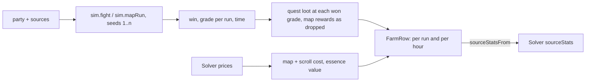

# Profit calculator

[Root](../../index.md) > [Tooling](../index.md) > [Profit Calculator](./index.md) > Profit calculator

`web/src/tools/profit.ts` (library; the battle page prices scrolls with it, no profit page yet). Implements the [game economy](../../game-economy/game-economy.md) cost chain.

## Table of contents

- [Sources of an item](#sources-of-an-item)
- [Modifiers](#modifiers)
- [Enchanting](#enchanting)
  - [Map enchanting](#map-enchanting)
- [Shared run cost](#shared-run-cost)
- [Solving the loop](#solving-the-loop)
- [Options](#options)
- [Outputs](#outputs)
- [Farming report](#farming-report)
- [Implementation](#implementation)
- [Not modelled](#not-modelled)

## Sources of an item

Each (item, asc) gets the cheapest of:

| Source | Unit cost |
|---|---|
| Quest | Share of `gold` (+ hero time) over expected drops |
| Rare quest | Same with `goldB` and `rewardB*` |
| Map run | Map cost − loot credit, divided by essence amount |
| Map-only loot | Its sell value (the gold given up by not selling it) |
| Craft | Craft gold + ingredients at same asc + 1× essence if asc > 0 |
| Ascend | Item at asc − 1 + 4× essence |

The `how` column says which one won.

## Modifiers

- `sell` is the plain item; `sell_1mod`, `sell_2mod` with one or two modifiers.
- A craft route rolls modifiers from `--crafter-level` and the craft grade (ingredients at `--grade`).
  `p_prefix%`, `p_suffix%`, `p_both%` give the odds; `ev_sell` and `ev_profit` are expected values.
- An ascend route keeps the plain item plain, so its `ev_sell` = `sell`.
- Crafted maps roll too, so expected essence per run includes their modifiers (`--no-map-mods` to compare).
- `ascend_modded_*.csv`: gain of upgrading an item you already own with 0/1/2 modifiers
  (`sell after − sell before − essence × cost`).
- Rules: [crafting](../../game-economy/crafting/crafting.md#modifiers), [selling](../../game-economy/selling/selling.md#base-value).

## Enchanting

`web/src/tools/enchant.ts`, equipment only:

- Expected cost of a first prefix and of a +1 suffix on an owned item: Markov chain over the attempt counter
  (rune amount grows with attempts; suffix failures can break and reset the counter).
- Rune and gem prices come from the solver (they are crafted materials). Ascended items add essence per attempt.
- Item grade for the odds = craft grade (from `--crafter-level` and `--grade`). Enchanter level: `--enchanter-level`.
- `best_strategy` = best of: sell as crafted, enchant to 1 modifier, enchant to 2 modifiers.
  Enchanting tops up whatever the craft rolled. Columns: `ench1_profit`, `ench2_profit`, `best_profit`,
  `best_margin%`, `enchant_min`.
- `enchant_*.csv`: per item and ascension, chance, expected attempts, cost, minutes and net gain of each enchant.
- Rules: [crafting](../../game-economy/crafting/crafting.md#enchanter).

### Map enchanting

- Each map (and asc-1 map) gets extra essence-source variants: a plain crafted map enchanted to suffix +N
  (N up to +16, or *8 at asc 1) with or without a first prefix. The cheapest per essence competes with "as crafted".
- Suffix climb: exact Markov chain over (tier, attempt counter), solved tier by tier. Its expected gold, runes,
  essence and attempts don't depend on prices, so they are computed once and priced inside the solver.
- `essence_sources_*.csv` gains an `enchant` column: the best enchanted variant of each map next to "as crafted".
- `--no-map-enchant` turns it off; `--map-suffix-max N` caps the tier (higher tiers make enemies stronger,
  which the model doesn't turn into a lower grade).
- Variants start from a plain map; they don't top up what the craft rolled.

## Shared run cost

A run drops several things. `--alloc` decides who pays:

- `value` (default): quest cost split in proportion to each drop's sell value.
  Map loot credited at sell value; the rest is the essence cost.
- `full`: every drop carries the whole run cost. No loot credit. Pessimistic: "I farm this only for X".

## Solving the loop

- Maps cost essence, and essence costs maps.
- Repeated relaxation until no cost drops. Converges in a few passes (checked at 50 and 500).
- Full run takes about 5 s.
- `--essence-from "Forest Essence=Hard Tuvale Map"` or `"273=1@1"` forces one source, to compare map tiers.

## Options

| Option | Default | Effect |
|---|---|---|
| `--grade` | 3 | Quest/map grade 1..5 |
| `sourceStats` | none | Per quest (`"qid"`, `"qid\|rare"`) or map (`"mid\|asc"`): a grade distribution and hours per run from simulation, used instead of `grade` for that source's loot, essence and time (crafting odds keep `grade`) |
| `--luck` | 0 | Party luck |
| `--alloc` | value | See above |
| `--essence-from` | cheapest | Force an essence source (repeatable) |
| `--hero-hour-cost` | 0 | Gold per hour of quest/map time |
| `--crafter-level` | 60 | Crafter level for modifier odds and craft grade |
| `--no-map-mods` | off | Ignore map modifiers in essence yield |
| `--enchanter-level` | 60 | Enchanter level; 0 disables enchant strategies |
| `--no-map-enchant` | off | Don't consider enchanted maps as essence sources |
| `--map-suffix-max` | none | Highest map suffix tier to enchant to |
| `--type` | equipment, consumable, map | Types in the ranking |
| `--sort` | best_profit | `best_profit`, `best_margin%`, `ev_profit`, `ev_margin%`, `ev_profit_per_craft_hour`, or the plain `profit`, `margin%`, `profit_per_craft_hour` |
| `--top` | 25 | Rows printed |

## Outputs

- `reports/profit_g<grade>_<alloc>.csv`: sell, cost, profit, margin %, craft minutes, profit per craft-hour, route.
- `reports/enchant_g<grade>_<alloc>.csv`: enchant odds, attempts, cost, time and net gain per item.
- `reports/ascend_modded_g<grade>_<alloc>.csv`: upgrade gain per item and ascension step for 0/1/2 modifiers.
- `reports/essence_sources_g<grade>_<alloc>.csv`: every map × essence with map cost, loot credit,
  cost per essence, and which one was chosen.

## Farming report

`web/src/tools/farming.ts`: where a party should spend its time. Each source is simulated with the combat engine;
win rate, grades and time come from the fights, the economy from the game's loot rules and the Solver's prices.

| Field | Meaning |
|---|---|
| `win`, `grade`, `grades` | Won share; average won grade; share of runs at each grade 1..5 |
| `time_h`, `runs_per_hour` | Hours per run (lost runs included) |
| `cost` | Quest gold, or the map + every scroll equipped (the game removes them when the map starts) at Solver cost |
| `loot_value` | Base sell value of the loot per run, essence excluded |
| `essence`, `essence_total`, `essence_value` | Essence per run by name, total, and value at the Solver's unit cost |
| `gold_per_hour`, `essence_per_hour`, `value_per_hour` | (loot - cost) / h, essence / h, (loot + essence value - cost) / h |

- Quests (`Quest:endQuesting`, `Quest:createRewards`): time = battle time + quest time × enemies × `gradeTime[grade]`
  (lost = grade 0, factor 2), speed bonus; loot only when won, at that fight's grade and the party's luck.
  The enemy count scales fixed drops and parcel odds/amounts (`lootService`); `questLoot(…, enemyAmount)`.
- Map runs use the engine's `Campaign` as is: rewards as dropped, essence at the run's grade (average of the rooms),
  time = battles + walking. Checked equal to `evaluateMap` on win, grade, time and essence.
- Map essence in the game is paid at the run's performance grade (`Campaign:getGrade`), not the map's crafted grade:
  that's why `sourceStats` replaces only the run grade.
- Not modelled: hero revive cost after a lost quest, hero XP.

## Implementation

`web/src/tools/profit.ts` (with `enchant.ts`, `gamedata.ts`): runs in the browser (no `fs` outside `main`) and in Node.

- The options below were command-line flags of the former tool; they are `SolverOptions` / `ProfitOptions` fields now.
- In code: `profitReport(gameFromData(), {grade: 3, ...})` returns the four tables and the printed lines.
- Ported from the former `tools/profit.py` / `enchant.py` (removed 2026-11-23). Before deletion, stdout and all four
  CSVs were byte-identical to Python on 7 option sets (default, `--alloc full`, grade 1/2/4/5, luck, hero hour cost,
  `--essence-from`, `--type`, `--no-map-mods`, `--no-map-enchant`, `--map-suffix-max`, crafter/Enchanter levels,
  `--enchanter-level 0`, `--save`).
- Python's number semantics are kept on purpose, so reports read the same as before:
  - `round()` ties to even on the exact binary value (`pyRound`), `-0.0` kept.
  - int vs float cells (`35` vs `35.0`): costs are floats unless built only from integer sell values/gold (`Solver.costFloat`); `PyFloat` cells print like Python.
  - Tables iterate in ascending id order; suffix -1 (Worn) first.
- Tests: `web/test/profit.test.ts`.

## Not modelled

- Reset to raise grade before enchanting; equipment suffix tiers above +1 (no price effect anyway).
- Stronger enemies from map suffixes (grade kept at `--grade`).
- Modifier boost from modded ingredients (`_prefixBoost`, `_suffixBoost`).
- Customer preference and haggle bonuses; buying from customers.
- Events, weekly shop, purchases.
- Crafter level, unlocks and crafter time as a bottleneck (only reported per craft-hour).
- Multi-enemy quests (parcel odds scale non-linearly).
- Battle time on quests; asc-1 map's stronger enemies lowering grade.
- 136 ids have no source: placeholders, event/weekly items, random maps.
