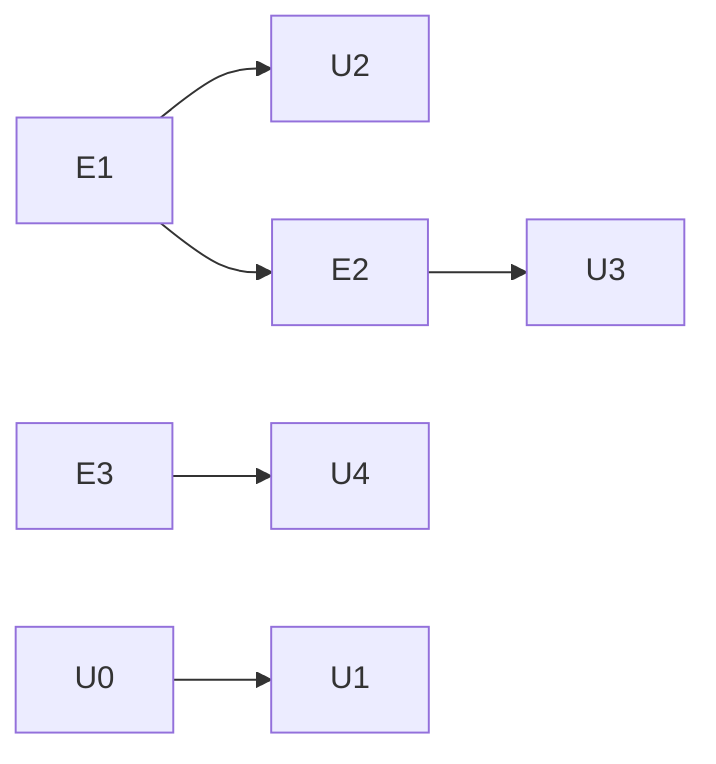

# Roadmap

[Root](../../index.md) > [Tooling](../index.md) > [Roadmap](./index.md) > Roadmap

## Table of contents

- [Sessions and ownership](#sessions-and-ownership)
- [Engine lane](#engine-lane)
- [UI lane](#ui-lane)
- [Dependencies](#dependencies)
- [Later](#later)
- [Open design questions](#open-design-questions)

## Sessions and ownership

The site is the only product ([website](../website/website.md)). Three Claude sessions share the repo:

| Session | Lane | Owns |
|---|---|---|
| "Merchant RPG simulator GitHub Pages setup" | Engine | `web/src/sim/`, `web/src/tools/`, `web/test/`, `docs/tooling/{combat-simulator,profit-calculator,website}/` |
| "Python simulator to TypeScript" | UI | `site/`, `web/src/ui/`, `web/scripts/` |
| "Lua game balancing tools" | Roadmap operator | this page, `docs/findings/`, `docs/game-economy/`; dispatches tasks |

Rules:
- Each session commits only the files it owns. A file outside the lane needs a hand-off message first.
- `web/src/tools/export-gamedata.ts` is in the UI lane until the wiki batch is committed (wikidata export).
- Push with `agent_utils.sh push`, then check the GitHub Actions run (CI + Pages).
- Every task ships with tests (`npm test`) and the OKF docs update of the folder it touches.
- New engine APIs are pure functions returning typed data, with a progress callback and a cancel check, so the
  web worker can run them. No `console` output and no `node:*` imports outside `export-gamedata.ts` and tests.

## Engine lane

| Id | Task | Status |
|---|---|---|
| E1 | **Structured search API.** `cmdSkills`, `cmdGear`, `cmdParty`, `cmdSolo`, `cmdMaps`, `cmdScrolls` (`web/src/tools/combat.ts`) print text through `IO`. Split each into a pure function that returns typed results (ranked candidates with their `FightEval`/`MapEval`), with `onProgress(done, total)` and `shouldStop()`. Text formatters become optional wrappers or go. | Dispatched |
| E2 | **Combat → economy link.** `farmingReport(sim, party, sources, n)`: for each quest / map × asc (with scrolls), win rate, grade, run time, essence and loot per run at the *simulated* grade, scroll cost per run (priced by `Solver`), essence/h and gold/h. `Solver` option to take a per-source grade and time instead of the global `grade` (won map runs end at grade 5, not 3). | Queued |
| E3 | **Equal-gear class balance.** `standardHero(classId, level, prestige, gearPolicy)` (best catalog gear with itemLevel ≤ level, default rotation) and `classMatrix(quests, n)`, to separate class power from the player's gear. | Queued |
| E4 | **CI-safe regression tests.** Fixed-seed snapshot tests using catalog/standard heroes only (no save data), for fights, map runs and `profitReport`, so CI catches drift without the local fixtures. | Queued |
| E5 | **Engine anomalies.** Archon takes 0% damage (unexplained); Goblin Warlord "Feast" not covered by any reference fight. | Queued |

## UI lane

| Id | Task | Needs | Status |
|---|---|---|---|
| U0 | Wiki, tooltips, save kept across pages (IndexedDB), top bar, radar chart, rotation rows, grade stacks | - | In progress |
| U1 | **Profit page** (`profit.html`) on `profitReport` (`web/src/tools/profit.ts`, already browser-safe): item ranking, enchant table, essence sources; options grade, luck, crafter/enchanter level, essence source. Plus the essence column in the save viewer's maps table. | - | Queued |
| U2 | **Search tabs on the battle page**: best rotation, best gear, best party for a quest or map run. | E1 | Queued |
| U3 | **Farming planner page**: where the player's party should spend hero time (essence/h, gold/h per quest and map). | E2 | Queued |
| U4 | **Class balance page**: class × quest win matrix on equal gear. | E3 | Queued |

## Dependencies

E2 reuses the map-run evaluation and scroll search from E1. U1 waits only for U0 because both edit `site/` and `web/src/ui/`.

## Later

- Economy model gaps: map suffix lowering the grade, quests against several enemies, Reset before a prefix,
  enchant before or after ascending, bonus modifier odds from modded ingredients, customer preferences and haggling,
  events and the weekly shop (most of the 136 items without a known source).
- Potions and permanent hero enchants in combat ("which help most").
- Joint gear + rotation + row + scrolls search for one fight.
- Levelling and prestige economics (XP per hour, is prestiging worth it).
- Validation against real combat logs (`quest_*.clog2`).

## Open design questions

For the game's author; see [findings](../../findings/findings.md#open-questions): essence cost following
level × rarity, price depending only on the modifier count, hard maps as poor essence sources, no craft modifiers on
level-60 gear, removing the level-70 maps.
