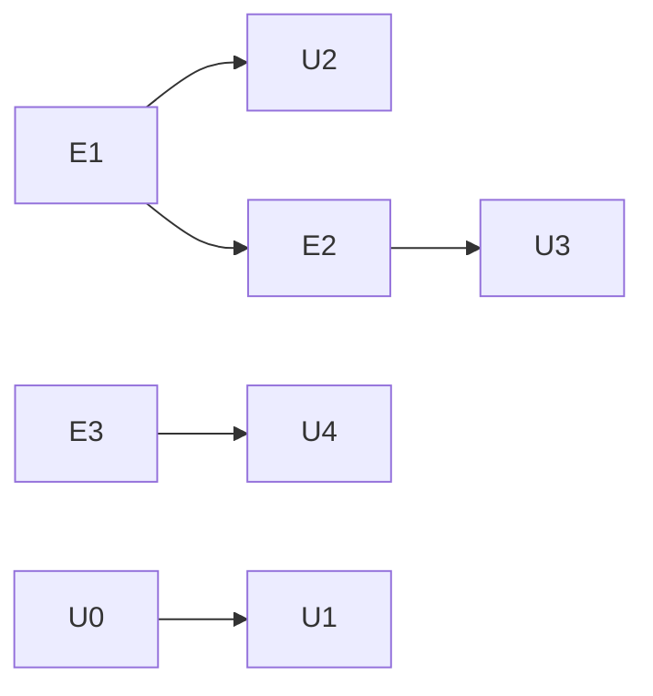

# Roadmap

[Root](../../index.md) > [Tooling](../index.md) > [Roadmap](./index.md) > Roadmap

## Table of contents

- [Sessions and ownership](#sessions-and-ownership)
- [Engine lane](#engine-lane)
- [UI lane](#ui-lane)
- [Dependencies](#dependencies)
- [Later](#later)
- [Open design questions](#open-design-questions)

## Sessions and ownership

The site is the only product ([website](../website/website.md)). Three Claude sessions share the repo:

| Session | Lane | Owns |
|---|---|---|
| Engine session [09e5f4] | Engine | `web/src/sim/`, `web/src/tools/`, `web/test/`, `docs/tooling/{combat-simulator,profit-calculator}/` |
| UI session [dae1e8] (offline since 2026-11-23; agents cover its lane) | UI | `site/`, `web/src/ui/`, `web/scripts/`, `docs/tooling/website/` |
| Roadmap session [515001] | Roadmap operator | this page, `docs/findings/`, `docs/game-economy/`; dispatches tasks, merges agent branches |
| Background agents (spawned by Roadmap) | One task each | a new file set per task, on a branch in their own worktree |
| Release agent (spawned by Roadmap) | Verify, commit, push, CI | nothing; commits the exact paths a lane hands over |

Session titles may change; the ref in brackets and the lane column are what count.

Rules:
- **Only the Roadmap side commits and pushes** (user rule, 2026-11-23), through its release agent so Roadmap stays free to steer. A lane session that finishes a task sends
  Roadmap its file list, a commit summary and its tsc / npm test / site build results; Roadmap commits, pushes and checks CI.
- Each session edits only the files it owns. A file outside the lane needs a hand-off message first.
- `web/src/tools/export-gamedata.ts` is in the UI lane until the wiki batch is committed (wikidata export).
- Roadmap pushes with `agent_utils.sh push`, then checks the GitHub Actions runs (CI + Pages).
- Every task ships with tests (`npm test`) and the OKF docs update of the folder it touches.
- New engine APIs are pure functions returning typed data, with a progress callback and a cancel check, so the
  web worker can run them. No `console` output and no `node:*` imports outside `export-gamedata.ts` and tests.

## Engine lane

| Id | Task | Status |
|---|---|---|
| E1 | **Structured search API.** `cmdSkills`, `cmdGear`, `cmdParty`, `cmdSolo`, `cmdMaps`, `cmdScrolls` (`web/src/tools/combat.ts`) print text through `IO`. Split each into a pure function that returns typed results (ranked candidates with their `FightEval`/`MapEval`), with `onProgress(done, total)` and `shouldStop()`. Text formatters become optional wrappers or go. | Done (fbe6c34; API in docs/tooling/combat-simulator "Search API") |
| E2 | **Combat → economy link.** `farmingReport(sim, party, sources, n)`: for each quest / map × asc (with scrolls), win rate, grade, run time, essence and loot per run at the *simulated* grade, scroll cost per run (priced by `Solver`), essence/h and gold/h. `Solver` option to take a per-source grade and time instead of the global `grade` (won map runs end at grade 5, not 3). | Done (8bf0e54: `web/src/tools/farming.ts`, `SolverOptions.sourceStats`) |
| E3 | **Equal-gear class balance.** `standardHero(classId, level, prestige, gearPolicy)` (best catalog gear with itemLevel ≤ level, default rotation) and `classMatrix(quests, n)`, to separate class power from the player's gear. | Done (5a02460) |
| E4 | **CI-safe regression tests.** Fixed-seed snapshot tests using catalog/standard heroes only (no save data), for fights, map runs and `profitReport`, so CI catches drift without the local fixtures. | Done (0ae0fe8; `web/test/snapshots/`, `npm run test:update-snapshots`) |
| E5 | **Engine anomalies.** Archon "0%": not a bug (self-heal + reflect, scored on end-of-fight HP). Feast: ported correctly; TS regression case added to E4. | Done |
| E6 | **Healing enemies read 0%.** `evaluate` scores the enemy by end-of-fight HP (`combat.ts`); also report the lowest enemy HP reached and total damage dealt. Small, after E1. | Done (ebb995d: `enemy_dmg_peak`, `enemy_dmg_total`; also fixed `searchGear` restore of empty slots) |
| E7 | **Economy model gaps** (confirm each in `decompiled/` first): enchant before vs after ascending; Enchanter Reset to raise grade before a prefix; bonus modifier odds from modded ingredients. | Done (54b2646) |
| E8 | **Class matrix on the E1 search**: `classMatrix` uses `searchSkills` from `combat.ts`, cheaper default (one search per class on a reference quest). | Done (527fc30) |
| E9 | **Joint fight optimiser** (user's original ask): `optimiseFight` alternates party + rows, rotations/passives, owned gear (no item used twice) and scrolls until no gain; per-round trace; worker-safe. | Done (436dc34) |
| E10 | **Potions and permanent hero enchants in combat**: which help most per class / fight (rules from `decompiled/` first). | Done (6305395) |
| E11 | **Profit-model fixes from U1**: a forced essence source whose map needs that essence leaves it unpriced (cycle, solve as a fixed point or error); essence cost floored at 0 g at grade 5 (flag "free by-product" or allow negative). | Done (cf8901c) |
| E12 | **Levelling and prestige economics**: XP per hour per quest/map for a party (simulated grade, time), hours to take a hero 1 → 60, cost and payoff of prestiging (tier stats, ×N quest size, enchant slots), with progress/cancel. | Done (7345aa9) |
| E13 | **Schedule base** (user: must): targeting and effect-duration rules from the game code; effect tags for every skill (probe-verified); enemy 5-turn timelines as committed data + `tools/schedule.ts`; a counter-schedule heuristic validated against simulated rankings. | Done (1570ca8) |
| E14a | **Order and timing steps in `optimiseFight`**: 36 within-row orders, front/back swaps, per-hero rotation phase shifts (1–4 slots), each kept only if it gains. | Done (c808fa0) |
| E14b | **Schedule pre-filter**: rank candidate rotations with the E13 heuristic and simulate only the top ones in `searchSkills` / `optimiseFight`, so party-wide rotation search fits the time budget. | Done (3fd47cd) |
| E15 | **Offline warm start**: best rotation per class × enemy × tier generated locally (E8 class matrix), committed as data; searches start from it. | Done (60d385b) |
| E16 | **Death and revive model in scoreSchedule** so Revive rotations (Cleric vs Demon Mage ×5) are not filtered out. | In progress (engine session) |
| E17 | **Top-K party search** (user): `searchParties` grows parties from min to max size until enough configurations win; each with rows/order, per-hero rotations (pre-filter + warm start) and, for maps, optional scrolls; ranked by win, then fewest heroes, then score. | Done (ece6f08, incl. E17b rule fixes) |
| E18 | **Expansions library** (user): `tools/expansions.ts`: contentExpansion rules (Frozen: region 6 Frentir, Bard, prestige 3 / level 51–60, region-6 materials, L51–60 gear; Scribe: crafter 8, maps, scrolls, item ascension, essences, map materials, gear 764–780) and inferExpansions(save) from save signals (ownership itself lives in UserInfo.usr, which the site doesn't read); docs/game-economy/expansions. | Done (5c910f2) |
| E19 | **Game translations export** (user): the install's Localization JSONs (EN, FR, DE, ES, BR, RU, IT, PL) trimmed to game-content names/descriptions → `inventory/i18n/<lc>.json`; `tools/i18n.ts` lookup. | Done (b85a0e4) |
| E20 | **Map-only content economics** (user): map bosses, Treasure Bushes and map-only drops need the whole map run (map craft cost + craft time + run time, map win rate), so no standalone "quest" for them in levelling/farming/profit; per-unit price of map-exclusive items; duplicate levelling bands merged; `questStats` / `mapRunStats` helpers (XP, time, XP/min). | Done (a3bc564, 6d52704) |
| E21 | **Required front-middle slot** (user): some battles/maps require a hero in front 2; find the rule in the game, enforce it in every party search and evaluation, expose `requiredSlots`. | Done (cfc8da6) |
| E22 | **Engine follow-ups from the solver**: empty front row (back-only parties won Murlok in 1 turn; check the game's targeting fallback); scorer "✓" notes ignore forced-Basic windows (Drown); searchParties/searchScrolls overrun the time budget (148 s for 120 s). | Done (609d160…3f877f4): empty front row = game behaviour; searches stop on time; Drown scored |
| E23 | **Hero id 0 read as an empty slot** in `partyProblem` (party quests refused the save's first hero in Front 2). | Done (merging) |
| E24 | **Effect windows off by one?** Ancient Mist reads "3 turns" but the timeline covers 4; verify durations vs the action order and fix the probe or label every window. | Done (3cdc842): windows were right; lastsHeroActions/lastsEnemyActions added |
| U28 | **Expansion-aware site** (user decisions): ownership = inference from the save + manual "I own Frozen / Scribe" toggles; Frozen AND Scribe content hidden by default when not owned (a "show expansion content" toggle), always labelled with the expansion icon; a wiki Expansions page; the example save owns both. | E18, U24–U26 | Done (d055d55, d0dcbb8) |
| U29 | **Language picker** (user): game names and descriptions (items, skills, enemies, maps, classes, prefixes) follow the chosen language across the wiki and tools; the site's own UI stays English; English fallback; per-language lazy load. | E19, U28 | Done (ab2a203) |
| U30 | **Wiki cross-links**: link stats and battle terms on existing wiki pages to the Stats/Battle reference anchors (list from U25: Eva → hit-chance, Def → defence, grade, luck, AP, ascension → essence, …). | U28 | Done (217c5f3) |
| U31 | **Stats/Battle pages v2** (user): no title/description; topics as a sticky side panel (Topics button on mobile); no code-line citations on the page; "Two kinds of battle" section (quests vs Scribe maps). | - | Done (a28bdf2) |
| U32 | **Battle page: plan effects + Clear all** (user): a "Clear all" button empties every hero slot; enemy effects on heroes (force-action such as Drown → abilities disabled, stuns, stat debuffs) drawn on the hero cells of the turns they cover, with the skill crossed out and "Basic" shown; depends on correct effect windows (Drown: E17b check). | U28, E17b | Done (7a380ef, d75a46f) |
| U33 | **Quest XP, time and XP/min** (user): shown on wiki enemy pages and in battle results, from `questStats` (E20); map runs show craft + run time. Required front-middle slot: handled in U27/U32. Frozen levelling page: show `source.label` (map steps) instead of the boss name; use `isBoardQuest` where pages build quest lists. | E20, E21 | Done (merging), incl. a battle-page fix for hero 0 in Front 2 |
| U34 | **Modded item names** (user): "[Prefix] Item +N" built from translated parts (fixes translations of modded items); redundant "… page in the wiki →" links removed. | - | Done (58c99aa; U34b b9e07c5: no "du/de" in brackets) |
| U35 | **Menus** (user): regular header menus with section sub-menus (Wiki, Save…); burger + left drawer on mobile; frozen tools under "More". | - | Built (84ef8a3), merging after U36 |
| U36 | **Battle page v4** (user): only Simulate and Solve; Solve shows ≤ 5 results within 25% of the best, never 0%; opponent remembered; enemy radar scaled to the global max per stat, HP follows quest size; include/exclude checkbox per hero card (extra heroes auto-disabled over the quest size); no timeline strip in the enemy panel; enemy picker grouped Region / Region – Event / Region – Map (map-exclusive only); 5-turn plan as a third column grid (heroes + enemy × turns), compact text, effect sources in brackets, heroes' effects on the enemy, no schedule score; translated skills. | - | Built (9b0e605, 8a1ca26), merging |
| R1 | **Live site review** (user, while away): an agent browses the live site (home, save viewer, hero pages, battle, wiki; not the frozen pages) at 1280/375, dark/light, with/without the example save, several languages; reports inconsistencies between the "same" panels, visuals and improvements → a prioritised backlog for the user to review. | After U27, U30, U32 | Done: [findings](./review-r1.md) |
| R1-A | **Review fixes, battle page** (user: "schedule all backlog"): F02 useful default opponent + party, F06, F11/F12 (battle part), F20, F22, F24, F29, F35, F36. | R1 | Done (6137641) |
| R1-B1 | **Review fixes, wiki enemies/maps/XP**: F03, F04, F08, F11 (lists), F14, F15, F16, F17, F19, F40 (enemy/map pages), F41, F42, F44. | R1 | Done (9a0fe84) |
| R1-B2 | **Review fixes, wiki items/skills/classes/reference/expansions**: F07, F11 (skills/items), F18, F25, F26, F31, F33, F39, F40 (their pages), F43, F44 (Battle page). | R1 | Done (27bda45) |
| R1-C | **Review fixes, shared UI**: F05 grade contrast, F13 table headers, F27 one toggle style, F28 gold/time formats, F30 type labels, F32 home cards, F34 skip link, F35 orphan cards, F37 hero page AP, F38 save help, F45 save menu. | R1 | Done (6091280) |
| R1-D | **Adopt the shared helpers** (follow-up of R1-C): wiki and battle use `gold()`, `duration()`, `itemTypeText`, `segmented()` / `chip-toggle`; one set of slot names (Chest/Bracers/Talisman vs Body/Hands/Trinket); delete the old `data-save-help` markup; plan "TURN" label overlap; map "Essence per run" icon spill; the Expansions wiki page stops re-explaining the switches. Also: Treasure Bush enemy pages say "crystals and gems" (not "crystals, stones and other special materials"); map base time uses `duration()`; drop the unused `.ref-kind-tag` style. | R1-B2, R1-C | Done (a539f2e) |
| R1-E | **Battle page stat overlap and enemy header** (found after R1): hero card stat values never run together ("1,183 1,159"), stats of 5+ digits shortened with the full value in a tooltip; the plan's enemy column header shows the full name. | R1-A | Done (a6abccb) |
| U37 | **Wiki tables**: craft cost, cost total (cumulative, incl. materials at avg gold/unit and basic crafted parts like bars) and sell value as columns, each one cell with 3 ascension values in outlined asc-colour boxes, no "g"; maps get cost, cost total, sell, asc0/asc1; drop "Description" column (hover has it); "Made by" → "Origin"; sell ranges removed from tables (avg kept); enemies: one "Region" column without kind duplicated, drop "Maps" count column; skill details: base and rare enemies on one line, rows ordered by region. | R1 | Done (aa0c517) |
| U38 | **Page load and back navigation**: no flash of the save file picker while a page loads (Save, Battle, others); going to another page and back restores the scroll position. | R1 | Done (dcf36b4) |
| U39 | **Battle: radar, plan drawer, timeline**: radar drops HP, scales to the max stat, EVA max fixed at 200; the plan becomes a second tab, the main working view (flow diagram): the hero is changed from the column header, a skill by clicking a cell in turns 1–5; flow and Party tabs share one state; for a map run, a horizontal bar picks which battle of the map to view (map order, left to right); the full combat, every turn until the fight ends, with HP shown and a divider every 5 turns (turns 1–5 are the editable rotation); cells become a timeline: one sub-line per fighter action, the skill in the actor's column, damage/heal as main text on the target, active buffs/debuffs as chips (prototype the layout first); Solve's spoiler disclaimer covers the whole page content. | R1 | Done (8516f7c) |
| U40 | **Battle Flow, round 2**: Party tab first; the enemy is changed by clicking its name in its column, like heroes; the end-of-turn summary gets its own background with HP and effects, all HP bars aligned; no "every hero" group, each hero lists its effects; effects shown as plain text (e.g. "+15% Def") with a "<skill> from <hero>" tooltip, values updated live as the fight changes them (Enrage growing with damage taken, effects that double debuffs…); damage and heals get a "calculation" toggle that shows the exact formula with real values, each number with a tooltip saying where it comes from; no damage shown on a fighter after it falls (check whether it's the trace or the engine). Add-ons: edits over the AP limit refused in both views with an error toast (fixes the Flow resetting skills to Basic); rooms after the party died show only "Party died, battle skipped". | U39 | Done (03da3d5) |
| E25 | **Solver ranks scroll-free parties higher**: among Solve results, runs that need no scrolls rank above those that do. | U39 | Done (439291a) |
| U41 | **Solver page**: the Battle menu gets two entries, "Simulator" and "Solver"; Solve moves to its own page; the Party and Flow tabs stay hidden until a solve has run; the page asks first what to solve (inputs), then lists the results; "Load" becomes "Show", which reveals the Party and Flow tabs for that result. | U40 | Done (dcb1948) |
| U42 | **Solver layout**: one full-width Solve panel holding the quest/map toggle and opponent picker, smallest/largest party, include scrolls and the time budget (30 s); no Quest enemy/Map run tabs or enemy card during setup (the card comes back with the results); no "1 What to solve" / "2 Results" headings; results hidden until a solve completes, full width under the panel. Add-on: with Scribe hidden, both Simulator and Solver hide everything map-related (map run toggle, pickers, scrolls, battle bar). | U41 | Done (3e40574) |
| U43 | **Simulator results, compact**: first only win % and average grade, then a "Show details" button for the rest; smaller stat cards; essence per run placed properly; "before XP bonuses" removed; the summary table adds each hero's HP left at the end; average and worst-case turn count (worst room for maps) against the game's turn cap. | U41 | Done (022fca9) |
| U44 | **Menus**: the Save sub-pages move into the same dropdown as the save selection; Export CSV lists "All" first; the "Battle" menu entry only opens its dropdown (like More), no page; no sub-page chip row on the Battle pages. | U41 | Done (4457f1c) |
| U45 | **Menu fixes after the U44 browser check**: top-bar dropdowns stay 8 px inside the screen at every width (the save menu was 38 px off the left edge on phones); on the Save pages the top-bar Save button is marked current; check-site accepts that mark. | U44 | Done (452dd93) |
| P1 | **Profit page, first batch** ([review-profit](./review-profit.md) B1–B12): no level-70 content, shared formatters and toggles, Scribe-hidden orb UI, explanation sentences removed, translated names, phone layout with a sticky first column, Only gains in Enchanting, no in-page save panel. | review-profit | Done (11e2b36) |
| F1 | **Farming page, first batch** ([review-farming](./review-farming.md)): legal party per quest (size and required slot, like the Simulator), Battle locks kept, revive gold subtracted, quest-board quests only, worker kept alive, grade badges, shared helpers, no explanation sentences, Scribe-hidden maps, sortable Source / Essence, 30 runs per map. | review-farming | Done (1668383) |
| R2-B | **Save viewer on phones** ([review-r2](./review-r2.md)): one-line inventory filter, compact hero stat grid with a folded radar, one-line passive, merged Basic turns, themed gear cards with outline legend, crafter headers Lv / Asc 1 / Asc 2, two-button no-save picker on every save page, tooltips instead of paragraphs, one-line empty states. | review-r2 | Done (1345f9b) |
| F2 | **Farming page, second batch** ([review-farming](./review-farming.md)): random-offer tag on rare variants, Win and Grade beside Source, steps Party then Rank then sources with tick counts, event bosses grouped and unticked, stale results dimmed, craft time tooltip, game-mode note, even Scrolls row. | F1 | Done (7d2ccf3) |

## UI lane

| Id | Task | Needs | Status |
|---|---|---|---|
| U0 | **User's site review (8 items):** 1 remove "How it works"; 2 GitHub link kept, moved to a header; 3 save picker opens "Pictures"; 4 party stats as a radar chart with values shown; 5 items/skills/passives/maps clickable to a Wiki page + hover tooltip summary; 6 rotation as rows; 7 grades as "14 × C" with a styled letter; 8 save kept across pages (no re-upload). Browser-checked: all ✓ except 3 partial (picker reopens the last save folder; %APPDATA% can't be preset for the first pick). | - | Done (a0be74b); item 3 partial: first pick cannot preset %APPDATA% |
| U5 | **Ascension outlines** (user request): asc 1 = silver outline, asc 2 = gold, replacing the "asc N" text; one helper applied wherever an item/map with `prestigeLevel` is rendered (targets derived, not listed by hand); hero/crafter prestige checked separately. | U0 | Done (9f246d3) |
| U6a | **Wiki review** (user): enemy names in the skills list; class page with the radar + growth curves side by side, compact white bold AP badge, passives before skills in the same table, whole row clickable with hover. | - | Done (38b841e) |
| U6b | **Save viewer review** (user): hero overview as a sortable table + per-hero details page; no "×" in inventory grades; crafters: no name outline / Asc column, instead Level / Asc 1 level / Asc 2 level (`Crafter:getEffectiveLevelForItem`). After a save is imported, the drop zone and file status collapse into one discreet "change save" button at the top (once, in `save-source.ts`, on every page). | U3 | Done (af277a8) |
| U6c | **Enemy wiki pages** (user): Enemies list + enemy page (stats normal/rare, skills, drops, maps); enemy names link there; quests such as "Forest Gathering" excluded by a static, commented enum `NON_ENEMY_QUEST_IDS`. | U6a | Done (d83384f) |
| U7 | **"Optimise this fight" on the battle page** on `optimiseFight` (E9): time budget 2 / 5 / 10 min, per-step trace (round, step, before → after, change), "Use this setup", comparison with the best party alone. | E9 | Folded into U8 (optimiser = one of the modes) |
| U8 | **Battle page rework** (user): mode first (Simulate / Best rotation / Best gear / Best party / Best scrolls / Optimise everything) decides which inputs show (best party asks for the opponent only); party in two columns (Back n, Front n); opponent card on the right like the heroes, dedicated map card; quest size ×1…×5 = one enemy with HP ×N (cap prestige×2−1), not "N enemies". | U6b, E9 | Done (08fb50e) |
| U9 | **Potions tab** on the battle page (U8 mode "Best potion / enchant"): `rankConsumables` per hero for the chosen opponent, gain per 1,000 g, free enchant slots; plus a class × potion view from `consumableMatrix` (wiki or class page). | E10, U8 | Done (9055014) |
| U10 | **Save viewer overview** (user): the big summary cards become a compact first tab "Overview" (default); the ascension legend is removed (save viewer by agent; wiki by the UI session). | U6b | Done (9fa46f6) |
| U12 | **Levelling page** on `levellingPlan` / `prestigePayoff` (E12): pick a hero (from the save), target level, companions; the plan per level band (quest, size, runs, hours, XP/h, revive gold), and the prestige panel (next tier's gains vs gold and relevel hours). Gathering quests shown, labelled "gathering". | E12 | Done (c2b29fd) |
| U13 | **Site-wide quality pass**: favicon, landing overview of the tools, consistent loading/empty/error states and number formats, keyboard and screen-reader pass, and a local headless regression sweep of every page (1280/375, light/dark, with and without a save). | - | Done (b0bcb9b) |
| U14 | **Titles bug + width** (user): page titles appear then disappear on every page; content +20–25% wider. | - | Done (d71da2f) |
| U15 | **Battle layout v2** (user): enemy always on the left, the 6 hero slots on the right in every mode (Best party / Optimise fill them); hero cards without radar, stats as a compact table, compact rotation/passive chips. | U14 | Done (68b3995) |
| U16 | **Game colour theme** (user: colours only, no pixel art or fonts): taupe-brown panels, gold borders, sand insets, red banner top bar, rarity-coloured item frames; light parchment variant. | U15 | Done (866981e) |
| U17 | **Save viewer v3** (user): Overview as compact cards; inventory grades as numeric columns (one per grade + total); crafters' ascension levels as "Level" + silver/gold icon headers. | - | Done (73f6fb7) |
| U18 | **Small moves** (user): Class balance to the top bar (out of the wiki; no improvements yet); save viewer CSV export into the save dropdown, instruction lines removed. | U14 | Done (a7dde18) |
| U19 | **Wiki v3** (user): recipe chains (equipment items only, no ingots or other materials) as a horizontal box-and-arrow diagram (gold, time, total time; no raw materials); "+NaN" stats fix (e.g. Archanos); game rarity colours and names; equipment parsing audit ("Region 5 item", kind None); class page: asc 0/1/2 = standard/silver/gold curves and 3-tier radar, no Crit, formula off the title, level caps 50/50/60 with ascension markers, click/slider to fix a level and update the stat cards; hero skill pages list the enemies the skill is good against (from E13 timelines). | - | Done (b082528, 446bb1c) |
| U20 | **Phone navs + example save** (user): top bar and in-page chip navs on one line on phones (superseded by U35's burger drawer); "Try with an example save" loads an anonymised copy of the user's save (userID neutralised, purchase flags off; regenerated by `web/scripts/make-example-save.ts`). | U16 | Done (2f9f898, 7690189) |
| U21 | **Wiki enemy/map fixes** (user): full-width banner section titles on wiki detail pages; win rewards and loot rolls as tables with "Nothing" as a row; map room enemies' Skills column always "Basic" (bug); skill "Good against" as a table with T1–T5 columns (reasons in tooltips); wiki tab titles/descriptions moved to the wiki home. | - | Done (b89bdaa, 31aa3a7) |
| U22 | **Hero page v2** (user): rotation rows like the wiki (whole row clickable, AP badge) with "Remaining x / y AP"; passive before rotation everywhere; gear in two columns (weapon/head/chest · hands/feet/trinket) via a shared `dom.ts` helper. | - | Done (c822cbf) |
| U23 | **Battle page v3 + page headers** (user): opponent on the RIGHT; hero slots the same size empty or filled, rotations always visible (no fold-out); the 5-turn plan below; step 3 merged into step 1; gear in two columns and passive first on hero cards; remove the per-page title + description block on every page (the home cards describe the tools). | U20, U22 | Done (def8837) |
| U24 | **Wiki fixes + regions** (user): enemy page without Rotation (descriptions in clickable timeline cards); drops with a rarity column, "Nothing" first, no B highlight; no data-source notes, explanations moved to "?" tooltips; "Good against" unlimited; Treasure Bushes listed; enemies sorted by level; a region model (Tuvale, Yarsol, Aldur, Vulkrum, Grimhal, Frentir, plus event and map-exclusive bosses) for sorting and grouping. | - | Done (b448842) |
| U25 | **Wiki reference pages** (user): "Stats" (every formula, anchored, sourced) and "Battle" (how a fight works), linkable from other pages. | - | Done (4421442) |
| U26 | **Battle results order + centered numbers** (user): results and progress right after the mode section, before party/opponent; numeric columns centered site-wide. | - | Done (e803565) |
| U27 | **One "Best party" mode** (user): merges Best party, Best rotation and Best scrolls (scrolls = a checkbox, maps only); min/max party size fields (1–6); a table of the top 5–10 configurations (size, party, rotations, scrolls used, win, turns/grade) with a "Load" button that fills the slots below. **Spoiler guard:** the solver starts hidden behind a disclaimer (it gives the answer and can spoil the fun; try the simulation first; use at your own risk); after accepting, a short warning stays visible. | E17, U26 | Done (7a380ef, d75a46f) |
| U11 | **Timelines in the UI**: enemy 5-turn timeline strip on enemy wiki pages and the battle opponent card; "why this rotation" notes (e.g. "Cleanse on T3 after Dark Curse on T2"); warm start in the battle searches. | E13, U8 | Done (c2be8b9) |
| U1 | (Agent after U0 is pushed: new `site/profit.html` + `web/src/ui/profit.ts`, top bar from `wiki.html`, reuse `dom.ts`, `itemLink`, `initSaveSource`, one esbuild line in `assemble-site.sh`; the UI session does the save-viewer essence column and the nav links.) **Profit page** (`profit.html`) on `profitReport` (`web/src/tools/profit.ts`, already browser-safe): item ranking, enchant table, essence sources; options grade, luck, crafter/enchanter level, essence source. Plus the essence column in the save viewer's maps table. | - | Done (1bf8501); nav links, save-viewer essence column and asc pills follow with U3 |
| U2 | **Search tabs on the battle page**: best rotation, best gear, best party for a quest or map run. Show the "lowest" enemy HP (`enemy_dmg_peak`, E6) next to HP removed. | E1 ✓ | Done (6dfca22) |
| U3 | **Farming planner page**: where the player's party should spend hero time (essence/h, gold/h per quest and map). | E2 | Done (17fe2c2) |
| U4 | **Class balance page**: class × quest win matrix on equal gear. | E3 | Done (7dbef8d) |

## Dependencies

E2 reuses the map-run evaluation and scroll search from E1. U1 waits only for U0 because both edit `site/` and `web/src/ui/`.

## Later

- **Frozen by the user (2026-11-23, extended 2026-11-24):** no new work on the Profit, Farming, Levelling and Class balance pages; they are also left out of reviews.

- Economy model gaps: map suffix lowering the grade (E2 now simulates it), quest size ×N (E2 scales loot and time), Reset before a prefix (E7),
  enchant before or after ascending, bonus modifier odds from modded ingredients, customer preferences and haggling,
  events and the weekly shop (most of the 136 items without a known source).
- Potions and permanent hero enchants in combat ("which help most").
- Joint gear + rotation + row + scrolls search for one fight.
- Levelling and prestige economics (XP per hour, is prestiging worth it).
- Validation against real combat logs (`quest_*.clog2`).

## Open design questions

For the game's author; see [findings](../../findings/findings.md#open-questions): essence cost following
level × rarity, price depending only on the modifier count, hard maps as poor essence sources, no craft modifiers on
level-60 gear, removing the level-70 maps.
