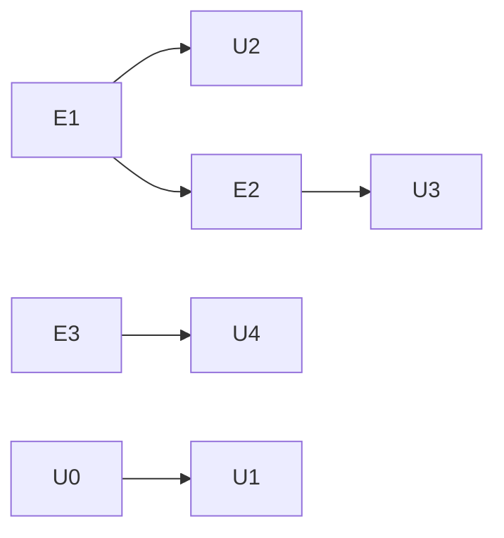

# Roadmap

[Root](../../index.md) > [Tooling](../index.md) > [Roadmap](./index.md) > Roadmap

## Table of contents

- [Sessions and ownership](#sessions-and-ownership)
- [Engine lane](#engine-lane)
- [UI lane](#ui-lane)
- [Dependencies](#dependencies)
- [Later](#later)
- [Open design questions](#open-design-questions)

## Sessions and ownership

The site is the only product ([website](../website/website.md)). Three Claude sessions share the repo:

| Session | Lane | Owns |
|---|---|---|
| Engine session [09e5f4] | Engine | `web/src/sim/`, `web/src/tools/`, `web/test/`, `docs/tooling/{combat-simulator,profit-calculator,website}/` |
| UI session [dae1e8] | UI | `site/`, `web/src/ui/`, `web/scripts/` |
| Roadmap session [515001] | Roadmap operator | this page, `docs/findings/`, `docs/game-economy/`; dispatches tasks, merges agent branches |
| Background agents (spawned by Roadmap) | One task each | a new file set per task, on a branch in their own worktree |
| Release agent (spawned by Roadmap) | Verify, commit, push, CI | nothing; commits the exact paths a lane hands over |

Session titles may change; the ref in brackets and the lane column are what count.

Rules:
- **Only the Roadmap side commits and pushes** (user rule, 2026-11-23), through its release agent so Roadmap stays free to steer. A lane session that finishes a task sends
  Roadmap its file list, a commit summary and its tsc / npm test / site build results; Roadmap commits, pushes and checks CI.
- Each session edits only the files it owns. A file outside the lane needs a hand-off message first.
- `web/src/tools/export-gamedata.ts` is in the UI lane until the wiki batch is committed (wikidata export).
- Roadmap pushes with `agent_utils.sh push`, then checks the GitHub Actions runs (CI + Pages).
- Every task ships with tests (`npm test`) and the OKF docs update of the folder it touches.
- New engine APIs are pure functions returning typed data, with a progress callback and a cancel check, so the
  web worker can run them. No `console` output and no `node:*` imports outside `export-gamedata.ts` and tests.

## Engine lane

| Id | Task | Status |
|---|---|---|
| E1 | **Structured search API.** `cmdSkills`, `cmdGear`, `cmdParty`, `cmdSolo`, `cmdMaps`, `cmdScrolls` (`web/src/tools/combat.ts`) print text through `IO`. Split each into a pure function that returns typed results (ranked candidates with their `FightEval`/`MapEval`), with `onProgress(done, total)` and `shouldStop()`. Text formatters become optional wrappers or go. | Done (fbe6c34; API in docs/tooling/combat-simulator "Search API") |
| E2 | **Combat → economy link.** `farmingReport(sim, party, sources, n)`: for each quest / map × asc (with scrolls), win rate, grade, run time, essence and loot per run at the *simulated* grade, scroll cost per run (priced by `Solver`), essence/h and gold/h. `Solver` option to take a per-source grade and time instead of the global `grade` (won map runs end at grade 5, not 3). | Done (8bf0e54: `web/src/tools/farming.ts`, `SolverOptions.sourceStats`) |
| E3 | **Equal-gear class balance.** `standardHero(classId, level, prestige, gearPolicy)` (best catalog gear with itemLevel ≤ level, default rotation) and `classMatrix(quests, n)`, to separate class power from the player's gear. | Done (5a02460) |
| E4 | **CI-safe regression tests.** Fixed-seed snapshot tests using catalog/standard heroes only (no save data), for fights, map runs and `profitReport`, so CI catches drift without the local fixtures. | Done (0ae0fe8; `web/test/snapshots/`, `npm run test:update-snapshots`) |
| E5 | **Engine anomalies.** Archon "0%": not a bug (self-heal + reflect, scored on end-of-fight HP). Feast: ported correctly; TS regression case added to E4. | Done |
| E6 | **Healing enemies read 0%.** `evaluate` scores the enemy by end-of-fight HP (`combat.ts`); also report the lowest enemy HP reached and total damage dealt. Small, after E1. | Done (ebb995d: `enemy_dmg_peak`, `enemy_dmg_total`; also fixed `searchGear` restore of empty slots) |
| E7 | **Economy model gaps** (confirm each in `decompiled/` first): enchant before vs after ascending; Enchanter Reset to raise grade before a prefix; bonus modifier odds from modded ingredients. | Done (54b2646) |
| E8 | **Class matrix on the E1 search**: `classMatrix` uses `searchSkills` from `combat.ts`, cheaper default (one search per class on a reference quest). | Done (527fc30) |
| E9 | **Joint fight optimiser** (user's original ask): `optimiseFight` alternates party + rows, rotations/passives, owned gear (no item used twice) and scrolls until no gain; per-round trace; worker-safe. | In progress (engine session) |
| E10 | **Potions and permanent hero enchants in combat**: which help most per class / fight (rules from `decompiled/` first). | Queued |
| E11 | **Profit-model fixes from U1**: a forced essence source whose map needs that essence leaves it unpriced (cycle, solve as a fixed point or error); essence cost floored at 0 g at grade 5 (flag "free by-product" or allow negative). | Queued (engine, before E10) |

## UI lane

| Id | Task | Needs | Status |
|---|---|---|---|
| U0 | **User's site review (8 items):** 1 remove "How it works"; 2 GitHub link kept, moved to a header; 3 save picker opens "Pictures"; 4 party stats as a radar chart with values shown; 5 items/skills/passives/maps clickable to a Wiki page + hover tooltip summary; 6 rotation as rows; 7 grades as "14 × C" with a styled letter; 8 save kept across pages (no re-upload). Browser-checked: all ✓ except 3 partial (picker reopens the last save folder; %APPDATA% can't be preset for the first pick). | - | Done (a0be74b); item 3 partial: first pick cannot preset %APPDATA% |
| U5 | **Ascension outlines** (user request): asc 1 = silver outline, asc 2 = gold, replacing the "asc N" text; one helper applied wherever an item/map with `prestigeLevel` is rendered (targets derived, not listed by hand); hero/crafter prestige checked separately. | U0 | Done (9f246d3) |
| U6a | **Wiki review** (user): enemy names in the skills list; class page with the radar + growth curves side by side, compact white bold AP badge, passives before skills in the same table, whole row clickable with hover. | - | Agent, branch `u6a-wiki-review` |
| U6b | **Save viewer review** (user): hero overview as a sortable table + per-hero details page; no "×" in inventory grades; crafters: no name outline / Asc column, instead Level / Asc 1 level / Asc 2 level (`Crafter:getEffectiveLevelForItem`). After a save is imported, the drop zone and file status collapse into one discreet "change save" button at the top (once, in `save-source.ts`, on every page). | U3 | In progress (UI session) |
| U1 | (Agent after U0 is pushed: new `site/profit.html` + `web/src/ui/profit.ts`, top bar from `wiki.html`, reuse `dom.ts`, `itemLink`, `initSaveSource`, one esbuild line in `assemble-site.sh`; the UI session does the save-viewer essence column and the nav links.) **Profit page** (`profit.html`) on `profitReport` (`web/src/tools/profit.ts`, already browser-safe): item ranking, enchant table, essence sources; options grade, luck, crafter/enchanter level, essence source. Plus the essence column in the save viewer's maps table. | - | Done (1bf8501); nav links, save-viewer essence column and asc pills follow with U3 |
| U2 | **Search tabs on the battle page**: best rotation, best gear, best party for a quest or map run. Show the "lowest" enemy HP (`enemy_dmg_peak`, E6) next to HP removed. | E1 ✓ | Done (6dfca22) |
| U3 | **Farming planner page**: where the player's party should spend hero time (essence/h, gold/h per quest and map). | E2 | Done, committing (release agent) |
| U4 | **Class balance page**: class × quest win matrix on equal gear. | E3 | Queued (UI session, after U2; best after E8) |

## Dependencies

E2 reuses the map-run evaluation and scroll search from E1. U1 waits only for U0 because both edit `site/` and `web/src/ui/`.

## Later

- Economy model gaps: map suffix lowering the grade, quests against several enemies, Reset before a prefix,
  enchant before or after ascending, bonus modifier odds from modded ingredients, customer preferences and haggling,
  events and the weekly shop (most of the 136 items without a known source).
- Potions and permanent hero enchants in combat ("which help most").
- Joint gear + rotation + row + scrolls search for one fight.
- Levelling and prestige economics (XP per hour, is prestiging worth it).
- Validation against real combat logs (`quest_*.clog2`).

## Open design questions

For the game's author; see [findings](../../findings/findings.md#open-questions): essence cost following
level × rarity, price depending only on the modifier count, hard maps as poor essence sources, no craft modifiers on
level-60 gear, removing the level-70 maps.
