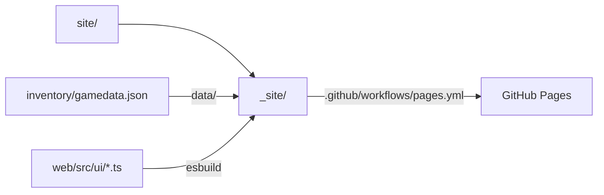
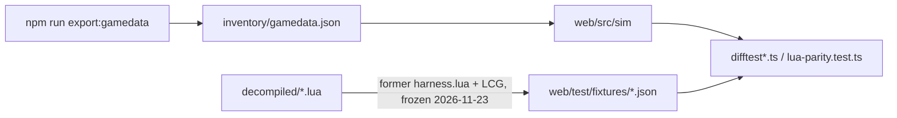

# Website

[Root](../../index.md) > [Tooling](../index.md) > [Website](./index.md) > Website

## Table of contents

- [Public repo rules](#public-repo-rules)
- [Deployment](#deployment)
- [Save viewer](#save-viewer)
- [Battle simulator](#battle-simulator)
- [Wiki](#wiki)
- [Profit page](#profit-page)
- [Farming planner](#farming-planner)
- [Shared page parts](#shared-page-parts)
- [What can run in the browser](#what-can-run-in-the-browser)
- [Battle simulation in the browser](#battle-simulation-in-the-browser)
- [TypeScript combat engine](#typescript-combat-engine)
  - [Regression snapshots](#regression-snapshots)
- [Roadmap](#roadmap)

## Public repo rules

- Repo: `git@github.com:titaniteChuck/merchant-rpg-simulator.git`, branch `main`.
- Never committed (`.gitignore`): game bytecode `merchant/`, `decompiled/`, every `*.lu`/`*.lua`, `saves/` (personal),
  `reports/` (generated), `tools/unluac.jar`, `web/test/fixtures/` (embed the player's heroes).
- Committed: `web/` (TypeScript engine, tools, pages' code), `inventory/` (exported data, the website's data source),
  `docs/`, `site/`. All tools are TypeScript since 2026-11-23 (the Python tools were removed).

## Deployment

- Runs on push to `main` touching `site/`, `inventory/`, `web/` or the workflow, or by hand.
- `web/scripts/assemble-site.sh [out]` builds the same `_site/` locally (esbuild bundles `web/src/ui/*.ts` into `js/`).
  Preview: `npx --yes serve _site`.
- Repo setting needed once: Settings > Pages > Source = GitHub Actions.

## Save viewer

`site/save.html` + `web/src/ui/save-viewer.ts`. The save is read in the browser, never uploaded.

- Decoding: `web/src/tools/save.ts`.
- Tables: `web/src/ui/save-tables.ts`, same columns as the former Python `savegame.py --export`; checked equal to its CSVs on a real
  save (inventory 167, maps 5, heroes 17, gear 102 rows).
- Hero combat stats: built with the TypeScript engine (`api.newHero` + `heroStats`), shown as a radar chart.
- Sections: summary tiles, heroes (stats, rotation, passive, gear), inventory (filter, sort, base value), maps, crafters;
  CSV download per table.
- Maps: essence per run from the profit model (`mapEssence`, with the map's grade, ascension, prefix and suffix).

## Battle simulator

`site/battle.html` + `web/src/ui/battle.ts` (page) + `web/src/ui/battle-worker.ts` (web worker).

- Party: six slots (front/back × 3) filled from the save's heroes; per hero, an optional rotation and passive editor
  with the AP budget (`api.skillInfo`). Over budget, the game falls back to the default rotation: shown as a warning.
- Opponent: a quest enemy (rare variant, 1-4 enemies) or a map run (owned map from the save, or any catalog map
  with ascension 0/1 and grade, up to 3 scrolls).
- The worker runs `evaluate` / `evaluateMap` from `web/src/tools/combat.ts` with seeds 1..n (common random numbers:
  every setting is compared on the same rolls). Checked equal to the former command-line tools (quest 80, 200 fights;
  map 22, 20 runs).
- Results: win rate, turns, grade, enemy HP removed, party HP left; for maps progress, time, loot value, essence,
  where runs are lost, scroll charges; per hero damage, taken, healing, death rate, damage by skill.
- Bundles: `js/battle.js` (page, ~100 KB) and `js/battle-worker.js` (~115 KB); `node:*` imports (Node-only scripts such as the data exporter)
  are external.
- Step 3 has tabs: Simulate, and four searches on the search API of `web/src/tools/combat.ts`
  (`web/src/ui/battle-search.ts`, run in the worker by `runSearch`):
  - Best rotation (quest): `searchSkills` for a party hero; ranked rotation + passive cards, "Use this rotation" applies
    it in the party editor.
  - Best gear (quest): `searchGear` with owned items (`ownedGearCandidates`) or crafted catalog items at a grade and
    ascension (`catalogGearCandidates`); now vs best, and the item per slot.
  - Best party (quest or map): `searchParty` over all the save's heroes; "Use this party" fills the slots.
  - Best scrolls (map): `searchScrolls`, every loadout of 0–3 scrolls, crafted cost from the profit model.
  - Progress per stage (throttled to ~10 updates per second), fight counts editable (smaller = faster). The searches
    are synchronous in the worker, so Cancel terminates it. Results show the enemy's lowest HP point (`enemy_dmg_peak`)
    when the enemy heals back; the Simulate results do too.
  - Tests: `web/test/battle-search.test.ts` (made-up heroes, runs in CI).

## Wiki

`site/wiki.html` + `web/src/ui/wiki.ts` (hash routes) + `web/src/ui/wiki-data.ts` (summaries, cross-references, links).

- Lists (filter, sort) and detail pages: skills (AP, effect, classes, enemies using it), passives (bonuses), equipment
  (stats by grade from `api.makeItem`, crafter level 60, asc 0), consumables, materials (where they drop), maps (bosses
  and room enemies with the map modifier, essence), classes (base stats, growth per level, skills, passives).
  Recipes and "used in" link items both ways.
- Text: `inventory/wikidata.json`, written by `npm run export:gamedata` next to `gamedata.json` (skill effects, item,
  map and class descriptions; the game's byte escapes decoded as UTF-8). `gamedata.json` itself is unchanged, so the
  engine's parity is untouched.
- Links everywhere: skills, passives, items and maps on the save viewer and battle pages link to the wiki and show a
  summary in a tooltip on hover or keyboard focus (`web/src/ui/tooltip.ts`).

## Profit page

`site/profit.html` + `web/src/ui/profit.ts` (page) + `web/src/ui/profit-tables.ts` (columns, sortable table) +
`web/src/ui/profit-worker.ts` (web worker). Model: [profit calculator](../profit-calculator/profit-calculator.md).

- The worker runs `profitReport(gameFromData(), options)` (3-5 s) and sends back plain rows (`PyFloat` -> number,
  `""` -> null) plus one entry per orb (ascension tier, level band, cheapest map). Settings changed while it solves are
  queued; only the newest answer is shown. The results are dimmed with a spinner while it works.
- Options: run grade, party luck, crafter level, Enchanter level, who pays for a run (`alloc` value/full), map
  modifiers on/off, and a forced map per orb (`essenceFrom`). Any change recomputes.
- Tabs:
  - What to make: every item × ascension, sorted by `best_profit`; filter by name, type, level range, ascension.
    Columns: profit and return of the best plan, best plan, sell value, average sale, cost to make, modifier chance
    (prefix / suffix / both on hover), craft time, cheapest way to get it.
  - Enchanting: `buildEnchantRows` (suffix and prefix odds, tries, cost, net gain per equipment and ascension).
  - Orb sources: cheapest map per orb for ascension 1 and 2, then every map × orb (`buildEssenceRows`).
- Every column header explains its metric on hover or focus (`tooltip.ts`). Tables show 100 rows, then "Show all";
  the sort applies to the whole filtered list and survives filtering.
- A save opened on any page marks the items the player owns ("You have" column, "Only what I own" filter), from
  `owned()` in `save.ts`, matched in the page: no recompute.
- Known engine limit: forcing an orb to a map that needs that orb to be crafted (every map except the single-region
  base maps Tuvale, Yarsol, … Frentir) leaves the orb unpriced (the solver relaxes from "unknown"), so items that
  need it drop out. The page warns when it happens.

## Farming planner

`site/farming.html` + `web/src/ui/farming.ts` (page) + `web/src/ui/farming-worker.ts` (web worker).

- Party: the one picked on the battle page (same browser storage, edited rotations included), editable here; without
  one, the six highest-level heroes.
- Sources: quests (preselected around the heroes' level, rare variants optional), owned maps, catalog maps at
  ascension 0/1 (grade S), up to 3 scrolls on every map run.
- `farmingReport` (`web/src/tools/farming.ts`) simulates each source with the party (common seeds) and prices it with
  the profit `Solver` (grade 3), solved once per worker (~3 s) and reused.
- Ranked by value per hour (loot sell value minus the run's cost, plus essence at its production cost); headline
  "best use of your heroes' time", or a warning when every source costs more than it earns. Tests:
  `web/test/farming-worker.test.ts`.

## Shared page parts

- Top bar on every page: Save viewer, Battle simulator, Profit, Farming, Wiki, and the GitHub link (right).
- The opened save is kept in this browser (IndexedDB, `web/src/ui/save-store.ts`); `save-source.ts` loads it on every
  page, so moving between pages never asks again. Bar: file name and age, Reload (rereads the same file without a dialog
  when the browser kept its handle: Chrome, Edge), Choose another file, Forget (deletes it from the browser).
- File picker (`save-file.ts`): Chrome/Edge start in the folder of the last opened save, else Documents; other browsers
  open the plain file dialog wherever the OS decides. A page can't open a dialog in `%APPDATA%` by itself.
- Hero stats: radar chart per hero (`radar.ts`; axes HP, Atk, Matk, Def, Mdef, Acc, Crit, each from 0 to the strongest
  hero of the save, real values printed at the axis ends, comparison on hover). Rotations are numbered rows (skill, AP,
  effect); grade stacks read "14 × C".
- Battle page: the party and edited rotations are remembered per save name (localStorage).
- Ascension is an outline, not text: silver for 1, gold for 2 (`ascClass` / `withAsc` / `ascSwatch` / `ascLegend` in
  `dom.ts`, tokens `--silver-*` / `--gold-*` in `style.css`, a masked gradient ring so it looks metallic on any surface).
  Items, maps and crafters (`ascLevel`) count 0–2; heroes store `prestigeLevel` 1–3, shown as ascensions = level − 1
  (`heroAsc`); the crafter `prestigeLevel` (a level counter) stays a number. Applied wherever an item-like object is
  shown: item links (inventory, counter, maps, hero gear, crafting jobs, wiki sell values), hero avatars (save viewer,
  battle slots), crafter names, the sortable Asc columns (swatch), the battle page's chosen map (options can't be
  outlined), and the wiki class growth table. Each outline also has a title and a screen-reader label ("ascension 1").

## What can run in the browser

| Tool | Browser? | Why |
|---|---|---|
| Save decoding | Yes | `web/src/tools/save.ts`; used by `save.html`. File stays local. |
| Item names, recipes, sell values | Yes | `data/gamedata.json`. |
| Profit calculator | Yes | `web/src/tools/profit.ts` in a web worker (`profit-worker.ts`), game model from `data/gamedata.json`; used by `profit.html`. |
| Combat engine (fights, map runs) | Yes | Ported to TypeScript in `web/src/sim/` (see below). |

## Battle simulation in the browser

Game code the simulator runs (decompiled line counts):

| Part | Lines |
|---|---|
| Skill functions `data.AbilityFunc` (253 functions) | 2467 |
| Combat classes: Hero 616, Combatant 552, Campaign 348, Party 258, Map 228, Battle 206, Enemy 140 | 2348 |
| Item, Equipment, statsService, Utilities and `data.Default` / `data.FormulaData` parts actually used | ~600 |
| Data tables (abilities, heroes, quests, maps, gear) | export to JSON, no port |

| Option | Cost | Game files needed by the visitor | Speed | Drift on game update |
|---|---|---|---|---|
| A. Port to TypeScript | ~5.5k Lua lines, 3-5 sessions, plus a differential test against the local lupa harness | No | Fast (JS) | Re-port changed functions (diff `decompiled/`) |
| B. Lua 5.1 in WebAssembly + visitor's own game files | ~1 session (Emscripten build, loader, file picker); `harness.lua` reused | Yes (bytecode loads directly: 4-byte `size_t` matches wasm32) | ~2-3x slower than native | None |
| C. Publish the decompiled code | none | No | - | None |

- C is excluded: no game code in the public repo.
- B depends on visitors being able to supply the `.lu` files (where the PC build keeps them is not checked yet).
- A's test oracle: same seed and a shared PRNG injected in both engines, compare logs fight by fight.

## TypeScript combat engine

Option A was chosen: the game's combat rules re-written in TypeScript, `web/src/sim/` (rules: `PORTING.md`).

- **Shared random generator**: Park-Miller LCG with Lua 5.1 `math.random` argument rules, in `lua.ts`. The
  reference outputs were recorded by the former Lua harness (`tools/sim/harness.lua`, removed with the Python
  tools) with the same generator installed before the game loaded, so `data.Default`'s local `random` used it too.
- **Differential tests** (local only, need the frozen fixtures): every action compared (turn, actor, skill,
  RNG draw count, all HP, effect names) plus the full result. `npm test` runs them when the fixtures exist.

| Test | Result |
|---|---|
| `node test/difftest.ts` (single fights) | 3000/3000 |
| `node test/difftest-maps.ts` (full map runs, 119 with a map prefix, 102 with a suffix) | 400/400 |
| `node test/difftest-items.ts` (`makeItem` rolls) | 1949/1949 |

- **Lua quirks emulated**: `pairs()` order and `#t` with holes (`lua-table.ts`, an ltable.c emulation checked
  against 400 real tables); Lua truthiness of `0`; level-70 map nil treasure (crash or dropped rooms).
- **Final reference set** (frozen 2026-11-23, scenario seed 2): covers 189 of the 223 skill functions and all 10
  scrolls. The other 34 skill functions belong to no hero class and no quest enemy, so the game never runs them.
  Fixtures embed the player's save heroes: they stay local (`web/test/fixtures/`, git-ignored).
- **Not verified**: crafting new maps (`isNew`) and new heroes with starting gear throw "not supported"
- **Speed**: about 0.34 ms per single-hero fight in Node.
- Search/optimisation and profit code (`combat.ts`, `profit.ts`) lives in `web/src/tools/`, for the pages. There are no
  command-line tools: the site is the product; `npm test` and the difftests are the local checks.

### Regression snapshots

CI-safe drift check (no save data, runs in CI): fixed-seed outputs compared with committed JSON.

| Test | Covers | Snapshot |
|---|---|---|
| `test/snapshots-sim.test.ts` | 57 fights: 5 parties, all 9 classes, L10-60, normal + rare, 1-4 enemies, seeds 1-3 | `fights.json` |
| | 10 map runs: maps 1, 8, 13, 17, 21, asc 0 + 1, prefix/suffix, scrolls, seeds 1-2 | `maps.json` |
| | Goblin Warlord's Feast heal (quest 91 x10, map 3 asc 1): HP rises on turns 3, 8, 13 | `feast.json` |
| `test/snapshots-profit.test.ts` | `profitReport` default and grade 5 + crafter level 40: top 30 rows, essence table, sha256 of every table | `profit-*.json` |

- Heroes: `test/helpers/catalog-heroes.ts`: best catalog item of the class's subtypes at the hero's level, `makeItem` with fixed seeds.
- Snapshots in `web/test/snapshots/`; a mismatch fails with the first differing path.
- Regenerate on purpose only: `npm run test:update-snapshots` (= `UPDATE_SNAPSHOTS=1`), then review the diff and commit.
- Runtime: about 11 s (profit report ~5 s per variant).

## Roadmap

1. Save viewer: done (`save.html`).
2. Profit page: done (`profit.html`). Next: essence column in the save viewer's maps table.
3. Battle simulator: done (`battle.html`). Next: skill, gear and party search on the same page.
