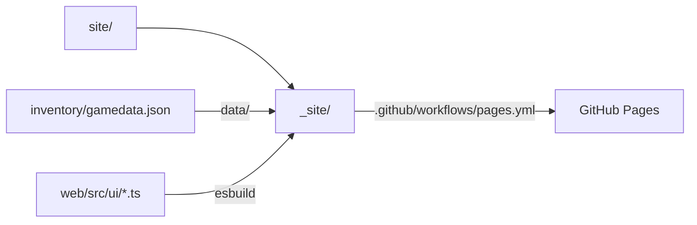
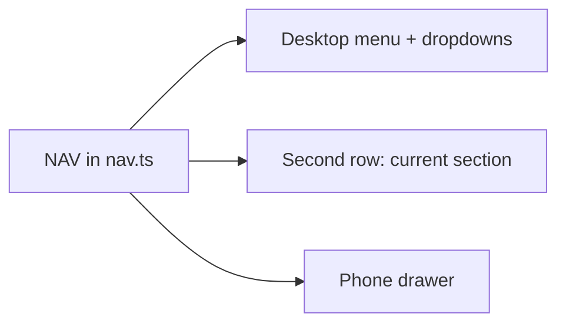
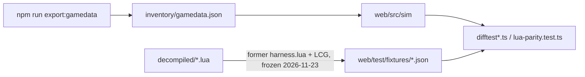

# Website

[Root](../../index.md) > [Tooling](../index.md) > [Website](./index.md) > Website

## Table of contents

- [Public repo rules](#public-repo-rules)
- [Deployment](#deployment)
- [Save viewer](#save-viewer)
- [Battle simulator](#battle-simulator)
- [Wiki](#wiki)
- [Profit page](#profit-page)
- [Farming planner](#farming-planner)
- [Levelling page](#levelling-page)
- [Class balance page](#class-balance-page)
- [Expansions](#expansions)
- [Languages](#languages)
- [Shared page parts](#shared-page-parts)
  - [Menus](#menus)
  - [Scroll position](#scroll-position)
- [What can run in the browser](#what-can-run-in-the-browser)
- [Battle simulation in the browser](#battle-simulation-in-the-browser)
- [TypeScript combat engine](#typescript-combat-engine)
  - [Regression snapshots](#regression-snapshots)
- [Roadmap](#roadmap)

## Public repo rules

- Repo: `git@github.com:titaniteChuck/merchant-rpg-simulator.git`, branch `main`.
- Never committed (`.gitignore`): game bytecode `merchant/`, `decompiled/`, every `*.lu`/`*.lua`, `saves/` (personal),
  `reports/` (generated), `tools/unluac.jar`, `web/test/fixtures/` (embed the player's heroes).
- Committed: `web/` (TypeScript engine, tools, pages' code), `inventory/` (exported data, the website's data source),
  `docs/`, `site/`. All tools are TypeScript since 2026-11-23 (the Python tools were removed).

## Deployment

- Runs on push to `main` touching `site/`, `inventory/`, `web/` or the workflow, or by hand.
- `web/scripts/assemble-site.sh [out]` builds the same `_site/` locally (esbuild bundles `web/src/ui/*.ts` into `js/`).
  Preview: `npx --yes serve _site`.
- Repo setting needed once: Settings > Pages > Source = GitHub Actions.

## Save viewer

`site/save.html` + `web/src/ui/save-viewer.ts`. The save is read in the browser, never uploaded.

- Decoding: `web/src/tools/save.ts`.
- Tables: `web/src/ui/save-tables.ts`, same columns as the former Python `savegame.py --export` (checked equal to its CSVs on a real
  save: inventory 167, maps 5, heroes 17, gear 102 rows), except the inventory's grade split (below).
- Hero combat stats: built with the TypeScript engine (`api.newHero` + `heroStats`), shown as a radar chart.
- Sections: Overview (default), Heroes, Inventory (filter, sort, base value), Maps, Crafters. CSV downloads (heroes,
  hero gear, inventory, maps, crafters; whole tables) are in the top-bar save menu.
  Each section has a hash (`#overview`, `#heroes`, `#inventory`, `#maps`, `#crafters`) and is reached from the site's
  menus (U35, [Menus](#menus): the Save dropdown, the second row under the top bar once a save is loaded, the phone
  drawer); the in-page tabs are gone. A section link is a normal hash link (`hashchange` re-renders, Back works). No
  hash or an unknown one opens Overview.
- Overview: small cards (`.save-cards`, about 80px tall, at most four per row so the eight cards make two full rows,
  two per row on a phone; the cards of a short last row grow to fill it, R1 F35), each with a label,
  a big number and an optional one-line hint: gold, inventory value and stacks, gold earned (both as "171,946 g"),
  items crafted, sales, heroes, maps owned / slots, mode and game version. Not the old big header tiles, not a table. No ascension legend:
  outlines carry their own tooltip and screen-reader label.
- Inventory: a kind filter (All, Equipment, Consumables, Materials, Maps, On the counter) as the shared segmented
  control (R1 F27, [Shared page parts](#shared-page-parts)); a Type column with the item's subtype in one spelling
  ("Essence", "Health", "Hood": `itemTypeText` in `names.ts`, R1 F30); values as "15 g". One count column per grade, best first (S, A, B, C, D: `GRADES_BEST_FIRST` / `gradeCounts` in
  `save-tables.ts`), then Total (the stack size). A stack split by grade keeps its split; a single-grade item counts
  in its grade. Cells hold numbers only ("–" for 0; rows keep 0 so the columns sort as numbers). The header shows the
  grade badge (accessible name "Grade S count"); every column sorts. The CSV has the same `S,A,B,C,D,total` columns
  in place of `grade` and `amount`.
- Header icons: `iconHeaders` in `save-viewer.ts` swaps a sortable header's text for nodes (badge, bar) with an
  `aria-label` and tooltip, since `table()` in `dom.ts` takes text labels.
- Heroes: one sortable table (avatar, class, level, ascension, combat stats, passive, status, quests, deaths). A hero's
  name opens its page, `save.html#hero=<id>` (back with "All heroes" to `#heroes`, previous/next): radar chart, then
  passive, rotation and gear (U22).
- Hero page (U22): rule everywhere in the save viewer: the passive comes before the rotation (hero page; the heroes
  CSV row already has `passive` before `rotation`).
  - Passive and rotation use the wiki class page's rows (`table.ability-rows`): the whole row opens the wiki page
    (hover highlight, `clickableRow` in `dom.ts`), the AP shown with the same badge (`apBadge` in `dom.ts`); Basic
    rows (0 AP) have no page. Passive row: name, bonus. Rotation rows: turn, skill, AP, effect.
  - AP budget beside the "Rotation" label: "18 / 20 AP used · 2 left" and a bar, the page's only AP figure (R1 F37:
    the stats under the radar no longer list AP; crit damage reads "×2.00"); over budget it warns that
    the game plays the default rotation instead (`Hero.calculateAPRemainder`). `HeroView.ap` in `save-tables.ts`:
    `used` = sum of the skills' `apCost` (`rotationAp`), `max` = `api.skillInfo(hero).maxAP`, the engine's
    `heroMaxActionPoints`: 5 + floor((min(level, 40) − 10) / 2) + apMod (gear, passive); 20 at level 40 and above.
  - Gear in two columns (`gearGrid` in `dom.ts`, CSS `.gear-grid`): weapon, head, body on the left; hands, feet,
    trinket on the right (the slot names of the whole site, R1-D); an empty slot shows a dashed placeholder. Rule for the
    site: six equipment slots go in these two columns, except where a compact layout is intended (`compact: true`
    gives one column). `bySlot(items, slotOf)` keys items by slot name or itemSlot number 1-6; the battle page can
    adopt the same helper.
  - Tests: `web/test/hero-page.test.ts` (AP budget against the formula for levels 10-60, rotation AP, slot order).
- Crafters: Level (ascension 0), Level + a silver bar (ascension 1), Level + a gold bar (ascension 2), the bar being the
  ascension outline's gradient (`.lvl-asc`), named "Level for ascension-1 items" / "…-2 items" for screen readers
  (`crafterLevelFor` in `save-tables.ts`). The save keeps `level`,
  `ascLevel` (ascensions unlocked) and `prestigeLevel` (the level reached in the current ascension, 1 after each
  ascension). As in `obj.Crafter.lua` `getEffectiveLevelForItem`, an item of the crafter's current ascension uses
  `prestigeLevel` and lower ascensions use `level`; an ascension not unlocked shows "—".
- Maps: time as a duration ("4 min"), value as "15 g"; essence per run from the profit model (`mapEssence`, with the map's grade, ascension, prefix and suffix).
- Item names with modifiers (U34): "[Prefix] Item +N" everywhere (inventory, counter, maps, hero gear, crafters, CSV),
  `modItemName` in `names.ts` (see [Languages](#languages)); name columns sort by the base name.
- No "… page in the wiki →" links next to a name that is already a link (U34): a name link opens its wiki page.

## Battle simulator

Two pages since U41, one code: the Simulator, `site/battle.html` + entry `web/src/ui/battle.ts`, and the Solver,
`site/solver.html` + entry `web/src/ui/solver.ts`. Both entries call `initBattlePage(kind)` of
`web/src/ui/battle-page.ts` (the page code, `battle.ts` until U41); the Solver's panel and results are
`web/src/ui/battle-search.ts`; runs go to `web/src/ui/battle-worker.ts` (web worker). Each page has its own bundle
(`js/battle.js`, `js/solver.js`).

- Two pages (U41; until then two modes of one page, chosen in a "What do you want to do?" step 1):
  - Menu: Battle ▾ with Simulator and Solver, in the dropdown, the second row and the phone drawer (see
    [Menus](#menus)); the Battle link itself opens the Simulator.
  - Simulator (`battle.html`): no mode chooser. Step 1 is the Simulate box (Runs, ▶ Simulate), step 2 the Results,
    step 3 the Party and Flow tabs with the opponent in the Party tab, as below.
  - Solver (`solver.html`, U42 layout): no step headings. The spoiler guard first; once accepted, the warning line,
    then one full-width Solve panel (`#solve-box`): a compact Quest / Map segmented control with its picker (the
    enemy with Rare variant and Quest size, or the map with ascension and grade for a catalog map), then smallest and
    largest party, Include scrolls, the time budget in seconds and 🔎 Solve, "Leave heroes out" under them; a running
    solve's progress bar, clock and Cancel show inside the panel. No enemy card and no tabs during setup: the
    opponent card (radar, map facts, scroll pickers) is drawn into `#target-card`, the Party tab's right column, so it
    shows with the party a result's Show brings (`placeTarget` in `battle-page.ts`; the Simulator has no
    `#target-card` and keeps its card under its pickers). The results section (`#search-results`, full width, under
    the panel) is hidden until a solve is done; a new solve hides the last results until it ends; a Cancel or an
    error is a line in the panel. Then "Party and flow", the Party and Flow tabs (`#party-box`), hidden in
    the HTML: no party panel at all until a solve has run and a result's Show (was "Load") has put its setup in the
    party (`SearchContext.onShow` → `revealParty`). Editing there works as on the Simulator (AP limit toast, include
    boxes, Flow edits, map room bar, remembered tab); 🔒 locks feed the next solve. Once shown it stays for later
    solves; a new save or Forget hides it again.
  - Scribe hidden (U42, both pages): when Scribe is not owned and "Show expansion content" is off (`isHidden("Scribe")`
    in `expansion-state.ts`, the rule the wiki hides Scribe content by), nothing of maps shows, the save's own maps
    included: no Quest / Map toggle at all (quests only), no map pickers, ascension or grade, no "Include scrolls" on
    the Solver, no "<Region> – Map" groups in the enemy picker (`enemyGroups(ids, false)` in `battle-setup.ts`), and
    so no map room bar or map-run results. A remembered map run falls back to a quest (`syncOppKinds`); turning
    Scribe on or off in the expansion menu redraws at once (`subscribe(onExpansions)`).
  - Shared state: the Solver's party is its own and is kept in memory only (`persistParty` / `restoreParty` do
    nothing there), so Solver edits never change the Simulator's remembered party (`battle-party:<file>`). The
    Solver's opponent is remembered apart (`solver-opponent`, starting from the Simulator's `battle-opponent` on a
    first visit). "▶ Open in Simulator" beside the step 3 heading copies the shown party (slots, rotations, heroes left
    out; the Simulator's edited rotations of other heroes kept, no locks: `simulatorPartyFrom` in
    `ui/battle-links.ts`) and the opponent to the Simulator's keys, then opens the Simulator. Why: a solver result is
    an answer to look at; it shouldn't silently overwrite the party the visitor is building by hand.
  - Old links: `battle.html` with `?mode=solve` (or `party`, `solver`), `?solve`, `#solve`, `#solver`, `#mode=solve`
    goes to `solver.html` (`solverRedirect` in `ui/battle-links.ts`, run by the entry before the page is built). The
    old remembered mode (`battle-mode`) is removed and no longer read.
  - Tests: `web/test/battle-u41.test.ts`.

- Page order (U26, was U23): (1) mode, its options and its Run button; (2) Results, right under the Run button
  (`#results-box`: progress bar, then the outcome); (3) party and opponent, then the 5-turn plan. The party and
  opponent block is always the setup being edited: the searches fill it with what they found. When a run starts
  (▶ Simulate, or a search through `SearchContext.onStart`), `revealResults` in `battle.ts` brings the Results into
  view: on a wide screen they are usually already on screen and nothing moves; on a phone (760 px and less), or when
  the heading is off screen, one smooth scroll puts it at the top (instant with reduced motion). Only at the start:
  progress updates and the result never scroll, so a user who scrolls away stays there. No page title or lead
  paragraph (visually-hidden h1 only, like every page but the home page and the wiki).
- Step 1, mode (history: U41 split the two modes into two pages, above. U8; U27 merged Best party, Best rotation and Best scrolls into one Best party; U36 kept two): Simulate
  and Solve (the solver, Best party until U36) (`MODES` in `battle.ts`: per mode, whether step 3 asks for the party,
  which opponents it accepts, and its search panel). Best gear, Best potion / enchant and Optimise everything left the
  page in U36; their engine code (`searchGear`, `rankConsumables`, `optimiseFight`) and the worker's handlers stay (the
  history below describes them as they were). A new mode is one row there plus, for a search, one panel in
  `battle-search.ts`. The chosen mode is remembered (localStorage
  `battle-mode`; a remembered mode that no longer exists falls back to Simulate). Under 560px the modes are two compact columns (hint in the title). Under the mode cards, one box
  (`.run-box`, U23; was a separate step 3) holds the chosen mode's options and its Run button: Runs and ▶ Simulate, or
  the search's panel and 🔎 Search. The output goes to the Results section, step 2 (`#results` for Simulate,
  `#search-results` for the searches: `initSearch(ctx, panelMount, resultsMount)`); rebuilding the panel after a party or
  opponent change keeps the results and a running search. Until a run, Results shows a one-line hint.
- Step 3, party, opponent and plan (U15, reworked in U23, U36 and U39; step 2 until U26), the same arrangement in every
  mode: two tabs (U39; U40: Party first), Party and Flow (the fight turn by turn, see "Flow tab" below). Party: the six hero slots (back row 1-3
  | front row 1-3) and the opponent card in two columns, stacked below 960 px. (U36 had the 5-turn plan as a third column.) Every slot has the same size, filled or empty (empty: the same skeleton greyed, "–" stats, "—" rows): head
  (avatar, Back / Front N, class and level pill, 🔒 in the search modes), hero picker, stat strip (HP, Atk, Matk, Def,
  Mdef, Acc, Crit; columns as wide as their values, five-digit values shortened to "12.3K" with the full value in a
  tooltip), then PASSIVE before ROTATION, both as the wiki / save viewer ability rows (`table.ability-rows`,
  whole row opens the wiki page via `clickableRow`, AP via `apBadge`): passive row (name, bonus), rotation rows (turn,
  skill, AP), and "x / y AP" beside the Rotation label (over budget: red, ⚠, the game then plays the default rotation).
  Editing in place, no fold-out: each row ends with a ⇄ control (a transparent `<select>` over the icon), which swaps
  the skill (Basic and the unlocked skills, with AP) or the passive without changing the slot's size; focus returns to
  the same control. Gear is not shown in the slots. In Best party and Optimise everything the slots are the search's:
  empty ones read "to be found", and a filled slot has a 🔒 toggle (a hero picked by hand is locked; locked heroes stay
  in the party and follow their hero when the search moves it).
  - Include box (U36): a checkbox at the top right of each filled card. Unticked, the hero stays in its slot but doesn't
    fight (dimmed card, "left out"; `state.excluded`, remembered with the party). When more heroes are ticked in than
    the opponent takes (`partyRules` maxSize, e.g. after switching to Desolation Wolf, 3), the first ones in the game's
    slot order are kept (the required slot first, then back 1, front 1, back 2, front 2, back 3, front 3) and the rest are
    left out automatically: their box is unticked and disabled ("over the limit"), and a note names them
    (`includedSlots` in `ui/battle-setup.ts`). Simulate, the plan, the quest-size cap and the party check
    (`partyProblem`, so the required Front 2 rule) use the included heroes only; the solver's locks skip the others.
  - Clear all (U32): a button above the slots empties every slot (and its lock; edited rotations are kept), then shows
    "↩ Put back the previous party" until it is used or a slot is changed by hand.
  - Party setup rules (game 3.18, the engine's E21 `partyRules` / `partyProblem` in `combat.ts`, wrapped for the page by
    `web/src/ui/battle-rules.ts`): a party quest (`questData.party`) always fills Front 2
    (the game opens the party with the quest's hero there; swapped, never emptied) and takes at most `questSize`
    heroes (2-6; Desolation Wolf takes 3); a solo quest takes exactly one hero, in Front 1; a map run has no rule. The
    required slot has a "required" badge and an outline; empty slots the opponent doesn't allow are greyed and
    disabled ("solo: Front 1 only", "at most N heroes"); a line under Clear all states the rule, and what keeps the
    party from fighting (the page's own words since R1 F24, e.g. "Desolation Wolf takes at most 3 heroes, not 4.") is shown
    inline and stops ▶ Simulate before the worker runs.
  - The opponent:
  - Quest enemy: enemy link to its wiki page (the only link: no "Enemy page in the wiki →" line since U36), level, rare
    and "attacks first" pills, radar of the base stats. Placeholders are not offered (`isEnemy`).
    - Picker (U36): grouped by region and kind, region by region: "<Region>", "<Region> – Event", "<Region> – Map"
      (`enemyGroups` in `ui/battle-setup.ts` on the wiki's `regionOf`); the Map group holds only map-exclusive
      monsters (map bosses and the map Treasure Bushes); each group by level. No level bands.
    - Radar (U39, `enemyRadar` in `ui/battle-setup.ts`): no HP axis; the HP is a line of text above the radar that
      follows the quest size ("HP 420,000 (140,000 ×3, quest size)"). Atk, Matk, Def and Mdef share one rim, this
      enemy's highest of the four, so the shape shows what it is strong at (the Mighty Bush no longer squashes every
      other shape); Eva's rim is always 200 and 200 or more sits on the rim (`EVA_RIM`). The vertex tooltips say "% of
      the scale". U36 scaled each axis to the game-wide maximum; before U36: rims per kind and level band.
    - No timeline strip in the card (U36): the turns are in the plan; without timeline data the card lists the rotation.
    - Remembered (U36): the opponent (quest or map run, enemy, rare, size, map, grade, ascension, scrolls) is kept in
      localStorage `battle-opponent` (try/catch) and put back when the page is opened again; switching quest ⇄ map
      brings back the other kind's last choice. A remembered size the party can't take falls back to ×1.
    - Fresh start (R1 F02): with no remembered quest, the page opens on `defaultQuest` (`ui/battle-setup.ts`): the
      toughest quest-board enemy (highest level, then HP × attack) of the region of the save's highest hero level, at
      or below that level; gathering bushes, Treasure Bushes, event bosses and Epic / Final bosses are skipped, the base
      game first (an expansion's enemy only when nothing else fits). A save with no remembered party (localStorage
      `battle-party:<file>`) gets `defaultSlots`: its strongest heroes (ascension, level, max HP), as many as the
      opponent takes, the toughest in front, filled from the required slot (Front 2 / Front 1 solo) then Front 1, Front 3,
      Front 2, Back 1-3. So no party warning shows before the visitor acts (example save: Cerberus, five heroes).
  - Party problem text (R1 F24): `problemOf` in `ui/battle-rules.ts` asks the engine (`partyProblem`) whether the layout
    can start and writes the reason itself from `partyRules` (`problemText`): the enemy's name in the visitor's
    language (`enemyName`), never a quest id ("Put a hero in Front 2: the game always fills it for Loup de la
    désolation."). The engine's English text stays for logs and worker errors.
  - Short text (R1 F20): one-line mode hints (the long one in the card's tooltip); the quest size, the radar's rims,
    what a map run is, how to read the plan and how the solver works are in "?" helps (`helpTip` of `wiki-help.ts`),
    the rows' meaning, the run's seeds and the solver's columns in tooltips; "No run yet." until a run. The quest-size
    help states the cap only once the party has heroes ("The largest size depends on your heroes' ascension tier"
    before, R1 F36). Clear all is disabled while every slot is empty.
  - Map card rooms (R1 F29): "10 + 1.0 treasure": `mapRooms` at the map's grade (boss included) plus the treasure rooms
    expected per run (`mapTreasure`), as the results' "of 11.1 rooms (avg)" counts them; both tooltips say so.
  - Quest size ×1 to ×max: one enemy with N× HP, N× loot and N× quest time, max = `maxQuestAmount` of the party
    (highest hero prestige × 2 − 1); a rare quest is always ×1. Best party and Optimise everything allow up to the
    strongest hero of the save; the searches skip parties that can't take the size.
  - Map run: owned map from the save (prefix, suffix, grade, ascension outline; a modded map is named
    "[Prefix] Map +N" from its translated parts by `modItemName`, U34, in the picker and the card since U36) or any catalog map with ascension 0/1
    and grade; card with level, grade, rooms, time, enemy power ×, boss links, modifiers, and up to 3 scrolls.
- The worker runs `evaluate` / `evaluateMap` from `web/src/tools/combat.ts` with seeds 1..n (common random numbers:
  every setting is compared on the same rolls). Checked equal to the former command-line tools (quest 80, 200 fights;
  map 22, 20 runs).
- Results: win rate, turns, grade, enemy HP removed, party HP left; for maps progress, loot value, essence,
  where runs are lost, scroll charges; per hero damage, taken, healing, HP left, death rate, damage by skill.
  - Compact first (U43, `ui/battle-results.ts` `compactResult`): a result shows only the Win rate and Grade when won
    tiles (`.result-summary`), then "Show details" with the run line beside it; the button opens the rest (the other
    tiles, the XP / map-run row, the notes, the per-hero table) and becomes "Hide details". Open or closed is
    remembered for the browser tab (sessionStorage `battle-results-details`, try/catch; closed by default and when
    storage fails). The Simulator's tiles are compact (`#results .tiles`: smaller padding and type, as many per row
    as fit, at least 168 px each; the balanced-row rules of R1 F35 no longer apply there). The link line under the XP
    row reads "How these are counted:" (no "Before XP bonuses").
  - Turns (U43): quests, the average with "N when won", the longest fight and the game's cap, "max 37 of 200 turns
    (at 200 the enemy wins)", and, when fights reached it, "N of M fights (x %) reached turn 200 and were lost" (the
    tile turns red). Maps: "Turns per room" (average over the rooms fought), the average per run, the longest single
    room across runs with the cap, and the runs stopped by it (a capped room is a lost room, so at most one per run).
    The cap is the engine's `TURN_CAP` (`sim/battle.ts`, Battle:combatLoop): see [Combat](../../combat/combat.md#battle-loop).
    Stats: `turns_max`, `turns_capped` (FightEval), `room_turns`, `run_turns`, `room_turns_max`, `rooms_capped`
    (MapEval); each map room records its `turns` (`Combat.turns`, the `combats` of a map-run result; read by the
    statistics only, the Lua parity script skips it as TS-only).
  - HP left per hero (U43): the summary table's "HP left" column is each hero's HP at the end of the fight (a map run:
    of the whole run, HP carried over), 0 when dead, as a percent of max HP averaged over the runs; its tooltip gives
    the average HP and max HP (`hp_left`, `hp_left_frac`, `max_hp` in HeroEval, `heroAccumulator`).
  - Essence per run (U43): a tile of the map-run row, after Craft time, Run time, XP per hero and XP / min, one essence
    per line ("from the runs won" when not every run is won); in the first row when the run has no XP figures.
  - Damage without overkill (R1 F22): against a quest, "Damage / fight" is what came off the enemy: the party's total
    capped at the enemy's max HP (`enemy_dmg_total / enemy_dmg_total_frac`), each hero keeping its share
    (`effectiveDamage` in `ui/battle-setup.ts`); a cell's tooltip gives the damage dealt with overkill, the header's
    says how it's counted. Map runs and "Damage by skill" keep the damage dealt.
  - Tile grids (R1 F35): `tiles()` in `battle.ts` sets `data-n`; above 1100 px the U33 grid, narrower 5 or 6 tiles in
    3 columns, on a phone 2 columns with an odd count's first tile across both: never a lone tile on the last row. The
    two mode cards always share one row. The run line is short ("200 fights · 1,159 ms", seeds in its tooltip).
- XP and time (U33, `ui/quest-xp.ts`): a second row of tiles under the outcome (`.qxp-tiles`, the same tile size), then
  a line linking Stats › Experience / Quest and map time (/ Craft). Quest: XP per hero (`questStats`, the party's size,
  no XP bonus), quest time = the simulated fight + the quest's own time at the average grade when won (else B), with
  the party's speed, and XP / min (e.g. Maexna ×3, two heroes, won in 1 turn at S: 600 XP, 15 s + 3 min 45 s = 4 min,
  150 XP / min). The fight's seconds come from the result's averages (`fightBattleSeconds`: the heroes' skill uses +
  one enemy action a turn, minus its last one in a win unless it acts first, × 5 s, + 5 s a turn): FightEval has no
  action count. Map: craft time (the map and the lower maps of its recipe, `mapRunStats`), the simulated run time,
  XP per hero per run (every room won) and XP / min over craft + run (Murlok Madness Map at B, two heroes: 13 min +
  2 h 4 min, 15,015 XP, 110 / min). R1 F06: a room's XP comes only with its win, so the map's XP is the full run's
  times the share of rooms cleared on average (`mapResultXp` `cleared`; hint "the rooms won (53.8 %)"), "—" when no
  room is ever won; a quest never won shows "—" for XP per hero and XP / min. What the result is about (quest, size, rare, party size and speed; map, grade,
  ascension) is taken when the run starts (`runContext`), so changing the opponent afterwards doesn't change it.
- Party check fix (U33): `partyProblem` in `battle.ts` passes the filled slots as objects; it passed hero indices, and
  the engine's check (`partyProblem` in `tools/combat.ts`, a falsy test) read the save's first hero (index 0) as an
  empty slot ("needs a hero in front 2").
- Bundles: `js/battle.js` (page, ~100 KB) and `js/battle-worker.js` (~115 KB); `node:*` imports (Node-only scripts such as the data exporter)
  are external.
- The Run button of step 1 runs the mode: Simulate, or one search of the search API of `web/src/tools/combat.ts`
  (`web/src/ui/battle-search.ts`, run in the worker by `runSearch`):
  - Best gear (quest): `searchGear` with owned items (`ownedGearCandidates`) or crafted catalog items at a grade and
    ascension (`catalogGearCandidates`); now vs best, and the six slots in two columns (`gearGrid`, U23: changed slots
    marked with a "change" pill, the others "keep"), the source of each change listed under it.
  - Best party, the solver (quest or map, U27): `searchParties` (`web/src/tools/parties.ts`, see
    [Party search](../combat-simulator/party-search.md)) over all the save's heroes (with their edited rotations)
    except the ones ticked in "Leave heroes out", the locked slots' heroes in every party (`lock`). It replaces the
    former Best party (`searchParty`), Best rotation (`searchSkills`) and Best scrolls (`searchScrolls`) modes: one
    search gives the heroes, their rows and order, every hero's rotation and passive and, for a map, the scrolls.
    - Spoiler guard: the mode starts hidden behind a card ("This tool runs simulations and finds the best fit … do it
      at your own risk.") with "▶ Try Simulate first" (U41: "▶ Try the Simulator first", which opens the Simulator page)
      and "Show me the solver anyway". Accepting is remembered in
      localStorage `battle-solver-shown` (try/catch; with storage blocked it holds for the page view); the panel then
      starts with "⚠ Spoiler tool: it gives you the answer." and a "Hide it again" link (forgets the choice, stops a
      running search and clears its results). Until accepted (U39), the guard hides the whole rest of the Solve page:
      the Solve panel, the results and the Party and Flow tabs are hidden (U42: every section after the guard's) (`SearchContext.guarded` → `#setup.solve-guarded`).
    - Options: smallest and largest party (1 and 6, clamped to the quest's size cap, both 1 on a solo quest),
      "Include scrolls" (map runs only; disabled with "(map runs only)" on a quest; U42: off, a map run is solved with
      no scrolls, since the card's scroll pickers are out of sight during setup), the time budget (U42: a number input
      in seconds, 30 by default, 5 to 600; the search stops then and shows what it found), "Leave heroes out". The
      options as last set survive the panel's rebuild when the opponent changes (for the page view).
    - Progress by stage ("solo", "size N": done / total) with the time used on the bar. Cancel stops softly: the page
      revokes a blob: URL that the worker's `shouldStop` reads with a synchronous request (at most every 250 ms;
      `SearchRequest.stopUrl`, `stopSignal` in `battle-worker.ts`), and the configurations found so far come back as a
      normal result ("Stopped early"); a worker that doesn't answer within 10 s is terminated.
    - Shortlist (U36, `solveShortlist` in `ui/battle-setup.ts`): of the search's configurations (up to 10), the table
      shows only those worth trying: never a 0 % win, only within 25 % of the best one found (win ≥ 0.75 × best win and
      ranking score ≥ 0.75 × best score), at most 5; a line says how many weaker ones were left out. None left: "No
      setup won a single fight …" with what to change.
    - Order (E25): winners (win ≥ 90 %, the solver's threshold) first; within the winners, and within the others, the
      fewest scrolls first (`scrollCount`: the length of the config's `scrolls` loadout, repeats counted; `null` or
      empty = none), then the solver's own order (winners: the fewest heroes, then score; others: score). The sort runs
      on the 25 % window before the cut to 5, so a scroll-free setup just past the top 5 can replace a scroll-using
      one. A clearly weaker scroll-free setup can't jump ahead: 40 % against 95 % is outside the window, and a
      non-winner never goes above a winner (a scroll-free 80 % stays under a 95 % with scrolls); a scroll-free 70 %
      does go above an 85 % with scrolls (both non-winners, both in the window). Quests have no scrolls: winners
      first, then the solver's order, as before. A scroll penalty on the score was not used: it would need a
      tuned weight and could let a weak scroll-free setup outrank a strong one.
    - Results: a table of up to 5 setups (10 before U36), # · Heroes · Party (hero chips in the class colours, 🏹 back row then 🛡️
      front row, a "rough" tag when `tuned` is false: only screened) · Scrolls (maps only: a green "No scrolls" pill,
      or "N scrolls:" then the scroll links; the column head's tooltip gives the order) · Win ·
      Turns (quest) or Grade (map) · Lowest enemy HP (quest: 1 − `enemy_dmg_peak`) or Progress (map) · Load.
    - Load fills the six slots, every hero's rotation and passive and (with scrolls) the map's scrolls, marks the row
      "✓ Loaded" and offers "↩ Put back the previous party" (party, rotations and scrolls as before). A setup that
      breaks the party rules is not loadable (its button is disabled with the reason in its tooltip); since E21 the
      search only returns setups that follow them (Desolation Wolf: 3-hero winners, Front 2 filled).
  - Best potion / enchant (quest or map, U9): potions and enchants: `rankConsumables` (`web/src/tools/consumables.ts`)
    rank what a hero should drink or enchant for a fight. Per party hero: potions (one at a time, last 3 quests) or one
    more permanent enchant, ascensions 0/1/2 to try, fights per option (editable: ~56 potions × 40 fights take ~25 s).
    The hero's free enchant slots are shown first (big number; max = 8 + 4 × (prestige − 1)). Table: effect, win and
    lowest-enemy-HP (map: progress) change in points, score gain, crafted cost (profit Solver, solved once per worker,
    optional) and gain per 1,000 g; for enchants, the gain of filling every free slot with the best one (`fillGain`).
  - Optimise everything (quest or map): `optimiseFight` (`web/src/tools/optimise.ts`) over all heroes but the left-out
    ones, locked heroes (`lock`), time budget 2 / 5 / 10 min (bar = time used), party, rotation, gear (owned items) and
    scroll steps. The step-2 party is passed as `startParty`: with the party step off it is kept (order, row swaps and
    rotation phase shifts may still move it), with it on it is the party to beat. Result: "Best party alone" (`firstPartyEv`) vs "Optimised",
    the party (back, front), each member's rotation and passive, gear to equip (the page can't change the save),
    scrolls, and the step trace (hero ids shown as names; E14a steps "Order within rows", "Swap rows", "Phase of X";
    score gain, time). Gear to equip (U23): one card per hero with its six slots in two columns (`gearGrid`; unchanged
    slots read "keep") and where to take each item from. Passives are listed before rotations in every result card. The result fills the slots, the rotations and the map's scrolls at once, with "Put back the
    previous party". When the budget runs out, the best setup so far is shown. The battle worker loads
    `data/timelines.json` at start, so `searchSkills` / `optimiseFight` pre-filter rotations by their schedule score
    (E14b, 10-19x faster); without the file the searches run in full. It also loads `data/warmstart.json`
    (`inventory/warmstart.json`, ~560 KB, copied by `assemble-site.sh`; E15, wired in U23) with `loadWarmStart`, only a
    table of `WARMSTART_VERSION`: `searchSkills` and `optimiseFight` then try its rotation for the class, tier and enemy
    first. A failed fetch or another version is ignored (the searches start from scratch). The empty slots show no
    suggestion: they have no class to look up.
  - Progress per stage (throttled to ~10 updates per second), fight counts editable (smaller = faster). The searches
    are synchronous in the worker, so Cancel terminates it. Results show the enemy's lowest HP point (`enemy_dmg_peak`)
    when the enemy heals back; the Simulate results do too.
  - Tests: `web/test/battle-search.test.ts` (made-up heroes, runs in CI).

- Enemy timeline (U11, `web/src/ui/timeline.ts` on `web/src/tools/schedule.ts`, data `data/timelines.json` =
  `inventory/timelines.json`): what the enemy does on each of its 5 turns and how long each effect lasts; time
  cleanses, heals and big hits around it.
  - Strip (wiki enemy pages; on the battle page's opponent card until U36): one cell per turn (skill link, tag icons: hits one / split / row /
    everyone, heal, buff, debuff, stun, shield, reflect …), and one bar per effect over the turns the heroes act while
    it is on: an effect on the enemy covers `facingTurns`, an effect on the heroes their `ownerTurns`, offsets from the
    cast turn, wrapping from T5 to T1 (Soul Barrier cast on T4 covers T5 and T1). Tooltips: duration, stats, cleanse /
    dispel, and the rules (durations count in the owner's own actions; the enemy always follows its rotation and hits
    the front row, split evenly, unless the skill says otherwise).
  - 5-turn plan (under the party and opponent block since U23, step 3, full width, every mode, quest opponent): one row per actor in the real action order
    (back 1, front 1, back 2, front 2, back 3, front 3, then the enemy; the enemy first on questType 6), each hero's
    slot k under turn k, with `scoreSchedule`'s notes per cell (✓ helps, ⚠ hurts: "into Soul Barrier", "cleanses
    Alternate Reality", "heals after enemy damage") and the score per turn; stats from `scheduleContext`.
  - What the enemy does to the heroes (U32, `enemyHitsOn` / `castLines` in `timeline.ts`): each hero cell shows the
    enemy effects on that hero for that turn, from the timeline windows (`ownerTurns`: durations count in the heroes'
    own actions, offsets from the cast turn, so with the enemy last an effect cast on turn k covers k+1 …; steady
    state, a window wrapping past T5 covers T1 from the second cycle). A forced action (Drown) strikes the planned
    skill out and reads "→ Basic", a stun reads "Stunned" (red cell); debuffs ("⬇️ Atk −50 %"), damage over time,
    stat swaps are small markers with a tooltip (who cast it, when, cleansable). The same effect cast again keeps its
    latest cast. Effects land on the probe's locations; with that row empty they fall on the other row. The enemy
    cells say each effect in plain words: "Drown → all heroes: abilities disabled (Basic only), for their next 2
    actions (T4, T5)", or "→ itself" for its buffs. Murlok Monarch (quest 92): Drown on T3 disables the heroes' T4
    and T5. The ✓ / ⚠ notes are `scoreSchedule`'s, which doesn't model forced actions yet (an engine follow-up).
  - 5-turn plan v4 (U36, replaces the two items above; `planGrid` in `ui/battle-plan.ts`, drawn by `partyPlan` in
    `timeline.ts`): the third column of step 3, a grid whose COLUMNS are the heroes in action order (by party location)
    plus the enemy (first on questType 6) and whose ROWS are turns 1-5; the enemy column alone while the party is empty.
    The row-header column (T1–T5, "Turn" on top) is 36 px wide and clips instead of running into the first column
    (R1-D; it was 24 px and "TURN" overlapped the first hero's header).
    - Compact words in the cells ("dmg", "AoE", "heal", "atk −50%", "def", "eva", "crit", "→ Basic", "stun", "DoT",
      "dispel", "taunt" …), the full words and sentence in the tooltip (`title`). A skill's effect isn't re-explained
      beyond that: the skill link's own tooltip has its description.
    - Hero cells: the planned skill (struck out with "→ Basic" under a forced action, "stun" under a stun), what the
      skill does in compact words, and each enemy effect on that hero for that turn with its SOURCE skill:
      "[Tidal Wave] atk −50%", "[Drown] → Basic" (windows from `ownerTurns` as in U32; the latest cast of an effect wins).
    - Enemy cells: its skill and a compact summary ("AoE · atk −50%"), its own buffs still on from earlier turns
      ("[Ancient Mist] eva +50%", over `facingTurns`), and the maluses the heroes put on it, each with its source:
      debuffs and damage over time ("[Sunder II] def −49%", "[Ambush II] atk −60%"), "[Taunt] taunt", "[Silence] dispel",
      "[Cleanse] cleanse". A hero's effect counts only when it really plays the skill (not when stunned or forced to
      Basic). Windows: `ownerTurns` from the hero-skill probe (enemy last; shifted one turn when the enemy acts first),
      `facingTurns` for defensive maluses (def, mdef, eva, damage taken); a "next attack" effect (Taunt) covers one turn.
    - Durations in tooltips (U36 on E24, timelines.json v6): from `lastsHeroActions` / `lastsEnemyActions`, never the
      game's description: an effect on the heroes "for 4 hero turns", one on the enemy "for 3 enemy turns (covers 4
      hero turns)" (Ancient Mist Eva↑). The wiki strip's bar tooltips use the same text.
    - No schedule score any more (no per-turn score, no ✓ / ⚠ notes), and no effect-window bars under the grid.
    - Names: every skill name in the grid, the marks and the tooltips goes through `names.ts` (`skillName`, `skillLink`),
      so it follows the language picker ("[Raz-de-Marée] atk −50%" in French). The wiki strip's effect bars translate the
      skill part of an effect's name too (`effectLabel`: "Ancient Mist Eva↑" → "Brume Ancienne Eva↑").
  - Search results: "Against the enemy's timeline" notes under each optimised rotation (quests only; gone with
    Optimise everything in U36).
  - Without the timeline data the pages fall back to the plain rotation list.
  - Flow tab (U39, replaces the plan column of U36; reshaped in U40): step 3 has two tabs over ONE party state,
    👥 Party first (the hero cards and the opponent card, as before; the default) and 🗓️ Flow second (U40 swapped
    them). The active tab is remembered for the browser tab (sessionStorage `battle-tab`, try/catch). Both tabs edit
    through `ui/battle-edit.ts` (`assignHero`: one slot per hero, the new hero fights, a hand-picked hero locked in
    Solve; `setRotationSkill`), then the page saves the party, redraws both tabs and traces the fight again.
    - AP limit (U40): an edit that would put a hero over its action-point limit is refused in both tabs, the state
      unchanged, with an error toast "Paladin: 23 / 20 AP. Change refused." (`toast()` in `dom.ts`, one aria-live
      region per page). `editRotationSkill` (a rotation slot; an edit that lowers a rotation already over is allowed,
      so an old party can be brought back under), `assignHeroChecked` (a hero whose edited rotation is over can't be
      put in a slot), and the Party tab's passive ⇄ (dropping Wisdom, which gives AP, is refused when the rotation
      would then be over). The limit counts the passive the hero plays (`apBudgetOf`), on the card's "x / y AP" too.
      A saved party already over the limit keeps the card's warning, and the Flow shows the same warning (and the
      rotation as planned) instead of a traced fight: the engine would play the default rotation (Basic everywhere),
      which the Flow used to show.
    - Enemy column (U40): the enemy's name in its head opens the opponent choices with a ▾, a transparent select over
      the name (the heroes' heads work the same way now): the Party tab's enemy list, each enemy with a rare variant
      listed twice ("<id>:rare"); for a map run, the Party tab's map list. Picking one sets the Party tab's own controls
      (`#quest`, `#rare`, `#map`) and fires their change, so both tabs share one state.
    - What it shows: the WHOLE fight, every turn from 1 until it ends (won, lost, or the game's 200-turn cap), one turn
      under the other, from ONE concrete run: Simulate's first fight (seed `fightSeed(1, 0)`, the same rolls as the
      first of Simulate's runs: hits, misses, critical hits, evasion). A one-line note above the chart says so. Combat
      results are unchanged: the trace only reads the engine.
    - Data: `traceFight` / `traceMapRun` in `tools/fight-trace.ts` on the engine's trace (`api.ts traceStart`), which
      U39 extended with display-only fields per action: `did` (what the actor really played: another skill under a
      forced action, `false` when stunned), `hits` (per fighter: damage taken and HP really healed), `fx` (the effects
      on every fighter), `misses`, `life` (every fighter's HP and max HP) and `battle` (which battle of a map run).
      `combatant.ts` records `_did`. `planTimeline` in `ui/battle-plan.ts` turns it into turns → lines → cells (pure,
      tested).
    - Calculations (U40): while a trace runs, and only then, the engine records every hit and heal with the values it
      really used: `hooks.calc` (a `CalcSink`, set by `traceStart`, cleared by `traceStop`) and `calcState` in
      `combatant.ts`. `sendAttack` records the attacker's stats and the attack the skill sent, then each on-attack
      effect; `receiveAttack` the share for this target (`damageRatio`), each on-damage effect, the hit chance, crit or
      lucky hit and its factor, DEF / MDEF and penetration and the reduction factors, each part rounded, each
      damage-received effect, the total and the target's HP before and after; `sendHeal` / `receiveHeal` the amount,
      percent / revive / overload and the HP really given back; damage and heal over time are named after their effect
      (`calcState.tick`), and what a dmgFunc sends (reflects, absorbs) after that effect (`runDmgFunc`). Without a sink
      the engine pays one property check per attack, heal and effect (3,600 fights: same time as before within noise);
      results are unchanged (the Lua-parity tests run with the trace on). `TraceHit` now carries `calc` (the records),
      `ko`, and `deadHits` / `deadDmg`; its `dmg` is the sum of the hits' totals on a standing fighter and `heal` the HP
      really given back. `ui/battle-calc.ts` (pure) turns a record into terms with a value and a tooltip
      (`attackFormula`, `healFormula`, `evalLine`): "ATK 575 × 1.6 × 0.333 share × 2 crit × 75.8% DEF 32 = 1,370", one
      line per part (physical, magic, true) and a total; a skill's base reads as stat × multiplier when one stat (or
      sum: ATK + ACC …) times a skill-like multiplier gives it back exactly (`decompose`), else as the skill's amount.
      The tests recompute every hit from its parts (`web/test/battle-u40.test.ts`).
    - Effects as text (U40): an effect shows what it does, from its live numbers in the trace, never from the skill
      data: "+15% Def", "−20% Atk", "Taunt", "1,235 MAtk/turn", "+120 HP/turn", "Shield 340", "+25% Dmg taken"
      (`effectText` in `battle-calc.ts`; the code-only effects, reflects, absorbs, stuns, by name). Live values:
      stacking effects (Enraged +10% Atk per hit taken, Song of Courage, Rampart, the Growths …), Amplify Magic (doubles
      the debuffs on the target, damage over time included), Mana Shield's shield left (`_live` on the skill's own
      effect object, which its dmgFunc lowers), Holy Shield's MDEF now. The trace records who put each effect on and
      with which skill (`from`, `skill`; a stack keeps the first caster), shown on hover as "<skill> from <fighter>".
      An effect at 0 turns left still shows (it works until its owner acts again); one spent or ended (`gone`: a one-hit
      effect that worked, the effects of a fallen fighter) does not.
    - Hits on a fallen fighter (U40): the game ends a fight only once the turn is over (`Battle.combatLoop` checks the
      enemy's HP after the whole turn; `receiveAttack` has no dead check, in the game's Lua as in the port), so heroes
      acting after the enemy's KO still hit it. The engine keeps that (parity); the trace counts those hits apart and the
      Flow shows "no target" (or "then no target" after damage) with a tooltip, not damage.
    - Layout (prototype C of three, static HTML compared on a real Odin trace: chips on every line was unreadable,
      per-line "new effect" chips repeated party buffs six times): per turn, one line per action in action order; the
      actor's cell tinted in its class colour with the skill played (planned skill struck out under a stun or a
      forced action, "miss" when an attack missed); damage (−, red) or healing (+, green) as the main text in the
      column of whoever takes it, each followed by a small "▾ calculation" toggle that opens the exact formula under the
      line, full width, in column order (the toggle turns to "▸"; again closes it), "✝ KO" on the hit that fells a
      fighter, and what an effect that lands (or grows) does, as text (U40; U39 had a dot). Under the lines, the
      end-of-turn summary on its own band (U40): each fighter's HP (bar and number in fixed places, so every bar has the
      same place and width in every column and turn; an empty bar and "✝ down" once fallen) and its own effects as text
      with turns left; no "every hero" grouping any more (U40). A light dashed divider every 5 turns ("Turns 6–10: the rotations again"); the result at the end ("🏆 Won on
      turn 4", "💀 Lost on turn 14", or the turn cap). Past 100 turns the rest waits behind "Show turns 101–N".
    - Editing: each hero column head has a small ▾ (a transparent select, faint until hover or focus, keyboard
      reachable) to change the slot's hero (the hero choices of the Party tab; the required Front 2 of a party quest
      can't be emptied); in turns 1–5 each hero's actor cell has a ▾ for that rotation slot (Basic and the unlocked
      skills with AP). Turns 6 and on are read-only (they repeat the rotation).
    - Sticky column heads (the page scrolls normally); at 700 px and less the chart scrolls sideways in its own frame.
    - Opponent: one line ("vs Odin ×3 · change", the link opens the Party tab). Without a party that can fight (no
      heroes, or a party rule), the rotation's 5 turns as planned (`planGrid`) with the ▾ controls.
    - Map runs: a horizontal bar above the chart lists the run's battles in map order ("1 · Treasure Bush" …
      "Boss · Murlok Monarch"; `mapRoomTabs`), as the Map run mode's first run plays them (same seed: layout, rolls and
      HP carried from room to room); picking one shows that battle's full fight from its real start state; rooms not
      reached are dimmed and show the plan, except the rooms after the one where the party died (U40, `RoomTab.skipped`):
      their tab stays, the panel shows only "💀 Party died, battle skipped". Arrow keys move along the bar; it scrolls sideways on a phone. The room is
      remembered while the same map, ascension and grade stay chosen (sessionStorage `battle-flow-room`).
  - Plan grid (U39 before the Flow tab): `planGrid` counts turns from the start of the fight (turn 1 carries nothing
    over; turn 6 on carries what round one left on) and takes a turn count (default 10).

## Wiki

`site/wiki.html` + `web/src/ui/wiki.ts` (hash routes) + `web/src/ui/wiki-data.ts` (summaries, cross-references, links).

- Lists (filter, sort) and detail pages: skills (AP, effect, classes, enemies using it), passives (bonuses), equipment
  (stats by grade from `api.makeItem`, crafter level 60, asc 0), consumables, materials (where they drop), maps (bosses
  and room enemies with the map modifier, essence), classes (base stats, radar and growth curves, passives, skills).
  Recipes and "used in" link items both ways.
- Text: `inventory/wikidata.json`, written by `npm run export:gamedata` next to `gamedata.json` (skill effects, item,
  map and class descriptions; the game's byte escapes decoded as UTF-8). `gamedata.json` itself is unchanged, so the
  engine's parity is untouched.
- Links everywhere: skills, passives, items and maps on the save viewer and battle pages link to the wiki and show a
  summary in a tooltip on hover or keyboard focus (`web/src/ui/tooltip.ts`).
- Skills list (U6a): the Enemies column shows the first 3 enemy names, then "+N more" with every name in a tooltip;
  it still sorts by count. Each name links to the enemy page (U6c).
- Enemies (U6c, `web/src/ui/wiki-enemies.ts`, routes `#/enemies`, `#/enemy/QUESTID`): one page per quest id, normal
  and rare variant together. Facts (kind = quest `title` or "Quest", level, region, party size, rare variant and its
  `abRand` % chance per map room), stats table (base quest stats, XP, gold), one card per variant with the 5-turn
  rotation (`attackList[(turn-1) % 5 + 1]`, skill links and effects) and drops (`rewardX1/2` fixed per win, `rewardX3/4`
  loot tables, items incl. equipment; shown as tables since U21, see below), and the maps
  (`enemyMapRoles`: room, boss, or treasure room for Treasure Bushes = `treasureId[ceil(mapLevel/10)]`) with the map's
  enemy multiplier and the ascension-1 one (×2, silver outline). Each variant card shows the 5-turn timeline strip (U11)
  (U24: it replaces the rotation list, see below). Menu link "Enemies" (World group, [Menus](#menus)).
- Enemy links (`enemyLink`) everywhere: skills list, skill pages, map list Boss column, map pages' enemy tables, item
  "Where it drops" (now also for equipment), home search. Placeholders stay plain text.
- Not enemies: `PLACEHOLDER_QUEST_IDS` in `wiki-data.ts` (was `NON_ENEMY_QUEST_IDS` until the U28 follow-up), a static,
  commented list of the "MissNo" placeholders (39–41, 58–60, 75, 76; the game skips them too). Used by `enemyIds`,
  `enemiesWith`/`enemyNamesWith`, `enemyMapRoles`/`enemyMaps`. `test/wiki-data.test.ts` checks it still equals
  "nickname MissNo" in the data.
- Quest bushes (U28 follow-up, user): the gathering quests (questType 1: 1 Forest, 11 Yarsol, 21 Aldur, 30 Vulkrum,
  42 Grimhal, 77 Hoarfrost) are the first battle of each region's quest board, fought on their own like any quest (no
  attack; they drop herbs, a moss and a root, for potions). They were excluded with the placeholders; they are enemies again
  (`isGathering`), kind "Quest bush". The Enemies list's Kind column now reads Quest bush · Quest · Boss · Party Boss ·
  Event boss (questType 6, the game's "Epic Boss") · Map boss · Map treasure bush (`enemyKind`). Both bush kinds' pages
  add "Fought" (quest board, first battle / map rooms at grade B+; short facts since R1-B1) and "Mainly drops" (the
  every-win materials and their game type). Included in the skills' enemy lists (they use Basic) and the battle
  picker; left out of "Good against" (nothing to answer: they never hit), the class balance and the levelling
  reference quests (no threat).
- Class page (U6a, reworked in U19, `web/src/ui/wiki-classes.ts`): stat cards at the top (HP, Atk, Matk, Acc, Crit, Def,
  Mdef) for the selected level and ascension; above the charts an ascension switch (0/1/2) and a level slider
  (1..the tier's max). Clicking a growth chart (or Enter on it) picks that level for every chart, the cards and the
  radar; hovering reads values and the crosshair returns to the picked level. URL `#/class/ID/LEVEL/ASC` (kept in step
  with `history.replaceState`). Radar: the three ascensions on one chart at the selected level (each capped at its
  tier's max), the selected one filled; rim = best class and ascension at that level. Growth curves (`line-chart.ts`,
  inline SVG): one chart per stat, Crit left out of the curves and radar (on request; Rogue, Berserker and Assassin do
  grow it), formula as a caption under each chart. Colours: ascension 0 the site accent, 1 silver, 2 gold (`--v3-asc*`
  tokens built on the outline tokens), plus dotted / dashed / solid lines. Level caps from the game: max level of a
  tier = `#heroLevelRequirement[tier]` (50, 50, 60); a ring marks where the next ascension unlocks:
  `canHeroPrestige` reads `heroPrestigeLevelRequirement[prestigeLevel + 1]`, so level 40 of ascension 0 and level 50 of
  ascension 1 (entry 1 is never read). Passives come before skills, both in the same table (#, name, AP badge, effect);
  the whole row opens the page.
- Equipment (U19, `web/src/ui/wiki-items.ts`): `isPlaceholder` drops the game's unused rows from every list and the
  search (equipment with itemSlot 0 or subType "None": "Region 5 Item", "Extra Item", "Event Item", "New Item",
  "Break", "10+ Items", the second "Grok's Trinket", headers like "Bison"…; materials and consumables with an empty
  subType). No crafter, recipe, image or stat formula, and nothing references them. Columns: Slot, Kind, Level,
  Rarity, Bonus stats, Origin (crafter or "drop"; was "Made by"), Cost, Total cost, Sell value (U37, see below). No
  class restriction exists in the game (any hero wears any item of the slot from the item's level:
  `scene.HeroEquipOverlay`); items have no region field.
- Item and map prices (U37): the Equipment, Consumables, Materials and Maps lists end with Cost, Total cost and Sell
  value. Each cell holds one value per ascension variant (`ascValues` in `dom.ts`): plain numbers (`goldNumber`, the
  number part of `gold()`, no "g"), each in a small box outlined in its tier colour (`--v3-asc0/1/2`, the class page's
  accent / silver / gold; `.asc-vals`, `.av` in `site/style.css`), the full values in the cell's tooltip. Equipment and
  consumables have three slots (asc 0/1/2), maps two (asc 0/1), materials one; a variant the item doesn't have
  (`lockPrestige`, or asc 1–2 the visitor hides without Scribe) is a dashed "–" slot, an item that isn't crafted a
  single "–". The columns sort by the asc-0 value; a legend above the table names the boxes. Helpers in
  `wiki-items.ts`:
  - `itemAscLevels` (the type's variants from `ascLevels` in `tools/profit.ts`, minus `lockPrestige`), `sellAt`
    (`sellValue` of `tools/engine.ts`, the game's price: stackables at the rounded average of the data's pair).
  - `craftCost`: one craft's gold, `cost` (not scaled by ascension), plus for an ascended craft the essence it
    consumes (`Game.essenceForAscension`, `default.prestigeItemMaterial`) at the essence's sell value.
  - `totalCost`: `craftCost` + amount × each ingredient's own total for crafted ones (equipment, consumables and maps
    at the same ascension, as the game requires; crafted materials such as bars and lumber plain) + amount × sell
    value per unit for uncrafted ones (ores, logs, drops), memoised per game data.
  - Before U37 the only total was the crafting chain's (`recipeTree`): own gold + each crafted ingredient's total,
    hidden ingot / lumber crafts included, but the raw materials added nothing (Iron Ingot 5 g instead of 5 + 2 × 3 g of
    Iron Ore; Orous Spear 6,921 g instead of 7,761 g). `recipeTree` now has `rawCost` (the uncrafted ingredients at
    their sell value) inside `totalCost`, so a chain's total equals the table's asc-0 Total cost, and the box tooltip
    names the raw-material gold.
- List columns (U37): no Description column on the Consumables and Materials lists (the item's hover card has it,
  the filter still matches it); the data's sell pair ("15–20") is no longer shown beside a sell value, only in the
  detail page's tooltip (`sellNode`).
- Bonus stats: `bonusStat` values are ranges `{ 1: min, 2: max }`; `statText` treated them as numbers ("+NaN Str" on
  Archanos and every item with bonus stats). Now "+20–25 Str", fractions in % ("+5–15% Atk"), and the item page's
  "Stats by grade" table (with an ascension 0/1/2 switch) shows base stats and each bonus range per grade from
  `default.getStatRange` (grade spread × `ascStat` multiplier, crafter level 60 raising the minimum).
- Rarity: the game has no rarity names (TextData only has the word "Rarity"; "Common … Legendary!" in
  `scene.SpinGame` names the prize-wheel slices), so a "Rarity N" chip in the game's own colour (`UI.rarityColor`:
  1 white, 2 #80ff80, 3 #50a0ff, 4 #ff00ff, 5-6 #ffff00, 7-8 #ff0000, 10 = 3, 11 = 4) with dark text and a thin outline
  (readable in both themes). Item links keep the contrast-tuned `--rar-*` text colours; 10 and 11 now map to 3 and 4.
- Crafting chain (U19, `web/src/ui/recipe-chain.ts`): on equipment pages, a horizontal diagram of boxes and arrows
  (HTML + CSS borders, scrolls sideways in its frame on a phone). Only equipment gets a box (crafted equipment
  ingredients on the left, the item on the right); raw materials and crafted materials such as ingots or lumber stay in
  the recipe list, and maps and consumables have no chain. An item whose crafted ingredients are all materials shows as
  a single box. Each box: linked name, gold cost, own craft time (`runTime`), Total (own + amount × each crafted
  ingredient's total, one after the other, the hidden material crafts included; the box's tooltip lists them; the
  gold total also counts the raw materials at their sell value since U37), crafter
  and level needed. Rules (`obj.Craft`, `obj.Crafter`): time = floor(runTime × craftGradeSpeed[grade]) × amount ×
  craftTimeMod (standard: 1.1, 1, 0.9, 0.8, 0.75 for D..S); the crafter level only changes the start grade, not the
  time; cost = `cost` × amount.
- Skill pages (U19, `web/src/ui/wiki-skills.ts`): "Good against" for hero skills, from `inventory/timelines.json`
  (enemy timelines, skill tags and effect windows of `schedule.ts`), deterministic rules, no fight simulation: cleanse
  vs removable debuffs / damage over time / stuns on the heroes; dispel vs the enemy's removable buffs, shields,
  reflects; taunt vs heavy single or row hits (more when they reach the back row); shields, the reflect song and
  Def / Mdef buffs vs heavy hits of their kind; party heals vs hits on everyone and damage over time; Atk cuts vs heavy
  hitters; Def / Mdef / Eva cuts and Acc buffs vs the matching enemy buffs; true, magic or physical damage where the
  enemy's filters let that kind through; no direct damage as a safe action during reflect windows. Ranked by score,
  every enemy shown at once since U24 (was top 10 then "Show all"), each enemy linked with a one-line reason. U21: shown as a table (rank, enemy, T1–T5 for
  the enemy's 5 turns): each reason of `reasons()` carries the enemy turns it is about (cleanse / dispel: the windows
  of the main effect it names; taunt, shields, single heals, Atk cuts: the heavy hit's turn; party heals: the
  party-wide hits, else the damage over time; Def / Mdef / Eva cuts and damage through filters: the buff's window),
  and a ✓ marks those turns, with the reasons in the cell's tooltip (`title` and `aria-label`, focusable). An "All"
  column appears only when a reason has no turn (none of the current rules). `turnMarks()` in `wiki-skills.ts`.
- List pages (U21): no visible title or intro paragraph at the top of a wiki tab (Skills, Passives, Equipment,
  Consumables, Materials, Maps, Enemies, Classes, and the home): crumbs, filter, table. The h1 stays, visually hidden
  (`.sr-only`), for screen readers. Each section's description moved to the wiki home, one line on its card
  (`CATEGORIES` in `wiki.ts`: route, icon, label, count, description). Detail pages keep their name heading and the
  banner sections.
- Section banners (U21, `.wiki-banner` in the `wiki v4` block of `site/style.css`): every detail-page section title
  (enemy, item, map, class, skill; the `section()` helper of `wiki.ts`) is a full-width dark-brown bar with a gold bottom
  border and white text, the same in both themes (`--wiki-banner-bg`). `.wiki-banner.sub` is the smaller in-card
  version (enemy cards' Timeline / Drops, bleeding to the card edges; the class page's "Growth per level").
- Enemy drops as tables (U21, `web/src/ui/wiki-loot.ts`, rules of `obj.combat.lootService`), per win against one
  enemy (a map room), party luck 0, one column per battle grade D..S (B = base; shaded until U24):
  - Every win (`rewardX1/2` = { material, min, max }): amount = clamp(round(math.random(min × gb × 10, max × gb × 10) / 10),
    0, 5) with gb = `gradeBonus` (0.6, 0.75, 1, 1.25, 1.5); cells give the amount range per grade (hover: the odds),
    "Chance" = chance of at least one at grade B (below 100 % only for the 0–1 rewards, which show "none N %").
  - Each loot roll (`rewardX3/4` = a parcel), one table per roll: item (link + rarity chip), amount (hover: the
    weighted amount odds), chance per grade, and "Nothing" (first row since U24, in the same columns); each grade column adds up to 100 %.
    odds[0] = max(nilOdds × `gradeParcelBonus` (1.25, 1.1, 1, 0.9, 0.75) − luck, 1), items = odds × enemyAmount.
  - Exact for `Utilities.weightedRandom`: threshold = math.random(0, total) (total + 1 integers), first choice in
    `pairs()` order whose running sum reaches it, so the first choice (item 1; key 0 "nothing" sits in the hash part
    and comes last) also wins threshold 0. The order comes from the engine's Lua table emulation (`sim/lua-table.ts`).
    `parcelRoll` (item "Where it drops") uses the same numbers at grade B. `test/wiki-v4.test.ts` checks it against the
    engine's `weightedRandom`.
- Map pages, Skills column (U21): it was not reading a wrong field. It shows each variant's own rotation (`attackList`,
  rare `attackListB`, as `default.enemyAttackList`), and many room enemies really have "Basic" on all 5 turns in
  `data.QuestData` (all region 1 enemies incl. Grass Spider and the goblins, Coral Giant, Water Willow, Yarsol Snapper,
  Sand Lizard, the titans, treants and golems…), so the Tuvale maps and the Revenge maps listed only "Basic", and other
  rows ended in ", Basic". Now the cell counts the rotation: real skills linked with ×N, then "Basic ×N" muted, or
  "Basic attack only"; the tooltip gives the turn order; it sorts by the skill names (`rotationSummary`,
  `skillSummaryText`).
- Reference pages (U25): **Stats** (`#/stats`, `web/src/ui/wiki-stats.ts`) says how every number is calculated, and
  **Battle** (`#/battle`, `web/src/ui/wiki-battle.ts`) how a fight runs. Both are in the wiki menu (Reference group,
  [Menus](#menus)) and on the wiki home (`CATEGORIES`).
  - One section per topic with a stable anchor, `#/stats/<topic>` and `#/battle/<topic>`; the page scrolls to it. The
    anchors are the keys of `STAT_TOPICS` and `BATTLE_TOPICS` in `web/src/ui/wiki-ref.ts`: hero-stats, max-hp, damage,
    defence, hit-chance, crit, ap, luck, grade, time, quest-size, xp, item-stats, sell, craft, essence, enchant,
    map-essence; quests-and-maps, setup, turn-order, rotation, targeting, attack, effects, buffs-debuffs, heals, revives, death,
    battle-end, map-runs, quest-size.
  - Each section: formulas in readable math (HTML, ``/``, fractions as `.frac`, no library), the variables,
    a worked example and notes ("Unconfirmed" where the code doesn't settle it). Since U31 the pages cite **no game
    code** (no `file:line` notes or tooltips, no Lua names): the decompiled-source references behind each section are
    the `SOURCES` table of `web/test/wiki-ref.test.ts` (key `page/topic` → `[file, line, expected text]`), checked
    there and never shipped to the site. Update a line there when a section's rule moves.
  - Layout (U31, `refPage` in `wiki-ref.ts`): like the other wiki tabs, no visible title or intro (crumbs and a
    visually-hidden h1). A sticky side panel (`.ref-side`, 220 px, left) lists the topics beside the sections and marks
    the one being read (`aria-current="location"`, an IntersectionObserver over the sections, the band from 72 px
    to 40 % of the viewport; one observer per page, the previous one disconnected). Below 760 px the panel is hidden and a compact
    sticky "Topics" dropdown (`
`, showing the current topic) sits at the top instead; it
    closes on a pick, Escape or a click outside. Topic links scroll in place and `history.pushState` the
    `#/PAGE/TOPIC` hash (no re-render); a shared link or Back goes through the wiki router as before.
  - Battle starts with **Two kinds of battle** (`#/battle/quests-and-maps`): quests on the regional map (one enemy, from
    the region's gathering bush to its bosses, quest size ×1 / ×3 / ×5 by hero tier) and maps (Scribe expansion: a run
    of rooms to clear, HP carried over, random Treasure Bushes dropping stones, scrolls, the exit HP rule), linking
    to `quest-size` and `map-runs`.
  - Linking from other pages: `statLink(topic, label?)` and `battleLink(topic, label?)` in `wiki-ref.ts` (an `a.wl`
    with the topic's one-line formula as its tooltip); `sl()` / `bl()` give the same link as an HTML string.
  - `test/wiki-ref.test.ts`: one section per topic, every cross-link resolves, the worked-example formulas match the
    port (reduction, AP, grade, essence, item stat ranges), no section body cites code (`.lua`, `obj.X`, `file:line`),
    every section has `SOURCES` entries, and every one contains the expected code (when `decompiled/` is there;
    skipped in CI).
  - Findings written up there: skill-parameter penetration (Pulverize "defPen 45"…) never applies (the attack keeps
    the lower of the skill's and the attacker's own, which is 0); a potion charge is used per map room, not per map;
    map grade 1 adds 0 to the enemy modifier (not −0.2); heroes have 0 evasion, so enemy hits always land; luck also
    raises map essence (× (1 + luck / 100)).
  - CSS: the `wiki reference pages` block of `site/style.css` (U25; its `.ref-toc` and `.ref-src` rules are unused
    since U31), then the `wiki reference v2` block at the end (side panel, Topics dropdown, `.ref-kinds` cards).
- Timeline cards (U24, `timeline.ts`): enemy pages have no Rotation section any more; each turn card of the timeline
  strip holds the skill's effect (`skillDesc`) under its name, and the whole card opens the skill page (the skill name
  stays the one real link; CSS stretches its click area over the card, `.tl-cell.tl-link`, with a hover and a focus
  ring; "Basic" has no page). Same cards on the battle page's opponent card (and, without the effect, the enemy row of
  the 5-turn plan; hero cells there are whole-card links too). In a narrow box (container query, 520 px and less: a
  phone, the opponent card) the strip stacks one turn per line and the effect bars become chips with their turns
  ("Soul Barrier · T4–T5"). `enemyStrip(tl, { note: false })` leaves out the line under it (`stripNote`), which the
  wiki moves into the Timeline "?". Without timeline data the plain rotation list stays as the fallback.
- Drop tables (U24): rarity in its own column; "Nothing" is the first row of each loot roll, with the same columns
  (rarity and amount "–") and a chance per grade; no shaded B column.
- "?" help (U24, `wiki-help.ts`: `helpTip`, `withHelp`, `sectionHelp`): the explanations that sat under section titles
  ("Quest stats, before any map multiplier…", the drop rules, the maps' multiplier note, "Good against"'s intro, the
  item "Stats by grade" note, the crafting-chain note, the map pages' modifier note) are now a small round "?" after the
  title: its text shows in a popover on hover, keyboard focus or tap (Escape closes), and is the button's
  `aria-describedby` (a hidden element), so screen readers read it on focus. Data-source notes are gone from the pages
  (the loot roll's "table “Region1Adv”", "(obj.combat.lootService)"). "Acts before the heroes every turn" became an
  "Acts" fact on the enemy page.
- Cross-links to Stats and Battle (U30): the wiki pages link a term to the reference section that explains it,
  instead of repeating the formula. Two quiet forms only: the term itself (a dotted-underline `statLink` /
  `battleLink`, its tooltip the one-line formula), or a last line in a "?" popover ("How it's calculated →" /
  "How it works →" for one link, the topic names with "→" for several: the `refs` argument of `helpTip`,
  `withHelp`, `sectionHelp`). A "?" with links stays open while the pointer is over it (closes 250 ms after it
  leaves both), a click on a link doesn't blur it shut, and Tab from the button reaches the links. Never a code
  citation. Links per page:
  - Enemy: Stats "?" → hit-chance (Eva), defence (Def, Mdef), quest-size (HP ×N); "Acts before the heroes" →
    battle turn-order; Timeline "?" → battle rotation; drop tables' "by battle grade" header → grade; Drops "?" →
    grade, luck, quest-size (the grade-bonus, parcel and luck formulas it repeated are gone); bush "quest size" →
    quest-size; Maps "?" → map-essence.
  - Item: "Sell value" → sell; "Bonus stats" fact and Stats by grade "?" → item-stats (the range formula is gone
    from the "?"); the ascension switch's "Ascension" → essence; recipe cost and time → craft; Crafting chain "?" →
    craft. Map: "Enemy modifier", "Essence per run" and the Boss / Room enemies / Treasure "?" → map-essence; "Sell
    value" → sell.
  - Skill: "AP cost" → ap; Good against "?" → battle rotation, effects, and buffs-debuffs for cleanse / dispel
    skills (`removesEffects` in `wiki-skills.ts`).
  - Class: HP and Crit stat cards → max-hp, crit; "Growth per level" "?" → hero-stats; the skills table's AP
    header → ap.
  - Home cards: Skills "action-point cost" → ap; Equipment "Bonus stats" → item-stats, "sell value" → sell; Maps
    "map modifier" → map-essence; Classes "growth" → hero-stats.
  - Link labels are site words (stat names stay English); game names in the same lines still go through `names.ts`.
    `test/wiki-crosslinks.test.ts`: every `statLink` / `battleLink` / `sl` / `bl` target in `web/src/ui` is a real
    section, and the pages above keep their links. CSS: the `wiki cross-links` block at the end of `site/style.css`.
- Skill descriptions (U30): `abilityData.desc` (the wiki's English) is outdated for six skills; `SKILL_DESC_FIX` in
  `wiki-data.ts` overrides it in English, checked against the combat code: Demon Slash (1.8× Atk + 1.2× Matk),
  Disharmony (Mdef −60 %), Siphon Soul (1.5× Matk), Sunder (1.5× (Atk + Acc)) take the game's TextData
  (`inventory/i18n/en.json`); Absorb Atk / Matk are rewritten ("Take Atk Dmg↓75% & heal .75x of it for 1 Turn":
  TextData leaves out the 75 % cut). Other languages already use TextData. `test/skill-desc.test.ts`.
- Good against (U24): every enemy at once, no top 10 / "Show all".
- Treasure Bushes (U24): quests 99–104 were never in `NON_ENEMY_QUEST_IDS` and the Enemies list did hold all six
  (levels 10–60). What hid them: the list sorted by quest id put them at the very end, all named "Treasure Bush", and
  map pages build their tables from the map's `enemyList` and `bossList` only, while the bush is added to a room at run
  time (`obj.Map:generateTreasure`), so no map page showed it (a level-1 map such as Tuvale Map gets bush 99). Now the
  list is in region order (the region-1 bush sits with Tuvale), and map pages have a "Treasure" section with the bush of
  their level band (none for the level-70 maps: `treasureId[7]` does not exist).
- Treasure Bush levels (U28 follow-up): a bush's quest `levelReq` (10, 20 … 60) is the top of its band, so bush 99 read
  as a level-10 enemy sorted after Tuvale's level-9 ones, and looked like Yarsol's. Now a bush shows the level range of
  the maps it spawns in (`bushMaps`, `bushLevels`, `enemyLevelText` in `wiki-data.ts`: 99 = maps 1–10, 100 = 13–20 …
  104 = 52–60), sorts by the lowest one, and its region is the lowest map's ("bush of maps level 1–10": 99 Tuvale …
  104 Frentir). Same in enemy links, the skill pages and the battle picker ("Lv 1–10 · Treasure Bush"). The enemy page
  keeps `levelReq` as a detail ("maps level 1–10 (quest level 10)", "Quest level" in its stats table) and lists the maps
  in its Maps section (role "treasure"). The game inserts the bush at a random room position (`math.random(1,
  #self.enemies)`, `obj.Map.lua:186-203`), not as the first room; its stats take the map's multiplier like any room
  (the campaign uses `map.finalMapStats` for every combat).
- Regions (U24, `regionOf(kind, id)` in `wiki-data.ts` → { id, name, full, order, group: "region" | "event" | "map",
  why }; tested in `test/wiki-v5.test.ts`). Names from `TEXT.regionText` (Tuvale Forest, Yarsol Cove, Aldur Highlands,
  Vulkrum Badlands, Grimhal Volcano, Frentir Chasm). The rule, from the game data, level bands only as the last resort:
  - Enemy: `questData[id].region`, the field the game groups quests by: the quest board (`scene.QuestMenu`
    `drawEnemyLocations`) lists a quest on region R's board when `quest.region == R` and `questType ~= 8`; the quest
    screens draw the region's background from it. Fatalis (57) is region 5: Grimhal.
  - Event bosses (questType 6 = the quests `data.EventData` opens with `unlockQuest`, 61–74): group "event", same field,
    which is where the event news sends you ("Find X in" `TEXT.regionText[questData[i].region]`).
  - Map bosses (questType 8 "Map Boss", 91–98): never on a quest board; group "map", region of the lowest-level map
    whose `bossList` holds them. Their own field is not used: Protector of the Forest (95) and King of the Mountain (96)
    say region 1 but are level 60, bosses of the level-58 Revenge maps → Frentir.
  - Treasure Bushes (99–104, also questType 8): group "region", the field (= the band of maps they hide in).
  - Map: `min(floor(itemLevel / 10) + 1, 6)`, the region the game's map screen draws (`scene.maps.MapViewMenu`):
    Yarsol Map (10) is Yarsol, Frentir Map (50) and the level-70 maps Frentir.
  - Item (no region field): the lowest region where it drops every win (quest `rewardX1/2`, gathering quests included)
    or as map essence; else the lowest region of an enemy whose loot roll holds it; else the region most of its recipe's
    ingredients come from (ties: nearest the level band); else the level band (1–10 Tuvale … 51–60 Frentir). So the
    tier materials at level 10, 20 … 50 (Mithril, Adaman, Darksteel, Magma, Glacial; essences at 10–40 belong to the
    region below) follow where they drop, not their level.
  - Bosses whose region differs from their level band: none once map bosses use their map (Protector of the Forest and
    King of the Mountain differ from their own region field, see above). Fatalis is level 50, inside Grimhal's band;
    by level alone it ties with Frentir Map (level 50), which is how it looked "Frentir".
  - Use: a Region column (chip in the region's colour, "event" / "map boss" tag, tooltip = how it was decided) in the
    Enemies, Maps, Equipment, Consumables and Materials lists, which open sorted by region, group (region, event, map
    boss), then level; the Region column sorts the same way and a gold rule marks where the region changes
    (`tr.reg-N`, any sort). Region fact (with the reason) on enemy, map and item pages; the enemy lead line names it.
    U37: the Enemies list's Region column is the chip alone (`regionChip(…, { tag: false })`), since its Kind column
    already says event / map boss; the Maps column (how many maps hold the enemy) is gone.
- Skill pages (U37): "Enemies with this skill" shows one line per enemy, its rare variant beside the base name when
  both play the skill ("Wild Boar · Hogger" + rare pill; a rare variant alone keeps its own line), with level and
  region chip, ordered by the game's region order, then level (`enemyLines` in `wiki-data.ts`). "Good against" merges
  a rare variant into its base enemy's row when their turn marks are the same; that table keeps its best-match order
  (its # rank).
- XP and time on enemy pages (U33, `questXpBlock` / `mapXpBlock` in `wiki-enemies.ts` on `ui/quest-xp.ts`): a section
  right under the facts, with toggles (grade D–S, default B; party size; map ascension 0 / 1) and a small table. No
  formula on the page: the column headers link to Stats › Quest size, Experience, Quest and map time, Craft, and the
  "?" says what the numbers include.
  - Quest-board quests (`isBoardQuest`): one row per quest size, ×1, ×3 (tier 2) and ×5 (tier 3) from the engine's
    cap (`maxQuestAmount`), plus the rare variant at ×1: XP per hero, the quest's own time at that grade (the fight
    adds to it: the Battle page simulates it) and XP / min. Party sizes from `partyRules`: 1 hero, and the quest's
    size for a party quest ("Solo quest: 1 hero" otherwise). Maexna at B, one hero: ×1 400 XP, 1 min 40 s,
    240 / min; ×3 1,200, 5 min; ×5 2,000, 8 min 20 s; rare 500, 300 / min (two heroes: half the XP).
  - Map-only enemies (`isMapOnlyQuest`: map bosses 91–98, Treasure Bushes 99–104): "Fought in: <maps>", then per map
    (`mapsWithQuest`, craftable maps only) its role (boss, treasure, with the share of runs when below 1), craft time,
    run time (the walk; the fights add to it), XP per hero for the whole run (every room won) and XP / min over craft
    + run (`mapRunStats`). Murlok Monarch at B, one hero: Murlok Madness Map 13 min + 2 h, 30,030 XP, 226 / min;
    Goons of Evil Map (boss in 33% of runs) 57 min + 3 h, 26,472, 112 / min. Maps hidden by the expansion settings
    are left out with the "N hidden" note; a Treasure Bush at grade D or C says it needs B or better.
  - CSS: the `quest xp` block at the end of `site/style.css`. Tests: `test/quest-xp.test.ts`.
- Live-site review R1, wiki world (R1-B1, `test/wiki-world.test.ts`, CSS `r1 wiki world` block at the end of
  `site/style.css`):
  - XP block: the grade, party and ascension picks are kept per enemy for the session (`xpPicksOf` in
    `wiki-enemies.ts`), so a language change or an expansion switch no longer resets them (F03). The table is as wide
    as its columns (no 720 px cap; it scrolls in its frame on a phone) and its numbers are centred like every other
    table (F04, F14). Map-only enemies: the maps that hold the enemy but no crafter can make (the level-70 maps,
    `uncraftableMapsWith` in `quest-xp.ts`) are named under the table, "Left out, not craftable (level 70)" (F42).
  - Enemy facts: the Maps card reads "6 · 1 craftable" (and "boss in N" only when the enemy is not the boss of all of
    them, `mapsFact`); the Maps section marks each uncraftable map "not craftable" (F42). Map bosses and Treasure
    Bushes have no Party card (a map room) and the Region card has no "map boss" / "event" tag next to the Kind card
    (`regionChip(r, why, { tag: false })`), its reason shown only for a map boss ("First map: …") (F41).
  - Bush facts are short (F19): Fought "Quest board · 1st battle" or "Map rooms · grade B+" (linked to Battle › Two
    kinds of battle / Map runs); Mainly drops = the every-win materials and their game type from the data
    (`bushDropKinds` / `bushDropText`: quest bushes "herbs", a moss and a root; Treasure Bushes "crystals and gems",
    a region's crystal and its gem, e.g. Forest Crystal and Emerald) (F44, R1-D).
  - Neutral formats around translated names (F40): "Lv 9" (lead line, tooltips, Level card "Maps Lv 1–10 · quest
    Lv 10"), region reasons "Board: <region>", "Event: <region>", "First map: <map>", "Map Lv N", tooltips
    "<region> · <reason>", enemy tooltips "Maps: <names>".
  - Rare variants (F11): the variant's own name and a small "rare" pill everywhere on the enemy and map pages, the
    Enemies list's Rare variant column, the Rare variant card and the home search (was the kind "Enemy (rare)").
  - Map page: the lead is the flavour sentence only (`mapFlavour` in `wiki-data.ts` drops the game's "Boss: … Mod: Nx"
    tail in every language; it named bosses loosely, "Goblin King" for Goblin Warlord) (F17); the Essence per run card
    wraps its names inside the card (F16), one essence per line with its expansion icons wrapping with the name, not
    past the card's edge (R1-D); the Base time card uses `duration()` ("1 h 45 min", was "105 min").
  - A wiki list whose every row is hidden expansion content (the Maps list without Scribe) shows one empty state:
    "All 32 maps are expansion content you don't own…", a link to the Expansions page and "Show expansion content"
    (no filter, "0 of 0", badge line or empty table) (F15). The home Enemies card says the quest bushes are included (F08).
- Live-site review fixes (R1-B2, [review](../roadmap/review-r1.md)). CSS: the `r1 wiki ref` block at the end of
  `site/style.css`; tests `test/wiki-r1b2.test.ts` (helpers) and `test/wiki-r1b2-patch.test.ts` (the `wiki-data.ts`
  part). Pages wired in `wiki.ts`, `wiki-data.ts` and `expansion-menu.ts`.
  - Durations (`duration()` in `dom.ts` since R1-D; was `durationText`): under a minute in seconds ("15 s", never
    "0 min"), under 10 minutes with the seconds ("1 min 30 s"), then "12 min", "1 h 57 min", "2 d 3 h". The recipe line under a Recipe list
    (`craftLine`, `recipe-chain.ts`: crafter · cost · time · XP, cost and time linked to Stats › Craft) and the
    crafting-chain boxes use it.
  - Sell value of a material or consumable: the game's value, round((sell[1] + sell[2]) / 2) × 2 × ascension
    (`obj.Item:getSellValue`; Minor Potion 15–20 sells for 18, 35, 70), the data's pair in the tooltip only since U37
    (`sellNode`, `sellRange`). Equipment and maps have one value × rarityMod, no pair.
  - Rarity 10 and 11 chips keep their number and the colour the game draws them in (rarity 3 / 4); the tooltip says
    so (`rarityTip`). An essence's region reason is "where a map run gives it" (map essence is its own source kind in
    `itemSources`), not "where it drops every win".
  - No emoji before a detail page title (skills, passives, Expansions; enemy pages are another lane's), no lead line
    that a card repeats: a skill's effect is an "Effect" card, a passive has only its Bonuses card, a consumable with
    an Effect card has no description lead; the class radar's caption no longer repeats the level and ascension line.
  - Skills list: skills no class learns and no enemy plays (`isUnusedSkill`: Absorb All, Titanic Clap…, 46 rows with
    the passives' names) sit in a collapsed "Unused (N)" table under the list; a hero skill no enemy plays has no
    "Enemies with this skill" section (`isHeroOnlySkill`).
  - Item "Where it drops": a rare variant is its own name + the rare pill (no "(rare)" in the detail).
  - Battle reference: the Maps card carries the Scribe badge (`xpBadge` in `wiki-ref.ts`: a placeholder in the
    section's HTML string that `refPage` swaps for `expansionBadge`); quest bushes drop mainly herbs (a moss and a
    root every win), Treasure Bushes crystals and gems (plus runes from their loot rolls), not "leaves" or "stones".
  - FR (F40): names stand alone in neutral formats ("Crafting chain · <name> · …", "×2 → <name>", radar title
    "<class> · level 50 · ascension 0", the Stats example "<class> · ascension 0 · level 50").

## Profit page

`site/profit.html` + `web/src/ui/profit.ts` (page) + `web/src/ui/profit-tables.ts` (columns, sortable table) +
`web/src/ui/profit-worker.ts` (web worker). Model: [profit calculator](../profit-calculator/profit-calculator.md).

- The worker runs `profitReport(gameFromData(), options)` (3-5 s) and sends back plain rows (`PyFloat` -> number,
  `""` -> null) plus one entry per orb (ascension tier, level band, cheapest map). Settings changed while it solves are
  queued; only the newest answer is shown. The results are dimmed with a spinner while it works.
- Options: run grade, party luck, crafter level, Enchanter level, who pays for a run (`alloc` value/full), map
  modifiers on/off, and a forced map per orb (`essenceFrom`). Any change recomputes.
- Tabs:
  - What to make: every item × ascension, sorted by `best_profit`; filter by name, type, level range, ascension.
    Columns: profit and return of the best plan, best plan, sell value, average sale, cost to make, modifier chance
    (prefix / suffix / both on hover), craft time, cheapest way to get it.
  - Enchanting: `buildEnchantRows` (suffix and prefix odds, tries, cost, net gain per equipment and ascension).
  - Orb sources: cheapest map per orb for ascension 1 and 2, then every map × orb (`buildEssenceRows`).
- Every column header explains its metric on hover or focus (`tooltip.ts`). Tables show 100 rows, then "Show all";
  the sort applies to the whole filtered list and survives filtering.
- A save opened on any page marks the items the player owns ("You have" column, "Only what I own" filter), from
  `owned()` in `save.ts`, matched in the page: no recompute.
- Known engine limit: forcing an orb to a map that needs that orb to be crafted (every map except the single-region
  base maps Tuvale, Yarsol, … Frentir) leaves the orb unpriced (the solver relaxes from "unknown"), so items that
  need it drop out. The page warns when it happens.

## Farming planner

`site/farming.html` + `web/src/ui/farming.ts` (page) + `web/src/ui/farming-worker.ts` (web worker).

- Party: the one picked on the battle page (same browser storage, edited rotations included), editable here; without
  one, the six highest-level heroes.
- Sources: quests (preselected around the heroes' level, rare variants optional), owned maps, catalog maps at
  ascension 0/1 (grade S), up to 3 scrolls on every map run.
- `farmingReport` (`web/src/tools/farming.ts`) simulates each source with the party (common seeds) and prices it with
  the profit `Solver` (grade 3), solved once per worker (~3 s) and reused.
- Ranked by value per hour (loot sell value minus the run's cost, plus essence at its production cost); headline
  "best use of your heroes' time", or a warning when every source costs more than it earns. Tests:
  `web/test/farming-worker.test.ts`.

## Levelling page

`site/levelling.html` + `web/src/ui/levelling.ts` (page) + `web/src/ui/levelling-worker.ts` (web worker), on
`levellingPlan` / `prestigePayoff` of `web/src/tools/levelling.ts` (E12, U12).

- Step 1: the hero (default: the lowest one below its tier's max level) with avatar, class, level of max and
  ascension; up to 5 companions (Front 2-3, Back 1-3; the hero stands in Front 1), who fight alongside and share the XP.
- Step 2, levelling plan: from level (the hero's by default; lower it to plan a fresh hero), target level, levels per
  step, quest size (×1 and the max, ×1, the max), minimum win rate, XP potion (+30 / +60 / +100 %), fights per quest.
  Result: time, quest runs and revive gold, then one row per step: best quest by XP per hour among those won often
  enough, size, win rate, XP per run, runs, hours, XP per hour, revive gold. Gathering quests (questType 1, e.g.
  Forest Gathering) are included and labelled "gathering" (the best early XP; the wiki hides them from Enemies).
  "Stuck at level N" when no quest is won often enough. A map step (`source.kind` "map", E20) shows the map, linked in
  the visitor's language with its ascension and a "map run" tag (U33; it showed `source.quest`, the map's boss).
- Step 3, next ascension (none at the last tier): a reference quest (default: the plan's last quest, else the
  toughest quest at or below the tier's max level). Now vs after: max level, enchant slots, quest size cap, stats at
  max level, solo win and enemy HP removed on the reference quest; costs: level required (reached or not), gold,
  enchants lost, hours and runs to level back to max (the relevel plan is in a fold-out).
- Progress per level band; Cancel terminates the worker.

## Class balance page

`site/class-balance.html` + `web/src/ui/class-balance.ts` (page) + `web/src/ui/class-balance-worker.ts` (web
worker), on `classMatrix` / `summarizeByClass` of `web/src/tools/classes.ts` (E3, U4). No save needed. Its own top-bar
link ("Balance", U18) and a home card; not part of the wiki (it depends on hero build, level and rotations).

- Options: level, ascension (level capped at 50 / 50 / 60), quests by level band (1-10, 11-20 …, enemies only;
  "Party quests and bosses" on by default, off = solo quests only), gear (`best` same catalog items for all, `fit`
  fitted to the class, `none`), rotation (searched, or the game default: all Basic), the quest the rotation is
  searched on (Auto, Each quest, or one quest), and "Heavier run" (100 fights per cell and a wider search instead of
  30, ~30 s by default).
- Auto reference quest: a quick pre-pass (default rotations, 10 fights per cell) finds the quests at least one class
  wins; the rotation is searched on the toughest of them (enemy HP × (atk + matk)), else on the least tough quest.
- Results: per class (best mean win first): mean win, quests won ≥ 90 %, enemy HP removed at its lowest point
  (averaged), damage dealt and taken per fight, the rotation and passive used. Matrix class × quest: win %
  (single-hue heat, number printed), turns, and a bar for the enemy HP removed at its lowest; tooltip with turns when
  won, HP left, death rate, damage dealt / taken / healed. Classes link to their wiki page, quests to the enemy page
  (with its 5-turn timeline).
- Progress per cell and rotation search; Cancel terminates the worker.

## Expansions

U28: the site knows the two paid expansions (the Frozen Tome and Scribe; rules in
[Expansions](../../game-economy/expansions/expansions.md), library `web/src/tools/expansions.ts`).

- State, one module for every page: `web/src/ui/expansion-state.ts`. Owned = `inferExpansions` of the loaded save
  (what the save proves) with the visitor's manual toggles on top (`effectiveExpansions`); no save = nothing owned.
  `showAll()` = "Show expansion content" (global). `isVisible(kind, id, extra)` = base game, owned, or show-all
  (`contentExpansion`, cached). `subscribe(fn)` re-renders a page on every change; another tab's change arrives through
  the `storage` event.
- Storage (localStorage, every access in try/catch): `expansions-overrides` ({ Frozen?: bool, Scribe?: bool }),
  `expansions-show-all`, and `expansions-inferred` (the last save's guess and evidence, so the wiki knows it at once;
  removed on Forget). `save-source.ts` calls `noteSave(text, name)` after every load (it waits for the page's game
  data) and `noteSave(null)` on Forget or when no save is stored; the wiki and class balance call `syncWithStoredSave()`.
- Controls (`web/src/ui/expansion-menu.ts`): "I own Frozen Tome", "I own Scribe" (`menuitemcheckbox`; the hover
  text gives the save's guess and its evidence, the line under says "from the save", "not in the save", "no save" or
  "set by hand"), "Show expansion content", "↺ Use the save's guess" (only while a toggle is set by hand) and "What the
  expansions add →". A toggle that agrees with the save's guess clears its override. They end the save menu when a
  save is loaded; otherwise (no save, the wiki, the class balance) a small top-bar button (❄ ✒ ▾, "Expansions" in its
  label) holds the same menu. Up / Down / Escape as in the save menu (`menuKeys`). The items update in place: the menu
  stays open.
- Badge (`dom.ts`): `expansionBadge(needs)` = one inline-SVG icon per expansion (a snowflake for the Frozen Tome,
  colour `--xp-frozen`; a quill for Scribe, `--xp-scribe`), each `role="img"` with "Frozen Tome expansion" /
  "Scribe expansion" as label and title; `{ link: true }` makes it a link to `#/expansions` (outside other links).
  `expansionMark(needs)` = " ❄" / " ✒" for `<option>` text. The name links of `wiki-data.ts` add it systematically:
  `itemLink` (items, maps; an ascended item also needs Scribe), `enemyLink`, `classLink`, plus `regionChip` (Frentir).
  Their tooltip adds "Needs the … (see Wiki › Expansions)". The badge shows whether the content is visible or not.
- Hidden content referenced in a table: `itemLink` / `enemyLink` / `classLink` return the greyed placeholder
  (`expansionPlaceholder`: dashed pill, the badge, "expansion content", a link to the Expansions page) unless
  `{ always: true }`. The save's own things always pass `always` (save viewer gear, inventory, maps, crafts; the
  battle and farming pages' own maps). Per place:
  - lists (wiki lists and search, battle / farming / levelling / class-balance pickers, profit tables): rows left out,
    with a "N … from expansions you don't own are hidden. [Show expansion content]" note on the wiki lists;
  - loot tables and recipes of visible content: the placeholder row (the chances still add up to 100 %);
  - "Where it drops", "Used in", an enemy's Maps, "Enemies with this skill", "Good against": hidden entries counted in
    a note, not listed;
  - a hidden item, map, enemy or class page: its name and badge, why it's hidden, "Show expansion content" and
    "I own …" buttons. R1 F31: the reason follows the source (`notOwnedWhy` in `expansion-why.ts`): "you set it to
    not owned", "your save shows no sign of it" or "no save loaded".
- Per page:
  - Wiki: lists, home search and home counts filtered; classes columns of skills and passives without the hidden
    classes; class pages without the hidden ascension tier (levels 51–60; the radar's rims only compare visible classes
    and tiers); page titles carry the badge. New page `#/expansions` (`wiki-expansions.ts`, menu link and home card):
    no visible title or intro, like the other tabs (R1 F26): "Your expansions" with one status line (what you own,
    from the save or set by hand) and a pointer to the top bar's Expansions menu, which holds the switches and the
    save's evidence (R1-D: the page no longer repeats them; what the site does is behind its "?"), then one section per group (Frozen Tome, Scribe, content
    behind both) as cards: status, store text, what it adds, details, and folded lists of every gated enemy, class,
    map, equipment, consumable and material (real links, `always`). Changing a switch re-renders the
    current page in place (no jump to the top).
  - Battle: enemy picker, catalog maps and scrolls filtered (options of expansion content end with ❄ / ✒); the save's
    maps stay; "Map run" disappears when no map can be picked. Best gear: catalog ascension options 1–2 need Scribe and
    the worker drops catalog items of hidden expansions (`expansions` in the gear request, `battle-worker.ts`). Best
    scrolls and the potion / enchant search: hidden scrolls, ascension options and consumables left out. Best party /
    Optimise: heroes of a hidden class start ticked in "Leave heroes out". A change keeps the chosen opponent when it is
    still offered.
  - Save viewer: never hides the player's things; badges on items and the Bard.
  - Profit / Farming / Levelling (frozen pages, minimal): profit rows, orbs and map sources filtered; farming quests,
    catalog maps (and their ascension) and scrolls filtered, ticks kept on a change; levelling's reference quests
    filtered and "next ascension" replaced by a note when it is the Frozen tier.
  - Class balance: the Bard (request `classes`), ascension 2 and the level cap (50), and quest bands follow.
- Not gated: skills and passives themselves (a Bard-only skill keeps its row; its Classes cell is empty without the
  Bard), the home page (`index.html`, no expansions button).
- Tests: `web/test/expansion-state.test.ts` (no save, example save, overrides, show-all). Sweep: `check-site.ts` runs
  every page without a save, which is the "no expansion owned" variant; pages `expansions` (`#/expansions`) and
  `wiki-enemies` (`#/enemies`) added.
- CSS: block `/* expansions */ … /* end expansions */` at the end of `site/style.css`.

## Languages

U29: the game's names and descriptions follow a language picked in the top bar; the site's own text stays English.

- What follows the language: names of items, materials, consumables, maps, skills, passives, enemies (rare variants
  too), quest titles ("Boss de groupe"), classes, prefixes, crafters, regions; descriptions of items, maps, skills and
  classes. On every page: links, lists, tables, tooltips, search, battle pickers, cards, results and 5-turn plan,
  save viewer, class balance, profit / farming / levelling (names only).
- What stays English: the site's words (labels, help, "Quest bush", "Basic"), stat labels (Atk, HP…), suffix symbols
  (+1, *2), hero names (the player's), effect names and the scorer's reasons (worker text), the optimiser's trace
  ("Change" column), CSV column names. English keeps the wiki's own texts (`wikidata.json`): six skill texts differ
  from the game's TextData (E19), and English never loads a translation file.
- Data: `assemble-site.sh` copies `inventory/i18n/*.json` to `data/i18n/`. A page loads only its language's file
  (70–105 KB), once; `index.json` (5 KB) only when the picker opens.
- Picker (`site/theme.js`, before paint): "EN ▾" after the theme button, a menu of `index.json`'s languages by native
  name (Français, Русский…), keyboard (arrows, Home / End, Escape). The choice is kept in `localStorage` `lang`; on a
  first visit the browser's language (`navigator.languages`, `pt-*` → `br`) when the game has it, else English, not
  stored until the visitor picks. It sets `<html data-lang>` and fires `merchant:language`. `LANGS` in theme.js must
  match `index.json` (test). Phone: one compact chip, the top bar stays one line (U20).
- Code: `web/src/ui/names.ts` is the one place names are looked up: `itemName`, `enemyName(id, rare)`,
  `questTitle`, `className`, `skillName`, `passiveName`, `prefixName`, `suffixName`, `crafterName`, `regionName`,
  `descOf`, `modItemName`, `itemNameFromEnglish` (worker rows name items in English), `compareNames` (`Intl.Collator` of
  the language: every table sorts names in that order), `searchText` (searches match the shown and the English name).
  It calls `tr()` of `web/src/tools/i18n.ts` and falls back to English. Ids, routes and keys stay English
  (`wiki.html#/skill/Absorb%20All`). `web/src/ui/language.ts`: `languageReady` (every page awaits it before its first
  render), `onLanguageChange`, `relabel()` (every name link carries `data-name="kind|id"` and gets its new text in
  place) and `rerenderKeeping(root, draw)` (redraw keeping fields, selects, checkboxes, sorted columns and scroll).
  Descriptions keep their `{hp}` placeholders filled (`itemText`). Regions: the translations have the full name only,
  so another language shows "Forêt de Tuvale" in the chips; region `why` texts are getters.
- Changing the language redraws in place, nothing reloads:
  - Wiki: the route again with `rerenderKeeping` (filter, sorted column, ascension pickers, class level, scroll).
  - Save viewer: rows rebuilt, tab or hero page and inventory filter / sort kept.
  - Battle: party slots (skill and passive pickers), opponent card with the chosen enemy / map / grade / scrolls,
    runs, plan, last simulation, last search result (drawn again without re-applying its setup); the search form is
    left as it is.
  - Class balance: reference-quest list and last result. Profit: tables, tiles, orb selects (the expansion redraw).
    Farming: party, sources (ticks kept) and last result. Levelling: hero pickers' labels, reference quests (choice
    kept); the rest by `relabel`.
- Checks: `web/test/languages.test.ts` (FR / RU names, titles, search text, placeholders, sorting, routes, picker
  codes). `check-site.ts --lang fr` runs the sweep with French names (default English).
- Modded items (U34): an item with a prefix or suffix is named from its parts by ONE helper, `modItemName(type, id,
  {prefix, suffix})` in `names.ts`: the prefix in brackets before the base name, without the English possessive
  (`prefixTag`: "Defender's" → "Defender"), the suffix symbol after it, never translated: "[Defender] Molten Platemail
  +6", in French "[Défenseur] Plate en Fusion +6" (U34b: in FR / ES / IT / BR `prefixTag` also drops a leading
  article or preposition, "du Défenseur" → "Défenseur", "Di ghiaccio" → "Ghiaccio"). Each part is translated on its own (a whole modded string has no
  translation). The engine names a modded item in one English string ("Defender's Molten Platemail +6",
  `sim/equipment.ts`): `parseItemName` splits it back into id, prefix and suffix, and `itemNameFromEnglish` shows it
  with `modItemName`. Used by the save viewer (inventory, counter sales, maps, hero gear, crafters' jobs, CSV: same
  bracket format, in the page's language) and by the battle page's search results through `itemNameFromEnglish`.
  Item-name columns sort by the base name (`Column.sortBy` in `dom.ts`); the inventory filter matches the shown and
  the English base name. Still building map names by hand (to move to `modItemName`): `farming.ts` `ownedMapLabel`,
  `battle.ts` map options and map card, `battle-search.ts` `equipLink` / `gearCell` (shows the engine's English
  string). Tests: `web/test/mod-names.test.ts`.
- CSS: block `/* language picker */ … /* end language picker */` at the end of `site/style.css`.

## Shared page parts

- Colours (U16): the game's palette, as tokens at the top of `site/style.css`, no game images or fonts. Dark (the
  default): dark-brown page `#2b231d`, taupe-brown panels `#4a4038` / `#5a5048` with gold-ochre frames (`#c8961e`
  mixed into the panel colour), warm-white titles and text, gold links and focus `#f0c24a`; the top bar is a red banner
  `#b8322a` with a gold trim and white text; primary buttons, selected tabs and step badges use the red; skill chips and
  hero gear rows are sand insets `#c8b898` with dark text, gear framed in its rarity colour; AP numbers white with a
  dark outline. Light ("parchment"): page `#e8dcc2`, panels `#f7f0de` / `#efe4c9`, dark-brown text, the same banner.
  Every text token meets WCAG AA (4.5:1) on page and both panel colours (lowest: 4.55, dark skill links).
- Theme switch: `site/theme.js` (plain script in every page's head, before the stylesheet paints) sets
  `data-theme` on `<html>` from localStorage `theme` (dark unless "light") and adds a ☀ / ☾ button to the top bar.
  The OS setting is not used; the sweep (`check-site.ts`) sets the stored theme for its light and dark runs.
- Page width: content up to 1280 px (was 1040), 16 px side padding; phones unchanged. Page titles (h1) are solid
  text: the former gradient text (background-clip: text) vanished on repaint in desktop Chrome / Edge.
- Page headers (U23): only the home page (its cards describe each tool) and the wiki show a title and lead. Save,
  Battle, Profit, Farming, Levelling and Class balance start right under the top bar; each keeps a visually-hidden h1
  (`.visually-hidden` in the "battle v3" block of `style.css`) for screen readers, the current menu entry
  (`aria-current="page"`) and its document `<title>`.
- Top bar on every page: the site's menus (below) and, on the right, the ☀ / ☾ switch, the language picker, the save
  or expansions chip and the GitHub link. Favicon: `site/favicon.svg` (generic coin on the site gradient, no game
  art), linked from every page. Up to U34 the top bar held seven static links (U13 long-name titles, U18 Balance,
  U20 one sideways-scrolling line on a phone); U35 replaced them with the menus.
- Phone rows (U20, 600 px and less; block "phone navs + example save" at the end of `style.css`): the top bar and the
  in-page tab rows (the profit page's result tables) are each ONE line. The top bar keeps the burger, the coin (site
  name for screen readers only), the ☀ / ☾ switch, the language chip, the save chip (📜 ▾, the file name in its
  tooltip and menu) and the GitHub mark. Tab rows scroll sideways with no scrollbar: a 22 px fade marks the edge
  that has more (scroll-driven animation on `--fade-l` / `--fade-r`; no fade when the row fits or without scroll
  timelines). `theme.js` scrolls the selected tab into view on load and whenever it changes (only that row, never the
  page). The rules for the former `.topnav` / `.wiki-nav` rows are still in that block but match nothing since U35.
  The sweep fails when one of these rows wraps.
- Keyboard: `tabKeys` in `dom.ts` gives a tab list the WAI-ARIA tabs pattern (Left / Right / Home / End, only the
  selected tab in the Tab order; the save viewer used it until U35); the menus as in [Menus](#menus); the save menu moves with Up / Down and closes with Escape;
  mode cards and switches are radio groups; sortable table headers are buttons; every focusable element (links
  included) gets the accent focus ring. Colours never carry a value alone: win rates and heat cells print the number.
- Numbers in tables are centred (U26): the `table()` helper of `dom.ts` marks a `num` column's cells and header with
  class `num`, and `th.num, td.num` are `text-align: center` (block "battle v3.1 + numbers" at the end of `style.css`).
  That covers the save viewer, Profit, Farming, Levelling, Class balance and the battle results, plus the hand-built
  tables that already mark numbers with `.num` (profit's best sources, levelling's prestige table, the wiki drop tables
  and the "Good against" rank). Also centred from CSS: the row numbers of the ability rows (save viewer, wiki class
  pages, battle slots) and the class-balance matrix headers; the battle stat strips, the "Good against" T1–T5 marks
  and the class-balance cells already were. Not tables, so unchanged: the wiki loot lists (`.loot-pct`), overview
  values and tiles.
- Site-wide consistency (R1, the live-site review; CSS block `/* r1 global */ … /* end r1 global */` at the end of
  `style.css`, tests `web/test/r1-global.test.ts`):
  - Grade badges: white letters on darker grade colours, every grade at WCAG AA in both themes (white on D `#6b7085`
    4.90, C `#1a8048` 4.97, B `#2f6bc8` 5.17, A `#9440c4` 5.54, S gradient `#b45309` → `#c42a6e` 5.02 / 5.38; were
    3.2–4.5).
  - Table headers: one style, the `table()` helper's (small, upper case, muted, bold); `thead th` applies it to the
    hand-built tables too (class and hero ability rows, battle results, Good against, drop tables). Row headers
    (`tbody th`) keep theirs.
  - Toggles: two styles only. A segmented control for one choice out of a few: `.seg` with `label.seg-opt` around a
    radio (`segmented(name, label, options, value, onChange)` in `dom.ts`, an option may carry a `cls`), named on
    screen by `segField(label, seg, cls?)` (`.seg-field`, `.seg-label`): the save viewer's inventory kind filter, the
    battle opponent (static `.seg` markup in `battle.html`), the class page's and item page's ascension (`.cls-asc`,
    options `asc-opt tier-N`: the picked one keeps its tier colour as the edge) and the enemy XP grade, party and
    ascension (R1-D; `.mode-switch` stays only on the frozen Profit page, same look). The picked option is gold-edged on
    a gold tint. An on / off chip for filters that combine: `.chip-toggle`, a button with `aria-pressed`
    (`chipToggle(label, on, onToggle)` in `dom.ts`; no page needs one yet: the battle's form checkboxes stay
    checkboxes). Selected tabs (`.tabs`) and the battle mode cards stay as they are.
  - Numbers, gold and time: `fmt` / `fmt1` / `pct` in `dom.ts` format in the language picked in the top bar
    ("171,946" in English, "171 946" in French); `gold(n, decimals?)` is THE gold amount ("171,946 g", "12.5 g", "—"
    when unknown); `duration(sec)` THE duration ("15 s", "1 min 30 s" under 10 minutes, "12 min", "2 h 6 min",
    "1 d 3 h"; never "0 min"). R1-D: the wiki (map base time, sell values, recipe lines and chains, XP tables) and the
    battle page (map time, loot value, XP tiles) use them; `durationText` (wiki-items) and `timeText` (quest-xp) are gone.
  - Item types: `subtypeLabel` / `itemTypeText` in `names.ts` give every subtype a capital first letter ("essence" →
    "Essence"; "Head · Hood" for equipment with its slot, "Trinket" once for a trinket of kind Trinket) and the kind
    for an item without one; `ITEM_TYPE_LABELS` ("Material") and `ITEM_TYPE_PLURALS` ("Materials", list titles,
    breadcrumbs, the Expansions lists, the inventory filter). R1-D: the wiki's item type line, list Slot / Type columns
    and link tooltips (`itemSummary`) use them.
  - Slot names (R1-D): one set everywhere, `GEAR_SLOT_NAMES` / `slotName(v)` in `dom.ts`: Weapon, Head, Body, Hands,
    Feet, Trinket. The game shows no slot names; its code and art call the slots weapon, head, body, hands ("handSet"),
    feet and trinket ("Trinkets"), and "Bracers" and "Trinket" are equipment kinds, so the hero page's former
    Chest / Bracers / Talisman are gone.
  - Skip link: `nav.ts` puts "Skip to content" (`.skip-link`, visible when focused) first in every page's body; it
    moves the focus to `<main>` (given `id="main"` when it has no id, and `tabindex="-1"`) without touching the hash,
    which the save viewer and the wiki read as a route.
  - Card grids: the save overview cards and the wiki's fact cards (`.facts`) wrap as flex rows whose cards grow, so
    a last card alone fills its row instead of sitting alone in a column.
  - Home: no "Available" badge on the cards; Save viewer, Battle simulator, Wiki (the menu's order), then "Other tools"
    (Profit, Farming, Levelling, Class balance: frozen) as smaller, quieter cards.
  - Save help: one "Where is my save file?" section (`saveHelp()` in `save-source.ts`, folded, Windows and Steam Deck
    paths, slot file names) under the drop zone of every page that uses `initSaveSource`, hidden once a save is
    loaded. R1-D: the pages' own HTML helps and the `data-save-help` marker are gone.
  - Save menu: three groups split by separators: Save file (Reload, Choose another file, Try the example save,
    Forget), Expansions, then the page's entries folded under their title ("Export (CSV) ▸" in the save viewer). The
    menu (and the expansions button's) is never taller than the window: `fitMenu` in `expansion-menu.ts` sets its
    `max-height` to the room under it and it scrolls inside.
- Regression sweep: `web/scripts/check-site.ts` (local, needs Chrome; how to run it in `tools/README.md`). At 600 px and
  less it also checks that the top bar and the tab rows are one line high (U20). Menus (U35): above 760 px the main
  menu shows with a current entry and every dropdown opens on screen and closes with Escape; at 760 px and less only
  the burger shows, it opens the drawer (on screen, current page marked, focus inside) and Escape closes it. Without
  `saves/snapshot/` it uses the example save for its "with save" runs. The Linux Playwright Chromium builds under
  `~/.cache/ms-playwright` don't start on this WSL (missing `libgbm`, headless shell crashes): it runs on Windows Chrome.
- The opened save is kept in this browser (IndexedDB, `web/src/ui/save-store.ts`); `save-source.ts` loads it on every
  page, so moving between pages never asks again. Before a save is loaded the page shows its drop zone and save help
  (`saveHelp`); once one is loaded they are hidden and one button in the top bar ("📜 PlayerData.txt ▾") holds the
  menu: file name and age, Reload (rereads the same file without a dialog
  when the browser kept its handle: Chrome, Edge), Choose another file, Forget (deletes it from the browser and brings
  the drop zone back). Dropping a file anywhere on the page still loads it.
- No flash of the picker (U38): IndexedDB answers asynchronously, so a page used to show its drop zone for a moment
  before hiding it. `save-store.ts` now also keeps a synchronous hint, localStorage `merchant:has-save` = "1"
  (`SAVE_FLAG`, set by `putSave`, removed by `forgetSave`, and brought in step with the store on every page start, so
  a save kept before U38 gets it on the first visit). `theme.js`, a classic script in every page's head, reads it
  before the first paint and sets `<html class="has-save">`; one rule in `style.css` hides `#drop` (the profit page's
  `
` around it too), the example row and the save help under that class. `initSaveSource`'s `setLoaded` keeps
  the class in step: it is taken off when the store turns out empty or the stored save can't be read, and the picker
  then shows. With a save expected the expansions chip isn't mounted first either (the save chip replaces it). Storage
  blocked (reads throw, `try` / `catch`): no class, the picker shows as before.
- Example save (U20): "🧪 Try with an example save", a button under the drop zone (outside its `<label>`, so it doesn't
  open the file dialog) on every page that uses `initSaveSource` (save viewer, battle, profit, farming, levelling), and
  "🧪 Try the example save" in the save menu. It fetches `data/example-save.txt` (`site/data/example-save.txt`: a real
  save anonymised by `web/scripts/make-example-save.ts`, userID "example", purchase flags false) and loads it exactly
  like a picked file named "Example save": same parsing, kept in IndexedDB for the other pages; the chip reads
  "📜 Example save ▾". Its menu has no Reload and says "Open your own save" instead of "Choose another file"; Forget
  works as usual. A failed download (offline, HTTP error, empty file) shows "Could not load the example save: …" and
  leaves the page as it was. A page can add its own menu entries
  (`menuExtras`, rebuilt at each opening): the save viewer's "Export (CSV)" group (U18), one download per table.
- File picker (`save-file.ts`): Chrome/Edge start in the folder of the last opened save, else Documents; other browsers
  open the plain file dialog wherever the OS decides. A page can't open a dialog in `%APPDATA%` by itself.
- Hero stats: radar chart per hero (`radar.ts`; axes HP, Atk, Matk, Def, Mdef, Acc, Crit, each from 0 to the strongest
  hero of the save, real values printed at the axis ends, comparison on hover). Rotations are numbered rows (skill, AP,
  effect); grade stacks read "14 C" (count, then the grade letter in its colour).
- Battle page: the party and edited rotations are remembered per save name (localStorage).
- Ascension is an outline, not text: silver for 1, gold for 2 (`ascClass` / `withAsc` / `ascSwatch` in
  `dom.ts`, tokens `--silver-*` / `--gold-*` in `style.css`, a masked gradient ring so it looks metallic on any surface).
  Items and maps count 0–2; heroes store `prestigeLevel` 1–3, shown as ascensions = level − 1 (`heroAsc`). Applied wherever an item-like object is
  shown: item links (inventory, counter, maps, hero gear, crafting jobs, wiki sell values), hero avatars (save viewer,
  battle slots), crafter levels per ascension, the sortable Asc columns (swatch with the number), the battle page's chosen map (options can't be
  outlined), and the wiki class growth table. Each outline also has a title and a screen-reader label ("ascension 1").

### Menus

U35, `web/src/ui/nav.ts` (bundled as `js/nav.js`, a module in every page's head; CSS block `/* menus + drawer */ …
/* end menus + drawer */` at the end of `style.css`). One list, `NAV`, holds every page and sub-page; the desktop
menu, its dropdowns, the second row and the phone drawer are all built from it, so the HTML pages carry no links of
their own (only the brand and the GitHub link). `web/test/nav.test.ts` checks that every `site/*.html` is in `NAV`
and loads `js/nav.js`, that the wiki links are routes of `wiki.ts` and the save links its `TABS`, and the current-item
rules.

| Section | Sub-pages |
| --- | --- |
| Home | – |
| Save ▾ | Overview, Heroes, Inventory, Maps, Crafters |
| Battle ▾ | Simulator, Solver (U41; two pages, `battle.html` and `solver.html`) |
| Wiki ▾ | Search; Items: Equipment, Consumables, Materials; World: Maps, Enemies; Heroes: Classes, Skills, Passives; Reference: Stats, Battle, Expansions |
| More ▾ | Other tools: Profit, Farming, Levelling, Balance (frozen tools) |

- Desktop (above 760 px): `<nav class="mainnav" aria-label="Site">` in the top bar after the brand. A section with
  sub-pages is its link plus a ▾ button (`aria-expanded`, `aria-controls`) that opens its dropdown (disclosure
  pattern, not an ARIA menu); More is a ▾ button only. The wiki dropdown shows its groups in four columns under a
  Search row. A mouse opens a dropdown on hover too; a click elsewhere, Tab out of it or Escape (focus back on ▾)
  closes it; Down / Up on ▾ open it on the current (or last) link; Up / Down / Home / End move inside; Left / Right
  move between the top entries. A dropdown that would pass the right edge shifts left. The current section gets
  `.is-current` (darker, gold underline); its own link `aria-current="true"` when a sub-page is current.
- Second row (desktop): the current section's sub-pages as chips under the top bar (`nav.subnav`, the former wiki
  chips' look; groups split by a thin bar). It replaces the wiki's static chip row and the save viewer's tabs; the
  save row only shows once a save is loaded (`save-viewer.ts` sets `data-save-loaded` on `<html>`). Between 761 and
  1100 px the top bar stays one line: "GitHub" and the save file name give way to the icons, and below 960 px the
  site name to the coin.
- Phone (760 px and less): the menu and the second row are hidden; a burger (`.nav-burger`, `aria-expanded`,
  `aria-controls="nav-drawer"`) at the left of the top bar opens a left drawer, `dialog#nav-drawer` opened with
  `showModal()` (the page behind is inert; Tab and Shift+Tab also wrap inside it): a banner head with the coin, the
  site name and a close button, then every section, its sub-pages as nested lists behind a ▾ toggle (the current
  section unfolded, the others folded), the current page highlighted and focused. Escape, the close button, a tap on
  the backdrop or on a link close it (focus back on the burger); widening past 760 px closes it; the page doesn't
  scroll behind it (`html.drawer-open`). It slides in from the left (0.2 s), not with reduced motion.
- Current page: `currentNav(path, hash)`: the page's file name picks the section (More for the frozen tools); in the
  save viewer the hash picks the section (`#hero=<id>` is Heroes, no or an unknown hash Overview); in the wiki the
  route's first part, a detail route counting for its list (`#/enemy/97` → Enemies, `#/item/material/12` →
  Materials, `#/stats/hit-chance` → Stats); a sub-page that is a page of its own (Battle's Simulator and Solver, U41)
  is found by its file name. Marked on load and on every `hashchange` / `popstate`
  (`aria-current="page"` in the menu, the second row and the drawer). A section with sub-pages marks its own top
  link `aria-current="true"` even when it is the same page as a sub-page (Battle and Simulator).
- The right-side controls are not built here: `theme.js` (theme, language), `save-source.ts` (save chip) and
  `expansion-menu.ts` (expansions chip) insert them before the GitHub link, as before.

### Scroll position

U38, `web/src/ui/scroll-memory.ts`, mounted by `nav.ts` on every page as soon as `js/nav.js` runs:

- Kept per URL (path, query and hash: one entry per wiki route or save viewer section) in sessionStorage, key
  `scroll:<path><query><hash>` (`scrollKey`, `ScrollStore`; storage missing or throwing: nothing kept, nothing
  breaks). Written on every scroll event and on `pagehide`, never while a restore is pending.
- `history.scrollRestoration = "manual"`: the browser's own restore runs before the pages have drawn (they build their
  content after loading data) and would land short.
- Restore: on every page load (Back / Forward, reload, a menu link back to the page, any link from another page) and on
  an in-page route change (`hashchange` / `popstate`, deduplicated by URL), the saved position is read, then after two
  frames (the page redraws its route and may scroll to the top itself) retried every frame until the page is tall
  enough (`tallEnough`), then scrolled to. It gives up after 15 s (`RESTORE_TIMEOUT`) and as soon as the visitor
  scrolls, taps, clicks or presses a key. A page kept whole by the browser (bfcache) is left as it is.
- In-page links: a link in the content to another route of the same page (a wiki entry, a hero in the save viewer)
  opens it at the top; the menus (top bar, second row, drawer) and the breadcrumbs restore the target's position, so
  going back to a list you scrolled lands where you were. The wiki reference pages' topic links (`pushState`, no
  event) keep their own scroll to the topic.
- Tests: `web/test/u38-load.test.ts` (store keyed by URL, blocked storage, the tall-enough rule, the mount in `nav.ts`,
  and the picker hint: `theme.js` run with a fake storage, every page with a drop zone loading it in the head, the CSS
  rule).

## What can run in the browser

| Tool | Browser? | Why |
|---|---|---|
| Save decoding | Yes | `web/src/tools/save.ts`; used by `save.html`. File stays local. |
| Item names, recipes, sell values | Yes | `data/gamedata.json`. |
| Profit calculator | Yes | `web/src/tools/profit.ts` in a web worker (`profit-worker.ts`), game model from `data/gamedata.json`; used by `profit.html`. |
| Combat engine (fights, map runs) | Yes | Ported to TypeScript in `web/src/sim/` (see below). |

## Battle simulation in the browser

Game code the simulator runs (decompiled line counts):

| Part | Lines |
|---|---|
| Skill functions `data.AbilityFunc` (253 functions) | 2467 |
| Combat classes: Hero 616, Combatant 552, Campaign 348, Party 258, Map 228, Battle 206, Enemy 140 | 2348 |
| Item, Equipment, statsService, Utilities and `data.Default` / `data.FormulaData` parts actually used | ~600 |
| Data tables (abilities, heroes, quests, maps, gear) | export to JSON, no port |

| Option | Cost | Game files needed by the visitor | Speed | Drift on game update |
|---|---|---|---|---|
| A. Port to TypeScript | ~5.5k Lua lines, 3-5 sessions, plus a differential test against the local lupa harness | No | Fast (JS) | Re-port changed functions (diff `decompiled/`) |
| B. Lua 5.1 in WebAssembly + visitor's own game files | ~1 session (Emscripten build, loader, file picker); `harness.lua` reused | Yes (bytecode loads directly: 4-byte `size_t` matches wasm32) | ~2-3x slower than native | None |
| C. Publish the decompiled code | none | No | - | None |

- C is excluded: no game code in the public repo.
- B depends on visitors being able to supply the `.lu` files (where the PC build keeps them is not checked yet).
- A's test oracle: same seed and a shared PRNG injected in both engines, compare logs fight by fight.

## TypeScript combat engine

Option A was chosen: the game's combat rules re-written in TypeScript, `web/src/sim/` (rules: `PORTING.md`).

- **Shared random generator**: Park-Miller LCG with Lua 5.1 `math.random` argument rules, in `lua.ts`. The
  reference outputs were recorded by the former Lua harness (`tools/sim/harness.lua`, removed with the Python
  tools) with the same generator installed before the game loaded, so `data.Default`'s local `random` used it too.
- **Differential tests** (local only, need the frozen fixtures): every action compared (turn, actor, skill,
  RNG draw count, all HP, effect names) plus the full result. `npm test` runs them when the fixtures exist.

| Test | Result |
|---|---|
| `node test/difftest.ts` (single fights) | 3000/3000 |
| `node test/difftest-maps.ts` (full map runs, 119 with a map prefix, 102 with a suffix) | 400/400 |
| `node test/difftest-items.ts` (`makeItem` rolls) | 1949/1949 |

- **Lua quirks emulated**: `pairs()` order and `#t` with holes (`lua-table.ts`, an ltable.c emulation checked
  against 400 real tables); Lua truthiness of `0`; level-70 map nil treasure (crash or dropped rooms).
- **Final reference set** (frozen 2026-11-23, scenario seed 2): covers 189 of the 223 skill functions and all 10
  scrolls. The other 34 skill functions belong to no hero class and no quest enemy, so the game never runs them.
  Fixtures embed the player's save heroes: they stay local (`web/test/fixtures/`, git-ignored).
- **Not verified**: crafting new maps (`isNew`) and new heroes with starting gear throw "not supported"
- **Speed**: about 0.34 ms per single-hero fight in Node.
- Search/optimisation and profit code (`combat.ts`, `profit.ts`) lives in `web/src/tools/`, for the pages. There are no
  command-line tools: the site is the product; `npm test` and the difftests are the local checks.

### Regression snapshots

CI-safe drift check (no save data, runs in CI): fixed-seed outputs compared with committed JSON.

| Test | Covers | Snapshot |
|---|---|---|
| `test/snapshots-sim.test.ts` | 57 fights: 5 parties, all 9 classes, L10-60, normal + rare, quest amount 1-4, seeds 1-3 | `fights.json` |
| | 10 map runs: maps 1, 8, 13, 17, 21, asc 0 + 1, prefix/suffix, scrolls, seeds 1-2 | `maps.json` |
| | Goblin Warlord's Feast heal (quest 91 x10, map 3 asc 1): HP rises on turns 3, 8, 13 | `feast.json` |
| `test/snapshots-profit.test.ts` | `profitReport` default and grade 5 + crafter level 40: top 30 rows, essence table, sha256 of every table | `profit-*.json` |

- Heroes: `test/helpers/catalog-heroes.ts`: best catalog item of the class's subtypes at the hero's level, `makeItem` with fixed seeds.
- Snapshots in `web/test/snapshots/`; a mismatch fails with the first differing path.
- Regenerate on purpose only: `npm run test:update-snapshots` (= `UPDATE_SNAPSHOTS=1`), then review the diff and commit.
- Runtime: about 11 s (profit report ~5 s per variant).

## Roadmap

1. Save viewer: done (`save.html`).
2. Profit page: done (`profit.html`). Next: essence column in the save viewer's maps table.
3. Battle simulator: done (`battle.html`). Next: skill, gear and party search on the same page.
