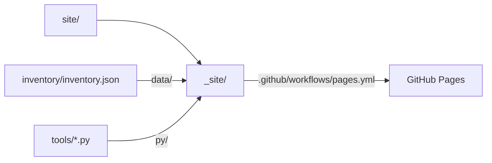

# Website

[Root](../../index.md) > [Tooling](../index.md) > [Website](./index.md) > Website

## Table of contents

- [Public repo rules](#public-repo-rules)
- [Deployment](#deployment)
- [What can run in the browser](#what-can-run-in-the-browser)
- [Battle simulation in the browser](#battle-simulation-in-the-browser)
- [Roadmap](#roadmap)

## Public repo rules

- Repo: `git@github.com:titaniteChuck/merchant-rpg-simulator.git`, branch `main`.
- Never committed (`.gitignore`): game bytecode `merchant/`, `decompiled/`, every `*.lu`/`*.lua` except
  `tools/sim/harness.lua` (our own), `saves/` (personal), `reports/` (generated), `tools/unluac.jar`, `tools/_vendor/`.
- Committed: `tools/`, `inventory/` (exported data, the website's data source), `docs/`, `site/`.

## Deployment

- Runs on push to `main` touching `site/`, `tools/`, `inventory/` or the workflow, or by hand.
- Repo setting needed once: Settings > Pages > Source = GitHub Actions.

## What can run in the browser

| Tool | Browser? | Why |
|---|---|---|
| Save decoding (`savegame.py`) | Yes | Standard library only; run through Pyodide or port to JS. File stays local. |
| Item names, recipes, sell values | Yes | `data/inventory.json`. |
| Profit calculator (`profit.py`) | Needs work | `gamedata.load_game()` reads `decompiled/`; needs a loader from `inventory.json`. |
| Combat simulator (`combat.py`) | Not as is | Runs the game's own Lua, which is not published. Options: port the combat rules, or let the user load their own game files. |

## Battle simulation in the browser

Game code the simulator runs (decompiled line counts):

| Part | Lines |
|---|---|
| Skill functions `data.AbilityFunc` (253 functions) | 2467 |
| Combat classes: Hero 616, Combatant 552, Campaign 348, Party 258, Map 228, Battle 206, Enemy 140 | 2348 |
| Item, Equipment, statsService, Utilities and `data.Default` / `data.FormulaData` parts actually used | ~600 |
| Data tables (abilities, heroes, quests, maps, gear) | export to JSON, no port |

| Option | Cost | Game files needed by the visitor | Speed | Drift on game update |
|---|---|---|---|---|
| A. Port to TypeScript | ~5.5k Lua lines, 3-5 sessions, plus a differential test against the local lupa harness | No | Fast (JS) | Re-port changed functions (diff `decompiled/`) |
| B. Lua 5.1 in WebAssembly + visitor's own game files | ~1 session (Emscripten build, loader, file picker); `harness.lua` reused | Yes (bytecode loads directly: 4-byte `size_t` matches wasm32) | ~2-3x slower than native | None |
| C. Publish the decompiled code | none | No | - | None |

- C is excluded: no game code in the public repo.
- B depends on visitors being able to supply the `.lu` files (where the PC build keeps them is not checked yet).
- A's test oracle: same seed and a shared PRNG injected in both engines, compare logs fight by fight.

## Roadmap

1. Save viewer: drop a save file, show heroes, gear, inventory, maps.
2. Profit tables from `inventory.json` (pre-computed or in Pyodide).
3. Battle simulation and gear/party optimisation (blocked on the combat-code question above).
