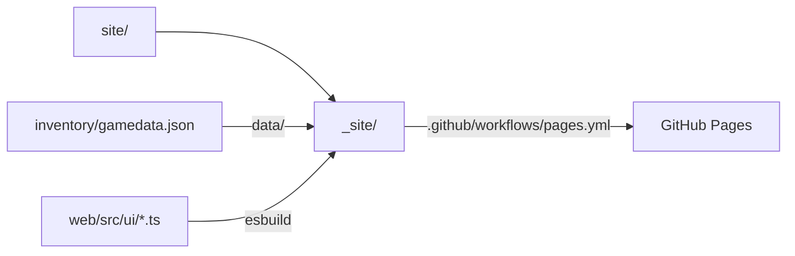
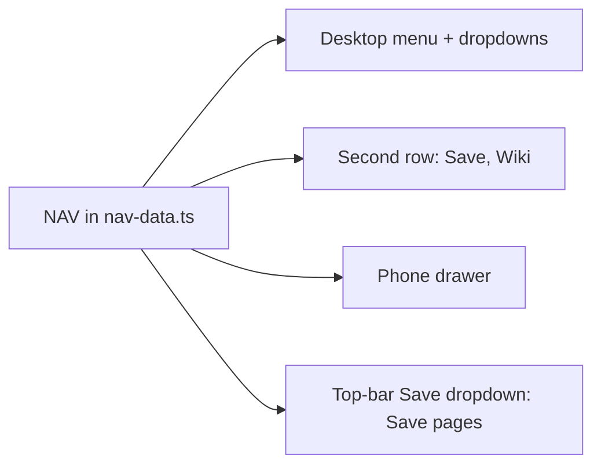
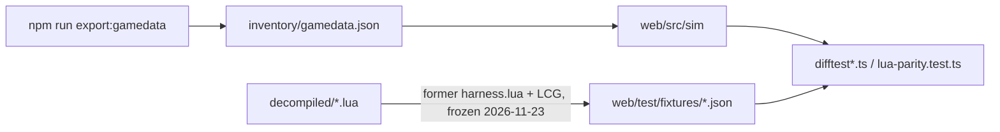

# Website

[Root](../../index.md) > [Tooling](../index.md) > [Website](./index.md) > Website

## Table of contents

- [Public repo rules](#public-repo-rules)
- [Deployment](#deployment)
- [Save viewer](#save-viewer)
- [Battle simulator](#battle-simulator)
- [Wiki](#wiki)
- [Profit page](#profit-page)
- [Farming planner](#farming-planner)
- [Levelling page](#levelling-page)
- [Class balance page](#class-balance-page)
- [Expansions](#expansions)
- [Languages](#languages)
- [Shared page parts](#shared-page-parts)
  - [Menus](#menus)
  - [Scroll position](#scroll-position)
- [What can run in the browser](#what-can-run-in-the-browser)
- [Battle simulation in the browser](#battle-simulation-in-the-browser)
- [TypeScript combat engine](#typescript-combat-engine)
  - [Regression snapshots](#regression-snapshots)
- [Roadmap](#roadmap)

## Public repo rules

- Repo: `git@github.com:titaniteChuck/merchant-rpg-simulator.git`, branch `main`.
- Never committed (`.gitignore`): game bytecode `merchant/`, `decompiled/`, every `*.lu`/`*.lua`, `saves/` (personal),
  `reports/` (generated), `tools/unluac.jar`, `web/test/fixtures/` (embed the player's heroes).
- Committed: `web/` (TypeScript engine, tools, pages' code), `inventory/` (exported data, the website's data source),
  `docs/`, `site/`. All tools are TypeScript since 2026-11-23 (the Python tools were removed).

## Deployment

- Runs on push to `main` touching `site/`, `inventory/`, `web/` or the workflow, or by hand.
- `web/scripts/assemble-site.sh [out]` builds the same `_site/` locally (esbuild bundles `web/src/ui/*.ts` into `js/`).
  Preview: `npx --yes serve _site`.
- One esbuild run, no code splitting (review F14): every page and worker is one self-contained file. Each tool page's
  entry imports `nav.ts` first, so the menus are inside its bundle and the page loads only `js/<page>.js`: one copy of
  the modules nav and the page share (dom, names, language, tooltip, Save menu), one instance of their state. Home
  loads `js/nav.js` alone; Balance still loads `js/nav.js` plus its own bundle. First visit before → after: Simulator
  266.0 → 256.9 KB (90.6 → 87.1 KB gzipped), Wiki 268.2 → 258.9 KB, Profit 185.2 → 176.3 KB, Save 160.0 → 150.4 KB.
  Shared chunks (`--splitting`) were tried and dropped: a chunk carries what any page uses from its modules, so each
  first visit grew 30–90 % (Simulator 324 KB, Home 37 KB), a bad trade for a phone-first site.
- No source maps in the site (review F21, about 10 MB); `SOURCEMAP=1 web/scripts/assemble-site.sh` adds them for a
  local debugging session.
- Data files and workers (review F13, `web/src/ui/data-files.ts`, `worker-data.ts`): a page fetches each data file
  once (`dataJson`: bytes kept, JSON parsed once) and starts its workers with `dataWorker(script, files)`, which posts
  a copy of those bytes (transferred `ArrayBuffer`s) as the worker's first message; requests posted right away wait
  for it. The worker reads them with `workerJson` and fetches only a file it didn't get (and in Node tests). Used by
  the Simulator, Solver, Levelling and Farming (`gamedata.json`; the Solver's searches also `timelines.json` and
  `warmstart.json`). Profit and Balance still fetch in the worker.
- Repo setting needed once: Settings > Pages > Source = GitHub Actions.

## Save viewer

`site/save.html` + `web/src/ui/save-viewer.ts`. The save is read in the browser, never uploaded.

- Decoding: `web/src/tools/save.ts`.
- Tables: `web/src/ui/save-tables.ts`, same columns as the former Python `savegame.py --export` (checked equal to its CSVs on a real
  save: inventory 167, maps 5, heroes 17, gear 102 rows), except the inventory's grade split (below) and, after the
  `rarity` number of the item, map and gear rows, a `rarity_name` column ("Epic", U57).
- Hero combat stats: built with the TypeScript engine (`api.newHero` + `heroStats`), shown as a radar chart.
- Sections: Overview (default), Heroes, Inventory (filter, sort, base value), Maps, Crafters. CSV downloads (heroes,
  hero gear, inventory, maps, crafters; whole tables) are in the top-bar Save dropdown, "All" first (U44): every table
  in one file, `all_tables.csv`, whose first column `table` names the table of each row (then the union of the
  tables' columns, a column a table lacks left empty; `withAllTables` / `allTablesRows` in `save-tables.ts`). One
  combined file because the site has no zip writer.
  Each section has a hash (`#overview`, `#heroes`, `#inventory`, `#maps`, `#crafters`) and is reached from the site's
  menus (U35, [Menus](#menus): the Save dropdown, the second row under the top bar once a save is loaded, the phone
  drawer); the in-page tabs are gone. A section link is a normal hash link (`hashchange` re-renders, Back works). No
  hash or an unknown one opens Overview.
- Every load opens Overview (U52): a load the visitor starts (the file picker, a drop, the example save, Reload, the
  Save dropdown's entries, on any page that calls `initSaveSource`) ends with `goToOverview` in `save-source.ts`:
  `overviewAfterLoad(path, hash)` gives `#overview` on the save viewer (nothing when already there) and
  `save.html#overview` on any other page (the Solver, Profit …), after the save is stored, so the save viewer restores
  it. The save kept in this browser, restored when a page opens, never moves the page.
- Width (U52): every page keeps its vertical scrollbar's room (`html { scrollbar-gutter: stable; }`), so a short page
  (the save viewer's Overview, the wizard) has the same main width as the long ones on a desktop with classic
  scrollbars; `save.html` uses the shared frame (`body` max 1280 px, a plain `<main>`). Tests `web/test/save-u52.test.ts`.
- "Open your save" wizard (U46, `web/src/ui/save-wizard.ts`): `save.html#open`, a view of the save viewer like
  `#hero=<id>`, shown with or without a save (it takes the no-save picker's place: `html.wiz-open` hides the drop
  zone, example row, help and the Save pages' chip row; U52: the root class was `save-wizard`, the wizard section's own
  class, so the section's 640 px max-width also narrowed the whole page). The Save dropdown's "📂 Choose another file", "📂 Open your own save" (example loaded)
  and "📂 Open your save" (no save) go there (`openWizard` in `save-source.ts`, `location.assign("save.html#open")`,
  so from another page it opens the save viewer) instead of opening the file dialog; Reload still rereads or re-picks
  the same file, and the drop zone button still opens the dialog. Step 1 (`#open`): two big choices, 💻 PC and
  📱 Mobile (links to `#open=pc` / `#open=mobile`), and U52's third card "🧪 Example / Anonymised real save" (a
  `button.wiz-choice`, same icon, label and sub layout; one equal column per card, side by side even on a phone). A platform:
  "← PC or mobile" (back to `#open`), its numbered steps (`WIZARD` in `save-wizard.ts`), a "📂 Pick a file" primary
  button (the shared chooser, `chooseSave`, returned by `initSaveSource` with the example loader) and short muted
  notes. PC: copy the system's save folder (Windows, Steam Deck / Linux (Proton), macOS), paste it in the dialog's
  address bar, choose `PlayerData.txt` or `Slot2Data.txt` … `Slot5Data.txt`. Mobile: the game's bug report mail
  (see [Save loader: Phones](../save-loader/save-loader.md#phones)), "only the slot you are playing is attached",
  "not tested on every mail app". `#open` is none of the Save pages (`currentNav` gives no sub-page, and U52 hides the
  chip row there; the real Save pages keep it). The "Where is my save file?" help gains the Mac
  folder, a Phone line and a "Step by step" link to the wizard. CSS block `u46`; tests `web/test/save-u46.test.ts`.
- Overview: small cards (`.save-cards`, about 80px tall, at most four per row so the eight cards make two full rows,
  two per row on a phone; the cards of a short last row grow to fill it, R1 F35), each with a label,
  a big number and an optional one-line hint: gold, inventory value and stacks, gold earned (both as "171,946 g"),
  items crafted, sales, heroes, maps owned / slots, mode and game version. Not the old big header tiles, not a table. No ascension legend:
  outlines carry their own tooltip and screen-reader label.
- Inventory: a kind filter (All, Equipment, Consumables, Materials, Maps, On the counter) as the shared segmented
  control (R1 F27, [Shared page parts](#shared-page-parts)), one row of chips that scrolls sideways on a phone instead
  of wrapping (R2 F14, `.inv-kinds`); above it, one line holds the name filter, the count ("167 stacks · 2,004,759 g",
  the base value) and a "?" with what the value is (the base customer price, before haggling, preferences and counter
  bonuses), what a silver or gold outline around a name marks (ascension 1 or 2, R2 F17) and what "on the counter"
  means: no sentence under the table (R2 F52). A filter that matches nothing shows one muted line, not an empty table
  (R2 F54). A Type column with the item's subtype in one spelling
  ("Essence", "Health", "Hood": `itemTypeText` in `names.ts`, R1 F30); values as "15 g". One count column per grade, best first (S, A, B, C, D: `GRADES_BEST_FIRST` / `gradeCounts` in
  `save-tables.ts`), then Total (the stack size). A stack split by grade keeps its split; a single-grade item counts
  in its grade. Cells hold numbers only ("–" for 0; rows keep 0 so the columns sort as numbers). The header shows the
  grade badge (accessible name "Grade S count"); every column sorts. The CSV has the same `S,A,B,C,D,total` columns
  in place of `grade` and `amount`.
- Header icons: `iconHeaders` in `save-viewer.ts` swaps a sortable header's text for nodes (badge, bar) with an
  `aria-label` and tooltip, since `table()` in `dom.ts` takes text labels.
- Heroes: one sortable table (avatar, class, level, ascension, combat stats, passive, status, quests, deaths). A hero's
  name opens its page, `save.html#hero=<id>` (back with "All heroes" to `#heroes`, previous/next): stat grid and
  radar, then passive, rotation and gear (U22, R2 F15). The head's chips: class, level (`lv()`), status, then
  "⚔️ 1,204 quests" and "💀 3 deaths" (`heroCounts`, U46; the former footer line is gone).
  The Asc column's swatch (`ascSwatch` in `dom.ts`, shared with the inventory, maps and Profit) holds its number in
  its own box (`.asc-n`, `text-box: trim-both cap alphabetic`), so the digit sits in the swatch's centre both ways (U46).
- Empty sections (R2 F54): no heroes, no maps, no crafters, no gear on a hero: one muted line each.
- Hero page (U22): rule everywhere in the save viewer: the passive comes before the rotation (hero page; the heroes
  CSV row already has `passive` before `rotation`).
  - Combat stats (R2 F15): a compact number grid first, four per row (HP Atk Matk Acc / Def Mdef Crit, "Crit dmg
    ×2.00"; then Eva and Speed when not 0; AP only when there is no budget line: `gridStats` in `save-tables.ts`);
    each radar stat's tooltip names the save's best value and who holds it. The radar folds under the grid
    ("Radar against the save's best", open above 760 px, closed on a phone, at most 200 px wide there). On the radar
    itself Crit's rim is always 100 and Acc's 250 (U47, see [Shared page parts](#shared-page-parts)).
  - Passive (R2 F15): one line, "PASSIVE Juggernaut · +25% HP" (`passiveLine`; the name opens its wiki page;
    "none" muted), no table.
  - Rotation: the wiki class page's rows (`table.ability-rows`): the whole row opens the wiki page
    (hover highlight, `clickableRow` in `dom.ts`), the AP shown with the same badge (`apBadge` in `dom.ts`); Basic
    rows (0 AP) have no page. Rows: turn, skill, AP, effect. One row per turn, all five, Basic turns included (U46:
    R2 F15's merged "3–5 Basic" row and `rotationGroups` / `turnLabel` are gone).
  - AP budget beside the "Rotation" label: "18 / 20 AP used · 2 left" and a bar, the page's only AP figure (R1 F37:
    the stats under the radar no longer list AP; crit damage reads "×2.00"); over budget it warns that
    the game plays the default rotation instead (`Hero.calculateAPRemainder`). `HeroView.ap` in `save-tables.ts`:
    `used` = sum of the skills' `apCost` (`rotationAp`), `max` = `api.skillInfo(hero).maxAP`, the engine's
    `heroMaxActionPoints`: 5 + floor((min(level, 40) − 10) / 2) + apMod (gear, passive); 20 at level 40 and above.
  - Gear in two columns (`gearGrid` in `dom.ts`, CSS `.gear-grid`): weapon, head, body on the left; hands, feet,
    trinket on the right (the slot names of the whole site, R1-D); an empty slot shows a dashed placeholder. Rule for the
    site: six equipment slots go in these two columns, except where a compact layout is intended (`compact: true`
    gives one column). `bySlot(items, slotOf)` keys items by slot name or itemSlot number 1-6; the battle page can
    adopt the same helper.
  - Gear cards on the hero page follow the theme (R2 F16): the card is `--card-2` with the rarity-coloured name, not
    the light sand inset in dark mode (the Battle page's gear cards are unchanged). U46: the card's frame is the
    item's ascension, a plain `--border` for 0 and the U5 silver / gold gradient for 1 and 2 (`gearAsc`: classes
    `gear-asc asc-N`, the gradient drawn as the border box under a `--card-2` padding box), no longer the rarity; the
    name keeps its rarity colour without the outline (`itemLink(…, { noOutline: true })`, the tooltip still names the
    ascension). The "?" by "Gear" says so; each card's tooltip ends with "Ascension 1 (silver outline)"
    (`ascOutlineText`). No gear at all is one muted line.
  - Tests: `web/test/hero-page.test.ts` (AP budget against the formula for levels 10-60, rotation AP, slot order),
    `web/test/save-r2b.test.ts` (R2-B: one rotation row per turn, stat grid, picker, crafter headers, empty states),
    `web/test/save-u46.test.ts` (U46: wizard, chips, gear frames, swatch).
- Crafters: headers "Lvl" (ascension 0), "Asc 1" + a silver bar, "Asc 2" + a gold bar (R2 F18), the bar being the
  ascension outline's gradient (`.lvl-asc`), named "Level for ascension-1 items" / "…-2 items" for screen readers
  (`crafterLevelFor` in `save-tables.ts`). How the levels work is a "?" on the "Lvl" header, not a paragraph under
  the table. The save keeps `level`,
  `ascLevel` (ascensions unlocked) and `prestigeLevel` (the level reached in the current ascension, 1 after each
  ascension). As in `obj.Crafter.lua` `getEffectiveLevelForItem`, an item of the crafter's current ascension uses
  `prestigeLevel` and lower ascensions use `level`; an ascension not unlocked shows "—".
- Maps: time as a duration ("4 min"), value as "15 g"; essence per run from the profit model (`mapEssence`, with the map's grade, ascension, prefix and suffix).
- Item names with modifiers (U34): "[Prefix] Item +N" everywhere (inventory, counter, maps, hero gear, crafters, CSV),
  `modItemName` in `names.ts` (see [Languages](#languages)); name columns sort by the base name.
- No "… page in the wiki →" links next to a name that is already a link (U34): a name link opens its wiki page.

## Battle simulator

Two pages since U41, one code: the Simulator, `site/battle.html` + entry `web/src/ui/battle.ts`, and the Solver,
`site/solver.html` + entry `web/src/ui/solver.ts`. Both entries call `initBattlePage(kind)` of
`web/src/ui/battle-page.ts` (the page code, `battle.ts` until U41); the Solver's panel and results are
`web/src/ui/battle-search.ts`; runs go to `web/src/ui/battle-worker.ts` (web worker). Each page has its own bundle
(`js/battle.js`, `js/solver.js`).

- Two pages (U41; until then two modes of one page, chosen in a "What do you want to do?" step 1):
  - Menu: Battle ▾ with Simulator and Solver, in the dropdown, the second row and the phone drawer (see
    [Menus](#menus)); the Battle link itself opens the Simulator.
  - Simulator (`battle.html`): no mode chooser. U48: no section titles on screen (the `h2`s are visually hidden) and
    no Results section. The Simulate panel holds (U65) the opponent's controls first (see U65), then Runs, ▶ Simulate, its "?" and then `#sim-summary`: a run's progress
    and Cancel, its error, or its summary (win rate, grade when won, Show details and the run line); the details
    (`#results`, empty and not shown until a result) sit right under the panel; then the Party and Flow tabs with the
    opponent's card in the Party tab, as below. Until U48 these were numbered steps (Simulate, Results hidden until the first
    run, Party and opponent).
  - Solver (`solver.html`, U42 layout): no step headings. The spoiler guard first; once accepted, the warning line,
    then one full-width Solve panel (`#solve-box`): a compact Quest / Map segmented control with its picker (the
    enemy with Rare variant and Quest size, or the map with ascension and grade for a catalog map), then smallest and
    largest party, Include scrolls, the time budget in seconds and 🔎 Solve, the hero table under them (U50); a running
    solve's progress bar, clock and Cancel show inside the panel. No enemy card and no tabs during setup: the
    opponent card (radar, map facts, scroll pickers) is drawn into `#target-card`, the Party tab's right column, so it
    shows with the party a result's Show brings (U65: `drawEnemyCard` in `battle-page.ts`, on both pages; the map's
    facts and scrolls are in the panel, and until U65 the Simulator had no `#target-card` and kept its card under its
    pickers). The results section (`#search-results`, full width, under
    the panel) is hidden until a solve is done; a new solve hides the last results until it ends; a Cancel or an
    error is a line in the panel. Then "Party and flow", the Party and Flow tabs (`#party-box`), hidden in
    the HTML: no party panel at all until a solve has run and a result's Show (was "Load") has put its setup in the
    party (`SearchContext.onShow` → `revealParty`). U48: read-only there, since "▶ Open in Simulator" is where it gets
    edited (`pageControls("solve")` in `battle-edit.ts`): the same cards and Flow without hero pickers, ⇄ controls,
    include boxes, Clear all, drag and drop, the Flow's ▾ or its enemy picker; a row's empty slots are a plain count.
    U50: no 🔒 locks either (the Solve panel's hero table says which heroes a solve keeps); the map room bar, the calculations
    and the remembered tab work as on the Simulator. Once shown it stays for later solves; a new save or Forget hides
    it again.
  - Scribe hidden (U42, both pages): when Scribe is not owned and "Show expansion content" is off (`isHidden("Scribe")`
    in `expansion-state.ts`, the rule the wiki hides Scribe content by), nothing of maps shows, the save's own maps
    included: no Quest / Map toggle at all (quests only), no map pickers, ascension or grade, no "Include scrolls" on
    the Solver, no "<Region> – Map" groups in the enemy picker (`enemyGroups(ids, false)` in `battle-setup.ts`), and
    so no map room bar or map-run results. A remembered map run falls back to a quest (`syncOppKinds`); turning
    Scribe on or off in the expansion menu redraws at once (`subscribe(onExpansions)`).
  - Shared state: the Solver's party is its own and is kept in memory only (`persistParty` / `restoreParty` do
    nothing there), so Solver edits never change the Simulator's remembered party (`battle-party:<file>`). The
    Solver's opponent is remembered apart (`solver-opponent`, starting from the Simulator's `battle-opponent` on a
    first visit). "▶ Open in Simulator" beside the step 3 heading copies the shown party (slots, rotations, heroes left
    out; the Simulator's edited rotations of other heroes kept: `simulatorPartyFrom` in
    `ui/battle-links.ts`) and the opponent to the Simulator's keys, then opens the Simulator. Why: a solver result is
    an answer to look at; it shouldn't silently overwrite the party the visitor is building by hand.
  - Old links: `battle.html` with `?mode=solve` (or `party`, `solver`), `?solve`, `#solve`, `#solver`, `#mode=solve`
    goes to `solver.html` (`solverRedirect` in `ui/battle-links.ts`, run by the entry before the page is built). The
    old remembered mode (`battle-mode`) is removed and no longer read.
  - Tests: `web/test/battle-u41.test.ts`.

- U48 (both battle pages; tests `web/test/battle-u48.test.ts`, CSS in the `U48` block):
  - Drag and drop (Simulator): a filled hero card is picked up from anywhere but its form controls (`[data-drag]`;
    every slot is a target, `[data-slot]`) with Pointer Events (`web/src/ui/party-drag.ts`). Mouse or pen: after 6 px
    of movement. Touch: after a 350 ms rest within 10 px, so a finger that moves sooner scrolls the page (no
    `touch-action` change); once on, a non-passive `touchmove` on `#party` stops the page scrolling under the finger
    and the page scrolls by itself near the window's top or bottom edge. The card follows the pointer, the slot under
    it is outlined, Escape or a release elsewhere puts it back, the click that ends a drag is swallowed. On a filled
    slot the heroes swap, on an empty one the hero moves (`moveHero` in `battle-edit.ts`, pure: include ticks follow
    their hero); refused with a toast when it would empty the required slot (Front 2 of a party quest)
    or leave Front 1 on a solo quest. The card's hero picker stays (click to pick, keyboard).
  - The size cap: "ℹ️ At most N heroes" under the opponent's picker (`#party-cap`, filled by `renderParty`) when it
    leaves heroes out; no names (their cards say "over the limit").
  - Flow: no "vs <enemy> · change" line (the enemy column's head names the enemy and changes it); a map run keeps
    "map run: <map>". One long page at every width: no scroll frame of its own (until U48, 700 px and less scrolled
    sideways in an 85vh frame); on a phone the columns share the width (no minimum width, the HP bar over its number,
    "▾ calculation" shows only its ▾; until U51 a 22 px turn column). A calculation opens in its column: since U51
    exactly the column's width (until U51 it was as wide as its text, pulled left by `calcPanelLeft`; see U51).
  - "↑" (both pages, `initToTop`): fixed bottom right, `aria-label` "Back to top", shown once the page is scrolled
    down more than a screen (`toTopVisible`); back to the top smoothly, at once under reduced motion, the focus on
    `main`. The page keeps 76 px under its end so the button never covers the last content; a toast moves above it.

- U50, the Solver's hero table (tests `web/test/solver-u50.test.ts`, CSS in the `U50` block):
  - No 🔒 locks anywhere: not on the Solver's cards (`pageControls` has no `lock`), not in the party state
    (`PartyState` / `StoredParty` have no `locked`, `assignHero` locks nothing). The Simulator never showed them and
    they fed only the solve, so they are gone from both pages; Farming keeps an old stored `locked` untouched.
  - "Leave heroes out" is replaced by a fold under the Solve options, its summary "Heroes · 2 must · 3 out": a table of
    every hero of the save (name, numbered when several share it, `heroNames` in `levelling-view.ts`, and `lv()`;
    class; then a segmented radio group per hero named "<hero>: in the solve", `segmented()` in `dom.ts`, so arrow keys
    and screen readers work): ✓ Must include (green when picked), / Neutral (the default), ✗ Exclude (red). A hero of
    a hidden class starts as Exclude (as the old chips did).
  - Stored per save in localStorage `solver-heroes:<file>` (save hero id → `must` / `neutral` / `exclude`, every change
    at once; storage blocked: kept for the page view). Migration (`migrateOldLocks` in `ui/solver-heroes.ts`, run by
    both pages when a save loads): with nothing stored yet, the heroes locked in the old `battle-party:<file>`
    become Must include. The old left-out chips were never stored, so there is nothing to migrate from them.
  - The solve (`solverPick`): Exclude leaves the pool; Must include is the search's `lock` (`searchParties`: in
    every result party, any position, the party rules, the required Front 2 and the sizes kept). More Must include
    heroes than the opponent takes, or than the largest size asked, is one error line and no solve. Warm start and
    the time budget are unchanged.

- U51, Battle round 3 (tests `web/test/battle-u51.test.ts`, CSS in the `U51` block):
  - Solver results: every row shows Show · Party · (Scrolls) · Win · Grade · Turns (quest) or Progress (map) · Life ·
    Dead. `solverFigures` (`battle-setup.ts`) reads what the evaluation already measured (`combat.ts` `evaluate` /
    `evaluateMap`, carried to the page in `PartyConfig.ev`): Grade is the average grade of the won fights or runs as a
    letter badge (the average in its tooltip, "—" when never won; a quest now has one too); Life is `hp_left`, the
    party's HP left at the end as a share of its max HP (fallen heroes count 0), whole percent; Dead is the sum of the
    heroes' `death_rate`, heroes down at the end on average, one decimal ("0" muted when under 0.05). Short heads,
    each with its tooltip; on a phone the number cells are tighter.
  - One "?" beside the Party / Flow tabs, the open tab's: `#party-help` and `#plan-help` both sit in the tab row and
    `showTab` hides the other one (the Flow's "?" used to sit on the opponent line below the tabs). Simulator and
    Solver alike; the Flow's head line hides when it has nothing (a quest).
  - Flow without a "Turn" column: the column heads, the plan rows and the action lines share one grid of the actors'
    columns (`repeat(var(--pg-cols), minmax(0, 1fr))`, gap 3 px) at every width. Each turn starts with a full-width
    band, "Turn 3" (`turnRow` in `timeline.ts`, `flow-parts.ts` since U63, `turnBand` in `battle-layout.ts`): a `role=row` whose one
    `role=rowheader` spans every column (`aria-colspan`), first in the turn's `rowgroup` ("Turn N"). Turns 6, 11 …
    add "· ↻ rotations again" (the old dashed round divider is gone). The planned rotation (no fight) and the
    "Planned, not reached" turns use the same bands (muted for the latter).
  - Calculations are exactly their column's width: the line's `tc-calcs` box is a grid with the line's columns
    (`grid-auto-flow: row dense`) and each panel takes its column (`calcColumn(order, cols)`, 1-based
    `grid-column`), its text wrapping inside, left-aligned. Panels opened from several columns of one line sit side by
    side (a boss hit's damage on each hero at once); a heal's panel in the same column goes under the damage's. No
    margin maths, no `ResizeObserver` (`calcPanelLeft` and `placeCalcs` are gone).

- U58, three Flow layouts to compare (tests `web/test/battle-u58.test.ts`, CSS in the `U58 tabs` and `Flow 2` blocks):
  - Tabs Party · Flow 1 · Flow 2 · Flow 3 on both pages (U63: Party · Flow 2 · Flow 3, see U63) (the Solver's read-only as before), one Flow panel
    (`#flow-panel`, `aria-labelledby` the open Flow tab). `tabKeys` keyboard and the U51 "?" unchanged; each Flow has
    its own help after the run's note. The open tab is remembered per page (sessionStorage `battle-tab` on the
    Simulator, `solver-tab` on the Solver; an old "flow" reads as Flow 1). On a phone (420 px and less) the tabs are
    narrower so the four and the "?" fit one line.
  - Registry `web/src/ui/flow-layouts.ts`: `FLOW_LAYOUTS` (id, label, render, help). Every layout has Flow 1's
    signature, `FlowRender = (quest: { id: number; rare: boolean }, members: PlanMember[], trace?: TracedFight | null,
    edit?: PlanEdit) => HTMLElement | null` (null: no timeline for the enemy; `trace` null: no fight to show; `edit`
    undefined: read-only). `renderPlan` draws the open layout (the last one opened while Party is open), and opening
    another Flow tab draws the panel again. Adding a layout: an entry there and a tab button in both pages.
  - Flow 1 is `partyPlan` in `timeline.ts`, unchanged (its helpers are exported for the other layouts). Removed in U63.
  - Flow 2 (`web/src/ui/flow2.ts`, `renderFlow2`): no column heads. Each turn: its band, then a row of cards, one per
    fighter in Flow 1's column order, then the action lines as in Flow 1 (calculations one column wide, `calcColumn`)
    without the effect texts, which are in the cards. After the last turn, an "End" band and the cards as the fight
    ended, then the result and the "Planned, not reached" turns. A card: the name (strong, two lines at most), a slim
    HP bar with the number (the HP at the turn's start: the previous turn's end; turn 1 from the trace, `fightStart`),
    then the buffs and then the debuffs, one per line as text with their turns left at the right (green, red; a dotted
    line between the two groups; no dots), the source on hover. Turn 1's cards add the place and level ("Front 1 ·
    lvl 42", `PlanMember.level`) or "enemy" (· rare), and carry the hero and opponent pickers Flow 1 has in its heads.
    Class colour: the card's top edge and a 7 % tint; an ascended hero's frame is silver or gold (`--asc-grad`). A
    fallen fighter: a dashed muted card, ✝ before the name, the bar empty at 0, no effects. Screen readers: each card
    row is a `role=row` named "Turn 3: each fighter at its start", each card a cell with its HP and "Buff: …" /
    "Debuff: …, 2 turns left" as text. A narrow card (a phone) puts the bar over the number and shortens a long number
    (container query at 84 px). Without a traced fight, Flow 1's planned rotation. U63: the class colour outlines the
    hero card (no ascension frame) and the HP is the shared bar (see U63).
  - Flow 3 (`web/src/ui/flow3.ts`, `renderFlow3`): U59's layout, below.
- U59, Flow 3 (`web/src/ui/flow3.ts`; tests `web/test/battle-u59-flow3.test.ts`, CSS in the `Flow 3` block), one of
  the three Flow layouts the user compares (Party · Flow 1 · Flow 2 · Flow 3; the tabs and the registry
  `web/src/ui/flow-layouts.ts` are U58's). Entry point `renderFlow3(quest, members, trace, edit)`, the same inputs and
  result as Flow 1's `partyPlan` (`timeline.ts`, unchanged); without a traced fight it returns Flow 1's planned rotation.
  - Columns: one per fighter in action order (`planGrid`), a compact sticky head row (name, place; `aria-hidden`, since
    every card names its fighter). No turn bands, no end-of-turn summary.
  - One card per action, each on its own grid row of one ordered list (`ol.f3-grid`, `grid-row` set per item), so a
    card always sits lower than the previous action's card in any column and the DOM order is the reading order.
    `flow3Items` builds them from the same trace as Flow 1: each action goes through `planTimeline` as a turn of its own,
    so its "end of turn" state is the state right after that action (HP, live effects, the same chips and calculations).
  - A card, top to bottom: the fighter's name (class colour on the card's top edge; the enemy in the gold trim) with a
    tiny "T3" on each turn's first item; the skill as headline (the planned one struck out under a stun or a forced
    action, "miss"); the result, one row per fighter touched (name or "self", −damage / +healing with a "▾" each, "crit",
    "miss", "✝ KO", the effects that landed; heroes that only got the same effects share one "Party" row, or their
    names); then, quieter under a line, the HP right after the action and the fighter's effects, one per line, text
    only (turns left after "·"). A "▾" opens its calculation inside the card (`calcView`, as Flow 1).
  - HP (follow-up, the user's call): one compact bar, 13 px tall, with "remaining / total" inside it ("1,097 / 2,000");
    no number beside it, and a tighter state area (3 px above and below its line), so the cards are shorter. The fill
    is a tint of the tone colour (green, amber, red at 55 %) and the text is the theme's `--fg` with a halo of
    `--card`, so it reads over the filled and the empty part alike in light and dark themes. The bar is its own
    container (`container: f3hp`): under 118 px the compact numbers replace the whole ones ("9.7K / 10K", `fmtCompact`,
    only when the total reaches 10,000; Flow 2 does the same on phones), and an ellipsis is the last resort. Down:
    "0 / total" in an empty bar, in the bad colour. Desktop columns and the phone list use the same bar; the
    screen-reader label is unchanged ("Warrior: 1,097 / 2,000 HP", "Warrior is down").
  - Turns: a hairline across the columns between two turns (`li.f3-break`, `aria-hidden`), none before a turn that
    shows nothing.
  - Down: the trace has no action for a fallen fighter, so a dimmed "†" goes once in its column at the place of the
    first turn it misses (`dead` items; an old trace's `did = null` action the same), nothing more until it stands again.
  - Screen readers: each card starts with a visually hidden sentence, "Turn 3, Warrior: Slash on Boss, 1,240 damage"
    (`flow3Sentence`; several fighters joined by "; on", "the party" for a party buff, "falls", "critical", "missed");
    the visible names and numbers are `aria-hidden`, the skill link, the "▾" buttons ("Calculation: the damage to Boss")
    and the HP (`role=img`) stay.
  - Phone: one long page, no scroll frame. Under 560 px of Flow width (container query) there are no per-fighter
    columns: the list becomes a flex column (the inline `grid-row` / `--f3-col` no longer apply), so the items read
    top to bottom, full width, in the DOM's order, which is the chronology. No head row, no empty cells, no notch. Each
    card names its fighter, bolder, with a 4 px class-colour edge on its left; a "†" shows its fighter's name
    (`span.f3-dead-who`, hidden on a wide box) with a faint class-colour edge; the hairline and "T3" tag work as on a
    wide box, and a "▾" opens its calculation inside the card, at the card's full width. Desktop is unchanged: one
    column per fighter.
- U63, Flow 1 removed; Flow 2 and Flow 3 share their parts (tests `web/test/battle-u63.test.ts`, CSS in the `U63`
  block; the U58, U59, U51, U48, R3 QA, R2-C, U41, U40, a11y and tab tests updated):
  - Tabs Party · Flow 2 · Flow 3 on both pages; the labels stay (the layouts are still compared). A remembered tab
    "flow" or "flow1" opens Flow 2 (`parseTab`), the panel starts on Flow 2 and `flowLayout` falls back to it.
  - Code: Flow 1's rendering (`partyPlan`'s traced view `flowChart`, its end-of-turn band `hpEl` / `fxEl`, `takenEl`,
    `planNote`) is deleted. The parts the Flows share moved from `timeline.ts` to `web/src/ui/flow-parts.ts`:
    `PlanEdit`, `OptionGroups`, `nameEdit`, `skillEdit` (U64: replaced by `slotSkill`), `actorEl`, `calcPanel`, `calcToggle`, `turnRow`,
    `unreachedRows`, `fmtInt`, `FLOW_PAGE`. `timelineOf`, `tlName` and `loadTimelineData` stay in `timeline.ts` (the
    wiki's enemy strip uses them too). Dead CSS removed: `.tc-status`, `.tc-hp*`, `.tc-fxs`, `.tc .pg-heads`, the
    phone `.tc-hp` rules, Flow 2's `.f2-hp` / `.f2-bar` / `.f2-full` / `.f2-short` / asc frames, Flow 3's `.f3-hp*`.
  - No fight to show (no party, a party problem, an AP problem, a map room not reached): the rotation as planned, the
    smallest part kept of Flow 1 (U36's plan: heads with the hero and opponent pickers, turns 1-5 with their bands
    and ▾), now `plannedRotation` in `web/src/ui/flow-planned.ts`; both Flows return it. Chosen over redrawing the
    plan in Flow 2's cards: it is the one view that shows the enemy's effects on each hero per turn, and its heads keep
    every picker when there is no fight. Nothing editable is lost: with a fight, Flow 2's turn-1 cards carry the hero
    and opponent pickers (Flow 1's heads did) and its lines the ▾ of turns 1-5 (U64: the skill name itself); without
    one, the planned view does.
  - "?" texts: Flow 2's says how to read the cards and lines, the rotation rule (slot k on turn k, turn 6 is turn 1)
    and, on the Simulator, the pickers; both end with the planned rotation's line (`PLANNED_NOTE`).
  - Flow 2's hero card is outlined in its class colour (`.f2-card:not(.dead)`, border 80 % of `--c`); no ascension
    frame (`asc-1` / `asc-2` and `PlanMember.asc` are gone). The enemy keeps its own colour; a fallen card stays dashed.
  - One HP bar (`web/src/ui/flow-hp.ts`, `hpBar(v, label)`, with `hpTone`, `hpTexts`): Flow 3's U59 bar, now used by
    both Flows (classes `fl-hp`, `fl-hpbar`, `fl-hpfill`, `fl-hptxt`, `fl-hpfull`, `fl-hpshort`; container `flhp`):
    "remaining / total" inside a 13 px bar, the compact numbers under 118 px when the total reaches 10,000, "0 /
    total" in an empty bar when down, `role=img` with the label ("Ana: 1,097 / 2,000 HP"; Flow 3: "Warrior is down").
  - Map room bar on a PC (`roomScroller` in `battle-page.ts`, pure parts in `battle-layout.ts`): it has no scrollbar,
    so a vertical mouse wheel over it moves it sideways (`roomBarWheel`: lines and pages counted, clamped; 0, so the
    page scrolls, when the bar fits, at the end the wheel pushes to, or for a sideways swipe the browser handles; a
    non-passive listener cancels only the wheel it uses). A round ‹ / › button over each faded edge, shown only while
    there are rooms that way (with `fade-start` / `fade-end`), scrolls by 3/4 of the bar (`rowStep`); they are a mouse
    aid (`aria-hidden`, out of the tab order, they don't take the focus) and hidden on touch screens (`hover: none`).
    The selected room stays in view, 36 px clear of the edges (`scrollToShow`), on a click, the arrow keys, Home, End
    and a redraw (smooth unless reduced motion; at once on the first draw and when a hidden tab is shown). The keys
    are `tabKeys`, unchanged.
- U61, the Party view's HP chart (`web/src/ui/hp-chart.ts`; tests `web/test/battle-u61.test.ts`, CSS in the `U61`
  block), on both pages (the Solver's once a result's Show fills the party; nothing to edit in it):
  - Place (U65: the Party view's first row, full width, see U65; U62: the third column, `#hp-col`): a box `#hp-chart` made once at the end of `#opp-col` (`hpBox` in `battle-page.ts`), so under the opponent's
    card and its spider chart (the Simulator's `#target`, the Solver's `#target-card`); redrawing the card leaves it.
  - Data: the very trace the Flow tabs show. `renderPlan` traces once (`planTrace`: Simulate's first fight, seed
    `fightSeed(1, 0)`; a map run: `mapTrace`, the Map run mode's first run) and hands that object to the open Flow
    layout and to `showHp`; the chart never simulates. Every edit that re-traces the Flow (a skill, the rotation, a
    hero, include ticks, the enemy, rare, quest size, the map, its grade or scrolls) goes through `renderPlan`, so the
    chart follows. Only the box's content is replaced (`drawHpChart`); the "Table" fold keeps its open state and focus.
  - Series (`hpData`): x is the fight's start (Flow 2's `fightStart`) then each turn's end (the last `life` the trace
    recorded up to that turn); y is HP as a share of max HP (0-100 %), heroes and enemy on one scale. One line per
    hero in its class colour (`cls-N`, `--c`), the enemy dashed in the gold trim (`--trim`, as Flow 3). A fall: the
    line at 0 and a cross there (titled "<name> falls: turn 7"), again if it stands up and falls again.
  - A map run: the fought rooms one after the other (rooms not reached or skipped are left out), a dashed line before
    each room after the first, the x ticks naming rooms (1, 2 … Boss); the enemy line restarts with each room's enemy.
  - Absolute HP: hovering or tapping the plot shows a readout (the nearest step: "Turn 7", each fighter's HP / max, ✝
    when down) with a guide line; the legend under it gives each fighter's HP at the end and "fell turn N".
  - Accessible (U65: the SVG is the turn slider, described by the summary; see U65): the SVG is `role=img` named by `hpSummary` ("HP as a share of max HP over 14 turns, lost. Ana falls
    (turn 9)…"); a "Table" fold lists every step's HP (a row per turn, a column per fighter). The readout is
    `aria-hidden` (the table says the same).
  - Empty: no fighters, a party problem, an AP problem or a map run that can't run: one muted line ("HP by turn: shown
    once the party can fight."); no opponent built: the box is hidden.
  - Size: viewBox 360 × 200 (U65: as wide as the box, 200 high), `width: 100%`, so about 1:1 on a 375 px phone (full width there, its column on a desktop);
    colours from the theme tokens only (light and dark).

- U62, smaller Party view cards (both pages; `web/src/ui/fighter-card.ts`, `web/src/ui/pick-list.ts`; tests
  `web/test/battle-u62.test.ts`, CSS in the `U62` block):
  - Three columns (U65: replaced, the chart on top and heroes | opponent; see U65): heroes | opponent | HP chart (`#hp-col`, after `#opp-col` in both pages' `#setup-grid`; `hpBox`
    makes the U61 box there, no longer under the opponent's card). 961-1199 px: heroes on the left over two rows, the
    opponent then the chart on the right; 641-960 px: heroes full width, opponent | chart under them; 640 px and less
    (a 375 px phone): one column, heroes, opponent, chart.
  - The boss line (U65: replaced by `--enemy-line`, white or near-black; `--boss` deleted): purple, a `--boss` token in both themes (dark `#c99bff`, 4.6:1 on `--card`; light `#6b21a8`,
    7.7:1), still dashed, since the Assassin's class colour is purple too. The enemy card's stripe uses it as well.
  - One builder, `fighterCard({ kind, classes, attrs, head, tools, lines, stats, passive, rotation })`, for the hero
    cards and the quest enemy's card; one CSS family, `.fc` (`.fc-hero`, `.fc-enemy`, `.fc-head`, `.fc-stats`,
    `.fc-rows`). The old ones are deleted: `abilityBlock`, `statStrip`, the "⇄" `swapControl`, the U39 spider chart
    (`enemyRadar`, `EVA_RIM`) and their CSS (`.slot`, `.b3-slot`, `.stat-strip`, `table.slot-rows`, `.swap`,
    `.ap-mini`, `.opp-hp`, ...). The map run's card is unchanged.
  - The head is the picker. A hero: its `<select>` (`.fc-pick`, the ascension as a silver or gold frame), the include
    box at the right; no avatar, place, class or level pill, no "required" / "left out" pill (the outline, the
    dimming and the card's title say it; an empty slot the opponent doesn't allow says why in its picker, "— solo:
    Front 1 only —"). The enemy: the enemy `<select>`, then the quest size as a compact `<select>` ("×1",
    `aria-label` "Quest size", no label text) and its "?"; the size cap note and "Attacks first" under the head.
    Read-only (the Solver): the same words as plain text (the enemy's pickers stay in the Solve panel). U65: the enemy
    card has no picker on either page (the enemy and the quest size are in the Simulate panel).
  - Rare variants: no "Rare variant" box. The enemy list (`questOptions`, also the Flow's enemy head; was
    `flowEnemyOptions`) lists a quest with a rare variant twice, "Lvl 20 · Goblin" (`20`) and "Lvl 20 · Goblin
    Warlord (rare)" (`20:rare`; `questEntries`, `questValue`, `parseQuestValue` in `battle-setup.ts`). The stored
    opponent keeps its `{ quest, rare }` format, so old choices and U53's "Fight in simulator" links (`rare=1`) pick
    the rare entry (`restoreOpponent`), else the normal one.
  - Stats: two lines of four "label value" pairs (a `<dl>` grid), the same for heroes and the enemy: HP Atk Matk
    Def / Mdef Acc Eva Crit (`statGrid`; five digits shortened, "12.3K", the whole value in its tooltip). A hero's
    with the passive it plays (an edited one too); the enemy's from the engine's `Enemy` (`enemyStats`: the game
    mode's multipliers, Acc 100, Crit 0, HP times the quest size).
  - Passive and rotation: no "Passive" / "Rotation" titles, no turn numbers (an ordered list). A hero: its passive
    (no effect on its line) with the rotation's "14 / 20 AP" at the right, then five rows, skill and AP. On the
    Simulator a skill or the passive is a button (`aria-label` "Ana: turn 2 skill: Fireball. Change"; no wiki link,
    no "⇄"): it opens a list in place under its row (`role=listbox`, ↑ ↓ Home End, Enter or Space picks, Escape
    closes, Tab or a tap elsewhere closes), each choice with its AP and its effect under the name (`skillDesc`,
    `passiveText`). The edits are the same (U40's AP refusal toast and focus back on the button). On the Solver,
    plain text. Both show the effect on hover (`skillTip`, `passiveTip` in `wiki-data.ts`). The drag leaves the
    open list alone (`.pk-list` in `party-drag.ts`).
  - The enemy's rotation: its skill on turns 1-5 from its timeline (`enemyTurns`, the data of the Flow and the wiki's
    strip; without it, the game's rotation), the same rows, read-only, no AP.

- U64, the Flows' skill names (tests `web/test/battle-u64.test.ts`, CSS in the `U64` block; R3 QA, U48 and U63 tests
  updated):
  - No wiki link on a skill name in Flow 2, Flow 3 or the planned rotation (`skillLink` is gone from the Flow
    modules). A name that can't be edited is plain text with its effect on hover (`skillText` in `flow-parts.ts`,
    `skillTip`): the enemy's skills, a hero's forced action, turns 6 and later, Flow 3's fight (read-only), and every
    skill on the Solver.
  - On the Simulator, a hero's skill name in turns 1-5 (Flow 2's action lines and "Planned, not reached" rows, the
    planned rotation's cells; struck out under a stun or a forced action) is the slot's picker: `slotSkill` builds a
    U62 `pickButton` (`pick-list.ts`) whose list opens in the cell, each choice with its AP and effect, the same
    keyboard. The separate ▾ (`skillEdit`, `editControl`, `.fl-edit` CSS) is gone. `PlanEdit.skills(loc, current)`
    returns the Party view's choices (`rotationChoices(...).map(skillOption)`; `rotationOptions` deleted), so both
    views share one option builder. `setSkill` is unchanged: U40's AP refusal toast, then `renderParty` and
    `renderPlan` trace the fight again, redrawing the Flow and the HP chart, and the focus goes back to the name
    (`#flow-panel [data-focus="skill-<loc>-<turn>"]`).
  - Hero and opponent names in the Flows were never wiki links: in an editable view they keep U40's `nameEdit`
    (the hero list, and the opponent's `questOptions` with its rare entries); read-only, plain text. Unchanged.

- U65, the turn chart drives the cards (both pages; `web/src/ui/hp-chart.ts`, `fighter-card.ts`, `battle-page.ts`,
  the trace in `web/src/sim/api.ts` and `web/src/tools/fight-trace.ts`; tests `web/test/battle-u65.test.ts`, CSS in
  the `U65` block; the U61, U62, U42, U43, R2-C and quest-XP tests updated):
  - Layout: the chart (`#hp-col`) is the Party view's first row, full width, then heroes | opponent
    (`grid-template-areas: "hp hp" "party opp"`); 960 px and less (a 375 px phone): one column, the chart, the heroes,
    the opponent (its column at most 560 px wide). U62's three-column rules are deleted. The SVG's viewBox is as wide
    as its box (`chartWidth`, 300-1600) and 200 high, so the text keeps its size at every width; a resize or a hidden
    tab shown draws it again (`ResizeObserver` in `drawHpChart`).
  - The enemy line and the enemy card's stripe: `--enemy-line`, white (`#ffffff`) in the dark theme; in the light
    theme white would vanish on the parchment, so the theme's strongest neutral, its text colour `--fg` (`#2a2018`,
    near-black, about 14:1 on `--card`). Still dashed (6 3), so a class colour near it stays apart. U62's purple
    `--boss` is deleted.
  - Tabs HP · Damage dealt · Heals (`CHART_TABS`, a `role=tablist`, ← → Home End) on one x axis (turn 0, then each
    turn's end). HP as before (a share of max HP). Damage dealt and heals are cumulative (U66: per turn, see U66): lines that only go up read
    better than per-turn spikes (the rotation repeats every 5 turns) and compare the fighters' totals at a glance; the
    per-turn amount is in the readout and the table ("1,240 (+310)"). The y axis of those two is in round amounts
    (`niceMax`, `fmtCompact`). Who did what comes from the trace's calculations (`addCredits`): damage that landed on a
    standing fighter of the other side, overkill included, a damage over time its caster's; healing as the HP really
    given back. A hero's sums run over a whole map run, the enemy's restart with each room. The legend shows the end
    value (HP) or the total; the falls' crosses are on the HP tab only. The open tab is kept for the page view.
  - Picking the turn: the plot is a `role=slider` ("Turn", `aria-valuetext` the step, described by the summary
    `#hp-sum`); a click or a tap picks the nearest step (`nearestStep`), ← ↓ / → ↑ one step, Page Down / Up five, Home,
    End (`stepAfterKey`). A marker line and "Turn N" show it. The hover readout stays. Default: turn 0. A new trace
    (an edit) keeps the picked room and turn when the new fight still has it, else turn 0 (`pickStep`; `turnPick` in
    `battle-page.ts`). A pick only repaints the cards (`selectTurn` → `paintTurn`), nothing is traced again.
  - The cards at that turn (`paintTurn`, `paintCard` in place, so the pickers, an open list and the focus stay): the
    state at the end of the turn, from the chart's data, which is the Flows' own trace (`hpData` builds it with the
    series): an HP bar (`flow-hp.ts`) over the stats; the stats are the engine's live ones (Atk, Matk, Def, Mdef, Acc,
    Eva, Crit with that moment's buffs and debuffs, max HP); the buffs and debuffs inline under the stats and above the
    passive (`fxList`: Flow 2's text, green or red, "·2" turns left, the source on hover); the rotation row of the skill
    it played that turn highlighted (`.fc-row.active`, `aria-current`; none when stunned or down). A hero that doesn't
    fight, or no fight to show: the card's own stats, nothing else.
  - Turn 0 is the start, before any action: full HP, the stats as the fight began, no effects, no row.
  - The trace (read only): each `life` entry also has the fighter's live stats (`TRACE_STATS`), and a battle's first
    action carries the state before it (`start`: life and effects), handed on as `FightTrace.start` (a map room's too).
    Taken in the trace hooks that only read; no simulation result changes, the Lua-parity tests stay green.
  - A map run (U66: replaced, every room has its turn 0 again, on the last room's last turn's x; see U66) (the user's call, replacing a turn 0 per room): only the first room has a turn 0. Every later room
    starts directly with its turn 1; the state before it is the previous room's last turn (the room's own start, the
    new enemy at full HP, effects cleared, HP rounded or healed by a scroll, is not a step). This holds for the x axis
    and every tab's series (a hero's cumulative damage and heals run on across the rooms, nothing resets at a skipped
    turn 0; the enemy's restart with each room's enemy at its turn 1), the room boundaries (a dashed line halfway
    between a room's last turn and the next room's turn 1; `runStarts` is that turn 1), the turn selection (click and
    keys go from a room's last turn straight to the next room's turn 1), the cards, the default and kept selection
    (turn 0 is the first room's), the hover readout and the table (no "Room N: start" row after the first room). A
    fall in a later room's turn 1 is checked against that room's own start, not the last room's last turn. The enemy
    card follows the step's room: on room N's turn 1 it shows room N's enemy, on the previous room's last turn that
    room's enemy.
  - The enemy card (`drawEnemyCard`, `#target-card` on both pages): one enemy, no picker, the plain "Lvl N · name"
    (`lvStart`), × the quest size, "(rare)", "Attacks first". A quest: the chosen enemy. A map run: the enemy of the
    selected turn's room ("Room 3", "Boss room"), with its live stats from the trace; before the run can be traced, one
    muted line.
  - The opponent's controls are in the Simulate panel (`.opp-row`, first in the panel; the Solver's Solve panel as
    before): Quest enemy / Map run, the enemy list (its rare entries), the quest size and its "?", the size cap; a map,
    its ascension and grade, the three scrolls, and the map's facts in one compact line (`.map-facts`: name, Lvl,
    rooms, time, enemy power, boss, modifiers; was the map card beside the party). U53's "Fight in simulator" links
    still set the opponent (`takeLinkedOpponent`, `restoreOpponent`). `placeTarget`, the map card and its CSS
    (`.opp-card`, `.opp-ico`, `.opp-scrolls` column, `.opp-col .seg`, `.fc-tools .fc-size`) are deleted.
  - Details panel: no "XP per hero", "Quest time" or "XP / min" (`questXpTiles`, `mapXpTiles` deleted). A quest's
    details: Turns, Enemy HP removed, Party HP left. A map's: Progress, Turns per room, Time (per run; the map's craft
    time in its "?"), Loot value, Party HP left, Essence: six tiles, no lone tile on a row.
- U67, the Party view's cards at the chart's turn (both pages; `web/src/ui/fighter-card.ts`, `web/src/ui/card-turn.ts`,
  `battle-page.ts`, the trace in `web/src/sim/api.ts` and `web/src/tools/fight-trace.ts`; tests
  `web/test/battle-u67.test.ts`, CSS in the `U67` block; the U62 and U65 card tests updated):
  - No HP bar on the cards (U65's `.fc-hp` and its rule are gone); HP is the first stat, "HP now / max HP".
  - The stats (`statGrid`, `HERO_STATS`, `ENEMY_STATS`): HP across both columns, then two per row, each three cells,
    `<name> <value> (<modifier>)` ("Atk 1,234 (+15%)"), lined up on a six-column grid (`.fc-stat` is
    `display: contents`). A hero card: Atk Matk / Def Mdef / Acc Crit (no Eva); the enemy's: Atk Matk / Def Mdef /
    Acc Eva (no Crit). The value is the engine's at the selected turn's end (effects applied). The modifier is that
    stat's % sum then, floored as the game floors it (`pctFloor` in `sim/stats.ts`), plus an effect's flat points
    ("+15% +50", "+25"; "set" for Holy Shield and the swaps); none, no modifier part. Green when up, red when down,
    dotted; focusable, its tooltip (`tooltip.ts` `tip`: hover, focus, tap) lists each part with its source (an effect
    with its caster and turns left, the passive, an item by its "[Prefix]" name, enchantments, a potion, scrolls,
    "Other") and the calculation in the game's order: `(Base + flat) × (1 + sum of %) = value` (Hero /
    Enemy.determineStats, then statsService `calculatePercentStats`), the floor said when it applies (`modTipLines`).
    The % parts include the passive's and the gear's, which apply all fight long, so the sum is the engine's own.
  - The effects listed under the stats are only those that are no stat modifier (a stun, a taunt, a damage over
    time: `nonStatFx`); the stat ones are in the modifiers. U65's one-line list of every buff and debuff is gone.
  - The turn's rotation row ((turn − 1) mod 5) says what came of the action (`outcomeText`, `.fc-out`, focusable, the
    per-target lines in its tooltip): 💫 (`role=img`, "Action lost: Stun") when an effect took it; else per target,
    " · " between targets: the damage ("!" a crit), "Miss", "+N" a heal, "(1 miss)" when a multi-hit skill missed some.
    Nothing for a skill without a target (a buff).
  - A phone (560 px and less, where the two party rows stack): hero cards two per row; inside a card one stat per row
    (two would not fit half a phone's width), a hero's HP from five digits shortened ("12.3K / 20K").
  - The trace (read only, Lua parity unchanged): each `life` entry has the fighter's stat parts (`TraceLife.mods`,
    `TraceMod`: stat, pct / flat / set, value, source, engine name, and an effect's caster, skill, turns, debuff),
    the start's too; each action its outcome per target (`TraceEntry.out`, `TraceOutcome`: damage, healing, hits,
    heals, misses, crits; from the action's own calculations, not a tick) and the effect that took or changed it
    (`by`, recorded by `Combatant._didBy`, a display field like `_did`). The non-effect % parts are read from the hero
    (passive, items at or under its level, enchants, potion, the map's scroll buff); what the engine's sum holds
    beyond those is "Other" (the game keeps an enemy's Acc % across stat updates). `card-turn.ts` reads these for a
    card at a step (`cardTurnOf`: `modsAt`, `statMods`, `outcomeAt`, `nonStatFx`); `battle-page.ts` keeps the chart's
    fought runs (`chartRuns`) and heroes' names for it (`turnOfCard`).

- U66, the Party view's chart, second pass (the Simulator and the Solver; `web/src/ui/hp-chart.ts`, `battle-page.ts`,
  `site/battle.html`; tests `web/test/battle-u66.test.ts`, the U61, U65 and U48 tests updated; CSS in the `U66` block,
  the last one of `style.css`):
  - Every map room has its turn 0 again (c5f59a5's "only the first room" reverted), on the same x as the last turn of
    the room before (`chartLayout`): a hero's line goes straight on (same HP; a scroll's heal rises straight up), the
    enemy's drops to 0 (room N's enemy falls) and rises straight up to 100 % (room N+1's fresh enemy), one dashed
    path. The dashed room boundary is on that x. Two steps share it: a click or tap there picks room N+1's turn 0
    (`nearestStep` takes the later step), Turn −1 / ← from there is room N's last turn (the marker stays, the cards
    change), Turn +1 / → room N+1's turn 1. Every step is reached one at a time; the table has every room's start row.
  - Fight tabs: a row of tabs over the plot, one per fight (a quest: one, the enemy's name; a map run: the room bar's
    names, "1 · Wolf Pack" … "Boss · …"), each exactly over its fight's turns, turn 0 to the last turn (`fightLayout`,
    pure): the same px per turn for every fight, except one whose name (`fightTabWidth`, about 7 px a character) is
    wider than its turns: its turns widen until the tab fits and the others share what is left. When that no longer
    fits the box, the chart is as wide as it needs (1 unit = 1 px) and the tabs and the plot scroll sideways together
    (`.hp-scroll`); a vertical mouse wheel moves them sideways as on the map's room bar (`roomBarWheel`), and the
    selected turn or a clicked tab is brought into view (`scrollToShow`), both from `battle-layout.ts`. A tab click
    picks its fight's turn 0; the selected turn's fight is `aria-current`.
  - Damage dealt and Heals are per turn (each point that turn's damage or healing by that fighter; U65 had them added
    up): the y axis tops the largest turn, the readout and the table show the turn's own amount, the summary still
    gives each fighter's total. At a later room's turn 0 (nobody acts) the point repeats the last turn's, so the line
    goes on rather than dipping to 0 on the shared x.
  - A fighter that falls: its fall (0 on the HP tab, with its cross) is its last point on every tab; no point while
    it is down; a revive in the trace starts a new stretch of line (`plotted`).
  - Turn −1 / Turn +1 buttons beside the HP · Damage dealt · Heals tabs (`.hp-head`, `.hp-steps`), disabled at the
    ends (the focus moves to the other one), move the selected turn as the keys do; the cards follow.
  - Legend: each fighter's colour and name only (no HP, "fell turn N" or total).
  - Clear all (and its "Put back the previous party") moved from over the hero cards into the Simulate panel, first in
    its row (`#party-tools` in `site/battle.html`, filled by `renderParty`); same behaviour, Simulator only.

- Mobile review R2, batch R2-C ([review](../roadmap/review-r2.md#battle-simulator)): explanation sentences become "?"
  helps and the phone layout loses what costs a screen. Tests `web/test/battle-r2c.test.ts`; CSS in the `r2-c` block.
  - F20: the Simulate box's sentence is the "?" of its heading (`#sim-help`); the Results wait for the first run.
  - F23 / F36: no inner "👥 Party" heading on either page; the party's rule ("Party quest: Front 2 always filled, at
    most 5 heroes.") and, on the Solver, "The setup you showed …" are the "?" beside the Party / Flow tabs
    (`#party-help` in `.b3-tab-row`, `partyHelp`). Front 2 is still required on party quests (badge, outline, refusal).
  - F24: result tiles are a label and a value (`resultTile` in `battle-results.ts`): what was the subline ("4.7 when
    won · max 8 of 200 turns …", "each hero alive after a win …") is the tile's "?", the XP and time tiles' "?" end
    with their Stats link (no "How these are counted" line). Each result's details are one grid (quest 3 + 3 XP tiles;
    map 9, or 6 without XP figures, the essence last) whose columns `tileColumns` picks so no row ends with a lone
    tile: 3 on a phone (icons hidden, smaller values), on a wider screen one row up to 6, else 3 per row. The run line
    is "200 fights", the milliseconds and the seeds in its tooltip.
  - F25 / F26: the per-hero table has no Slot column: the hero cell is the name in plain text with its slot under it
    and the class colour as a 3 px bar on its left (`.hero-cell`), no pill; "Damage" (per fight or run in its tooltip).
  - F28: no "🗓️ The fight, turn by turn" heading; the Flow starts with the opponent line ("vs Cerberus · change") and
    its "?" (`#plan-help`), whose first paragraph is the note on the run it shows (`FLOW_NOTE`, `MAP_FLOW_NOTE`). U51:
    that "?" moved to the tab row, shown on the Flow tab.
  - F29: the map room bar is a `.scroll-row`; `edgeFades` sets `fade-start` / `fade-end` while there are rooms off
    that side, and a mask fades that edge. (U63: `roomScroller`, which adds the mouse wheel and ‹ › buttons.)
  - F30: in light mode the pills of a hero card (class · level, required, left out) and the Solver's hero chips use
    `--ink: 38%`: every class colour reaches 4.5:1 on the card (Paladin was 2.7:1). Since the accessibility review
    (F04) every pill in both themes uses `--pill-ink` (dark 55 %, light 38 %) over a fixed `--pill-base` (CSS `a11y`).
  - F31: the Solver's sizes on one row, "Party [1] – [5]", with a "?" (what they are, the quest's limit: `sizeHelp`);
    "Include scrolls" only for a map run; labels in sentence case ("Time budget (s)").
  - F32: the results table is Show · Party · (Scrolls) · Win · Turns / Grade · (Progress) (U51: + Grade, Life, Dead): Show first, and a tap
    on the row shows too; no # or Heroes column; a quest's lowest enemy HP is in the win cell's tooltip and under the
    rate when the setup can lose ("enemy HP 12.0%").
  - F33: after a Show the Solver's empty slots fold, per row, into one line, "3 empty back slots", that opens them
    (`foldEmpty`; never the required slot); every Show scrolls to the party.
  - F34: one status line over the table, "3 setups ≥ 90 % · 5.0 s" (after Cancel "· cancelled at 3.2 s"), and its
    "?" holds the rest: what the line counts, how the search ended, the evaluations and the setups not listed, the
    seeds (`solveStatus` in `battle-setup.ts`). A search that used its whole time budget is an ordinary end ("used its
    whole time budget (30 s) and lists the best setups found in that time"), not "Stopped early"; the row shown is the
    highlighted "✓ Shown" one (no "Setup #1 is shown below" line; the undo button keeps its line).
  - F35: a party row's 🛡️ / 🏹 icon (tooltip "Front row" / "Back row") stays on its first chip's line; "rough" has a
    "?" (`ROUGH_HELP`): only screened with the default rows and the heroes' own rotations, its size far from winning
    or the time ran out before its tuning.
  - Not in this batch: F21 (where the opponent goes on a phone), F22 (collapsed hero cards), F27 (the phone Flow).

- Page order (U26, was U23): (1) mode, its options and its Run button; (2) Results, right under the Run button
  (`#results-box`: progress bar, then the outcome); (3) party and opponent, then the 5-turn plan. The party and
  opponent block is always the setup being edited: the searches fill it with what they found. When a run starts
  (▶ Simulate, or a search through `SearchContext.onStart`), `revealResults` in `battle.ts` brings the Results into
  view: on a wide screen they are usually already on screen and nothing moves; on a phone (760 px and less), or when
  the heading is off screen, one smooth scroll puts it at the top (instant with reduced motion). Only at the start:
  progress updates and the result never scroll, so a user who scrolls away stays there. No page title or lead
  paragraph (visually-hidden h1 only, like every page but the home page and the wiki).
- Step 1, mode (history: U41 split the two modes into two pages, above. U8; U27 merged Best party, Best rotation and Best scrolls into one Best party; U36 kept two): Simulate
  and Solve (the solver, Best party until U36) (`MODES` in `battle.ts`: per mode, whether step 3 asks for the party,
  which opponents it accepts, and its search panel). Best gear, Best potion / enchant and Optimise everything left the
  page in U36; their engine code (`searchGear`, `rankConsumables`, `optimiseFight`) and the worker's handlers stay (the
  history below describes them as they were). A new mode is one row there plus, for a search, one panel in
  `battle-search.ts`. The chosen mode is remembered (localStorage
  `battle-mode`; a remembered mode that no longer exists falls back to Simulate). Under 560px the modes are two compact columns (hint in the title). Under the mode cards, one box
  (`.run-box`, U23; was a separate step 3) holds the chosen mode's options and its Run button: Runs and ▶ Simulate, or
  the search's panel and 🔎 Search. The output goes to the Results section, step 2 (`#results` for Simulate,
  `#search-results` for the searches: `initSearch(ctx, panelMount, resultsMount)`); rebuilding the panel after a party or
  opponent change keeps the results and a running search. Until a run, Results is hidden (R2 F20; a one-line hint before).
- Step 3, party, opponent and plan (U15, reworked in U23, U36 and U39; step 2 until U26), the same arrangement in every
  mode: two tabs (U39; U40: Party first), Party and Flow (the fight turn by turn, see "Flow tab" below). Party: the six hero slots (back row 1-3
  | front row 1-3) and the opponent card in two columns, stacked below 960 px. (U36 had the 5-turn plan as a third column.) Until U62 (see U62 above for the cards and the three columns now): every slot has the same size, filled or empty (empty: the same skeleton greyed, "–" stats, "—" rows): head
  (avatar, Back / Front N, class and level pill; 🔒 in the search modes until U50), hero picker, stat strip (HP, Atk, Matk, Def,
  Mdef, Acc, Crit; columns as wide as their values, five-digit values shortened to "12.3K" with the full value in a
  tooltip), then PASSIVE before ROTATION, both as the wiki / save viewer ability rows (`table.ability-rows`,
  whole row opens the wiki page via `clickableRow`, AP via `apBadge`): passive row (name, bonus), rotation rows (turn,
  skill, AP), and "x / y AP" beside the Rotation label (over budget: red, ⚠, the game then plays the default rotation).
  Editing in place, no fold-out: each row ends with a ⇄ control (a transparent `<select>` over the icon), which swaps
  the skill (Basic and the unlocked skills, with AP) or the passive without changing the slot's size; focus returns to
  the same control. Gear is not shown in the slots. In Best party and Optimise everything the slots are the search's:
  empty ones read "to be found" (until U50 a filled slot also had a 🔒 toggle; the Solver's hero table replaced it).
  - Include box (U36): a checkbox at the top right of each filled card. Unticked, the hero stays in its slot but doesn't
    fight (dimmed card, "left out"; `state.excluded`, remembered with the party). When more heroes are ticked in than
    the opponent takes (`partyRules` maxSize, e.g. after switching to Desolation Wolf, 3), the first ones in the game's
    slot order are kept (the required slot first, then back 1, front 1, back 2, front 2, back 3, front 3) and the rest are
    left out automatically: their box is unticked and disabled ("over the limit"), and a note names them
    (`includedSlots` in `ui/battle-setup.ts`). Simulate, the plan, the quest-size cap and the party check
    (`partyProblem`, so the required Front 2 rule) use the included heroes only.
  - Clear all (U32): a button above the slots empties every slot (edited rotations are kept), then shows
    "↩ Put back the previous party" until it is used or a slot is changed by hand.
  - Party setup rules (game 3.18, the engine's E21 `partyRules` / `partyProblem` in `combat.ts`, wrapped for the page by
    `web/src/ui/battle-rules.ts`): a party quest (`questData.party`) always fills Front 2
    (the game opens the party with the quest's hero there; swapped, never emptied) and takes at most `questSize`
    heroes (2-6; Desolation Wolf takes 3); a solo quest takes exactly one hero, in Front 1; a map run has no rule. The
    required slot has a "required" badge and an outline; empty slots the opponent doesn't allow are greyed and
    disabled ("solo: Front 1 only", "at most N heroes"); the rule is in the "?" beside the Party tab (R2 F23; a line under Clear all before), and what keeps the
    party from fighting (the page's own words since R1 F24, e.g. "Desolation Wolf takes at most 3 heroes, not 4.") is shown
    inline and stops ▶ Simulate before the worker runs.
  - The opponent:
  - Quest enemy: enemy link to its wiki page (the only link: no "Enemy page in the wiki →" line since U36), level, rare
    and "attacks first" pills, radar of the base stats. Placeholders are not offered (`isEnemy`).
    - Picker (U36): grouped by region and kind, region by region: "<Region>", "<Region> – Event", "<Region> – Map"
      (`enemyGroups` in `ui/battle-setup.ts` on the wiki's `regionOf`); the Map group holds only map-exclusive
      monsters (map bosses and the map Treasure Bushes); each group by level. No level bands.
    - Radar (U39, `enemyRadar` in `ui/battle-setup.ts`): no HP axis; the HP is a line of text above the radar that
      follows the quest size ("HP 420,000 (140,000 ×3, quest size)"). Atk, Matk, Def and Mdef share one rim, this
      enemy's highest of the four, so the shape shows what it is strong at (the Mighty Bush no longer squashes every
      other shape); Eva's rim is always 200 and 200 or more sits on the rim (`EVA_RIM`). The vertex tooltips say "% of
      the scale". U36 scaled each axis to the game-wide maximum; before U36: rims per kind and level band.
    - No timeline strip in the card (U36): the turns are in the plan; without timeline data the card lists the rotation.
    - Remembered (U36): the opponent (quest or map run, enemy, rare, size, map, grade, ascension, scrolls) is kept in
      localStorage `battle-opponent` (try/catch) and put back when the page is opened again; switching quest ⇄ map
      brings back the other kind's last choice. A remembered size the party can't take falls back to ×1.
    - Linked opponent (U53, `battle-links.ts` `simulatorHref` / `linkedOpponent`): `battle.html?quest=ID[&rare=1]` or
      `?map=ID[&asc=1]` (catalog map `cat:ID`, grade C) is merged into `battle-opponent` before the page builds
      (`takeLinkedOpponent`, Simulator only; the remembered scrolls and quest size stay, the party is untouched), then
      the query is dropped with `replaceState` so a reload keeps later changes. Storage blocked: held for the visit.
    - Fresh start (R1 F02): with no remembered quest, the page opens on `defaultQuest` (`ui/battle-setup.ts`): the
      toughest quest-board enemy (highest level, then HP × attack) of the region of the save's highest hero level, at
      or below that level; gathering bushes, Treasure Bushes, event bosses and Epic / Final bosses are skipped, the base
      game first (an expansion's enemy only when nothing else fits). A save with no remembered party (localStorage
      `battle-party:<file>`) gets `defaultSlots`: its strongest heroes (ascension, level, max HP), as many as the
      opponent takes, the toughest in front, filled from the required slot (Front 2 / Front 1 solo) then Front 1, Front 3,
      Front 2, Back 1-3. So no party warning shows before the visitor acts (example save: Cerberus, five heroes).
  - Party problem text (R1 F24): `problemOf` in `ui/battle-rules.ts` asks the engine (`partyProblem`) whether the layout
    can start and writes the reason itself from `partyRules` (`problemText`): the enemy's name in the visitor's
    language (`enemyName`), never a quest id ("Put a hero in Front 2: the game always fills it for Loup de la
    désolation."). The engine's English text stays for logs and worker errors.
  - Short text (R1 F20): one-line mode hints (the long one in the card's tooltip); the quest size, the radar's rims,
    what a map run is, how to read the plan and how the solver works are in "?" helps (`helpTip` of `wiki-help.ts`),
    the rows' meaning, the run's seeds and the solver's columns in tooltips; the Results hidden until a run (R2 F20). The quest-size
    help states the cap only once the party has heroes ("The largest size depends on your heroes' ascension tier"
    before, R1 F36). Clear all is disabled while every slot is empty.
  - Map card rooms (R1 F29): "10 + 1.0 treasure": `mapRooms` at the map's grade (boss included) plus the treasure rooms
    expected per run (`mapTreasure`), as the results' "of 11.1 rooms (avg)" counts them; both tooltips say so.
  - Quest size ×1 to ×max: one enemy with N× HP, N× loot and N× quest time, max = `maxQuestAmount` of the party
    (highest hero prestige × 2 − 1); a rare quest is always ×1. Best party and Optimise everything allow up to the
    strongest hero of the save; the searches skip parties that can't take the size.
  - Map run: owned map from the save (prefix, suffix, grade, ascension outline; a modded map is named
    "[Prefix] Map +N" from its translated parts by `modItemName`, U34, in the picker and the card since U36) or any catalog map with ascension 0/1
    and grade; card with level, grade, rooms, time, enemy power ×, boss links, modifiers, and up to 3 scrolls.
- The worker runs `evaluate` / `evaluateMap` from `web/src/tools/combat.ts` with seeds 1..n (common random numbers:
  every setting is compared on the same rolls). Checked equal to the former command-line tools (quest 80, 200 fights;
  map 22, 20 runs).
- Results: win rate, turns, grade, enemy HP removed, party HP left; for maps progress, loot value, essence,
  where runs are lost, scroll charges; per hero damage, taken, healing, HP left, death rate, damage by skill.
  - Compact first (U43, `ui/battle-results.ts` `compactResult`): a result shows only the Win rate and Grade when won
    tiles (`.result-summary`), then "Show details" with the run line beside it; the button opens the rest (the other
    tiles, the XP / map-run row, the notes, the per-hero table) and becomes "Hide details". Open or closed is
    remembered for the browser tab (sessionStorage `battle-results-details`, try/catch; closed by default and when
    storage fails). The Simulator's tiles are compact (`#results .tiles`: smaller padding and type, as many per row
    as fit, at least 168 px each; the balanced-row rules of R1 F35 no longer apply there). R2 F24: no link line under the XP
    row (the links are in the tiles' "?"), no "Before XP bonuses"; one balanced grid, see the R2-C list.
  - Turns (U43): quests, the average with "N when won", the longest fight and the game's cap, "max 37 of 200 turns
    (at 200 the enemy wins)", and, when fights reached it, "N of M fights (x %) reached turn 200 and were lost" (the
    tile turns red). Maps: "Turns per room" (average over the rooms fought), the average per run, the longest single
    room across runs with the cap, and the runs stopped by it (a capped room is a lost room, so at most one per run).
    The cap is the engine's `TURN_CAP` (`sim/battle.ts`, Battle:combatLoop): see [Combat](../../combat/combat.md#battle-loop).
    Stats: `turns_max`, `turns_capped` (FightEval), `room_turns`, `run_turns`, `room_turns_max`, `rooms_capped`
    (MapEval); each map room records its `turns` (`Combat.turns`, the `combats` of a map-run result; read by the
    statistics only, the Lua parity script skips it as TS-only).
  - HP left per hero (U43): the summary table's "HP left" column is each hero's HP at the end of the fight (a map run:
    of the whole run, HP carried over), 0 when dead, as a percent of max HP averaged over the runs; its tooltip gives
    the average HP and max HP (`hp_left`, `hp_left_frac`, `max_hp` in HeroEval, `heroAccumulator`).
  - Essence per run (U43): a tile of the map-run row (R2 F24: the last of the one details grid), after Craft time, Run time, XP per hero and XP / min, one essence
    per line ("from the runs won" when not every run is won); in the first row when the run has no XP figures.
  - Damage without overkill (R1 F22): against a quest, "Damage / fight" is what came off the enemy: the party's total
    capped at the enemy's max HP (`enemy_dmg_total / enemy_dmg_total_frac`), each hero keeping its share
    (`effectiveDamage` in `ui/battle-setup.ts`); a cell's tooltip gives the damage dealt with overkill, the header's
    says how it's counted. Map runs and "Damage by skill" keep the damage dealt.
  - Tile grids (R1 F35; R2 F24 replaces it in the Simulator with `tileColumns`, see the R2-C list): `tiles()` in `battle.ts` sets `data-n`; above 1100 px the U33 grid, narrower 5 or 6 tiles in
    3 columns, on a phone 2 columns with an odd count's first tile across both: never a lone tile on the last row. The
    two mode cards always share one row. The run line is short ("200 fights · 1,159 ms", seeds in its tooltip).
- XP and time (U33, `ui/quest-xp.ts`): tiles after the outcome ones (R2 F24: in the same grid), then
  a line linking Stats › Experience / Quest and map time (/ Craft). Quest: XP per hero (`questStats`, the party's size,
  no XP bonus), quest time = the simulated fight + the quest's own time at the average grade when won (else B), with
  the party's speed, and XP / min (e.g. Maexna ×3, two heroes, won in 1 turn at S: 600 XP, 15 s + 3 min 45 s = 4 min,
  150 XP / min). The fight's seconds come from the result's averages (`fightBattleSeconds`: the heroes' skill uses +
  one enemy action a turn, minus its last one in a win unless it acts first, × 5 s, + 5 s a turn): FightEval has no
  action count. Map: craft time (the map and the lower maps of its recipe, `mapRunStats`), the simulated run time,
  XP per hero per run (every room won) and XP / min over craft + run (Murlok Madness Map at B, two heroes: 13 min +
  2 h 4 min, 15,015 XP, 110 / min). R1 F06: a room's XP comes only with its win, so the map's XP is the full run's
  times the share of rooms cleared on average (`mapResultXp` `cleared`; hint "the rooms won (53.8 %)"), "—" when no
  room is ever won; a quest never won shows "—" for XP per hero and XP / min. What the result is about (quest, size, rare, party size and speed; map, grade,
  ascension) is taken when the run starts (`runContext`), so changing the opponent afterwards doesn't change it.
- Party check fix (U33): `partyProblem` in `battle.ts` passes the filled slots as objects; it passed hero indices, and
  the engine's check (`partyProblem` in `tools/combat.ts`, a falsy test) read the save's first hero (index 0) as an
  empty slot ("needs a hero in front 2").
- Bundles: `js/battle.js` (page, ~100 KB) and `js/battle-worker.js` (~115 KB); `node:*` imports (Node-only scripts such as the data exporter)
  are external.
- The Run button of step 1 runs the mode: Simulate, or one search of the search API of `web/src/tools/combat.ts`
  (`web/src/ui/battle-search.ts`, run in the worker by `runSearch`):
  - Best gear (quest): `searchGear` with owned items (`ownedGearCandidates`) or crafted catalog items at a grade and
    ascension (`catalogGearCandidates`); now vs best, and the six slots in two columns (`gearGrid`, U23: changed slots
    marked with a "change" pill, the others "keep"), the source of each change listed under it.
  - Best party, the solver (quest or map, U27): `searchParties` (`web/src/tools/parties.ts`, see
    [Party search](../combat-simulator/party-search.md)) over all the save's heroes (with their edited rotations)
    except the ones set to Exclude in the hero table, the Must include heroes in every party (`lock`; U50, until then
    "Leave heroes out" chips and the 🔒 locks). It replaces the
    former Best party (`searchParty`), Best rotation (`searchSkills`) and Best scrolls (`searchScrolls`) modes: one
    search gives the heroes, their rows and order, every hero's rotation and passive and, for a map, the scrolls.
    - Spoiler guard: the mode starts hidden behind a card ("This tool runs simulations and finds the best fit … do it
      at your own risk.") with "▶ Try Simulate first" (U41: "▶ Try the Simulator first", which opens the Simulator page)
      and "Show me the solver anyway". Accepting is remembered in
      localStorage `battle-solver-shown` (try/catch; with storage blocked it holds for the page view); the panel then
      starts with "⚠ Spoiler tool: it gives you the answer." and a "Hide it again" link (forgets the choice, stops a
      running search and clears its results). Until accepted (U39), the guard hides the whole rest of the Solve page:
      the Solve panel, the results and the Party and Flow tabs are hidden (U42: every section after the guard's) (`SearchContext.guarded` → `#setup.solve-guarded`).
    - Options: smallest and largest party (1 and 6, clamped to the quest's size cap, both 1 on a solo quest),
      "Include scrolls" (map runs only; R2 F31: not shown at all on a quest, was disabled with "(map runs only)"; U42: off, a map run is solved with
      no scrolls, since the card's scroll pickers are out of sight during setup), the time budget (U42: a number input
      in seconds, 30 by default, 5 to 600; the search stops then and shows what it found), the hero table (U50). The
      options as last set survive the panel's rebuild when the opponent changes (for the page view).
    - Progress by stage ("solo", "size N": done / total) with the time used on the bar. Cancel stops softly: the page
      revokes a blob: URL that the worker's `shouldStop` reads with a synchronous request (at most every 250 ms;
      `SearchRequest.stopUrl`, `stopSignal` in `battle-worker.ts`), and the configurations found so far come back as a
      normal result (R2 F34: "· cancelled at 3.2 s" in the status line; "Stopped early" before); a worker that doesn't answer within 10 s is terminated.
    - Shortlist (U36, `solveShortlist` in `ui/battle-setup.ts`): of the search's configurations (up to 10), the table
      shows only those worth trying: never a 0 % win, only within 25 % of the best one found (win ≥ 0.75 × best win and
      ranking score ≥ 0.75 × best score), at most 5; a line says how many weaker ones were left out. None left: "No
      setup won a single fight …" with what to change.
    - Order (E25): winners (win ≥ 90 %, the solver's threshold) first; within the winners, and within the others, the
      fewest scrolls first (`scrollCount`: the length of the config's `scrolls` loadout, repeats counted; `null` or
      empty = none), then the solver's own order (winners: the fewest heroes, then score; others: score). The sort runs
      on the 25 % window before the cut to 5, so a scroll-free setup just past the top 5 can replace a scroll-using
      one. A clearly weaker scroll-free setup can't jump ahead: 40 % against 95 % is outside the window, and a
      non-winner never goes above a winner (a scroll-free 80 % stays under a 95 % with scrolls); a scroll-free 70 %
      does go above an 85 % with scrolls (both non-winners, both in the window). Quests have no scrolls: winners
      first, then the solver's order, as before. A scroll penalty on the score was not used: it would need a
      tuned weight and could let a weak scroll-free setup outrank a strong one.
    - Results: a table of up to 5 setups (10 before U36), # · Heroes · Party (hero chips in the class colours, 🏹 back row then 🛡️
      front row, a "rough" tag when `tuned` is false: only screened) · Scrolls (maps only: a green "No scrolls" pill,
      or "N scrolls:" then the scroll links; the column head's tooltip gives the order) · Win ·
      Turns (quest) or Grade (map) · Lowest enemy HP (quest: 1 − `enemy_dmg_peak`) or Progress (map) · Load. R2 F32: Show · Party · (Scrolls) · Win · Turns / Grade · (Progress), see the R2-C list.
    - Load fills the six slots, every hero's rotation and passive and (with scrolls) the map's scrolls, marks the row
      "✓ Loaded" and offers "↩ Put back the previous party" (party, rotations and scrolls as before). A setup that
      breaks the party rules is not loadable (its button is disabled with the reason in its tooltip); since E21 the
      search only returns setups that follow them (Desolation Wolf: 3-hero winners, Front 2 filled).
  - Best potion / enchant (quest or map, U9): potions and enchants: `rankConsumables` (`web/src/tools/consumables.ts`)
    rank what a hero should drink or enchant for a fight. Per party hero: potions (one at a time, last 3 quests) or one
    more permanent enchant, ascensions 0/1/2 to try, fights per option (editable: ~56 potions × 40 fights take ~25 s).
    The hero's free enchant slots are shown first (big number; max = 8 + 4 × (prestige − 1)). Table: effect, win and
    lowest-enemy-HP (map: progress) change in points, score gain, crafted cost (profit Solver, solved once per worker,
    optional) and gain per 1,000 g; for enchants, the gain of filling every free slot with the best one (`fillGain`).
  - Optimise everything (quest or map): `optimiseFight` (`web/src/tools/optimise.ts`) over all heroes but the left-out
    ones, locked heroes (`lock`), time budget 2 / 5 / 10 min (bar = time used), party, rotation, gear (owned items) and
    scroll steps. The step-2 party is passed as `startParty`: with the party step off it is kept (order, row swaps and
    rotation phase shifts may still move it), with it on it is the party to beat. Result: "Best party alone" (`firstPartyEv`) vs "Optimised",
    the party (back, front), each member's rotation and passive, gear to equip (the page can't change the save),
    scrolls, and the step trace (hero ids shown as names; E14a steps "Order within rows", "Swap rows", "Phase of X";
    score gain, time). Gear to equip (U23): one card per hero with its six slots in two columns (`gearGrid`; unchanged
    slots read "keep") and where to take each item from. Passives are listed before rotations in every result card. The result fills the slots, the rotations and the map's scrolls at once, with "Put back the
    previous party". When the budget runs out, the best setup so far is shown. The battle worker loads
    `data/timelines.json` on its first search (a plain Simulate run loads only the game data, review F16; the page
    hands its own copy over, F13), so `searchSkills` / `optimiseFight` pre-filter rotations by their schedule score
    (E14b, 10-19x faster); without the file the searches run in full. It also loads `data/warmstart.json`
    (`inventory/warmstart.json`, ~560 KB, copied by `assemble-site.sh`; E15, wired in U23) with `loadWarmStart`, only a
    table of `WARMSTART_VERSION`: `searchSkills` and `optimiseFight` then try its rotation for the class, tier and enemy
    first. A failed fetch or another version is ignored (the searches start from scratch). The empty slots show no
    suggestion: they have no class to look up.
  - Progress per stage (throttled to ~10 updates per second), fight counts editable (smaller = faster). The searches
    are synchronous in the worker, so Cancel terminates it. Results show the enemy's lowest HP point (`enemy_dmg_peak`)
    when the enemy heals back; the Simulate results do too.
  - Tests: `web/test/battle-search.test.ts` (made-up heroes, runs in CI).

- Enemy timeline (U11, `web/src/ui/timeline.ts` on `web/src/tools/schedule.ts`, data `data/timelines.json` =
  `inventory/timelines.json`): what the enemy does on each of its 5 turns and how long each effect lasts; time
  cleanses, heals and big hits around it.
  - Strip (wiki enemy pages; on the battle page's opponent card until U36): one cell per turn (skill link, tag icons: hits one / split / row /
    everyone, heal, buff, debuff, stun, shield, reflect …), and one bar per effect over the turns the heroes act while
    it is on: an effect on the enemy covers `facingTurns`, an effect on the heroes their `ownerTurns`, offsets from the
    cast turn, wrapping from T5 to T1 (Soul Barrier cast on T4 covers T5 and T1). Tooltips: duration, stats, cleanse /
    dispel, and the rules (durations count in the owner's own actions; the enemy always follows its rotation and hits
    the front row, split evenly, unless the skill says otherwise).
  - 5-turn plan (under the party and opponent block since U23, step 3, full width, every mode, quest opponent): one row per actor in the real action order
    (back 1, front 1, back 2, front 2, back 3, front 3, then the enemy; the enemy first on questType 6), each hero's
    slot k under turn k, with `scoreSchedule`'s notes per cell (✓ helps, ⚠ hurts: "into Soul Barrier", "cleanses
    Alternate Reality", "heals after enemy damage") and the score per turn; stats from `scheduleContext`.
  - What the enemy does to the heroes (U32, `enemyHitsOn` / `castLines` in `timeline.ts`): each hero cell shows the
    enemy effects on that hero for that turn, from the timeline windows (`ownerTurns`: durations count in the heroes'
    own actions, offsets from the cast turn, so with the enemy last an effect cast on turn k covers k+1 …; steady
    state, a window wrapping past T5 covers T1 from the second cycle). A forced action (Drown) strikes the planned
    skill out and reads "→ Basic", a stun reads "Stunned" (red cell); debuffs ("⬇️ Atk −50 %"), damage over time,
    stat swaps are small markers with a tooltip (who cast it, when, cleansable). The same effect cast again keeps its
    latest cast. Effects land on the probe's locations; with that row empty they fall on the other row. The enemy
    cells say each effect in plain words: "Drown → all heroes: abilities disabled (Basic only), for their next 2
    actions (T4, T5)", or "→ itself" for its buffs. Murlok Monarch (quest 92): Drown on T3 disables the heroes' T4
    and T5. The ✓ / ⚠ notes are `scoreSchedule`'s, which doesn't model forced actions yet (an engine follow-up).
  - 5-turn plan v4 (U36, replaces the two items above; `planGrid` in `ui/battle-plan.ts`, drawn by `partyPlan` in
    `timeline.ts`; U63: kept as the Flows' view without a fight, `plannedRotation` in `flow-planned.ts`): the third column of step 3, a grid whose COLUMNS are the heroes in action order (by party location)
    plus the enemy (first on questType 6) and whose ROWS are turns 1-5; the enemy column alone while the party is empty.
    The row-header column (T1–T5, "Turn" on top) was 36 px wide (R1-D); U51 replaced it by a "Turn N" band over each
    turn.
    - Compact words in the cells ("dmg", "AoE", "heal", "atk −50%", "def", "eva", "crit", "→ Basic", "stun", "DoT",
      "dispel", "taunt" …), the full words and sentence in the tooltip (`title`). A skill's effect isn't re-explained
      beyond that: the skill link's own tooltip has its description.
    - Hero cells: the planned skill (struck out with "→ Basic" under a forced action, "stun" under a stun), what the
      skill does in compact words, and each enemy effect on that hero for that turn with its SOURCE skill:
      "[Tidal Wave] atk −50%", "[Drown] → Basic" (windows from `ownerTurns` as in U32; the latest cast of an effect wins).
    - Enemy cells: its skill and a compact summary ("AoE · atk −50%"), its own buffs still on from earlier turns
      ("[Ancient Mist] eva +50%", over `facingTurns`), and the maluses the heroes put on it, each with its source:
      debuffs and damage over time ("[Sunder II] def −49%", "[Ambush II] atk −60%"), "[Taunt] taunt", "[Silence] dispel",
      "[Cleanse] cleanse". A hero's effect counts only when it really plays the skill (not when stunned or forced to
      Basic). Windows: `ownerTurns` from the hero-skill probe (enemy last; shifted one turn when the enemy acts first),
      `facingTurns` for defensive maluses (def, mdef, eva, damage taken); a "next attack" effect (Taunt) covers one turn.
    - Durations in tooltips (U36 on E24, timelines.json v6): from `lastsHeroActions` / `lastsEnemyActions`, never the
      game's description: an effect on the heroes "for 4 hero turns", one on the enemy "for 3 enemy turns (covers 4
      hero turns)" (Ancient Mist Eva↑). The wiki strip's bar tooltips use the same text.
    - No schedule score any more (no per-turn score, no ✓ / ⚠ notes), and no effect-window bars under the grid.
    - Names: every skill name in the grid, the marks and the tooltips goes through `names.ts` (`skillName`, `skillLink`),
      so it follows the language picker ("[Raz-de-Marée] atk −50%" in French). The wiki strip's effect bars translate the
      skill part of an effect's name too (`effectLabel`: "Ancient Mist Eva↑" → "Brume Ancienne Eva↑").
  - Search results: "Against the enemy's timeline" notes under each optimised rotation (quests only; gone with
    Optimise everything in U36).
  - Without the timeline data the pages fall back to the plain rotation list.
  - Flow tab (U39, replaces the plan column of U36; reshaped in U40). **Removed in U63** as a layout (it was Flow 1,
    `partyPlan` / `flowChart`): the trace, calculations, effects as text, AP refusals and edits below carry on in Flow 2
    and Flow 3; the end-of-turn band, its HP bar and the column heads over a fight are gone. Step 3 has two tabs over ONE party state,
    👥 Party first (the hero cards and the opponent card, as before; the default) and 🗓️ Flow second (U40 swapped
    them). The active tab is remembered for the browser tab (sessionStorage `battle-tab`, try/catch). Both tabs edit
    through `ui/battle-edit.ts` (`assignHero`: one slot per hero, the new hero fights; `setRotationSkill`), then the page saves the party, redraws both tabs and traces the fight again.
    - AP limit (U40): an edit that would put a hero over its action-point limit is refused in both tabs, the state
      unchanged, with an error toast "Paladin: 23 / 20 AP. Change refused." (`toast()` in `dom.ts`, one aria-live
      region per page). `editRotationSkill` (a rotation slot; an edit that lowers a rotation already over is allowed,
      so an old party can be brought back under), `assignHeroChecked` (a hero whose edited rotation is over can't be
      put in a slot), and the Party tab's passive ⇄ (dropping Wisdom, which gives AP, is refused when the rotation
      would then be over). The limit counts the passive the hero plays (`apBudgetOf`), on the card's "x / y AP" too.
      A saved party already over the limit keeps the card's warning, and the Flow shows the same warning (and the
      rotation as planned) instead of a traced fight: the engine would play the default rotation (Basic everywhere),
      which the Flow used to show.
    - Enemy column (U40): the enemy's name in its head opens the opponent choices with a ▾, a transparent select over
      the name (the heroes' heads work the same way now): the Party tab's enemy list, each enemy with a rare variant
      listed twice ("<id>:rare"); for a map run, the Party tab's map list. Picking one sets the Party tab's own controls
      (`#quest`, `#rare`, `#map`) and fires their change, so both tabs share one state.
    - What it shows: the WHOLE fight, every turn from 1 until it ends (won, lost, or the game's 200-turn cap), one turn
      under the other, from ONE concrete run: Simulate's first fight (seed `fightSeed(1, 0)`, the same rolls as the
      first of Simulate's runs: hits, misses, critical hits, evasion). The Flow's "?" says so (R2 F28; a one-line note above the chart before). Combat
      results are unchanged: the trace only reads the engine.
    - Data: `traceFight` / `traceMapRun` in `tools/fight-trace.ts` on the engine's trace (`api.ts traceStart`), which
      U39 extended with display-only fields per action: `did` (what the actor really played: another skill under a
      forced action, `false` when stunned), `hits` (per fighter: damage taken and HP really healed), `fx` (the effects
      on every fighter), `misses`, `life` (every fighter's HP and max HP) and `battle` (which battle of a map run).
      `combatant.ts` records `_did`. `planTimeline` in `ui/battle-plan.ts` turns it into turns → lines → cells (pure,
      tested).
    - Calculations (U40): while a trace runs, and only then, the engine records every hit and heal with the values it
      really used: `hooks.calc` (a `CalcSink`, set by `traceStart`, cleared by `traceStop`) and `calcState` in
      `combatant.ts`. `sendAttack` records the attacker's stats and the attack the skill sent, then each on-attack
      effect; `receiveAttack` the share for this target (`damageRatio`), each on-damage effect, the hit chance, crit or
      lucky hit and its factor, DEF / MDEF and penetration and the reduction factors, each part rounded, each
      damage-received effect, the total and the target's HP before and after; `sendHeal` / `receiveHeal` the amount,
      percent / revive / overload and the HP really given back; damage and heal over time are named after their effect
      (`calcState.tick`), and what a dmgFunc sends (reflects, absorbs) after that effect (`runDmgFunc`). Without a sink
      the engine pays one property check per attack, heal and effect (3,600 fights: same time as before within noise);
      results are unchanged (the Lua-parity tests run with the trace on). `TraceHit` now carries `calc` (the records),
      `ko`, and `deadHits` / `deadDmg`; its `dmg` is the sum of the hits' totals on a standing fighter and `heal` the HP
      really given back. `ui/battle-calc.ts` (pure) turns a record into terms with a value and a tooltip
      (`attackFormula`, `healFormula`, `evalLine`): "ATK 575 × 1.6 × 0.333 share × 2 crit × 75.8% DEF 32 = 1,370", one
      line per part (physical, magic, true) and a total; a skill's base reads as stat × multiplier when one stat (or
      sum: ATK + ACC …) times a skill-like multiplier gives it back exactly (`decompose`), else as the skill's amount.
      The tests recompute every hit from its parts (`web/test/battle-u40.test.ts`).
    - Effects as text (U40): an effect shows what it does, from its live numbers in the trace, never from the skill
      data: "+15% Def", "−20% Atk", "Taunt", "1,235 MAtk/turn", "+120 HP/turn", "Shield 340", "+25% Dmg taken"
      (`effectText` in `battle-calc.ts`; the code-only effects, reflects, absorbs, stuns, by name). Live values:
      stacking effects (Enraged +10% Atk per hit taken, Song of Courage, Rampart, the Growths …), Amplify Magic (doubles
      the debuffs on the target, damage over time included), Mana Shield's shield left (`_live` on the skill's own
      effect object, which its dmgFunc lowers), Holy Shield's MDEF now. The trace records who put each effect on and
      with which skill (`from`, `skill`; a stack keeps the first caster), shown on hover as "<skill> from <fighter>".
      An effect at 0 turns left still shows (it works until its owner acts again); one spent or ended (`gone`: a one-hit
      effect that worked, the effects of a fallen fighter) does not.
    - Hits on a fallen fighter (U40): the game ends a fight only once the turn is over (`Battle.combatLoop` checks the
      enemy's HP after the whole turn; `receiveAttack` has no dead check, in the game's Lua as in the port), so heroes
      acting after the enemy's KO still hit it. The engine keeps that (parity); the trace counts those hits apart and the
      Flow shows "no target" (or "then no target" after damage) with a tooltip, not damage.
    - Layout (prototype C of three, static HTML compared on a real Odin trace: chips on every line was unreadable,
      per-line "new effect" chips repeated party buffs six times): per turn, one line per action in action order; the
      actor's cell tinted in its class colour with the skill played (planned skill struck out under a stun or a
      forced action, "miss" when an attack missed); damage (−, red) or healing (+, green) as the main text in the
      column of whoever takes it, each followed by a small "▾ calculation" toggle that opens the exact formula under the
      line, in column order, level with its column (U48; full width before) (the toggle turns to "▸"; again closes it), "✝ KO" on the hit that fells a
      fighter, and what an effect that lands (or grows) does, as text (U40; U39 had a dot). Under the lines, the
      end-of-turn summary on its own band (U40): each fighter's HP (bar and number in fixed places, so every bar has the
      same place and width in every column and turn; an empty bar and "✝ down" once fallen) and its own effects as text
      with turns left; no "every hero" grouping any more (U40). A light dashed divider every 5 turns ("Turns 6–10: the rotations again"); the result at the end ("🏆 Won on
      turn 4", "💀 Lost on turn 14", or the turn cap). Past 100 turns the rest waits behind "Show turns 101–N".
    - Editing: each hero column head has a small ▾ (a transparent select, faint until hover or focus, keyboard
      reachable) to change the slot's hero (the hero choices of the Party tab; the required Front 2 of a party quest
      can't be emptied); in turns 1–5 each hero's actor cell has a ▾ for that rotation slot (Basic and the unlocked
      skills with AP). Turns 6 and on are read-only (they repeat the rotation).
    - Sticky column heads (the page scrolls normally, at every width since U48: no scroll frame on a phone).
    - Opponent: U48, no line for a quest (was "vs Odin ×3 · change"); a map run's line is "map run: <map>". Without a party that can fight (no
      heroes, or a party rule), the rotation's 5 turns as planned (`planGrid`) with the ▾ controls.
    - Map runs: a horizontal bar above the chart lists the run's battles in map order ("1 · Treasure Bush" …
      "Boss · Murlok Monarch"; `mapRoomTabs`), as the Map run mode's first run plays them (same seed: layout, rolls and
      HP carried from room to room); picking one shows that battle's full fight from its real start state; rooms not
      reached are dimmed and show the plan, except the rooms after the one where the party died (U40, `RoomTab.skipped`):
      their tab stays, the panel shows only "💀 Party died, battle skipped". Arrow keys move along the bar; it scrolls sideways on a phone, with edge fades (R2 F29). The room is
      remembered while the same map, ascension and grade stay chosen (sessionStorage `battle-flow-room`).
  - Plan grid (U39 before the Flow tab): `planGrid` counts turns from the start of the fight (turn 1 carries nothing
    over; turn 6 on carries what round one left on) and takes a turn count (default 10).

## Wiki

`site/wiki.html` + `web/src/ui/wiki.ts` (hash routes) + `web/src/ui/wiki-data.ts` (summaries, cross-references, links).

- Lists (filter, sort) and detail pages: skills (AP, effect, classes, enemies using it), passives (bonuses), equipment
  (stats by grade from `api.makeItem`, crafter level 60, asc 0), consumables, materials (where they drop), maps (bosses
  and room enemies with the map modifier, essence), classes (base stats, radar and growth curves, passives, skills).
  Recipes and "used in" link items both ways.
- Text: `inventory/wikidata.json`, written by `npm run export:gamedata` next to `gamedata.json` (skill effects, item,
  map and class descriptions; the game's byte escapes decoded as UTF-8). `gamedata.json` itself is unchanged, so the
  engine's parity is untouched.
- Links everywhere: skills, passives, items and maps on the save viewer and battle pages link to the wiki and show a
  summary in a tooltip on hover or keyboard focus (`web/src/ui/tooltip.ts`).
- Skills list (U6a): the Enemies column shows the first 3 enemy names, then "+N more" with every name in a tooltip;
  it still sorts by count. Each name links to the enemy page (U6c).
- Enemies (U6c, `web/src/ui/wiki-enemies.ts`, routes `#/enemies`, `#/enemy/QUESTID`): one page per quest id, normal
  and rare variant together. Facts (kind = quest `title` or "Quest", level, region, party size, rare variant and its
  `abRand` % chance per map room), stats table (base quest stats, XP, gold), one card per variant with the 5-turn
  rotation (`attackList[(turn-1) % 5 + 1]`, skill links and effects) and drops (`rewardX1/2` fixed per win, `rewardX3/4`
  loot tables, items incl. equipment; shown as tables since U21, see below), and the maps
  (`enemyMapRoles`: room, boss, or treasure room for Treasure Bushes = `treasureId[ceil(mapLevel/10)]`) with the map's
  enemy multiplier and the ascension-1 one (×2, silver outline). Each variant card shows the 5-turn timeline strip (U11)
  (U24: it replaces the rotation list, see below). Menu link "Enemies" (World group, [Menus](#menus)).
- Enemy links (`enemyLink`) everywhere: skills list, skill pages, map list Boss column, map pages' enemy tables, item
  "Where it drops" (now also for equipment), home search. Placeholders stay plain text.
- Not enemies: `PLACEHOLDER_QUEST_IDS` in `wiki-data.ts` (was `NON_ENEMY_QUEST_IDS` until the U28 follow-up), a static,
  commented list of the "MissNo" placeholders (39–41, 58–60, 75, 76; the game skips them too). Used by `enemyIds`,
  `enemiesWith`/`enemyNamesWith`, `enemyMapRoles`/`enemyMaps`. `test/wiki-data.test.ts` checks it still equals
  "nickname MissNo" in the data.
- Quest bushes (U28 follow-up, user): the gathering quests (questType 1: 1 Forest, 11 Yarsol, 21 Aldur, 30 Vulkrum,
  42 Grimhal, 77 Hoarfrost) are the first battle of each region's quest board, fought on their own like any quest (no
  attack; they drop herbs, a moss and a root, for potions). They were excluded with the placeholders; they are enemies again
  (`isGathering`), kind "Quest bush". The Enemies list's Kind column now reads Quest bush · Quest · Boss · Party Boss ·
  Event boss (questType 6, the game's "Epic Boss") · Map boss · Map treasure bush (`enemyKind`). Both bush kinds' pages
  add "Fought" (quest board, first battle / map rooms at grade B+; short facts since R1-B1) and "Mainly drops" (the
  every-win materials and their game type). Included in the skills' enemy lists (they use Basic) and the battle
  picker; left out of "Good against" (nothing to answer: they never hit), the class balance and the levelling
  reference quests (no threat).
- Class page (U6a, reworked in U19 and U54, `web/src/ui/wiki-classes.ts`): an ascension switch (0/1/2) and a level
  slider (1..the tier's max), URL `#/class/ID/LEVEL/ASC` (kept in step with `history.replaceState`). Under it, side by
  side (stacked at 600 px and less, the radar at most 220 px wide):
  - Stat table (U54, `statRows` / `statTable`): one row per stat (HP, Atk, Matk, Acc, Def, Mdef, Crit), columns Per
    lvl (the tier's growth), Lvl 1, Lvl <picked>, Lvl <tier max>; stat = base + growth[tier] × lvl, no gear, passive
    or attribute points. A level past 50 (ascension 2, lvl 51–60) carries the Frozen Tome badge in its header.
  - Shape radar (U54, `shapeAxes` / `shapeRadar`): every class grows in proportion, so only the shape is drawn: the
    class at lvl 50, ascension 0, each axis's rim the highest value of that stat among all classes (Crit left out). No
    values anywhere (no value text, no tooltips, axis names only in the accessible name). It opts out of the fixed
    Crit / Acc rims (`radar(…, { fixedRims: false, values: false })`); every other radar keeps them.
  The growth charts (`line-chart.ts`) and the per-ascension radar layers are gone (U54). Level caps from the game: max
  level of a tier = `#heroLevelRequirement[tier]` (50, 50, 60); `canHeroPrestige` reads
  `heroPrestigeLevelRequirement[prestigeLevel + 1]`, so ascension 1 unlocks at level 40 of ascension 0 and ascension 2
  at level 50 of ascension 1 (entry 1 is never read). Colours: ascension 0 the site accent, 1 silver, 2 gold
  (`--v3-asc*`); the radar's shape in the class colour. Passives come before skills, both in the same table (#, name,
  AP badge, effect); the skills' first column is the unlock lvl (U54, `skillUnlockLevels` in `wiki-skills.ts`, the
  game's `attackListUnlocked`: 10, 15 … 35, the Bard's 7th at 40, and every class's last skill at 51, past
  `heroLastSkillUnlockLevel` 50, so Frozen Tome content: badge in the cell, and the row hidden with a "1 skill … hidden"
  note while expansion content is hidden). The whole row opens the page.
- Equipment (U19, `web/src/ui/wiki-items.ts`): `isPlaceholder` drops the game's unused rows from every list and the
  search (equipment with itemSlot 0 or subType "None": "Region 5 Item", "Extra Item", "Event Item", "New Item",
  "Break", "10+ Items", the second "Grok's Trinket", headers like "Bison"…; materials and consumables with an empty
  subType). No crafter, recipe, image or stat formula, and nothing references them. Columns: Slot, Kind, Level,
  Rarity, Bonus stats, Origin (crafter or "drop"; was "Made by"), Cost, Total cost, Sell value (U37, see below). No
  class restriction exists in the game (any hero wears any item of the slot from the item's level:
  `scene.HeroEquipOverlay`); items have no region field.
- Item and map prices (U37): the Equipment, Consumables, Materials and Maps lists end with Cost, Total cost and Sell
  value. Each cell holds one value per ascension variant (`ascValues` in `dom.ts`): plain numbers (`goldNumber`, the
  number part of `gold()`, no "g"), each in a small box outlined in its tier colour (`--v3-asc0/1/2`, the class page's
  accent / silver / gold; `.asc-vals`, `.av` in `site/style.css`), the full values in the cell's tooltip; screen
  readers get them from a visually-hidden line, the boxes are `aria-hidden` (accessibility review F03). Equipment and
  consumables have three slots (asc 0/1/2), maps two (asc 0/1), materials one; a variant the item doesn't have
  (`lockPrestige`, or asc 1–2 the visitor hides without Scribe) is a dashed "–" slot, an item that isn't crafted a
  single "–". The columns sort by the asc-0 value; a legend above the table names the boxes. Helpers in
  `wiki-items.ts`:
  - `itemAscLevels` (the type's variants from `ascLevels` in `tools/profit.ts`, minus `lockPrestige`), `sellAt`
    (`sellValue` of `tools/engine.ts`, the game's price: stackables at the rounded average of the data's pair).
  - `craftCost`: one craft's gold, `cost` (not scaled by ascension), plus for an ascended craft the essence it
    consumes (`Game.essenceForAscension`, `default.prestigeItemMaterial`) at the essence's sell value.
  - `totalCost`: `craftCost` + amount × each ingredient's own total for crafted ones (equipment, consumables and maps
    at the same ascension, as the game requires; crafted materials such as bars and lumber plain) + amount × sell
    value per unit for uncrafted ones (ores, logs, drops), memoised per game data.
  - Before U37 the only total was the crafting chain's (`recipeTree`): own gold + each crafted ingredient's total,
    hidden ingot / lumber crafts included, but the raw materials added nothing (Iron Ingot 5 g instead of 5 + 2 × 3 g of
    Iron Ore; Orous Spear 6,921 g instead of 7,761 g). `recipeTree` now has `rawCost` (the uncrafted ingredients at
    their sell value) inside `totalCost`, so a chain's total equals the table's asc-0 Total cost, and the box tooltip
    names the raw-material gold.
- List columns (U37): no Description column on the Consumables and Materials lists (the item's hover card has it,
  the filter still matches it); the data's sell pair ("15–20") is no longer shown beside a sell value, only in the
  detail page's tooltip (`sellTip`; the Sell fact card's tooltip, `sellTitle`, since U56).
- Bonus stats: `bonusStat` values are ranges `{ 1: min, 2: max }`; `statText` treated them as numbers ("+NaN Str" on
  Archanos and every item with bonus stats). Now "+20–25 Str", fractions in % ("+5–15% Atk"), and the item page's
  "Stats by grade" table (for the page's ascension, prefix and suffix since U49, see below) shows base stats and each
  bonus range per grade from `default.getStatRange` (grade spread × `ascStat` multiplier, crafter level 60 raising the
  minimum).
- Configured details pages (U49, `web/src/ui/wiki-config.ts`): map, equipment and consumable pages show the object
  with an ascension, prefix and suffix picked in a bar under the title (`configBar` in `wiki.ts`: Ascension as the
  class page's tier chips, Prefix and Suffix as selects, "None" first; CSS block `U49`).
  - Who takes what: ascension from `itemAscLevels` (equipment and consumables 0–2, maps 0–1, `lockPrestige` 0 only;
    asc 1–2 only when the visitor sees them, or the URL asks for it). Prefix and suffix on equipment and maps up to
    level 60 (a gem / rune band), not on Worn items: every one of the 43 prefixes (the Enchanter's pool depends on its
    own level and the item's grade, effective level 8–75, not on the item's level: `obj.Enchant:enchantPrefix`);
    suffixes +1 … `maxSuffixFor(asc)` (+16 at asc 0, *8 at asc 1, **8 at asc 2; an asc-2 item keeps the *N of the
    asc-1 item it was upgraded from); none on trinkets (slot 6) or on the level-70 maps. Consumables get the
    Ascension chips only; materials nothing. Option labels: "[Titan] · essence ×1.3, enemy HP +240" (prefix tag as in
    U34 names, then its effect on this object), "+5 · essence and Enemy × ×1.3".
  - URL: the hash route's query, `#/map/22?asc=1&prefix=20&suffix=5`, `#/item/equipment/15?suffix=3` (ids; only the
    values set; plain = no query). `parseHash` splits the route at the first literal "?" (names are encoded, so a "?"
    in one is `%3F`), `parseConfig` / `normaliseConfig` drop any value the object can't take (asc 2 on a map, a *N
    suffix at asc 0…), `configRoute` / `configHref` build it. A pick updates the URL with `replaceState` (as the class
    page's level picker: Back leaves the page) and redraws the page under the bar, the bar keeping the focus; the scroll
    memory keys on the full URL, so each configuration keeps its own position. The menus read the route before the "?".
  - Figures, all from the engine at map grade C: maps (`mapView`: `GameMap` from `api.makeMap`) rarity, Enemy ×
    (`mapEnemyMod`: ×2 at asc 1, × (1 + suffix atk), + a prefix's enemy modifier), sell value (`sellValue` with the
    ascension and modifier count), essence per run (`mapEssenceReward` with the run's `finalMapStats`: essenceBase from
    the prefix's sell, the suffix's atk and a prefix's essence modifier; asc 1 gives the asc-2 essence), and each
    boss, room enemy and Treasure Bush's stats inside the map (`Enemy` with `finalMapStats`, `mapEnemyStats`).
    Equipment (`equipmentAt`): the same seeded level-60 craft per grade, then `applyPrefix(true)` / `applySuffix(true)`
    as after a craft or enchant (the suffix scales the base stats, the prefix adds its stat to that bonus range or
    gets its own column); rarity and sell value with the modifiers. Consumables: the Effect from
    `consumableStat(id, asc)`. Recipe: at asc N the line "the ingredients above at ascension N, plus E × essence"
    (`essenceForAscension`).
  - Base time with a speed prefix (U53): Quick +4 / Swift +8 cut the run's walk time, which the base time is, by the
    speed % (`mapBaseTime` in `wiki-config.ts`, the engine's `determineMapWalkTime` with no party speed, capped at
    75 %; see [Maps](../../game-economy/maps/maps.md#prefix-and-suffix)). The fact shows the cut time and a muted
    "−8%", the plain time in its title; map 22 with Swift: 6,300 s → 5,796 s.
  - Kept at the base figure and marked with a dashed "base" tag (tooltip says why): the recipe's gold and time and
    the crafting chain's totals on a configured page, an enemy the engine can't build in the map, and the base time
    only when the engine can't build the map. Not affected by any modifier: level, region, rooms, boss list, drops.
  - "⚔️ Fight in simulator" (U53, `fightButton` / `enemyFightTarget` / `mapFightTarget` in `wiki-enemies.ts`): a
    compact link-button under the lead of a map page (`battle.html?map=22&asc=1`: the catalog map run at the page's
    ascension, grade C; the Simulator's catalog maps take no prefix or suffix, said in the button's title when the
    page has one) and of an enemy page (`battle.html?quest=12`). Hidden when the Simulator wouldn't offer it: an
    enemy that isn't a fight or that the visitor's expansions hide, a map boss or Treasure Bush (the picker's
    "– Map" group) and every map run with Scribe hidden (`isHidden("Scribe")`), a map at an ascension the
    expansions hide. The Simulator takes the link's opponent (see [Battle simulator](#battle-simulator), Linked opponent).
  - Map enemy tables (U49 change to the base figures too): they showed the quest's stats × Enemy × ("HP 110,000" for
    the Grimal-Frentir boss), which is not what the game does; they now show the engine's stats inside the map
    (`default.statModFromMap`: m = (Enemy × − 1) / 2, HP × 1.5m, Atk and Matk × m, Def, Mdef, Eva × (0.75 + 0.25m):
    41,250), as Stats › Map essence already said. The enemy page's Maps table "HP there" the same way.
  - One enemy table (U55, `mapEnemyTable` in `wiki-enemies.ts`, CSS `U55` block): the "Enemies" section replaces the
    Boss(es), Room enemies and Treasure sections. Rows: the Treasure Bush of the map's level band first, then the room
    enemies, the boss(es) last (each variant a row, as before); the same columns (Enemy, Level, HP … Eva, Skills), the
    same in-map stats and "base" tags. The bush and boss rows carry the enemy page's role pills ("treasure" gold, "boss"
    orange) and a tint (`tr.me-treasure`, `tr.me-boss`, a line above the first boss); a boss the rooms also draw
    (Vanquishers Map: 63, 64, 67) is one row tagged "boss room". One "?" (the Treasure Bush text, then the stats
    formula). Under 600 px the Enemy column is sticky (as the Profit tables) and its name wraps above its pills.
  - Level-70 maps (U55): the six maps with no base time (27–32) are the level-70 maps; no crafter can make them and
    nothing else gives a map in 3.18 (see [Maps](../../game-economy/maps/maps.md#level-70-maps)). They stay listed, as
    on the enemy pages (R1 F42), with the same muted "not craftable" mark (`uncraftableTag`) after the name on the Maps
    list and after the level on the map page; their page shows "Recipe · Not craftable." (27 and 28 have recipe data
    no Scribe can use). No base time is computed for them: the data has 0 and the game never runs them.
  - Save viewer links (`savedMods` in `save-tables.ts`, a WeakMap beside each row so the CSV columns don't change):
    an owned map, an inventory or counter stack and a hero's gear open their wiki page on their ascension, prefix and
    suffix (`itemLink(…, { config })`); a crafter's job on its ascension. Tests `web/test/wiki-config-u49.test.ts`.
- Details page facts (U56): the facts under a details page's title are small cards, one fact each, in a grid that
  fits three to a row at 375 px, built by one helper (`factCards` in `wiki-data.ts`; CSS block `U56`), on every wiki
  details page: equipment, consumables and materials (`itemFactCards`: Type, Lvl (`LV`), Region, Rarity (after the
  configuration's modifiers), Crafter, Sell, then Bonus stats, Effect, Prefix and Suffix as wide cards in the same
  grid), maps (Level, Region, Rarity, Rooms, Base time, Enemy ×, Rare boss, Sell value, Prefix, Suffix, Essence per
  run), enemies (Kind, Level, Region, Fought, Mainly drops, Party, Acts, Rare variant, Maps), skills (Effect, AP cost,
  Used by classes) and passives (Bonuses, Classes). The old `facts` / `compactFacts` strips of `wiki.ts` are gone
  (`enemyBody` builds its cards itself), and the enemy page's lead line ("Boss · lvl 20 · …", `enemyLead`), which
  only repeated the Kind, Level and Region cards. A card is `[label, value, style]`: `style.class` (`fc-wide` spans
  the row: effects, lists, the essence, a level-70 map's or a bush's level) and `style.title` (the card's tooltip).
  Class pages have no fact cards (R2-D F47: the stat table and radar say it, U54) and keep their lead sentence, as
  the item and map pages keep theirs. U49's picker bar and U53's "Fight in simulator" button are not facts and stay.
  - Coloured facts: the colour is on the card (its border and a light tint), the value inside is plain text, no chip,
    pill or box; the tooltip moves to the card. Rarity (`rarityCard`: `fc-rar-N`, the rarity chip's `--rarc-N`
    colours, title `rarityTip`, "Epic: rarity 4"), Region (`regionCard`: `fc-reg-N`, `--reg-N`, the region chip's
    tooltip `regionTitle`; the expansion badge and group tag kept, an enemy's map-boss reason after the name), Sell
    on items and Sell value on maps (`ascCard`: asc 0 plain, asc 1 and 2 framed by the silver / gold gradient
    `--asc-grad` as the hero gear cards, over a light tint of the metal; title `sellTitle`), an enemy's Rare variant
    (`fc-rare`, the rare pill's pink; the link to the rare variant kept). Tables and lists keep their chips.
  - Sell: one value, at the ascension picked in the U49 bar with its prefix and suffix (`pageSell`, the engine's
    `sellValue` through `configSell`), no "asc N" text; materials have no picker and show their single value. The
    stackables' data pair is in the card's tooltip (`sellTitle` in `wiki-items.ts`, replacing `sellBox` and
    `sellBoxes`). The card redraws with the page when the picker changes.
  - Equipment price: the same Sell card as consumables and materials, among the header cards (the user's call after
    U56 first put it in a Sell row closing Stats by grade; that row, `sellFoot`, and its CSS are gone). No grade
    changes an item's sell value (`default.itemSellValue`), so Stats by grade has no price.
  - Recipe and Used in: always their section with its title; with nothing to list, one muted line inside it ("Not
    craftable.", "Not used in any recipe." / "… you can make."), in the same place a list would be; the hidden-recipes
    note inside Used in. Tests `web/test/wiki-u56.test.ts`.
- Title line (U60, `titleLine` in `wiki-enemies.ts`, CSS block `U60`): on every details page with "⚔️ Fight in
  simulator" (maps, enemies) the button sits on the title's line, right-aligned (`.title-line`, a wrapping flex row;
  `.title-actions` with `margin-left: auto`); with no room (a long name at 375 px) it wraps under the title. Map
  pages pass it to `configuredPage` as `actions`, drawn again with the configuration.
- Enemy page modifiers (U60, the user's request; `EnemyConfig` in `wiki-config.ts`, `enemyConfigBar` /
  `enemyContext` / `statsRows` in `wiki-enemies.ts`; tests `web/test/wiki-u60.test.ts`):
  - Grade and Size in the maps' modifier bar (`.wiki-config.enemy-config`): grade chips D..S, size chips ×1..×5. Kept
    in the route's query, `#/enemy/12?grade=4&size=3`; grade 3 (B) and size 1 are the clean URL (`enemyConfigQuery`,
    `parseEnemyConfig` / `normaliseEnemyConfig` drop what the enemy can't take, `enemyRoute`). A pick updates the URL
    with `replaceState` and redraws the body under the bar.
  - Ranges from the game: grades 1..5 as the site's grade badges; a Treasure Bush 3..5 only (it appears only in map
    runs of grade B+, `treasurePerRoomPerGradeChance`). Size = the quest's enemyAmount, any value from 1 to
    `default.enemyAmount(hero)` = tier × 2 − 1 (`questService.getCurrentAndMaxAmount`, the quest dialog's −/+): ×1..×5
    (tier 3), ×1..×3 while the Frozen Tome is hidden (`isVisible("prestige", 3)`; a URL asking for more keeps it);
    a map-only enemy ×1 (a map room is one enemy). The party size (heroes) is not a modifier: it changes neither HP
    nor loot, and "XP per hero" is gone; the party line is the Party card ("Solo · 1 hero", "1–2 heroes", from
    `partyRules`; still none on a map room, R1 F41).
  - What follows them (the engine's rules): HP = `Enemy` with `amount` (max HP × size, the other stats unchanged;
    `questEnemyStats`); quest cost = gold × size (the quest dialog; rare: goldB); time = quest time × size ×
    gradeTime[grade] (no fight) and XP = exp × size (`questStats`, one hero: the party's whole XP); loot: every-win
    quantity × size after the clamp to 5 (`fixedAmounts(…, enemyAmount)`), a loot roll's item odds × size and its
    weighted amount rolled size times and summed (`lootTable(…, enemyAmount)`, lootService.generateParcelItem). The
    grade sets gradeTime, the loot tables' highlighted column and Every win's Chance; it does not change a quest's HP
    (the game sets a quest's grade after the fight). The rare variant is always ×1.
  - Stats table (`statsTable`): the XP and time table is gone ("XP per hero" dropped); one row per variant, columns
    Variant, Lvl, HP, Atk, Matk, Def, Mdef, Eva, Cost, Time, XP, XP / min (columns, as the table is one row per
    variant). A size above 1 tags the names "×3" / "×1".
  - Map-only enemies (map bosses, Treasure Bushes): the same cards, stats table and drops. Their stats are inside
    their map at the page's grade (`mapView(map, NO_CONFIG, grade)`: map grade S adds `mapGradeMod` 0.25 to Enemy ×),
    their Cost, Time and XP the map's run (`mapRun`: total cost at asc 0, craft + walk at the grade, the whole run's XP
    with every room won), one cell over both variants. Which map (`enemyRunMap`): among the craftable maps the
    visitor sees that fight it at the grade, a map where it is the boss first (its own map), then the cheapest (total
    cost), then the lowest id; shown as a "Map" card, with a "cheapest of N" tag (the rule in its tooltip) when more
    than one map fights it. Murlok Monarch → Murlok Madness Map (7) of 2; Goblin Warlord → map 3 of 2; a Treasure Bush
    → the cheapest map of its level band; The Mighty Bush (only in a level-70 map): "none craftable", "–". The
    "Fought in" table and "Left out" note are gone; the Maps section stays, its "HP there" at the page's grade.
  - Drops: Every win and the loot rolls share one colgroup (`LOOT_COLS`, `.loot-cols`: `table-layout: fixed`, Item
    30 %, Rarity 16 %, third column 14 %, each grade 8 %; at least 520 px, scrolling in its frame on a phone), so
    their columns line up. Loot roll rows go from the most likely to the least at the page's grade, Nothing included
    (`rollOrder`, ties in data order). The page's grade column is highlighted (`.pick`).
  - Removed facts: "Mainly drops" (`bushDrops`; `bushDropKinds` / `bushDropText` stay). The bush Level card reads
    "Maps lvl 1–10 · quest lvl 5" under the `LV` label.
- Rarity: the game has no rarity names (TextData only has the word "Rarity"; "Common … Legendary!" in
  `scene.SpinGame` names the prize-wheel slices), so the site uses the user's names (U57, `rarityName` /
  `RARITY_NAMES` in `web/src/ui/names.ts`): 1 Common, 2 Uncommon, 3 Rare, 4 Epic, 5 Legendary, 6 Legendary+1,
  7 Mythical; any other rarity (0, 8 = a rarity-7 item with a modifier, 10 and 11) reads "Rarity N". The chip shows the
  name in the game's own colour (`UI.rarityColor`: 1 white, 2 #80ff80, 3 #50a0ff, 4 #ff00ff, 5-6 #ffff00, 7-8 #ff0000,
  10 = 3, 11 = 4), its tooltip adds the number ("Epic: rarity 4"). Colour classes (`rar-N`, `--rarc-N`) and sorting stay
  keyed by the number (the Rarity column sorts Common → Mythical); the items list filter matches the names. Stats ›
  Sell value's rarity table heads and the sell / essence examples use the names; the formulas keep `rarity` as a
  number. Item links keep the contrast-tuned `--rar-*` text colours; 10 and 11 map to 3 and 4.
- Crafting chain (U19, `web/src/ui/recipe-chain.ts`): on equipment pages, a horizontal diagram of boxes and arrows
  (HTML + CSS borders, scrolls sideways in its frame on a phone). Only equipment gets a box (crafted equipment
  ingredients on the left, the item on the right); raw materials and crafted materials such as ingots or lumber stay in
  the recipe list, and maps and consumables have no chain. An item whose crafted ingredients are all materials shows as
  a single box. Each box: linked name, gold cost, own craft time (`runTime`), Total (own + amount × each crafted
  ingredient's total, one after the other, the hidden material crafts included; the box's tooltip lists them; the
  gold total also counts the raw materials at their sell value since U37), crafter
  and level needed. Rules (`obj.Craft`, `obj.Crafter`): time = floor(runTime × craftGradeSpeed[grade]) × amount ×
  craftTimeMod (standard: 1.1, 1, 0.9, 0.8, 0.75 for D..S); the crafter level only changes the start grade, not the
  time; cost = `cost` × amount.
- Timelines in the wiki (review F15): `data/timelines.json` is fetched only on the enemy and skill routes
  (`needsTimelines` in `wiki.ts`), not with the game data on every route.
- Skill pages (U19, `web/src/ui/wiki-skills.ts`): "Good against" for hero skills, from `inventory/timelines.json`
  (enemy timelines, skill tags and effect windows of `schedule.ts`), deterministic rules, no fight simulation: cleanse
  vs removable debuffs / damage over time / stuns on the heroes; dispel vs the enemy's removable buffs, shields,
  reflects; taunt vs heavy single or row hits (more when they reach the back row); shields, the reflect song and
  Def / Mdef buffs vs heavy hits of their kind; party heals vs hits on everyone and damage over time; Atk cuts vs heavy
  hitters; Def / Mdef / Eva cuts and Acc buffs vs the matching enemy buffs; true, magic or physical damage where the
  enemy's filters let that kind through; no direct damage as a safe action during reflect windows. Ranked by score,
  every enemy shown at once since U24 (was top 10 then "Show all"), each enemy linked with a one-line reason. U21: shown as a table (rank, enemy, T1–T5 for
  the enemy's 5 turns): each reason of `reasons()` carries the enemy turns it is about (cleanse / dispel: the windows
  of the main effect it names; taunt, shields, single heals, Atk cuts: the heavy hit's turn; party heals: the
  party-wide hits, else the damage over time; Def / Mdef / Eva cuts and damage through filters: the buff's window),
  and a ✓ marks those turns, with the reasons in the cell's tooltip (`title` and `aria-label`, focusable). An "All"
  column appears only when a reason has no turn (none of the current rules). `turnMarks()` in `wiki-skills.ts`.
- List pages (U21): no visible title or intro paragraph at the top of a wiki tab (Skills, Passives, Equipment,
  Consumables, Materials, Maps, Enemies, Classes, and the home): crumbs, filter, table. The h1 stays, visually hidden
  (`.sr-only`), for screen readers. Each section's description moved to the wiki home, one line on its card
  (`CATEGORIES` in `wiki.ts`: route, icon, label, count, description). Detail pages keep their name heading and the
  banner sections.
- Section banners (U21, `.wiki-banner` in the `wiki v4` block of `site/style.css`): every detail-page section title
  (enemy, item, map, class, skill; the `section()` helper of `wiki.ts`) is a full-width dark-brown bar with a gold bottom
  border and white text, the same in both themes (`--wiki-banner-bg`). `.wiki-banner.sub` is the smaller in-card
  version (enemy cards' Timeline / Drops, bleeding to the card edges; the class page's "Growth per level").
- Enemy drops as tables (U21, `web/src/ui/wiki-loot.ts`, rules of `obj.combat.lootService`), per win against one
  enemy (a map room), party luck 0, one column per battle grade D..S (B = base; shaded until U24):
  - Every win (`rewardX1/2` = { material, min, max }): amount = clamp(round(math.random(min × gb × 10, max × gb × 10) / 10),
    0, 5) with gb = `gradeBonus` (0.6, 0.75, 1, 1.25, 1.5); cells give the amount range per grade (hover: the odds),
    "Chance" = chance of at least one at grade B (below 100 % only for the 0–1 rewards, which show "none N %").
  - Each loot roll (`rewardX3/4` = a parcel), one table per roll: item (link + rarity chip), amount (hover: the
    weighted amount odds), chance per grade, and "Nothing" (first row since U24, in the same columns); each grade column adds up to 100 %.
    odds[0] = max(nilOdds × `gradeParcelBonus` (1.25, 1.1, 1, 0.9, 0.75) − luck, 1), items = odds × enemyAmount.
  - Exact for `Utilities.weightedRandom`: threshold = math.random(0, total) (total + 1 integers), first choice in
    `pairs()` order whose running sum reaches it, so the first choice (item 1; key 0 "nothing" sits in the hash part
    and comes last) also wins threshold 0. The order comes from the engine's Lua table emulation (`sim/lua-table.ts`).
    `parcelRoll` (item "Where it drops") uses the same numbers at grade B. `test/wiki-v4.test.ts` checks it against the
    engine's `weightedRandom`.
- Map pages, Skills column (U21): it was not reading a wrong field. It shows each variant's own rotation (`attackList`,
  rare `attackListB`, as `default.enemyAttackList`), and many room enemies really have "Basic" on all 5 turns in
  `data.QuestData` (all region 1 enemies incl. Grass Spider and the goblins, Coral Giant, Water Willow, Yarsol Snapper,
  Sand Lizard, the titans, treants and golems…), so the Tuvale maps and the Revenge maps listed only "Basic", and other
  rows ended in ", Basic". Now the cell counts the rotation: real skills linked with ×N, then "Basic ×N" muted, or
  "Basic attack only"; the tooltip gives the turn order; it sorts by the skill names (`rotationSummary`,
  `skillSummaryText`).
- Reference pages (U25): **Stats** (`#/stats`, `web/src/ui/wiki-stats.ts`) says how every number is calculated, and
  **Battle** (`#/battle`, `web/src/ui/wiki-battle.ts`) how a fight runs. Both are in the wiki menu (Reference group,
  [Menus](#menus)) and on the wiki home (`CATEGORIES`).
  - One section per topic with a stable anchor, `#/stats/<topic>` and `#/battle/<topic>`; the page scrolls to it. The
    anchors are the keys of `STAT_TOPICS` and `BATTLE_TOPICS` in `web/src/ui/wiki-ref.ts`: hero-stats, max-hp, damage,
    defence, hit-chance, crit, ap, luck, grade, time, quest-size, xp, item-stats, sell, craft, essence, enchant,
    map-essence; quests-and-maps, setup, turn-order, rotation, targeting, attack, effects, buffs-debuffs, heals, revives, death,
    battle-end, map-runs, quest-size.
  - Each section: formulas in readable math (HTML, ``/``, fractions as `.frac`, no library), the variables,
    a worked example and notes ("Unconfirmed" where the code doesn't settle it). Since U31 the pages cite **no game
    code** (no `file:line` notes or tooltips, no Lua names): the decompiled-source references behind each section are
    the `SOURCES` table of `web/test/wiki-ref.test.ts` (key `page/topic` → `[file, line, expected text]`), checked
    there and never shipped to the site. Update a line there when a section's rule moves.
  - Layout (U31, `refPage` in `wiki-ref.ts`): like the other wiki tabs, no visible title or intro (crumbs and a
    visually-hidden h1). A sticky side panel (`.ref-side`, 220 px, left) lists the topics beside the sections and marks
    the one being read (`aria-current="location"`, an IntersectionObserver over the sections, the band from 72 px
    to 40 % of the viewport; one observer per page, the previous one disconnected). Below 760 px the panel is hidden and a compact
    sticky "Topics" dropdown (`
`, showing the current topic) sits at the top instead; it
    closes on a pick, Escape or a click outside. Topic links scroll in place and `history.pushState` the
    `#/PAGE/TOPIC` hash (no re-render); a shared link or Back goes through the wiki router as before.
  - Battle starts with **Two kinds of battle** (`#/battle/quests-and-maps`): quests on the regional map (one enemy, from
    the region's gathering bush to its bosses, quest size ×1 / ×3 / ×5 by hero tier) and maps (Scribe expansion: a run
    of rooms to clear, HP carried over, random Treasure Bushes dropping stones, scrolls, the exit HP rule), linking
    to `quest-size` and `map-runs`.
  - Linking from other pages: `statLink(topic, label?)` and `battleLink(topic, label?)` in `wiki-ref.ts` (an `a.wl`
    with the topic's one-line formula as its tooltip); `sl()` / `bl()` give the same link as an HTML string.
  - `test/wiki-ref.test.ts`: one section per topic, every cross-link resolves, the worked-example formulas match the
    port (reduction, AP, grade, essence, item stat ranges), no section body cites code (`.lua`, `obj.X`, `file:line`),
    every section has `SOURCES` entries, and every one contains the expected code (when `decompiled/` is there;
    skipped in CI).
  - Findings written up there: skill-parameter penetration (Pulverize "defPen 45"…) never applies (the attack keeps
    the lower of the skill's and the attacker's own, which is 0); a potion charge is used per map room, not per map;
    map grade 1 adds 0 to the enemy modifier (not −0.2); heroes have 0 evasion, so enemy hits always land; luck also
    raises map essence (× (1 + luck / 100)).
  - CSS: the `wiki reference pages` block of `site/style.css` (U25; its `.ref-toc` and `.ref-src` rules were removed
    in the cleanup of 2026-11-25), then the `wiki reference v2` block at the end (side panel, Topics dropdown, `.ref-kinds` cards).
- Timeline cards (U24, `timeline.ts`): enemy pages have no Rotation section any more; each turn card of the timeline
  strip holds the skill's effect (`skillDesc`) under its name, and the whole card opens the skill page (the skill name
  stays the one real link; CSS stretches its click area over the card, `.tl-cell.tl-link`, with a hover and a focus
  ring; "Basic" has no page). Same cards on the battle page's opponent card (and, without the effect, the enemy row of
  the 5-turn plan; hero cells there are whole-card links too). In a narrow box (container query, 520 px and less: a
  phone, the opponent card) the strip stacks one turn per line and the effect bars become chips with their turns
  ("Soul Barrier · T4–T5"). `enemyStrip(tl, { note: false })` leaves out the line under it (`stripNote`), which the
  wiki moves into the Timeline "?". Without timeline data the plain rotation list stays as the fallback.
- Drop tables (U24): rarity in its own column; "Nothing" is the first row of each loot roll, with the same columns
  (rarity and amount "–") and a chance per grade; no shaded B column.
- "?" help (U24, `wiki-help.ts`: `helpTip`, `withHelp`, `sectionHelp`): the explanations that sat under section titles
  ("Quest stats, before any map multiplier…", the drop rules, the maps' multiplier note, "Good against"'s intro, the
  item "Stats by grade" note, the crafting-chain note, the map pages' modifier note) are now a small round "?" after the
  title: its text shows in a popover on hover, keyboard focus or tap (Escape closes), and is the button's
  `aria-describedby` (a hidden element), so screen readers read it on focus. Data-source notes are gone from the pages
  (the loot roll's "table “Region1Adv”", "(obj.combat.lootService)"). "Acts before the heroes every turn" became an
  "Acts" fact on the enemy page.
- Cross-links to Stats and Battle (U30): the wiki pages link a term to the reference section that explains it,
  instead of repeating the formula. Two quiet forms only: the term itself (a dotted-underline `statLink` /
  `battleLink`, its tooltip the one-line formula), or a last line in a "?" popover ("How it's calculated →" /
  "How it works →" for one link, the topic names with "→" for several: the `refs` argument of `helpTip`,
  `withHelp`, `sectionHelp`). A "?" with links stays open while the pointer is over it (closes 250 ms after it
  leaves both), a click on a link doesn't blur it shut, and Tab from the button reaches the links. Never a code
  citation. Links per page:
  - Enemy: Stats "?" → hit-chance (Eva), defence (Def, Mdef), quest-size (HP ×N); "Acts before the heroes" →
    battle turn-order; Timeline "?" → battle rotation; drop tables' "by battle grade" header → grade; Drops "?" →
    grade, luck, quest-size (the grade-bonus, parcel and luck formulas it repeated are gone); bush "quest size" →
    quest-size; Maps "?" → map-essence.
  - Item: "Sell value" → sell; "Bonus stats" fact and Stats by grade "?" → item-stats (the range formula is gone
    from the "?"); the ascension switch's "Ascension" → essence; recipe cost and time → craft; Crafting chain "?" →
    craft. Map: "Enemy modifier", "Essence per run" and the Enemies "?" (U55; was Boss / Room enemies / Treasure) → map-essence; "Sell
    value" → sell.
  - Skill: "AP cost" → ap; Good against "?" → battle rotation, effects, and buffs-debuffs for cleanse / dispel
    skills (`removesEffects` in `wiki-skills.ts`).
  - Class: HP and Crit stat cards → max-hp, crit; "Growth per level" "?" → hero-stats; the skills table's AP
    header → ap.
  - Home cards: Skills "action-point cost" → ap; Equipment "Bonus stats" → item-stats, "sell value" → sell; Maps
    "map modifier" → map-essence; Classes "growth" → hero-stats.
  - Link labels are site words (stat names stay English); game names in the same lines still go through `names.ts`.
    `test/wiki-crosslinks.test.ts`: every `statLink` / `battleLink` / `sl` / `bl` target in `web/src/ui` is a real
    section, and the pages above keep their links. CSS: the `wiki cross-links` block at the end of `site/style.css`.
- Skill descriptions (U30): `abilityData.desc` (the wiki's English) is outdated for six skills; `SKILL_DESC_FIX` in
  `wiki-data.ts` overrides it in English, checked against the combat code: Demon Slash (1.8× Atk + 1.2× Matk),
  Disharmony (Mdef −60 %), Siphon Soul (1.5× Matk), Sunder (1.5× (Atk + Acc)) take the game's TextData
  (`inventory/i18n/en.json`); Absorb Atk / Matk are rewritten ("Take Atk Dmg↓75% & heal .75x of it for 1 Turn":
  TextData leaves out the 75 % cut). Other languages already use TextData. `test/skill-desc.test.ts`.
- Good against (U24): every enemy at once, no top 10 / "Show all".
- Treasure Bushes (U24): quests 99–104 were never in `NON_ENEMY_QUEST_IDS` and the Enemies list did hold all six
  (levels 10–60). What hid them: the list sorted by quest id put them at the very end, all named "Treasure Bush", and
  map pages build their tables from the map's `enemyList` and `bossList` only, while the bush is added to a room at run
  time (`obj.Map:generateTreasure`), so no map page showed it (a level-1 map such as Tuvale Map gets bush 99). Now the
  list is in region order (the region-1 bush sits with Tuvale), and map pages have a "Treasure" section (U55: the first row of the one Enemies table) with the bush of
  their level band (none for the level-70 maps: `treasureId[7]` does not exist).
- Treasure Bush levels (U28 follow-up): a bush's quest `levelReq` (10, 20 … 60) is the top of its band, so bush 99 read
  as a level-10 enemy sorted after Tuvale's level-9 ones, and looked like Yarsol's. Now a bush shows the level range of
  the maps it spawns in (`bushMaps`, `bushLevels`, `enemyLevelText` in `wiki-data.ts`: 99 = maps 1–10, 100 = 13–20 …
  104 = 52–60), sorts by the lowest one, and its region is the lowest map's ("bush of maps level 1–10": 99 Tuvale …
  104 Frentir). Same in enemy links, the skill pages and the battle picker ("Lvl 1–10 · Treasure Bush"). The enemy page
  keeps `levelReq` as a detail ("maps level 1–10 (quest level 10)", "Quest level" in its stats table) and lists the maps
  in its Maps section (role "treasure"). The game inserts the bush at a random room position (`math.random(1,
  #self.enemies)`, `obj.Map.lua:186-203`), not as the first room; its stats take the map's multiplier like any room
  (the campaign uses `map.finalMapStats` for every combat).
- Regions (U24, `regionOf(kind, id)` in `wiki-data.ts` → { id, name, full, order, group: "region" | "event" | "map",
  why }; tested in `test/wiki-v5.test.ts`). Names from `TEXT.regionText` (Tuvale Forest, Yarsol Cove, Aldur Highlands,
  Vulkrum Badlands, Grimhal Volcano, Frentir Chasm). The rule, from the game data, level bands only as the last resort:
  - Enemy: `questData[id].region`, the field the game groups quests by: the quest board (`scene.QuestMenu`
    `drawEnemyLocations`) lists a quest on region R's board when `quest.region == R` and `questType ~= 8`; the quest
    screens draw the region's background from it. Fatalis (57) is region 5: Grimhal.
  - Event bosses (questType 6 = the quests `data.EventData` opens with `unlockQuest`, 61–74): group "event", same field,
    which is where the event news sends you ("Find X in" `TEXT.regionText[questData[i].region]`).
  - Map bosses (questType 8 "Map Boss", 91–98): never on a quest board; group "map", region of the lowest-level map
    whose `bossList` holds them. Their own field is not used: Protector of the Forest (95) and King of the Mountain (96)
    say region 1 but are level 60, bosses of the level-58 Revenge maps → Frentir.
  - Treasure Bushes (99–104, also questType 8): group "region", the field (= the band of maps they hide in).
  - Map: `min(floor(itemLevel / 10) + 1, 6)`, the region the game's map screen draws (`scene.maps.MapViewMenu`):
    Yarsol Map (10) is Yarsol, Frentir Map (50) and the level-70 maps Frentir.
  - Item (no region field): the lowest region where it drops every win (quest `rewardX1/2`, gathering quests included)
    or as map essence; else the lowest region of an enemy whose loot roll holds it; else the region most of its recipe's
    ingredients come from (ties: nearest the level band); else the level band (1–10 Tuvale … 51–60 Frentir). So the
    tier materials at level 10, 20 … 50 (Mithril, Adaman, Darksteel, Magma, Glacial; essences at 10–40 belong to the
    region below) follow where they drop, not their level.
  - Bosses whose region differs from their level band: none once map bosses use their map (Protector of the Forest and
    King of the Mountain differ from their own region field, see above). Fatalis is level 50, inside Grimhal's band;
    by level alone it ties with Frentir Map (level 50), which is how it looked "Frentir".
  - Use: a Region column (chip in the region's colour, "event" / "map boss" tag, tooltip = how it was decided) in the
    Enemies, Maps, Equipment, Consumables and Materials lists, which open sorted by region, group (region, event, map
    boss), then level; the Region column sorts the same way and a gold rule marks where the region changes
    (`tr.reg-N`, any sort). Region fact (with the reason on a map boss) on enemy, map and item pages, a card coloured by the region (U56).
    U37: the Enemies list's Region column is the chip alone (`regionChip(…, { tag: false })`), since its Kind column
    already says event / map boss; the Maps column (how many maps hold the enemy) is gone.
- Skill pages (U37): "Enemies with this skill" shows one line per enemy, its rare variant beside the base name when
  both play the skill ("Wild Boar · Hogger" + rare pill; a rare variant alone keeps its own line), with level and
  region chip, ordered by the game's region order, then level (`enemyLines` in `wiki-data.ts`). "Good against" merges
  a rare variant into its base enemy's row when their turn marks are the same; that table keeps its best-match order
  (its # rank).
- XP and time on enemy pages (U33; removed in U60: Time and XP / min are columns of the stats table, the grade and
  size page modifiers, see "Enemy page modifiers (U60)" above; `questXpBlock` / `mapXpBlock` and `xpPicksOf` are gone,
  `ui/quest-xp.ts` stays for the Battle page): was a section
  right under the facts, with toggles (grade D–S, default B; party size; map ascension 0 / 1) and a small table. No
  formula on the page: the column headers link to Stats › Quest size, Experience, Quest and map time, Craft, and the
  "?" says what the numbers include.
  - Quest-board quests (`isBoardQuest`): one row per quest size, ×1, ×3 (tier 2) and ×5 (tier 3) from the engine's
    cap (`maxQuestAmount`), plus the rare variant at ×1: XP per hero, the quest's own time at that grade (the fight
    adds to it: the Battle page simulates it) and XP / min. Party sizes from `partyRules`: 1 hero, and the quest's
    size for a party quest ("Solo quest: 1 hero" otherwise). Maexna at B, one hero: ×1 400 XP, 1 min 40 s,
    240 / min; ×3 1,200, 5 min; ×5 2,000, 8 min 20 s; rare 500, 300 / min (two heroes: half the XP).
  - Map-only enemies (`isMapOnlyQuest`: map bosses 91–98, Treasure Bushes 99–104): "Fought in: <maps>", then per map
    (`mapsWithQuest`, craftable maps only) its role (boss, treasure, with the share of runs when below 1), craft time,
    run time (the walk; the fights add to it), XP per hero for the whole run (every room won) and XP / min over craft
    + run (`mapRunStats`). Murlok Monarch at B, one hero: Murlok Madness Map 13 min + 2 h, 30,030 XP, 226 / min;
    Goons of Evil Map (boss in 33% of runs) 57 min + 3 h, 26,472, 112 / min. Maps hidden by the expansion settings
    are left out with the "N hidden" note; a Treasure Bush at grade D or C says it needs B or better.
  - CSS: the `quest xp` block at the end of `site/style.css`. Tests: `test/quest-xp.test.ts`.
- Live-site review R1, wiki world (R1-B1, `test/wiki-world.test.ts`, CSS `r1 wiki world` block at the end of
  `site/style.css`):
  - XP block: the grade, party and ascension picks are kept per enemy for the session (`xpPicksOf` in
    `wiki-enemies.ts`), so a language change or an expansion switch no longer resets them (F03). The table is as wide
    as its columns (no 720 px cap; it scrolls in its frame on a phone) and its numbers are centred like every other
    table (F04, F14). Map-only enemies: the maps that hold the enemy but no crafter can make (the level-70 maps,
    `uncraftableMapsWith` in `quest-xp.ts`) are named under the table, "Left out, not craftable (level 70)" (F42).
  - Enemy facts: the Maps card reads "6 · 1 craftable" (and "boss in N" only when the enemy is not the boss of all of
    them, `mapsFact`); the Maps section marks each uncraftable map "not craftable" (F42). Map bosses and Treasure
    Bushes have no Party card (a map room) and the Region card has no "map boss" / "event" tag next to the Kind card
    (`regionChip(r, why, { tag: false })`), its reason shown only for a map boss ("First map: …") (F41).
  - Bush facts are short (F19): Fought "Quest board · 1st battle" or "Map rooms · grade B+" (linked to Battle › Two
    kinds of battle / Map runs); Mainly drops = the every-win materials and their game type from the data
    (`bushDropKinds` / `bushDropText`: quest bushes "herbs", a moss and a root; Treasure Bushes "crystals and gems",
    a region's crystal and its gem, e.g. Forest Crystal and Emerald) (F44, R1-D).
  - Neutral formats around translated names (F40): "lvl 9" (tooltips, Level card "Maps lvl 1–10 · quest
    lvl 10"; U47), region reasons "Board: <region>", "Event: <region>", "First map: <map>", "Map lvl N", tooltips
    "<region> · <reason>", enemy tooltips "Maps: <names>".
  - Rare variants (F11): the variant's own name and a small "rare" pill everywhere on the enemy and map pages, the
    Enemies list's Rare variant column, the Rare variant card and the home search (was the kind "Enemy (rare)").
  - Map page: the lead is the flavour sentence only (`mapFlavour` in `wiki-data.ts` drops the game's "Boss: … Mod: Nx"
    tail in every language; it named bosses loosely, "Goblin King" for Goblin Warlord) (F17); the Essence per run card
    wraps its names inside the card (F16), one essence per line with its expansion icons wrapping with the name, not
    past the card's edge (R1-D); the Base time card uses `duration()` ("1 h 45 min", was "105 min").
  - A wiki list whose every row is hidden expansion content (the Maps list without Scribe) shows one empty state:
    "All 32 maps are expansion content you don't own…", a link to the Expansions page and "Show expansion content"
    (no filter, "0 of 0", badge line or empty table) (F15). The home Enemies card says the quest bushes are included (F08).
- Live-site review fixes (R1-B2, [review](../roadmap/review-r1.md)). CSS: the `r1 wiki ref` block at the end of
  `site/style.css`; tests `test/wiki-r1b2.test.ts` (helpers) and `test/wiki-r1b2-patch.test.ts` (the `wiki-data.ts`
  part). Pages wired in `wiki.ts`, `wiki-data.ts` and `expansion-menu.ts`.
  - Durations (`duration()` in `dom.ts` since R1-D; was `durationText`): under a minute in seconds ("15 s", never
    "0 min"), under 10 minutes with the seconds ("1 min 30 s"), then "12 min", "1 h 57 min", "2 d 3 h". The recipe line under a Recipe list
    (`craftLine`, `recipe-chain.ts`: crafter · cost · time · XP, cost and time linked to Stats › Craft) and the
    crafting-chain boxes use it.
  - Sell value of a material or consumable: the game's value, round((sell[1] + sell[2]) / 2) × 2 × ascension
    (`obj.Item:getSellValue`; Minor Potion 15–20 sells for 18, 35, 70), the data's pair in the tooltip only since U37
    (`sellTip`, `sellRange`). Equipment and maps have one value × rarityMod, no pair.
  - Rarity 10 and 11 chips keep their number and the colour the game draws them in (rarity 3 / 4); the tooltip says
    so (`rarityTip`). An essence's region reason is "where a map run gives it" (map essence is its own source kind in
    `itemSources`), not "where it drops every win".
  - No emoji before a detail page title (skills, passives, Expansions; enemy pages are another lane's), no lead line
    that a card repeats: a skill's effect is an "Effect" card, a passive has only its Bonuses card, a consumable with
    an Effect card has no description lead; the class radar's caption no longer repeats the level and ascension line.
  - Skills list: skills no class learns and no enemy plays (`isUnusedSkill`: Absorb All, Titanic Clap…, 46 rows with
    the passives' names) sit in a collapsed "Unused (N)" table under the list; a hero skill no enemy plays has no
    "Enemies with this skill" section (`isHeroOnlySkill`).
  - Item "Where it drops": a rare variant is its own name + the rare pill (no "(rare)" in the detail).
  - Battle reference: the Maps card carries the Scribe badge (`xpBadge` in `wiki-ref.ts`: a placeholder in the
    section's HTML string that `refPage` swaps for `expansionBadge`); quest bushes drop mainly herbs (a moss and a
    root every win), Treasure Bushes crystals and gems (plus runes from their loot rolls), not "leaves" or "stones".
  - FR (F40): names stand alone in neutral formats ("Crafting chain · <name> · …", "×2 → <name>", radar title
    "<class> · level 50 · ascension 0", the Stats example "<class> · ascension 0 · level 50").
- Mobile presentation review R2, batch D ([review](../roadmap/review-r2.md#wiki)). CSS: the `r2-d` block at the end
  of `site/style.css` (everything under `#wiki`, plus the rarity chip and the wiki's sub-navigation row); tests
  `test/wiki-r2d.test.ts`. The phone column sets of the lists and tables (F40, F51) wait for a design choice.
  - Home (F37, F38, F39): compact tiles (icon, name, count; about 52 px, two to a row at 600 px and less), the
    description as the tile's tooltip. Each list page has a "?" beside its filter with that description, the
    definitions the Equipment card used to carry (bonus stats, sell value) and the reference links (`CATEGORIES`,
    `listHelp`). The Skills count is the list's (`listedSkillNames` in `wiki-skills.ts`: the skills that aren't
    unused), so the home and the list agree. While a query is typed the tiles are hidden; a hit's kind is a small chip.
  - Priced lists (F41): no legend paragraph above Equipment, Consumables, Materials and Maps; the ascension key (the
    outlined boxes) and the definitions are in a "?" on the Cost header (cost, total cost) and on the Sell value
    header (`priceHeads`, `headHelp`). `helpTip` takes nodes as paragraphs (`HelpText`).
  - Item page (F42, F54; replaced in U56, see Item page facts below): was one fact strip, "Weapon · Dagger · lvl 0 ·
    Tuvale · Rarity 1 · Crafter · Sell asc 0 10 g asc 1 20 g asc 2 40 g"; the region's reason is the chip's tooltip, no
    "Item lvl 0" beside it; Bonus stats and Effect stay as cards. Stats by grade merges grades with the same numbers
    into one row, "D–S" when all five are the same (`mergeGradeRows`). An empty Drops ends the page as one muted line
    ("Drops · Not dropped …"), the hidden-content notes after it (Recipe and Used in were in that line until U56).
  - Map and enemy pages (F43): the facts are compact cards, three to a row on a phone (the essence and the bush facts
    span the row); map "Boss · None." and "Recipe · Not craftable." as one line.
  - Enemy pages (F44, F45): the XP block's Grade, Party and Ascension pickers sit on one row (it scrolls sideways when
    too narrow); "Left out: N level-70 maps, not craftable" is a closed `
`. Timeline and Drops are two
    sections of the page, with a column per variant under its name when there is a rare one; the drop tables are no
    longer nested in a card. An enemy in no map has "Maps · None: met only as a quest." as one line.
  - Rarity chips (F46): muted, in the grade badges' shape: the rarity's hue as text on a faint tint of it over a fixed
    base (page background in dark, card in light), tokens `--rarc-N` checked at 4.5:1 or more in both themes; 6 and 8
    share 5 and 7, 10 and 11 use 3 and 4. The chip no longer carries the game's own colour inline.
  - Class page (F47): no stat cards (the radar shows the values); a line above the radar gives the level, ascension and
    Crit (not charted); the radar's caption is the Stats section's "?" (`RADAR_HELP`); "tap a level to pick it". At 600
    px and less one growth chart shows at a time, picked by a Stat control (`cls-stat-pick`). An empty passive list is
    one line.
  - Expansions (F48): every card on its own row at 600 px and less, the long cards always full width; "In detail" is
    a closed `
` ("N points"); the status is one line, "You own … (from PlayerData.txt) · change it in 📜 Save
    › Expansions".
  - Stats › Hero stats (F49): the formula and its variables first, the ten steps in a closed `
`.
  - Sub-navigation (F50): the wiki's second row stays one line and scrolls sideways (it wrapped to two at 768 px).
  - Section titles (F55): plain text over a thin rule instead of the dark-brown banners, nested titles (variant names,
    Growth per level) as small upper-case labels, 24 px between sections on a phone. Sentences moved into "?" (F52):
    the Skills list's Unused note, the class radar caption. Empty states as one muted line (F54): Good against,
    Enemies with this skill.

## Profit page

`site/profit.html` + `web/src/ui/profit.ts` (page) + `web/src/ui/profit-tables.ts` (columns, sortable table) +
`web/src/ui/profit-worker.ts` (web worker). Model: [profit calculator](../profit-calculator/profit-calculator.md).

- The worker runs `profitReport(gameFromData(), options)` (1-5 s) and sends back plain rows (`PyFloat` -> number,
  `""` -> null), one entry per orb (ascension tier, region, cheapest map) and `costs`, the cost breakdown of every
  priced unit (`profitResponse`, `costBreakdown`). Settings changed while it solves are queued; only the newest answer
  is shown. The results are dimmed with a spinner while it works.
- Default settings (`DEFAULT_REQUEST`: grade B, luck 0, crafter and Enchanter 60, map modifiers on, Shared, hero time
  0, no forced orb): the build writes their answer to `data/profit-default.json`
  (`web/src/tools/export-profit-default.ts`, run by `assemble-site.sh`), so a first
  visit shows the tables without a solve; the worker starts on the first change, and going back to the defaults
  reuses the file (`isDefaultRequest`). Without the file the page solves as before.
  - Compact form (review F12, `web/src/tools/profit-compact.ts`): each table is stored by column (`cols` once, one
    array per row), string columns as a list of distinct values and indexes, a column mostly equal to an earlier one
    (`best_profit` = `ev_profit`) as null for "same", `p_any` computed again, and the cost breakdowns as a table with
    their parts flat. `expandProfit` gives back exactly the worker's answer (test on the real default answer);
    2,328,525 → 669,683 B (242 → 162 KB gzipped) and faster to parse. Numbers are not rounded: the page sorts and
    filters on them (a profit of 0.004 is a gain), so rounding could reorder rows or change the "Only gains" filter.
- Max level 60: the worker drops every item, enchanting and orb-source row above level 60 (Hard and Weekly Boss Rush
  maps, level 70); the level filter runs 1–60.
- Each item row carries `how_id`, the id its "Cheapest way" names (crafter, orb, quest or map), so the page shows the
  crafter, orb, enemy and map in the visitor's language (`names.ts`); the Type column uses `ITEM_TYPE_LABELS`, the orb
  tables the region name (`regionName`).
- Options: run grade and who pays for a run (`alloc` Shared / Full) as `segmented()` controls, party luck, crafter
  level, Enchanter level, hero time in gold per hour (the model's `heroHourCost`, added to every quest and map run;
  0 by default), "Count map modifiers" as a `chipToggle()`, and a forced map per orb (`essenceFrom`). Any change
  recomputes. At 600 px and less the options grid has two equal columns, run grade, who pays and the modifier chip on
  a full row; above, those three span two columns and never wrap. Each option's help is a `tip()` on its label
  (hover, focus or tap; a tap on the label shows it instead of focusing the field), and "Shared" / "Full" and the
  modifier chip carry theirs the same way: no `title` help on the page (R3 F18, F38).
- Tiles (at most 320 px each, two per row): "Most profit" and "No orbs", the item name at body size on one line (cut
  with an ellipsis), no expansion icons. When no expansion is shown, a muted line under them: "Base game only · add
  your expansions in 📜 Save ▾".
- Tabs "What to make", "Enchanting", "Orbs":
  - What to make: every item × ascension, sorted by `best_profit`; filter by name, type chips (Equipment,
    Consumables, Maps), ascension (`segmented` Any / 0 / 1 / 2), level range. Columns: profit and return of the best
    plan, best plan, sell value, average sale, cost to make, modifier chance (prefix / suffix / both in its tooltip), craft
    time, cheapest way to get it. A "Cost to make" value opens its breakdown in a row under the item (`whyPanel`):
    the cheapest way, the crafting gold, each part as amount × unit cost with its own source, and the total; a part
    made from parts opens the same way, one level at a time. Open breakdowns stay open across sorting and filtering.
    Map-run sources read "Map run: <map>, 0.3 per run", orb maps "Map: <map>, 63 per run".
  - Enchanting: `buildEnchantRows` (suffix and prefix odds, tries, cost, net gain per equipment and ascension); the
    "Only gains" chip (on by default) keeps rows where a suffix or a prefix earns more than it costs.
  - Orbs: cheapest map per orb for ascension 1 and 2, then every map × orb (`buildEssenceRows`).
- Numbers through `dom.ts`: `gold()` (cost per orb with one decimal), signed gold built on `goldNumber()`, `duration()`
  for craft time, `pct()` for shares.
- Every column header explains its metric on hover, focus or tap (`tooltip.ts`; "Tap a value…" wording). The level
  header is "Lvl" (`LV`); expansion icons are left out of the tables (the expansion menu already filters them); the
  breakdown's amounts stay on one line and align right on every line. Tables show 100 rows, then "First 100 of
  N. Show 300 more", 300 rows per click (`MORE_STEP`), never the whole table at once; the sort applies to the whole
  filtered list and survives filtering. Below 600 px the first column (the item) stays in view when a table scrolls
  sideways (with its own bottom line), the table fades at its right edge while there are more columns (the scroll-driven
  `--fade-r` of the phone rows), and an ascended item shows its ascension as a badge after its name (only there: the
  Asc column is out of view; one row per item × ascension until [D5](../roadmap/review-profit.md#d5-ascension-rows)).
- A save opened from the top-bar Save dropdown (or dropped on the page) marks the items the player owns ("You have"
  column, "Only what I own" chip), from `owned()` in `save.ts`, matched in the page: no recompute. The page has no save
  panel of its own (a hidden picker for `initSaveSource`).
- With Scribe hidden (`isHidden("Scribe")`): no Orbs tab, "No orbs" tile, orb sources, map-modifier chip, ascension
  filter, Asc column or Maps type chip.
- A forced orb source fails only when the map's recipe uses at least as many of that orb as a run yields (Treant /
  Golem Revenge and Archon's Reality with Glacial Essence, Vanquishers with Necro Essence): "<orb> can't come from
  <map> alone: a run yields fewer than its recipe uses."
- Waiting on the review's design choices ([review](../roadmap/review-profit.md#needs-a-design-choice)): map-only drop
  costing (D1), one cost story with the wiki (D2), ranking per hour (D3), columns (D4), ascension rows (D5), options on a
  phone (D6), the Orbs tab (D7); settings from the save (F19) with D6; sticky headers while the page scrolls (F06)
  with D4 / D6.
- Open design choices (map-only drop costs, one cost rule with the wiki, ranking, columns, ascension rows, phone
  options, the Orbs tab): [Profit page review](../roadmap/review-profit.md#needs-a-design-choice).

## Farming planner

`site/farming.html` + `web/src/ui/farming.ts` (page) + `web/src/ui/farming-worker.ts` (web worker).

- Party: the one picked on the battle page (`battle-party:<save>`, edited rotations included), editable here; without
  one, the six highest-level heroes. The stored party is read and written whole (`readStoredParty`,
  `storedPartyWith` in `web/src/ui/farming-party.ts`): the Simulator's ticked-out heroes are kept, and a
  ticked-out hero shows "left out" and doesn't fight.
- Legal party per source (game 3.18 rules, as the Battle page): `fightingSlots` takes the filled slots not ticked out,
  the required slot first (Front 2 on a party quest, Front 1 on a solo quest), then the game's slot order (Back 1,
  Front 1, Back 2, Front 2, Back 3, Front 3), capped at the quest's size (`includedSlots`, `rulesOf`). Glacial Goliath
  (size 2) with a full party: Front 2 and Back 1; a solo quest: the Front 1 hero. When the rules still fail
  (`problemOf`: Front 2 or Front 1 empty, all ticked out) the row reads "Can't start" with the reason, no figures,
  ranked last. `farmingReport` checks every source's party with `partyProblem` (option `partyFor`, row `blocked`).
- Steps: 1 Party, 2 Rank (fights per quest, runs per map, the Rank button, then the results), 3 What to compare
  (the source lists), so the Rank box sits above the long lists (review F12). On a phone the party selects take the
  full width (F11). The three map Scrolls selects share one even row (label, then three equal columns; on a phone
  the label above them).
- Sources: quest-board quests up to level 60 without placeholders (`farmQuestIds`: `isFightable`, `isBoardQuest`;
  no map bosses or Treasure Bushes, the map lists cover them), by level band of 10, the ones from 12 levels under the
  best hero up to its level ticked; event bosses (questType 6: Galam, Cragus, Odin, Faust) in their own last "Event"
  group, unticked (`questGroups`, `tickedByDefault`, F22). Rare variants optional, tagged "random offer" in the list
  and on their result rows (they only show up at random on the quest board, F07). Owned maps, catalog maps at
  ascension 0/1 (grade S), up to 3 scrolls on every map run. Fold summaries count the ticks ("Quests · 12 ticked",
  "Catalog maps · 0 ticked", F12). With Scribe hidden, or no map to pick, no map block and no scroll selects.
- `farmingReport` (`web/src/tools/farming.ts`) simulates each source with its party (common seeds) and prices it with
  the profit `Solver` (grade 3); the page keeps its worker between runs, so the Solver is solved once (~3 s) and
  reused; Cancel, or a new run while one is busy, ends the worker. Defaults: 40 fights per quest, 30 runs per map.
- Cost per run: quest gold, the map, the scrolls and the revive gold of the heroes who died (`cost.revive`; a lost
  quest kills the whole party), in the cell's tip; it comes off gold/h and value/h.
- Ranked by value per hour (gold: loot sell value minus the run's cost, plus essence at its production cost; the formula in
  the column's "?", which adds "Prices follow Standard mode, not <mode>." for a save in another mode: the profit
  Solver has no game mode, F19). Quest XP uses the mode's factor (`modeFactors`, F19). The three podium tiles, no
  headline card (F09); columns #, Source, Win, Grade, Value / h, Gold / h, Essence / h, Time / run, Cost / run,
  Loot / run, Essence / run, Deaths. Grade as the nearest letter badge (the average in its tip), time per run
  with `duration()` (a map row's tooltip "Craft X + run Y", F20), sortable Source (shown name) and Essence / run
  (total); the Source cell wraps (F11); a map row with runs the game's own code failed on shows "N of M runs".
  Results in `#farm-results` (the Battle `#results` tile rules don't apply).
- Review R3 ([review-r3](../roadmap/review-r3.md#farming), quick fixes): the podium tiles are named after their source
  (a map with 🗺️), "#1" … as icon (F26); the ranking figure reads "value/h" ("3,544 value/h"), the tile's subline
  and the Value / h cell's tip split it into gold and essence ("-1,283 g + 79.2 essence /h", `valueSplit`), and the
  Value / h and Gold / h "?" say value is gold plus essence priced in gold while Gold / h is gold alone (F27);
  negative Value / h and Gold / h in the loss colour (`pf-loss`), zero muted (F29); party selects use Levelling's
  `heroLabels` (`levelling-view.ts`: ascension, a number for same-named heroes, F30), on a grid of a label column
  and three equal columns, one column on a phone (F31); the scroll selects' empty option is "None", each select
  sized to its option (F32); no `title` help: the cost split, the time split, the average grade, "random offer",
  "left out", the Party heading, Scrolls and "N of M runs" use `tip()` (hover, focus and tap, dotted line), the
  column "?" open on tap (F33, F38); the source cell is two lines, the name then a muted "Lvl 51" for a quest or
  "Map grade S" for a map, so a map row has one grade badge, the run's (F34, F35); "–" for no essence in Essence / h
  and Essence / run (F36); at 600 px and less the table's edges fade while it scrolls sideways (R2-A's row-fade, F37).
  Texts in `farming-view.ts`; CSS in the `r3-farming` block. F25 and F28 wait for D1.
- Out of date (F23): once the party, the ticked sources, the scrolls or the run counts differ from the shown result's
  (`setupSignature` in `web/src/ui/farming-view.ts`), the result is dimmed under "Party or sources changed: rank
  again"; going back to the same setup clears it.
- Open (design choices of the review): the results layout and the phone column set (D1), party editing (D2), source
  presets and region groups (D3), rare variants (D4), owned-map pricing (D5), run counts (D6), quest level rule (D7,
  F08). Tests: `web/test/farming-worker.test.ts`, `web/test/farming-f1.test.ts`, `web/test/farming-f2.test.ts`,
  `web/test/farming-r3.test.ts`.
  Review: [review-farming](../roadmap/review-farming.md).

## Levelling page

`site/levelling.html` + `web/src/ui/levelling.ts` (page) + `web/src/ui/levelling-worker.ts` (web worker), on
`levellingPlan` / `prestigePayoff` of `web/src/tools/levelling.ts` (E12, U12; first batch of the
[Levelling review](../roadmap/review-levelling.md), L1; second batch L2; the Levelling quick fixes of the mobile
[review R3](../roadmap/review-r3.md#levelling), R3-L).

- Hero pickers (hero and companions): "Paladin (2) · Paladin · lvl 60 · Asc 2", the ascension always shown and heroes
  sharing a name numbered in save order (`heroLabels` in `web/src/ui/levelling-view.ts`, F24).
- Step 1: the hero (default: the lowest one below its tier's max level); on the picker's line only what the picker
  lacks: the avatar (class colour, ascension outline, no `title`) and "Lvl 53 / 60" (`heroLevelText`, R3 F09); a hero
  at max level gets a "planned from level 1" pill and From level 1 (a fresh hero of its class and ascension). Up to 5 companions, "Companions" with no slot names (placed by the game rules: they join party
  quests they may join and map runs, never solo quests, and share the XP; one tooltip says so); each hero can be
  picked once (the levelled hero and the heroes in the other selects are disabled).
- Step 2, levelling plan: from level (the hero's by default), target level, levels per step, fights per quest (5–100),
  then three segmented controls: quest size (×1 and max, ×1, Max), minimum win rate (50 / 75 / 90 / 99 %) and XP
  potion ("None · Boost · +1 · +2", the potion's game name in its tooltip, `potionShort`, R3 F05). The segmented
  controls never wrap: above 600 px each spans two option columns, at 600 px and less a full row. Help is in
  one-line tooltips on the labels (`tip()`), no `title` attributes and no sentence by the button. Every tooltip target
  on the page (labels, headers, the Time / XP / Gold cells, the compare Change cells) is focusable with a dotted
  underline (`tipOn`), so a tap opens it and it stays open (R3 F38).
- What the plan follows (game rules): the hero opens every quest, so a quest counts from its "Required level"
  (levelReq − 2 × (tier − 1)); companions join under the join rule; the quest size cap comes from the heroes in the
  fight (a solo quest: the hero's tier); the hero's XP towards its next level counts when the plan starts at its own
  level; the XP potion is the strongest XP Boost the hero may drink at each step (up to the one picked), one potion
  per 3 quests or per map run (its first 3 rooms); every launch costs the quest's gold × size. Expansion switches:
  only visible quests (no Frentir quests without the Frozen Tome), no map runs while Scribe is hidden
  (`planSources` with `isVisible` / `isHidden("Scribe")`).
- Result: a finished run (plan or compare) scrolls its result into view (smooth unless reduced motion, R3 F02). Three
  compact tiles on one row at every width (`.lv-tiles`, R3 F04): Time (`duration()`), Runs and Gold (launch + revive +
  potions + maps; the split as the tile's hint only when it has two parts or more, `goldParts` / `goldHint`; no levels
  hint), then one row per step: levels, best quest with its size after the name when above ×1 ("Maexna ×5"; quest bushes
  with a "quest bush" pill; a map step shows the map, linked with its ascension and a "map run" pill, U33), win, runs,
  time (a map step: "Craft X + run Y" in its tooltip), XP / min (`xpText`; the XP per run in its tooltip), XP potions
  (count × name, only when the plan uses one) and gold (`gold()`, the split, maps included, in its tooltip): 7 or 8
  columns instead of 10 (L2, F17 quick part, F20). A merged step
  shows its own average win, XP / run and XP / min; runs are XP needed / XP per run over the whole step, rounded up
  once. Win, XP / min and Gold headers have one-line tooltips. "Stuck at level N" when no quest is won often enough.
  At 600 px and less the plan and compare tables fade at the edge that has more columns (R2-A's scroll-driven
  `.scroll-row` fade on `.table-wrap`, R3 F37).
- Step 3, next ascension: the whole section is hidden at the last tier (R3 F08). Reference quest (quests the hero may
  open at its max level, grouped by region, toughest first; default: the plan's last quest, else the toughest at or
  below the hero's level − 5, a quest it wins now, else the easiest: `defaultRefQuest`, R3 F07; the comparison rule
  in the label's tooltip) and Compare, a secondary button (Plan is the page's one primary, R3 F10). Columns Stat /
  After / Change / Now; at 600 px and less Now is hidden and the Change cell's tooltip gives it (R3 F06). Rows: max
  level, enchant slots, quest size cap, stats at max level, Win and HP removed (best) on the reference quest; costs: level required (reached or not), gold,
  enchants lost, "Back to N" (hours and runs to the new tier's max level, whatever the target above) and gold on the
  way; the relevel plan in a fold-out.
- Runs: the worker stays alive between runs (game data parsed once, price Solver kept, relevel plans cached by hero,
  tier and options, so Compare on another reference quest only re-runs the reference fights); progress per candidate
  ("Level 46 · 35 %"); Cancel, or a new run while one is going, terminates it. Any change of an input (hero,
  companions, options, reference quest, expansion switches) dims the results on screen under "Settings changed: run
  it again for new figures." until the next run. CSS: the `levelling l1`, `levelling l2` and `r3-levelling` blocks of
  `site/style.css` (L2: below 560 px the number options and the companion selects sit two per row, the segmented
  options full width, F23 without the chips; R3-L moves the option breakpoint to 600 px). Tests
  `web/test/levelling-l2.test.ts`, `web/test/r3-levelling.test.ts`.
- Speed (example save, ascension-2 Cleric 1 → 60, Node): solo 7–16 s → 1.8 s, with 5 level-60 companions 39–78 s →
  13 s (same plan); candidates are tried best bound first and stop as soon as they can't win the band.
- Left for the user's design choices (D1–D7 of the review): the page layout and options fold (F13, F23), the result
  layout (F17 beyond the quick part), the companion model (F07; chips for F23, F24), who opens a party quest (now always the levelled hero: D4 A), the XP
  potion's form (kept as a picked potion, modelled per step: D5 A), the next-ascension block and map runs (asc 0,
  grade 3, craft time in full). R3 F01 (Plan button below the fold: D1, D3) and F03 (phone columns of the steps
  table: D2) wait for them too.

## Class balance page

`site/class-balance.html` + `web/src/ui/class-balance.ts` (page) + `web/src/ui/class-balance-worker.ts` (web
worker), on `classMatrix` / `summarizeByClass` of `web/src/tools/classes.ts` (E3, U4). No save needed. Its own top-bar
link ("Balance", U18) and a home card; not part of the wiki (it depends on hero build, level and rotations).

- Options: level, ascension (level capped at 50 / 50 / 60), quests by level band (1-10, 11-20 …, enemies only;
  "Party quests and bosses" on by default, off = solo quests only), gear (`best` same catalog items for all, `fit`
  fitted to the class, `none`), rotation (searched, or the game default: all Basic), the quest the rotation is
  searched on (Auto, Each quest, or one quest), and "Heavier run" (100 fights per cell and a wider search instead of
  30, ~30 s by default).
- Auto reference quest: a quick pre-pass (default rotations, 10 fights per cell) finds the quests at least one class
  wins; the rotation is searched on the toughest of them (enemy HP × (atk + matk)), else on the least tough quest.
- Results: per class (best mean win first): mean win, quests won ≥ 90 %, enemy HP removed at its lowest point
  (averaged), damage dealt and taken per fight, the rotation and passive used. Matrix class × quest: win %
  (single-hue heat, number printed), turns, and a bar for the enemy HP removed at its lowest; tooltip with turns when
  won, HP left, death rate, damage dealt / taken / healed. Classes link to their wiki page, quests to the enemy page
  (with its 5-turn timeline).
- Progress per cell and rotation search; Cancel terminates the worker.

## Expansions

U28: the site knows the two paid expansions (the Frozen Tome and Scribe; rules in
[Expansions](../../game-economy/expansions/expansions.md), library `web/src/tools/expansions.ts`).

- State, one module for every page: `web/src/ui/expansion-state.ts`. Owned = `inferExpansions` of the loaded save
  (what the save proves) with the visitor's manual toggles on top (`effectiveExpansions`); no save = nothing owned.
  `showAll()` = "Show expansion content" (global). `isVisible(kind, id, extra)` = base game, owned, or show-all
  (`contentExpansion`, cached). `subscribe(fn)` re-renders a page on every change; another tab's change arrives through
  the `storage` event.
- Storage (localStorage, every access in try/catch): `expansions-overrides` ({ Frozen?: bool, Scribe?: bool }),
  `expansions-show-all`, and `expansions-inferred` (the last save's guess and evidence, so the wiki knows it at once;
  removed on Forget). `save-source.ts` calls `noteSave(text, name)` after every load (it waits for the page's game
  data) and `noteSave(null)` on Forget or when no save is stored; the wiki and class balance call `syncWithStoredSave()`.
- Controls (`web/src/ui/expansion-menu.ts`): "I own Frozen Tome", "I own Scribe" (`menuitemcheckbox`; the hover
  text gives the save's guess and its evidence, the line under says "from the save", "not in the save", "no save" or
  "set by hand"), "Show expansion content", "↺ Use the save's guess" (only while a toggle is set by hand) and "What the
  expansions add →". A toggle that agrees with the save's guess clears its override. They end the Save dropdown when
  a save is loaded; otherwise (no save, the wiki, the class balance) the no-save Save dropdown (U44: "📜 Save ❄ ✒ ▾",
  `mountExpansionChip`, which before U44 was an "Expansions" button) holds them, after its Save file and Save pages
  groups. Up / Down / Escape as in the save menu (`menuKeys`). The items update in place: the menu
  stays open.
- Badge (`dom.ts`): `expansionBadge(needs)` = one inline-SVG icon per expansion (a snowflake for the Frozen Tome,
  colour `--xp-frozen`; a quill for Scribe, `--xp-scribe`), each `role="img"` with "Frozen Tome expansion" /
  "Scribe expansion" as label and title; `{ link: true }` makes it a link to `#/expansions` (outside other links).
  `expansionMark(needs)` = " ❄" / " ✒" for `<option>` text. The name links of `wiki-data.ts` add it systematically:
  `itemLink` (items, maps; an ascended item also needs Scribe), `enemyLink`, `classLink`, plus `regionChip` (Frentir).
  Their tooltip adds "Needs the … (see Wiki › Expansions)". The badge shows whether the content is visible or not.
- Hidden content referenced in a table: `itemLink` / `enemyLink` / `classLink` return the greyed placeholder
  (`expansionPlaceholder`: dashed pill, the badge, "expansion content", a link to the Expansions page) unless
  `{ always: true }`. The save's own things always pass `always` (save viewer gear, inventory, maps, crafts; the
  battle and farming pages' own maps). Per place:
  - lists (wiki lists and search, battle / farming / levelling / class-balance pickers, profit tables): rows left out,
    with a "N … from expansions you don't own are hidden. [Show expansion content]" note on the wiki lists;
  - loot tables and recipes of visible content: the placeholder row (the chances still add up to 100 %);
  - "Where it drops", "Used in", an enemy's Maps, "Enemies with this skill", "Good against": hidden entries counted in
    a note, not listed;
  - a hidden item, map, enemy or class page: its name and badge, why it's hidden, "Show expansion content" and
    "I own …" buttons. R1 F31: the reason follows the source (`notOwnedWhy` in `expansion-why.ts`): "you set it to
    not owned", "your save shows no sign of it" or "no save loaded".
- Per page:
  - Wiki: lists, home search and home counts filtered; classes columns of skills and passives without the hidden
    classes; class pages without the hidden ascension tier (levels 51–60) and its lvl-51 skills (U54); page titles carry the badge. New page `#/expansions` (`wiki-expansions.ts`, menu link and home card):
    no visible title or intro, like the other tabs (R1 F26): "Your expansions" with one status line (what you own,
    from the save or set by hand) and a pointer to the top bar's Expansions menu, which holds the switches and the
    save's evidence (R1-D: the page no longer repeats them; what the site does is behind its "?"), then one section per group (Frozen Tome, Scribe, content
    behind both) as cards: status, store text, what it adds, details, and folded lists of every gated enemy, class,
    map, equipment, consumable and material (real links, `always`). Changing a switch re-renders the
    current page in place (no jump to the top).
  - Battle: enemy picker, catalog maps and scrolls filtered (options of expansion content end with ❄ / ✒); the save's
    maps stay; "Map run" disappears when no map can be picked. Best gear: catalog ascension options 1–2 need Scribe and
    the worker drops catalog items of hidden expansions (`expansions` in the gear request, `battle-worker.ts`). Best
    scrolls and the potion / enchant search: hidden scrolls, ascension options and consumables left out. Best party /
    Optimise: heroes of a hidden class start as Exclude in the hero table (U50). A change keeps the chosen opponent when it is
    still offered.
  - Save viewer: never hides the player's things; badges on items and the Bard.
  - Profit / Farming / Levelling (frozen pages, minimal): profit rows, orbs and map sources filtered; farming quests,
    catalog maps (and their ascension) and scrolls filtered, ticks kept on a change; levelling's reference quests
    filtered and "next ascension" replaced by a note when it is the Frozen tier.
  - Class balance: the Bard (request `classes`), ascension 2 and the level cap (50), and quest bands follow.
- Not gated: skills and passives themselves (a Bard-only skill keeps its row; its Classes cell is empty without the
  Bard), the home page (`index.html`, no expansions button).
- Tests: `web/test/expansion-state.test.ts` (no save, example save, overrides, show-all). Sweep: `check-site.ts` runs
  every page without a save, which is the "no expansion owned" variant; pages `expansions` (`#/expansions`) and
  `wiki-enemies` (`#/enemies`) added.
- CSS: block `/* expansions */ … /* end expansions */` at the end of `site/style.css`.

## Languages

U29: the game's names and descriptions follow a language picked in the top bar; the site's own text stays English.

- What follows the language: names of items, materials, consumables, maps, skills, passives, enemies (rare variants
  too), quest titles ("Boss de groupe"), classes, prefixes, crafters, regions; descriptions of items, maps, skills and
  classes. On every page: links, lists, tables, tooltips, search, battle pickers, cards, results and 5-turn plan,
  save viewer, class balance, profit / farming / levelling (names only).
- What stays English: the site's words (labels, help, "Quest bush", "Basic"), stat labels (Atk, HP…), suffix symbols
  (+1, *2), hero names (the player's), effect names and the scorer's reasons (worker text), the optimiser's trace
  ("Change" column), CSV column names. English keeps the wiki's own texts (`wikidata.json`): six skill texts differ
  from the game's TextData (E19), and English never loads a translation file.
- Data: `assemble-site.sh` copies `inventory/i18n/*.json` to `data/i18n/`. A page loads only its language's file
  (70–105 KB), once; `index.json` (5 KB) only when the picker opens.
- Picker (`site/theme.js`, before paint): "EN ▾" after the theme button, a menu of `index.json`'s languages by native
  name (Français, Русский…), keyboard (arrows, Home / End, Escape). The choice is kept in `localStorage` `lang`; on a
  first visit the browser's language (`navigator.languages`, `pt-*` → `br`) when the game has it, else English, not
  stored until the visitor picks. It sets `<html data-lang>` and fires `merchant:language`. `LANGS` in theme.js must
  match `index.json` (test). Phone: one compact chip, the top bar stays one line (U20).
- Code: `web/src/ui/names.ts` is the one place names are looked up: `itemName`, `enemyName(id, rare)`,
  `questTitle`, `className`, `skillName`, `passiveName`, `prefixName`, `suffixName`, `crafterName`, `regionName`,
  `descOf`, `modItemName`, `itemNameFromEnglish` (worker rows name items in English), `compareNames` (`Intl.Collator` of
  the language: every table sorts names in that order), `searchText` (searches match the shown and the English name).
  It calls `tr()` of `web/src/tools/i18n.ts` and falls back to English. Ids, routes and keys stay English
  (`wiki.html#/skill/Absorb%20All`). `web/src/ui/language.ts`: `languageReady` (every page awaits it before its first
  render), `onLanguageChange`, `relabel()` (every name link carries `data-name="kind|id"` and gets its new text in
  place) and `rerenderKeeping(root, draw)` (redraw keeping fields, selects, checkboxes, sorted columns and scroll).
  Descriptions keep their `{hp}` placeholders filled (`itemText`). Regions: the translations have the full name only,
  so another language shows "Forêt de Tuvale" in the chips; region `why` texts are getters.
- Changing the language redraws in place, nothing reloads:
  - Wiki: the route again with `rerenderKeeping` (filter, sorted column, ascension pickers, class level, scroll).
  - Save viewer: rows rebuilt, tab or hero page and inventory filter / sort kept.
  - Battle: party slots (skill and passive pickers), opponent card with the chosen enemy / map / grade / scrolls,
    runs, plan, last simulation, last search result (drawn again without re-applying its setup); the search form is
    left as it is.
  - Class balance: reference-quest list and last result. Profit: tables, tiles, orb selects (the expansion redraw).
    Farming: party, sources (ticks kept) and last result. Levelling: hero pickers' labels, reference quests (choice
    kept); the rest by `relabel`.
- Checks: `web/test/languages.test.ts` (FR / RU names, titles, search text, placeholders, sorting, routes, picker
  codes). `check-site.ts --lang fr` runs the sweep with French names (default English).
- Modded items (U34): an item with a prefix or suffix is named from its parts by ONE helper, `modItemName(type, id,
  {prefix, suffix})` in `names.ts`: the prefix in brackets before the base name, without the English possessive
  (`prefixTag`: "Defender's" → "Defender"), the suffix symbol after it, never translated: "[Defender] Molten Platemail
  +6", in French "[Défenseur] Plate en Fusion +6" (U34b: in FR / ES / IT / BR `prefixTag` also drops a leading
  article or preposition, "du Défenseur" → "Défenseur", "Di ghiaccio" → "Ghiaccio"). Each part is translated on its own (a whole modded string has no
  translation). The engine names a modded item in one English string ("Defender's Molten Platemail +6",
  `sim/equipment.ts`): `parseItemName` splits it back into id, prefix and suffix, and `itemNameFromEnglish` shows it
  with `modItemName`. Used by the save viewer (inventory, counter sales, maps, hero gear, crafters' jobs, CSV: same
  bracket format, in the page's language) and by the battle page's search results through `itemNameFromEnglish`.
  Item-name columns sort by the base name (`Column.sortBy` in `dom.ts`); the inventory filter matches the shown and
  the English base name. Still building map names by hand (to move to `modItemName`): `farming.ts` `ownedMapLabel`,
  `battle.ts` map options and map card, `battle-search.ts` `equipLink` / `gearCell` (shows the engine's English
  string). Tests: `web/test/mod-names.test.ts`.
- CSS: block `/* language picker */ … /* end language picker */` at the end of `site/style.css`.

## Shared page parts

- Colours (U16): the game's palette, as tokens at the top of `site/style.css`, no game images or fonts. Dark (the
  default): dark-brown page `#2b231d`, taupe-brown panels `#4a4038` / `#5a5048` with gold-ochre frames (`#c8961e`
  mixed into the panel colour), warm-white titles and text, gold links and focus `#f0c24a`; the top bar is a red banner
  `#b8322a` with a gold trim and white text; primary buttons, selected tabs and step badges use the red; skill chips and
  hero gear rows are sand insets `#c8b898` with dark text, gear framed in its rarity colour; AP numbers white with a
  dark outline. Light ("parchment"): page `#e8dcc2`, panels `#f7f0de` / `#efe4c9`, dark-brown text, the same banner.
  Every text token meets WCAG AA (4.5:1) on page and both panel colours (lowest: 4.55, dark skill links).
- Theme switch: `site/theme.js` (plain script in every page's head, before the stylesheet paints) sets
  `data-theme` on `<html>` from localStorage `theme` (dark unless "light") and adds a ☀ / ☾ button to the top bar.
  The OS setting is not used; the sweep (`check-site.ts`) sets the stored theme for its light and dark runs.
- Page width: content up to 1280 px (was 1040), 16 px side padding; phones unchanged. Page titles (h1) are solid
  text: the former gradient text (background-clip: text) vanished on repaint in desktop Chrome / Edge.
- Page headers (U23): only the home page (its cards describe each tool) and the wiki show a title and lead. Save,
  Battle, Profit, Farming, Levelling and Class balance start right under the top bar; each keeps a visually-hidden h1
  (`.visually-hidden` in the "battle v3" block of `style.css`) for screen readers, the current menu entry
  (`aria-current="page"`) and its document `<title>`.
- Top bar on every page: the site's menus (below) and, on the right, in this order on every page (R2-A), the Save
  dropdown ("📜 <file name or Save> ▾"), the ☀ / ☾ switch, the language picker and the GitHub link. Favicon: `site/favicon.svg` (generic coin on the site gradient, no game
  art), linked from every page. Up to U34 the top bar held seven static links (U13 long-name titles, U18 Balance,
  U20 one sideways-scrolling line on a phone); U35 replaced them with the menus.
- Phone rows (U20, 600 px and less; block "phone navs + example save" at the end of `style.css`): the top bar and the
  in-page tab rows (the profit page's result tables) are each ONE line. The top bar keeps the burger, the coin (site
  name for screen readers only), the ☀ / ☾ switch, the language chip, the save chip (📜 ▾, the file name in its
  tooltip and menu) and the GitHub mark. Tab rows scroll sideways with no scrollbar: a 22 px fade marks the edge
  that has more (scroll-driven animation on `--fade-l` / `--fade-r`; no fade when the row fits or without scroll
  timelines). `theme.js` scrolls the selected tab into view on load and whenever it changes (only that row, never the
  page). The `.topnav` rules are still in that block (`nav.ts` removes a leftover `.topnav`); `.wiki-nav` is gone.
  The sweep fails when one of these rows wraps.
- Keyboard: `tabKeys` in `dom.ts` gives a tab list the WAI-ARIA tabs pattern (Left / Right / Home / End, only the
  selected tab in the Tab order; the save viewer used it until U35); the menus as in [Menus](#menus); the save menu moves with Up / Down and closes with Escape;
  mode cards and switches are radio groups; sortable table headers are buttons; every focusable element (links
  included) gets the accent focus ring. Colours never carry a value alone: win rates and heat cells print the number.
- Numbers in tables are centred (U26): the `table()` helper of `dom.ts` marks a `num` column's cells and header with
  class `num`, and `th.num, td.num` are `text-align: center` (block "battle v3.1 + numbers" at the end of `style.css`).
  That covers the save viewer, Profit, Farming, Levelling, Class balance and the battle results, plus the hand-built
  tables that already mark numbers with `.num` (profit's best sources, levelling's prestige table, the wiki drop tables
  and the "Good against" rank). Also centred from CSS: the row numbers of the ability rows (save viewer, wiki class
  pages, battle slots) and the class-balance matrix headers; the battle stat strips, the "Good against" T1–T5 marks
  and the class-balance cells already were. Not tables, so unchanged: the wiki loot lists, overview
  values and tiles.
- Site-wide consistency (R1, the live-site review; CSS block `/* r1 global */ … /* end r1 global */` at the end of
  `style.css`, tests `web/test/r1-global.test.ts`):
  - Grade badges: white letters on darker grade colours, every grade at WCAG AA in both themes (white on D `#6b7085`
    4.90, C `#1a8048` 4.97, B `#2f6bc8` 5.17, A `#9440c4` 5.54, S gradient `#b45309` → `#c42a6e` 5.02 / 5.38; were
    3.2–4.5).
  - Table headers: one style, the `table()` helper's (small, upper case, muted, bold); `thead th` applies it to the
    hand-built tables too (class and hero ability rows, battle results, Good against, drop tables). Row headers
    (`tbody th`) keep theirs.
  - Toggles: two styles only. A segmented control for one choice out of a few: `.seg` with `label.seg-opt` around a
    radio (`segmented(name, label, options, value, onChange)` in `dom.ts`, an option may carry a `cls`), named on
    screen by `segField(label, seg, cls?)` (`.seg-field`, `.seg-label`): the save viewer's inventory kind filter, the
    battle opponent (static `.seg` markup in `battle.html`), the class page's and item page's ascension (`.cls-asc`,
    options `asc-opt tier-N`: the picked one keeps its tier colour as the edge) and the enemy XP grade, party and
    ascension (R1-D), the Profit page's run grade, who pays and ascension filter (`.mode-switch` is no longer used by any page). The picked option is gold-edged on
    a gold tint. An on / off chip for filters that combine: `.chip-toggle`, a button with `aria-pressed`
    (`chipToggle(label, on, onToggle)` in `dom.ts`; the Profit page's filters and map modifiers; the battle's form checkboxes stay
    checkboxes). Selected tabs (`.tabs`) and the battle mode cards stay as they are.
  - Numbers, gold and time: `fmt` / `fmt1` / `pct` in `dom.ts` format in the language picked in the top bar
    ("171,946" in English, "171 946" in French); `gold(n, decimals?)` is THE gold amount ("171,946 g", "12.5 g", "—"
    when unknown); `duration(sec)` THE duration ("15 s", "1 min 30 s" under 10 minutes, "12 min", "2 h 6 min",
    "1 d 3 h"; never "0 min"). R1-D: the wiki (map base time, sell values, recipe lines and chains, XP tables) and the
    battle page (map time, loot value, XP tiles) use them; `durationText` (wiki-items) and `timeText` (quest-xp) are gone.
  - Item types: `subtypeLabel` / `itemTypeText` in `names.ts` give every subtype a capital first letter ("essence" →
    "Essence"; "Head · Hood" for equipment with its slot, "Trinket" once for a trinket of kind Trinket) and the kind
    for an item without one; `ITEM_TYPE_LABELS` ("Material") and `ITEM_TYPE_PLURALS` ("Materials", list titles,
    breadcrumbs, the Expansions lists, the inventory filter). R1-D: the wiki's item type line, list Slot / Type columns
    and link tooltips (`itemSummary`) use them.
  - Slot names (R1-D): one set everywhere, `GEAR_SLOT_NAMES` / `slotName(v)` in `dom.ts`: Weapon, Head, Body, Hands,
    Feet, Trinket. The game shows no slot names; its code and art call the slots weapon, head, body, hands ("handSet"),
    feet and trinket ("Trinkets"), and "Bracers" and "Trinket" are equipment kinds, so the hero page's former
    Chest / Bracers / Talisman are gone.
  - Skip link: `nav.ts` puts "Skip to content" (`.skip-link`, visible when focused) first in every page's body; it
    moves the focus to `<main>` (given `id="main"` when it has no id, and `tabindex="-1"`) without touching the hash,
    which the save viewer and the wiki read as a route.
  - Card grids: the save overview cards and the wiki's fact cards (`.facts`) wrap as flex rows whose cards grow, so
    a last card alone fills its row instead of sitting alone in a column.
  - Home: no "Available" badge on the cards; Save viewer, Battle simulator, Wiki (the menu's order), then "Other tools"
    (Profit, Farming, Levelling, Class balance: frozen) as smaller, quieter cards. R2-A reworked it (below).
  - Save help: one "Where is my save file?" section (`saveHelp()` in `save-source.ts`, folded, Windows, Steam Deck
    and Mac paths, slot file names, the phone route and a "Step by step" link to the U46 wizard) under the drop zone of every page that uses `initSaveSource`, hidden once a save is
    loaded. R1-D: the pages' own HTML helps and the `data-save-help` marker are gone.
  - Save menu: groups split by separators. U44 order: Save file (Reload, Choose another file, Try the example save,
    Forget), the page's entries folded under their title ("Export (CSV) ▸" in the save viewer), Save pages, then
    Expansions (see [Menus](#menus)). The menu is never taller than the window: `fitMenu` (`save-menu.ts`) sets its
    `max-height` to the room under it and it scrolls inside.
- Mobile review R2, batch A (R2-A: Home, menus, footer, formats; [review](../roadmap/review-r2.md); CSS block
  `/* r2-a */ … /* end r2-a */` at the end of `style.css`; tests `web/test/nav-r2a.test.ts`):
  - Home (F01–F05): the tools are compact rows (icon tile 36 px, name, one short line; the full description is the
    link's tooltip), in menu order with the Solver added: Save viewer, Battle simulator, Battle solver, Wiki. No
    visible "Tools" heading (visually hidden). The lead names the current tools ("save viewer, battle simulator and
    solver, wiki") and is one line at 600 px and less. "Older tools (4)" is a `
` (`site/index.html`), closed
    on phones (760 px and less) and opened on wider screens by `web/src/ui/home.ts` (`mountHome`, run by `nav.ts`; the
    home page has no script of its own); its former sentence is a "?" (`helpTip`) on the first line inside the section
    ("About these tools ?"), out of the `
` (accessibility review F09). The top bar is the page's `<header>`
    and the intro (`div.home-head`: h1, lead, quick links) is inside `<main>` (F10). With a save kept in
    the browser (`html.has-save`), one line of quick links under the lead: "📜 <file name>" then Heroes, Inventory,
    Simulator, Solver (static links, shown by CSS; `home.ts` puts the name).
  - Footer (F57): every page's footer is one line, "Fan project · not affiliated · Source ?" (`mountFooter` in
    `nav.ts`, `FOOTER_LINE`): "Source" links to the GitHub repo, and the "?" holds "Not affiliated with the developers
    of Merchant." plus the page's own small print (its `data-note`, else its former text, `footerNote`). The pages'
    HTML keeps its footer text as the fallback without script.
  - Formats (F56): `pct(x, digits = 1)` in `dom.ts` is THE percentage ("42.5%", `pct(x, 0)` "90%", no space before
    "%", "—" when not a number); `LV` / `lv(n)` / `lvStart(n)` THE level abbreviation, "lvl" since U47 (the user,
    2026-11-25: "lvl", not "lv"): "Lvl" in column headers and at the start of a cell or line (`LV`, `lvStart(49)`
    "Lvl 49"), lowercase "lvl 49" inline (`lv(49)`); not "Lv", "LV" or "level 49"; the game's translated names keep
    their own wording; `sentenceCase(label)` for labels written lower case ("Time budget (s)"). Applied in the shared
    helpers and the menus; the Battle, Solver, Wiki, Save viewer and frozen pages adopt them in their own batches.
  - Sideways rows (F58): `.scroll-row` is THE row of chips or links that scrolls sideways: one line, no scrollbar, a
    fade at the edge that has more (the U20 scroll-driven fade), children at their width, focus rings inside. The
    second row (`.subnav`) uses it (`nav.ts` `revealCurrent` keeps the current link in view); the other rows (room
    bar, filter chips, wiki sections) adopt it in their pages' batches.
- Regression sweep: `web/scripts/check-site.ts` (local, needs Chrome; how to run it in `tools/README.md`). At 600 px and
  less it also checks that the top bar and the tab rows are one line high (U20). Menus (U35): above 760 px the main
  menu shows with a current entry and every dropdown opens on screen and closes with Escape; at 760 px and less only
  the burger shows, it opens the drawer (on screen, current page marked, focus inside) and Escape closes it. R2-A
  (F12): the widths are read as the CSS reads them, `matchMedia("(max-width: 760px)")` and `(max-width: 600px)` (a
  768 px window with a scrollbar has a 753 px `clientWidth`, which read as a phone); the Save dropdown must be the
  first of the top bar's right-side controls. Without
  `saves/snapshot/` it uses the example save for its "with save" runs. The Linux Playwright Chromium builds under
  `~/.cache/ms-playwright` don't start on this WSL (missing `libgbm`, headless shell crashes): it runs on Windows Chrome.
- The opened save is kept in this browser (IndexedDB, `web/src/ui/save-store.ts`); `save-source.ts` loads it on every
  page, so moving between pages never asks again. Before a save is loaded the page shows its drop zone and save help
  (`saveHelp`); once one is loaded they are hidden and one button in the top bar ("📜 PlayerData.txt ▾") holds the
  menu: file name and age, Reload (rereads the same file without a dialog
  when the browser kept its handle: Chrome, Edge), Choose another file, Forget (deletes it from the browser and brings
  the drop zone back). Dropping a file anywhere on the page still loads it.
- No flash of the picker (U38): IndexedDB answers asynchronously, so a page used to show its drop zone for a moment
  before hiding it. `save-store.ts` now also keeps a synchronous hint, localStorage `merchant:has-save` = "1"
  (`SAVE_FLAG`, set by `putSave`, removed by `forgetSave`, and brought in step with the store on every page start, so
  a save kept before U38 gets it on the first visit). `theme.js`, a classic script in every page's head, reads it
  before the first paint and sets `<html class="has-save">`; one rule in `style.css` hides `#drop` (the profit page's
  `
` around it too), the example row and the save help under that class. `initSaveSource`'s `setLoaded` keeps
  the class in step: it is taken off when the store turns out empty or the stored save can't be read, and the picker
  then shows. With a save expected the expansions chip isn't mounted first either (the save chip replaces it). Storage
  blocked (reads throw, `try` / `catch`): no class, the picker shows as before.
- No-save picker (R2 F19, `initSaveSource`): one row of two buttons, "📂 Choose save file" (the `#drop` label drawn
  as a primary button, class `drop-btn`: a click opens the file dialog, a file dropped on it still loads) and
  "🧪 Example save", then a "?" with the privacy sentence (read by the browser, kept there for the other pages, never
  uploaded), what the example is and that a file can be dropped on the button (`PICKER_HELP`). `save-source.ts`
  replaces the label's text on every page (Save, Simulator, Solver, Farming, Levelling), so the pages' HTML needs only
  the `<label id="drop">` and its input; `save.html` already has the final label. The "Where is my save file?" help
  stays under the row. CSS in the `/* r2-b */` block of `style.css`.
- Example save (U20): "🧪 Example save", the second button of the no-save picker (outside the `<label>`, so it doesn't
  open the file dialog) on every page that uses `initSaveSource` (save viewer, battle, profit, farming, levelling), and
  "🧪 Try the example save" in the save menu. It fetches `data/example-save.txt` (`site/data/example-save.txt`: a real
  save anonymised by `web/scripts/make-example-save.ts`, userID "example", purchase flags false) and loads it exactly
  like a picked file named "Example save": same parsing, kept in IndexedDB for the other pages; the chip reads
  "📜 Example save ▾". Its menu has no Reload and says "Open your own save" instead of "Choose another file"; Forget
  works as usual. A failed download (offline, HTTP error, empty file) shows "Could not load the example save: …" and
  leaves the page as it was. A page can add its own menu entries
  (`menuExtras`, rebuilt at each opening): the save viewer's "Export (CSV)" group (U18), one download per table, "All" first (U44, every table in one file).
- File picker (`save-file.ts`): Chrome/Edge start in the folder of the last opened save, else Documents; other browsers
  open the plain file dialog wherever the OS decides. A page can't open a dialog in `%APPDATA%` by itself.
- Hero stats: radar chart per hero (`radar.ts`; axes HP, Atk, Matk, Def, Mdef, Acc, Crit, each from 0 to the strongest
  hero of the save, real values printed at the axis ends, comparison on hover). Fixed rims on every radar (U47; the
  user, 2026-11-25): Crit always 100 and Acc always 250 (`FIXED_RIMS`, applied inside `radar()` by axis label, so hero,
  save and Simulator radars all follow; U54: the class page's shape radar opts out with `fixedRims: false`); a value above the rim sits on it and the tooltip reads "% of the scale
  (100)". Rotations are numbered rows (skill, AP,
  effect); grade stacks read "14 C" (count, then the grade letter in its colour).
- Battle page: the party and edited rotations are remembered per save name (localStorage).
- Ascension is an outline, not text: silver for 1, gold for 2 (`withAsc` / `ascSwatch` in
  `dom.ts`, tokens `--silver-*` / `--gold-*` in `style.css`, a masked gradient ring so it looks metallic on any surface).
  Items and maps count 0–2; heroes store `prestigeLevel` 1–3, shown as ascensions = level − 1 (`heroAsc`). Applied wherever an item-like object is
  shown: item links (inventory, counter, maps, hero gear, crafting jobs, wiki sell values), hero avatars (save viewer,
  battle slots), crafter levels per ascension, the sortable Asc columns (swatch with the number), the battle page's chosen map (options can't be
  outlined), and the wiki class growth table. Each outline also has a title and a screen-reader label ("ascension 1").

### Menus

U35, `web/src/ui/nav.ts` (bundled as `js/nav.js` for Home and Balance, and imported first by every other page's
own bundle, review F14; CSS block `/* menus + drawer */ …
/* end menus + drawer */` at the end of `style.css`). One list, `NAV` (`web/src/ui/nav-data.ts`, pure data and
`currentNav`, no DOM, so the pages' bundles can read it too), holds every page and sub-page; the desktop menu, its
dropdowns, the second row, the phone drawer and the Save dropdown's Save pages are all built from it, so the HTML
pages carry no links of their own (only the brand and the GitHub link). `web/test/nav.test.ts` checks that every
`site/*.html` is in `NAV` and loads `js/nav.js` or a bundle whose entry imports `nav.ts`, that the wiki links are routes of `wiki.ts` and the save links its
`TABS`, and the current-item rules; `web/test/nav-u44.test.ts` the U44 rules (Save dropdown, "All" export, Battle
entry, no Battle second row); `web/test/nav-r2a.test.ts` the R2-A rules (top-bar order, chip format, one-line head,
folded expansions, drawer Save group, footer, home).

| Main menu | Sub-pages |
| --- | --- |
| Home | – |
| Battle ▾ | Simulator, Solver (U41; two pages, `battle.html` and `solver.html`); no page of its own (U44) |
| Wiki ▾ | Search; Items: Equipment, Consumables, Materials; World: Maps, Enemies; Heroes: Classes, Skills, Passives; Reference: Stats, Battle, Expansions |
| More ▾ | Other tools: Profit, Farming, Levelling, Balance (frozen tools) |
| (top-bar Save dropdown) | Save pages: Overview, Heroes, Inventory, Maps, Crafters (U44; `inSaveMenu` in `NAV`) |

- Desktop (above 760 px): `<nav class="mainnav" aria-label="Site">` in the top bar after the brand. A section with
  a page of its own and sub-pages (Wiki) is its link plus a ▾ button (`aria-expanded`, `aria-controls`) that opens its
  dropdown (disclosure pattern, not an ARIA menu); Battle and More (no page of their own) are a ▾ button only
  (`.menu-only`): a click opens the dropdown and never a page (U44; Battle's entry opened the Simulator before), with
  the same keys and ARIA. The wiki dropdown shows its groups in four columns under a
  Search row. A mouse opens a dropdown on hover too; a click elsewhere, Tab out of it or Escape (focus back on ▾)
  closes it; Down / Up on ▾ open it on the current (or last) link; Up / Down / Home / End move inside; Left / Right
  move between the top entries. Every top-bar dropdown (these, the Save dropdown and the language menu) stays inside
  the window with 8 px clear on both sides, at every width: no wider than `100vw - 16px` (CSS), shifted sideways by
  `keepInView` (`save-menu.ts`, a CSS translate; `theme.js` repeats the rule for the language menu). The current section gets
  `.is-current` (darker, gold underline); its own link `aria-current="true"` when a sub-page is current.
- Save dropdown (U44): ONE "📜 … ▾" button in the right side of the top bar holds the save's choice and actions and
  the save viewer's pages; the main menu has no "Save ▾" (phones keep the top-bar button, its file name hidden; R2-A
  gives the drawer a Save group again, below). R2-A (F07, F09, F10): one button format on every page, "📜 <name> ▾",
  the kept save's file name or "Save", no expansion icons (`saveChipButton(name, title)`), and always the first of the
  right-side controls (`chipSlot`: before the theme switch, the language picker and GitHub, whichever is there yet;
  `theme.js` adds its two before GitHub after `nav.js` has run, so one order holds on every page). Its head is one
  line, "<file name> · 11:45 PM" (the date too on another day) or "No save loaded", the rest in its tooltip
  (`menuHead`). The plain forms (every page, the wiki) share their head and "Open" link (`plainHead`, `openSaveLink`:
  "📂 Open a save", or "📂 Open the save viewer" with a save kept), from the kept save's name: localStorage
  `merchant:save-name` (`SAVE_NAME_KEY`, JSON name and time), written by `save-source.ts` when a save loads and removed
  when it is forgotten (`rememberSaveName`, which also fires `merchant:save-name` on window), read only while
  `html.has-save`. Groups, split by separators: Save file (Reload, Choose another file, Try the example
  save, Forget; with no save, Open your save and Try the example save, or the "Open" link to the save viewer on
  a page that doesn't read saves), the page's entries ("Export (CSV) ▸", folded: All, Heroes, Hero gear, Inventory,
  Maps, Crafters), Save pages (links with `data-nav`, the current one `aria-current="page"`, kept in step by `mark()`),
  then "Expansions ▸", folded too (R2-A F09, `expansionsFold`; both folds use `foldGroup`), so the dropdown stays
  short on a phone. Three builders, all in `.save-chip`: `save-source.ts` (a save loaded),
  `expansion-menu.ts` `mountExpansionChip` (no save, on a page that reads one or shows expansion content) and
  `save-menu.ts` `mountNavSaveChip` (put by `nav.ts` on every page: on Home, and until a page puts its own;
  `placeChip` swaps it out). `save-menu.ts` also holds `savePagesGroup`, `fitMenu`, `menuKeys` (Up / Down / Escape).
  On the Save pages the button itself is the current section (they have no menu or drawer entry): `aria-current="true"`
  and the current main-menu entry's look (`saveChipButton`, `markSaveChip` from `mark()`); check-site takes it, or the
  dropdown's current link, as the current marker. Tests `web/test/nav-u44-fix.test.ts`.
- Second row (desktop): the current section's sub-pages as chips under the top bar (`nav.subnav`, the former wiki
  chips' look; groups split by a thin bar), only for a section with a page of its own and sub-pages: Save and Wiki.
  U44: none on the Battle pages (Battle has no page of its own). It replaces the wiki's static chip row and the save
  viewer's tabs; the save row only shows once a save is loaded (`save-viewer.ts` sets `data-save-loaded` on `<html>`).
  R2-A (F08, F58): the row is a `.scroll-row` (one line, sideways, edge fades; the current link scrolled into view),
  and the Save one also shows at 760 px and less, under the top bar: on a phone it is the Save pages' section title
  (the Overview has no heading) and their one-tap switch.
  Between 761 and 1100 px the top bar stays one line: "GitHub" and the save file name give way to the icons, and
  below 960 px the site name to the coin.
- Phone (760 px and less): the menu and the second row are hidden; a burger (`.nav-burger`, `aria-expanded`,
  `aria-controls="nav-drawer"`) at the left of the top bar opens a left drawer, `dialog#nav-drawer` opened with
  `showModal()` (the page behind is inert; Tab and Shift+Tab also wrap inside it): a banner head with the coin, the
  site name and a close button, then every section, its sub-pages as nested lists behind a ▾ toggle (the current
  section unfolded, the others folded; Battle and More are a toggle only), the current page highlighted and focused.
  R2-A (F08, F11): Save is a drawer group again (U44 had left it to the top-bar dropdown only), labelled with the kept
  save's file name, "📜 PlayerData.txt" ("📜 Save" without one; `saveLabel`, kept in step on `merchant:save-name`),
  its link the Overview and its sub-pages Overview … Crafters; on the Save pages it is the current section, unfolded,
  the current page marked. Escape, the close button, a tap on the backdrop or on a link close it
  (focus back on the burger); widening past 760 px closes it; the page doesn't scroll behind it (`html.drawer-open`).
  It slides in from the left (0.2 s), not with reduced motion.
- Current page: `currentNav(path, hash)`: the page's file name picks the section (More for the frozen tools, Battle
  for the Simulator and the Solver); in the save viewer the hash picks the section (`#hero=<id>` is Heroes, no or an
  unknown hash Overview); in the wiki the route's first part, a detail route counting for its list (`#/enemy/97` →
  Enemies, `#/item/material/12` → Materials, `#/stats/hit-chance` → Stats); a sub-page that is a page of its own
  (Battle's Simulator and Solver) is found by its file name. Marked on load and on every `hashchange` / `popstate`
  (`aria-current="page"` in the menu, the second row, the drawer and the Save dropdown). A section with a page of its
  own and sub-pages marks its own top link `aria-current="true"` when a sub-page is current.
- The other right-side controls are not built here: `theme.js` (theme, language) inserts them before the GitHub
  link, as before.

### Scroll position

U38, `web/src/ui/scroll-memory.ts`, mounted by `nav.ts` on every page as soon as the menus' code runs (`js/nav.js`,
or the page bundle's first import):

- Kept per URL (path, query and hash: one entry per wiki route or save viewer section) in sessionStorage, key
  `scroll:<path><query><hash>` (`scrollKey`, `ScrollStore`; storage missing or throwing: nothing kept, nothing
  breaks). Written on every scroll event and on `pagehide`, never while a restore is pending.
- `history.scrollRestoration = "manual"`: the browser's own restore runs before the pages have drawn (they build their
  content after loading data) and would land short.
- Restore: on every page load (Back / Forward, reload, a menu link back to the page, any link from another page) and on
  an in-page route change (`hashchange` / `popstate`, deduplicated by URL), the saved position is read, then after two
  frames (the page redraws its route and may scroll to the top itself) checked each time the page's body changes
  size (`watchGrowth`, a `ResizeObserver`; every frame only without one; review F19: no layout read per frame while
  a page builds) until the page is tall enough (`tallEnough`), then scrolled to. It gives up after 15 s (`RESTORE_TIMEOUT`) and as soon as the visitor
  scrolls, taps, clicks or presses a key. A page kept whole by the browser (bfcache) is left as it is.
- In-page links: a link in the content to another route of the same page (a wiki entry, a hero in the save viewer)
  opens it at the top; the menus (top bar, second row, drawer) and the breadcrumbs restore the target's position, so
  going back to a list you scrolled lands where you were. The wiki reference pages' topic links (`pushState`, no
  event) keep their own scroll to the topic.
- Tests: `web/test/u38-load.test.ts` (store keyed by URL, blocked storage, the tall-enough rule, the mount in `nav.ts`,
  and the picker hint: `theme.js` run with a fake storage, every page with a drop zone loading it in the head, the CSS
  rule).

## What can run in the browser

| Tool | Browser? | Why |
|---|---|---|
| Save decoding | Yes | `web/src/tools/save.ts`; used by `save.html`. File stays local. |
| Item names, recipes, sell values | Yes | `data/gamedata.json`. |
| Profit calculator | Yes | `web/src/tools/profit.ts` in a web worker (`profit-worker.ts`), game model from `data/gamedata.json`; used by `profit.html`. |
| Combat engine (fights, map runs) | Yes | Ported to TypeScript in `web/src/sim/` (see below). |

## Battle simulation in the browser

Game code the simulator runs (decompiled line counts):

| Part | Lines |
|---|---|
| Skill functions `data.AbilityFunc` (253 functions) | 2467 |
| Combat classes: Hero 616, Combatant 552, Campaign 348, Party 258, Map 228, Battle 206, Enemy 140 | 2348 |
| Item, Equipment, statsService, Utilities and `data.Default` / `data.FormulaData` parts actually used | ~600 |
| Data tables (abilities, heroes, quests, maps, gear) | export to JSON, no port |

| Option | Cost | Game files needed by the visitor | Speed | Drift on game update |
|---|---|---|---|---|
| A. Port to TypeScript | ~5.5k Lua lines, 3-5 sessions, plus a differential test against the local lupa harness | No | Fast (JS) | Re-port changed functions (diff `decompiled/`) |
| B. Lua 5.1 in WebAssembly + visitor's own game files | ~1 session (Emscripten build, loader, file picker); `harness.lua` reused | Yes (bytecode loads directly: 4-byte `size_t` matches wasm32) | ~2-3x slower than native | None |
| C. Publish the decompiled code | none | No | - | None |

- C is excluded: no game code in the public repo.
- B depends on visitors being able to supply the `.lu` files (where the PC build keeps them is not checked yet).
- A's test oracle: same seed and a shared PRNG injected in both engines, compare logs fight by fight.

## TypeScript combat engine

Option A was chosen: the game's combat rules re-written in TypeScript, `web/src/sim/` (rules: `PORTING.md`).

- **Shared random generator**: Park-Miller LCG with Lua 5.1 `math.random` argument rules, in `lua.ts`. The
  reference outputs were recorded by the former Lua harness (`tools/sim/harness.lua`, removed with the Python
  tools) with the same generator installed before the game loaded, so `data.Default`'s local `random` used it too.
- **Differential tests** (local only, need the frozen fixtures): every action compared (turn, actor, skill,
  RNG draw count, all HP, effect names) plus the full result. `npm test` runs them when the fixtures exist.

| Test | Result |
|---|---|
| `node test/difftest.ts` (single fights) | 3000/3000 |
| `node test/difftest-maps.ts` (full map runs, 119 with a map prefix, 102 with a suffix) | 400/400 |
| `node test/difftest-items.ts` (`makeItem` rolls) | 1949/1949 |

- **Lua quirks emulated**: `pairs()` order and `#t` with holes (`lua-table.ts`, an ltable.c emulation checked
  against 400 real tables); Lua truthiness of `0`; level-70 map nil treasure (crash or dropped rooms).
- **Final reference set** (frozen 2026-11-23, scenario seed 2): covers 189 of the 223 skill functions and all 10
  scrolls. The other 34 skill functions belong to no hero class and no quest enemy, so the game never runs them.
  Fixtures embed the player's save heroes: they stay local (`web/test/fixtures/`, git-ignored).
- **Not verified**: crafting new maps (`isNew`) and new heroes with starting gear throw "not supported"
- **Speed**: about 0.34 ms per single-hero fight in Node.
- Search/optimisation and profit code (`combat.ts`, `profit.ts`) lives in `web/src/tools/`, for the pages. There are no
  command-line tools: the site is the product; `npm test` and the difftests are the local checks.

### Regression snapshots

CI-safe drift check (no save data, runs in CI): fixed-seed outputs compared with committed JSON.

| Test | Covers | Snapshot |
|---|---|---|
| `test/snapshots-sim.test.ts` | 57 fights: 5 parties, all 9 classes, L10-60, normal + rare, quest amount 1-4, seeds 1-3 | `fights.json` |
| | 10 map runs: maps 1, 8, 13, 17, 21, asc 0 + 1, prefix/suffix, scrolls, seeds 1-2 | `maps.json` |
| | Goblin Warlord's Feast heal (quest 91 x10, map 3 asc 1): HP rises on turns 3, 8, 13 | `feast.json` |
| `test/snapshots-profit.test.ts` | `profitReport` default and grade 5 + crafter level 40: top 30 rows, essence table, sha256 of every table | `profit-*.json` |

- Heroes: `test/helpers/catalog-heroes.ts`: best catalog item of the class's subtypes at the hero's level, `makeItem` with fixed seeds.
- Snapshots in `web/test/snapshots/`; a mismatch fails with the first differing path.
- Regenerate on purpose only: `npm run test:update-snapshots` (= `UPDATE_SNAPSHOTS=1`), then review the diff and commit.
- Runtime: about 11 s (profit report ~5 s per variant).

## Roadmap

1. Save viewer: done (`save.html`).
2. Profit page: done (`profit.html`). Next: essence column in the save viewer's maps table.
3. Battle simulator: done (`battle.html`). Next: skill, gear and party search on the same page.
